# 1.1 IS Audit Standards, Guidelines, Functions and Codes of Ethics: Diagrams

[← Domain 1](../README.md) | [Study notes](../Study-Notes/1.1-Study-Notes.md)

Markers: 📓 in my notes, ⭐ frequently tested, ➕ unverified.

## Section map

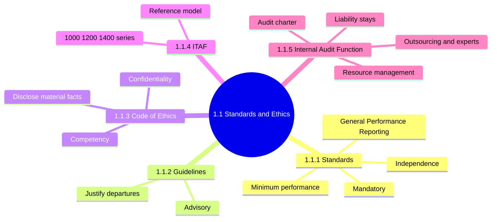

### 1.1.1 ISACA IS Audit and Assurance Standards

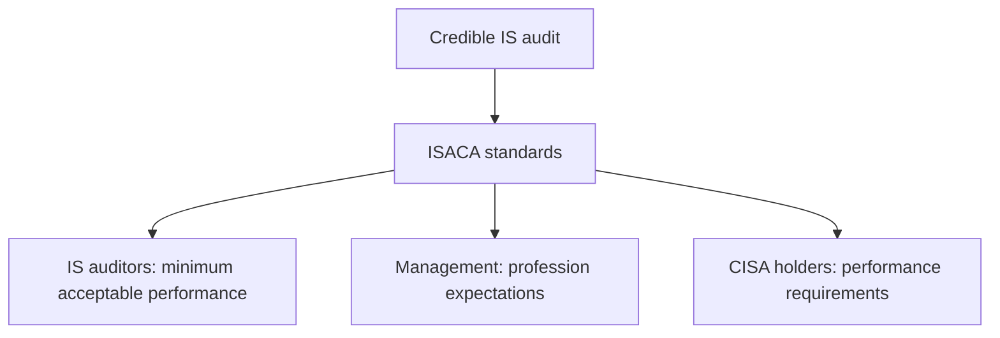

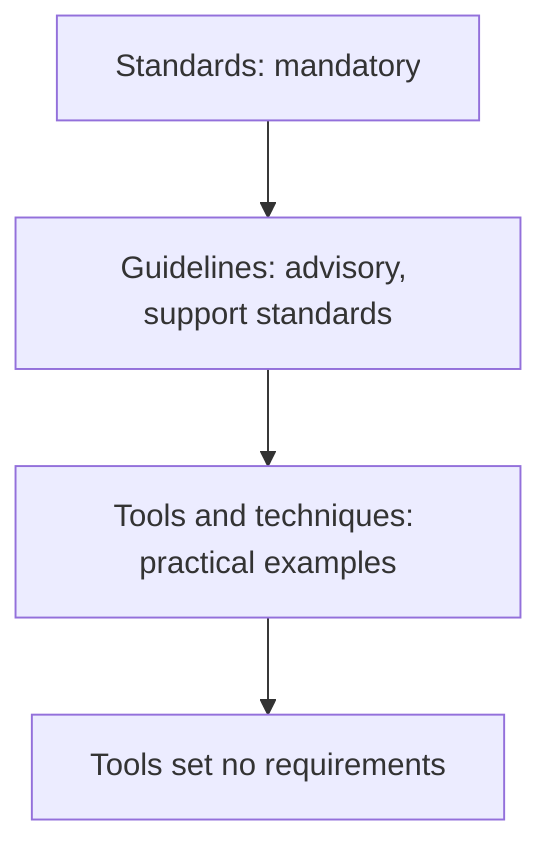

| Category | Cover | Memory aid |
|---|---|---|
| General ➕ | Ethics, independence, objectivity, due care, competency | Who |
| Performance ➕ | Planning, supervision, scoping, risk, materiality, evidence | What |
| Reporting ➕ | Report types, communication means, content | Say |

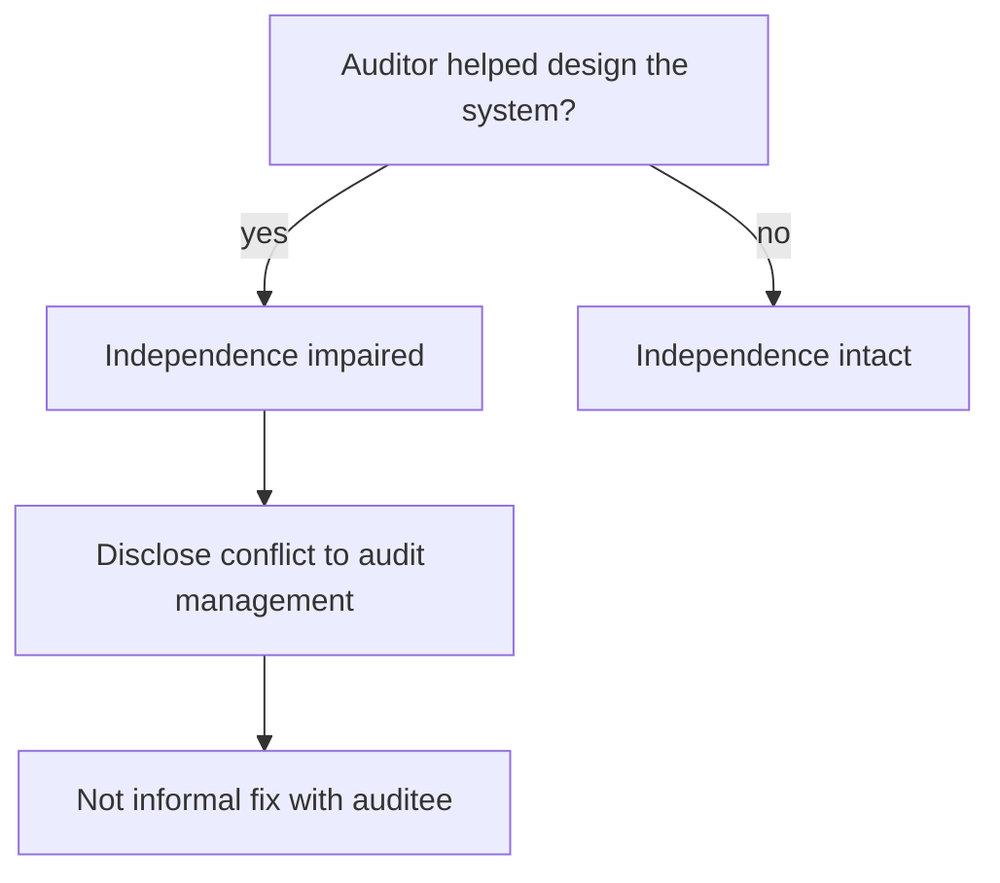

<b>Definitions</b>

- Standard: mandatory requirement for performing and reporting audit work.
- Independence: freedom from conflicts of interest and undue influence.
- Objectivity: impartial mental attitude in all engagement matters.
- Minimum level is a floor, not a target of excellence.
- Non-compliance can lead to disciplinary action 📓 (⚠ from my notes).

<b>Example</b>

- A consultant who built the payroll system should not audit it.
- A sampling worksheet template is a tool; using it is optional.

<b>Exam traps</b>

- "Guidelines are mandatory" is wrong; they are advisory.
- "Standards are optional" is wrong; members must comply.
- "Expertise offsets conflict" is wrong; skill does not restore independence.
- External firm independence is "top" factor 📓 (unverified ranking).
- Standard numbers need not be memorized; apply standards in the audit process.

### 1.1.2 ISACA IS Audit and Assurance Guidelines

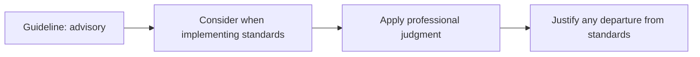

<b>Definitions and example</b>

- Guideline: advice on how to comply with the standards.
- Shows how to apply standards; gives recommended practices 📓.
- Example: auditor uses a different test approach and documents why.

<b>Exam traps</b>

- Guidelines flex with judgment; standards do not flex.
- Departing from a guideline does not trigger discipline.

### 1.1.3 ISACA Code of Professional Ethics

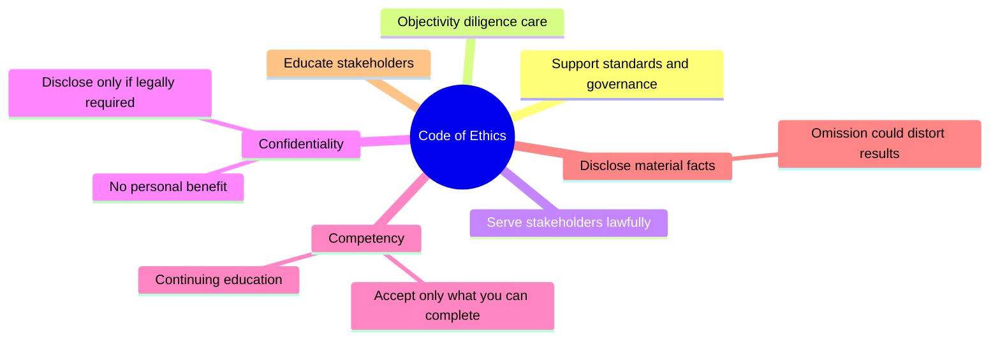

<b>Definitions and example</b>

- Confidentiality: protect information gained in work from improper disclosure.
- Competency: have skills, knowledge and ability for the work accepted.
- Disclosure: tell appropriate parties significant facts known to you.
- Example: auditor cannot trade on unpublished merger information.

<b>Exam traps</b>

- Confidentiality yields only to legal authority.
- Client request to hide facts is wrong; significant facts must be disclosed.
- Accepting work "to gain experience" violates competency.
- Exam tests application, not memorization.

### 1.1.4 ITAF (IT Assurance Framework)

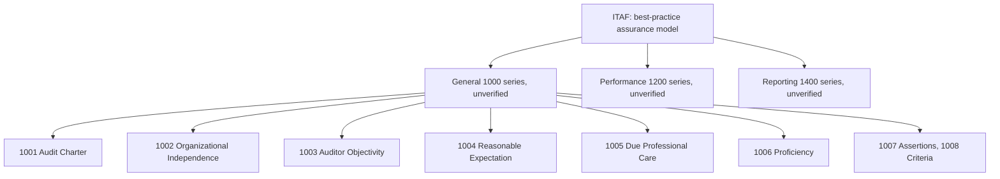

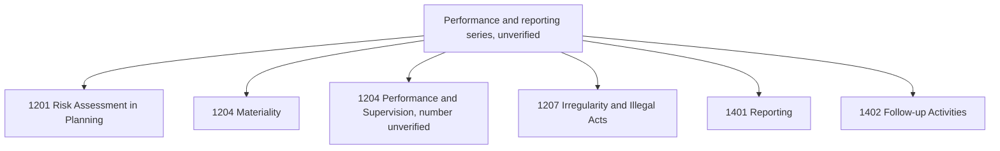

<b>Definitions</b>

- ITAF houses standards, guidelines and tools for planning through reporting.
- Defines IS assurance terms and concepts.
- Guidelines and tools are mapped to the standards.

<b>Exam traps</b>

- Exam does not test ITAF organization; application of standards is tested.
- Do not study numbers; learn what each standard demands.
- Number 1204 appears twice in the notes (unverified).

### 1.1.5 IS Internal Audit Function

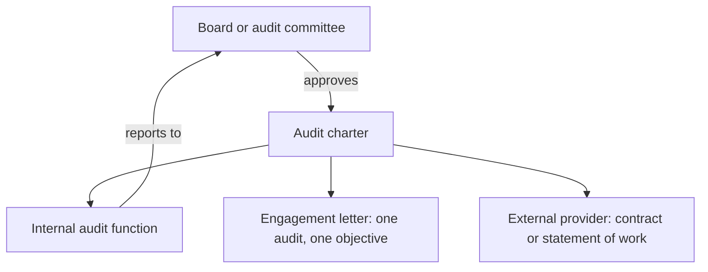

| Document | Scope | Approved or used by |
|---|---|---|
| Audit charter ⭐ | Entire scope of audit activities | Board or audit committee |
| Engagement letter | One audit and objective | Per engagement |
| Contract or SoW | External provider work | Per provider |

<b>Audit charter content ⭐</b>

- Purpose, responsibility, authority, accountability.
- Management responsibility, objectives, delegation of authority.
- Consulting-related services the IS audit function may perform.
- Defines independence and reporting lines ➕ (unverified).
- Changed only if thoroughly justified.

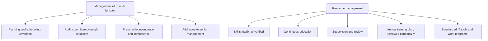

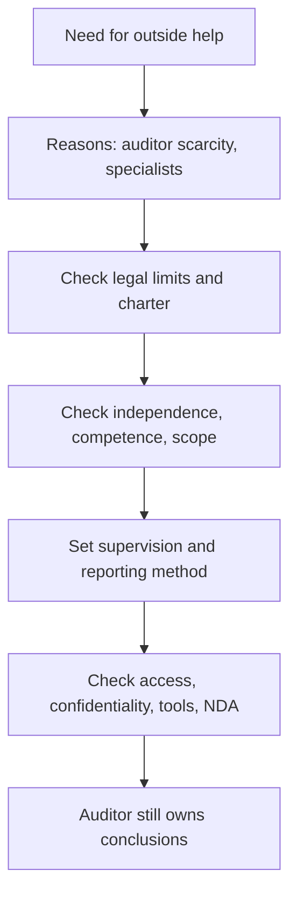

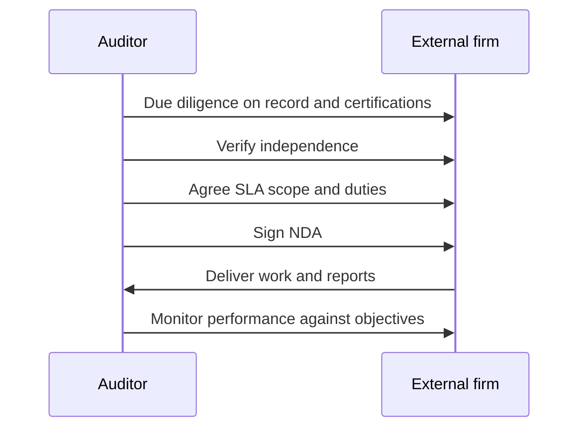

| Control | Purpose |
|---|---|
| Due diligence | Confirm track record, certifications, expertise |
| SLA | Set scope, expectations, responsibilities |
| NDA | Protect sensitive information |
| Performance monitoring | Confirm audit objectives achieved |

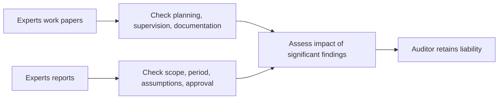

<b>Definitions and examples</b>

- Outsourcing audit work: assigning audit work to outside parties.
- Experts: networking, systems integration, digital forensics, industry specialists.
- Reliance relates to standard 1204 and guideline 2206 (numbering unverified).
- Example: a bank hires a forensics specialist for a fraud review.
- Communicate objectives, scope, methodology via formal engagement letter.

<b>Exam traps</b>

- Audit manager approving the charter is wrong; highest level approves.
- Engagement letter does not replace the charter.
- Outsourcing does not transfer liability.
- NDA protects confidentiality; it does not prove independence.
- Independence outweighs cost and location.

### Quick recall

| ⭐ Fact | Answer |
|---|---|
| Mandatory items | Standards only |
| Guidelines | Advisory; justify departures |
| Tools and techniques | Practical examples, no requirements |
| Helped design system | Independence impaired; disclose |
| Charter approval | Board or audit committee |
| Charter vs engagement letter | Overall scope vs one audit |
| Confidentiality exception | Legal authority only |
| Outsourced work | Liability stays with auditor |
| SLA / NDA / monitoring | Expectations / secrecy / objectives |
