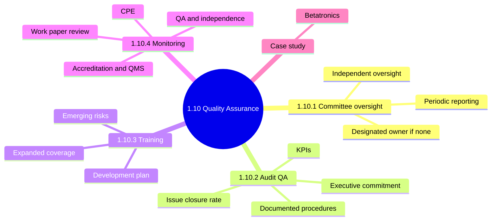
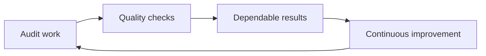
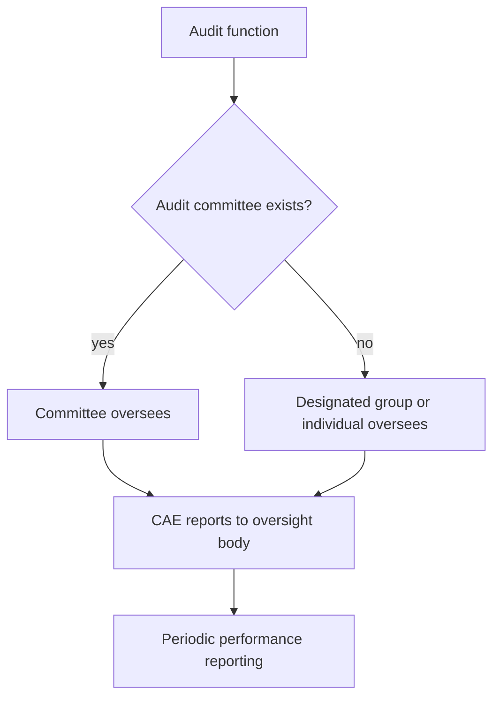
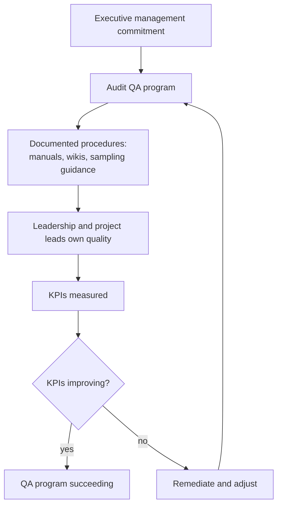
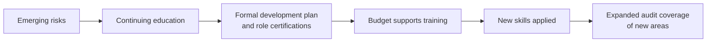
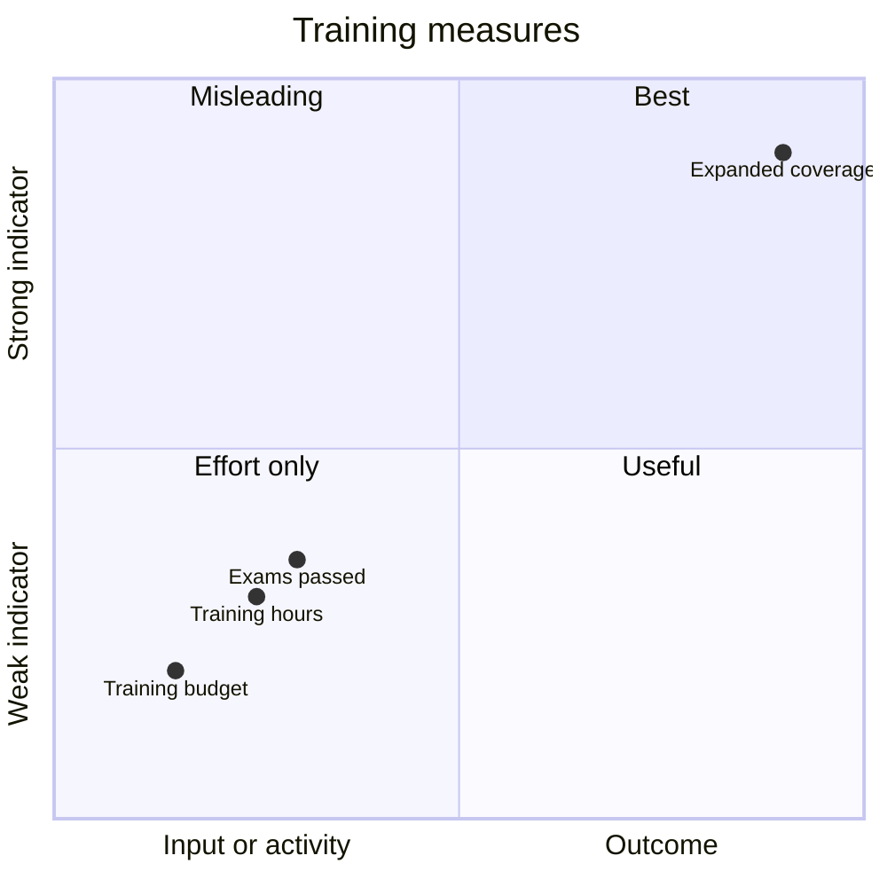
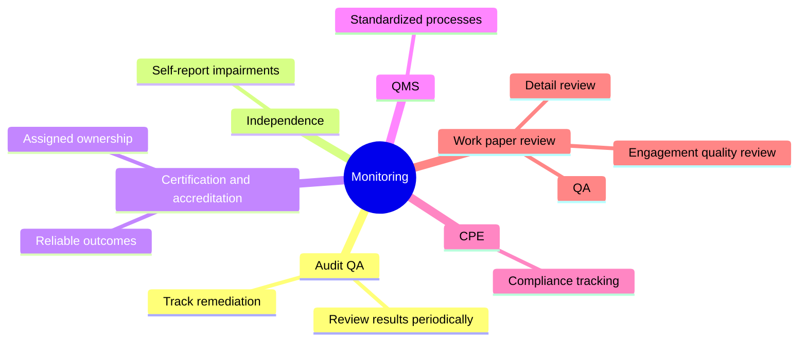
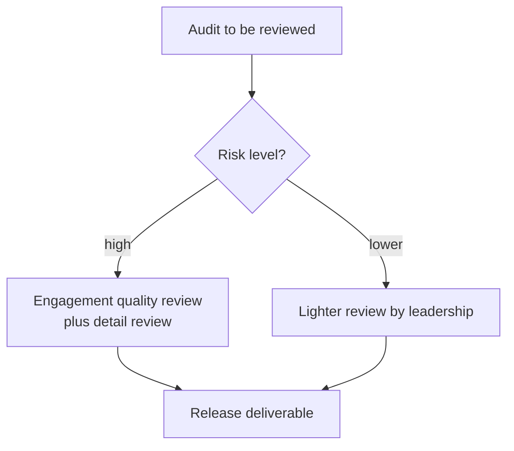

# 1.10 Quality Assurance and Improvement of the Audit Process: Diagrams

[← Domain 1](../README.md) | [Study notes](../Study-Notes/1.10-Study-Notes.md)

## Section map

### 1.10 Basics: why audit quality needs its own process

<b>Definitions and example</b>

- QA: planned, systematic activity giving confidence in audit quality.
- Four parts: oversight, audit QA, training, monitoring.
- A firm never reviewing its own work papers cannot be trusted.

### 1.10.1 Audit committee oversight 📓

<b>Definitions</b>

- Audit committee: governing body overseeing audit function and independence.
- CAE: head of the audit function, reports to the committee.
- Reporting to auditees would weaken independence.

<b>Exam traps</b>

- Primary role: independent oversight for fair, thorough audits.
- Approving policy, appointing officers, budgets are secondary duties.
- Oversight is not supervising each individual audit.

### 1.10.2 Audit quality assurance (QA) 📓

| Measure | What it shows |
|---|---|
| Improving KPIs | QA program success |
| Issue closure rate up | Management responsiveness |
| Faster reports, lower cost | Not proof of quality |

<b>Example</b>

- Closure rising from 60 to 85 percent shows prompter management action.
- A wiki defines sample sizes; every auditor must cite it.

<b>Exam traps</b>

- Executive commitment is the main success factor. ⭐
- Training helps quality but is not the success factor.
- Higher closure rate does not mean fewer issues.
- KPI and closure points are from user notes (unverified in manual).

### 1.10.3 Audit team training and development 📓

<b>Exam traps</b>

- Without continuing education, skills become outdated. 📓
- Choose outcome measures over input or activity measures.
- Purpose is addressing emerging risks, not building confidence.
- Coverage indicator is not in the manual (unverified).

### 1.10.4 Monitoring

<b>Definitions</b>

- Accreditation: formal recognition the audit function meets recognized standards.
- QMS: framework of standardized, documented processes.
- Independence monitoring: auditors self-report possible impairments.

<b>Exam traps</b>

- Accreditation primary advantage: improved reliability of audit outcomes. 📓⭐
- It does not mean lower cost or faster audits.
- QMS does not remove need for performance monitoring.
- Review depth follows risk, not equal effort.
- Primary advantage and QMS points are from user notes (unverified).

### Case study (Betatronics)

| Item | Detail |
|---|---|
| Company | Electronics maker, US headquarters, Latin American factories |
| Task | Preliminary work for regulatory compliance review |
| Prior issues | Shared admin accounts, weak passwords, poor change control |
| Oversight | Audit charter names audit committee |
| Questions | First action, worst logical finding, sample selection |

<b>Notes</b>

- Manual gives only the stem; no answers stated.
- Charter and committee illustrate section 1.10.1.

### Quick recall

| Fact | Answer |
|---|---|
| No audit committee | Designated group or individual oversees |
| ⭐ QA success factor | Executive management commitment |
| QA success shown by | Continuously improving KPIs |
| Rising issue closure | Management responsiveness |
| Best training indicator | Expanded coverage of new areas |
| ⭐ Accreditation advantage | Reliable audit outcomes |
| Independence monitoring | Self-reported impairments |
| Review depth | Based on risk |
