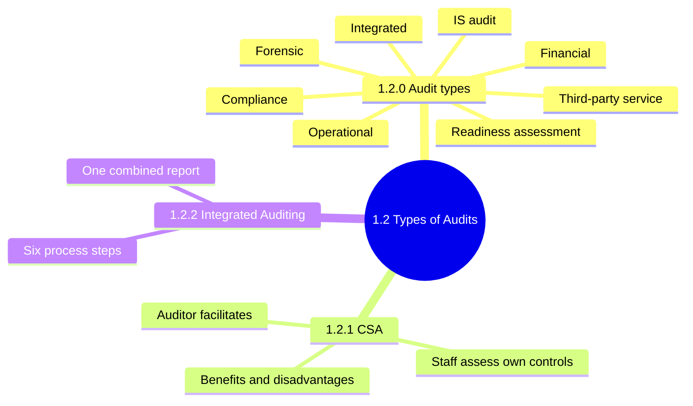
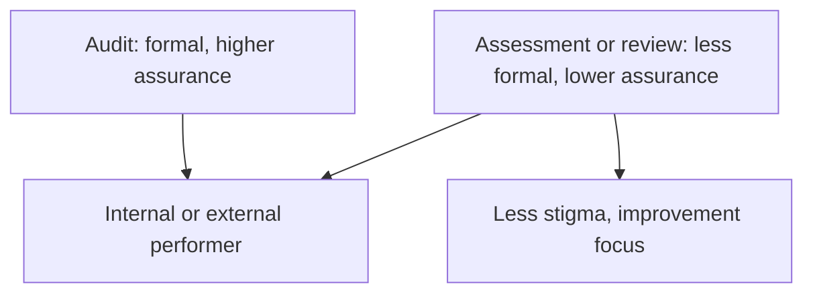
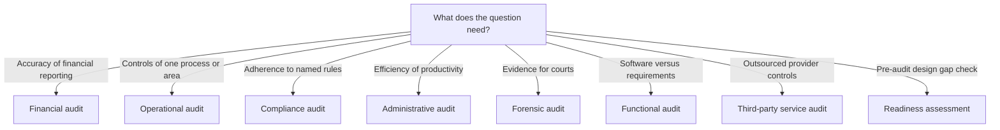
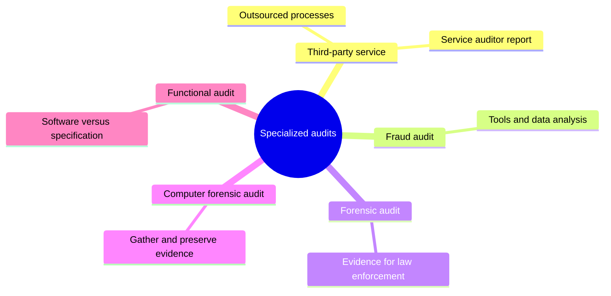
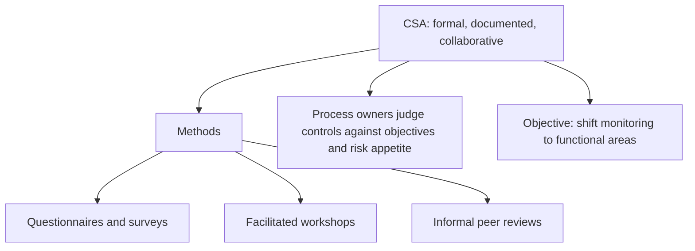
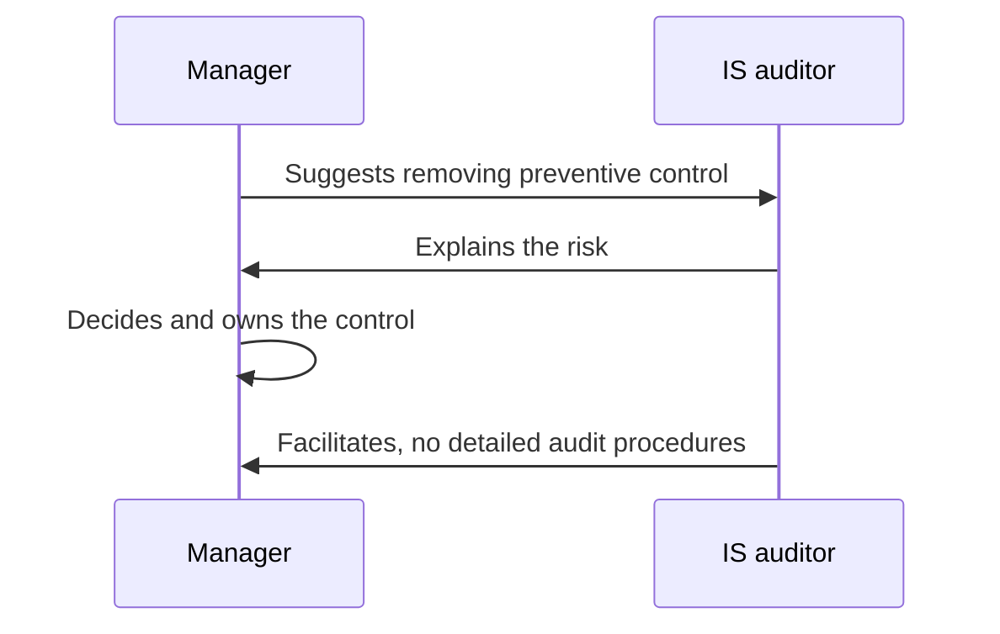
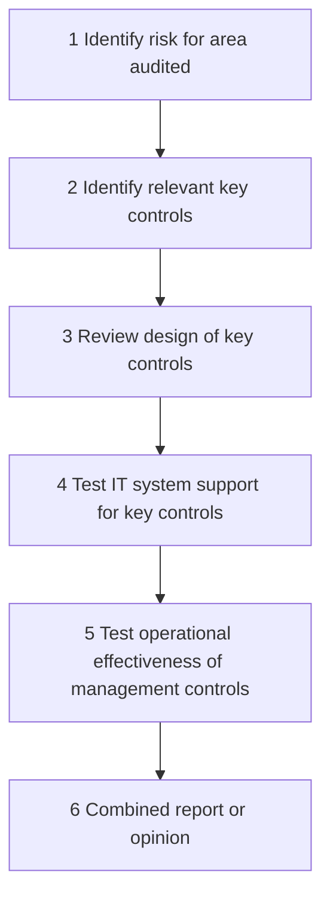
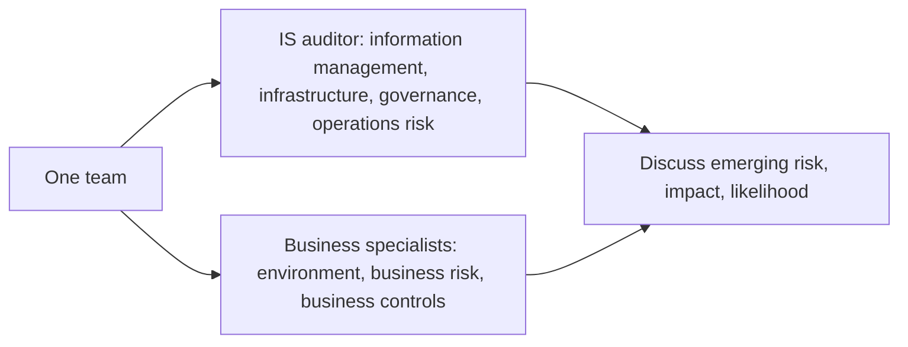

# 1.2 Types of Audits, Assessments and Reviews: Diagrams

[← Domain 1](../README.md) | [Study notes](../Study-Notes/1.2-Study-Notes.md)

Markers: 📓 in my notes, ⭐ frequently tested, ➕ unverified.

## Section map

### 1.2.0 Audit types

| Type | Focus | Key point |
|---|---|---|
| Financial | Financial reporting accuracy | Often substantive testing |
| Operational | Internal control of a process | IS audit of application controls |
| Compliance | Regulations, standards, practices | May focus on systems or data |
| Integrated | Financial plus operational steps | May or may not include IS auditor |
| Administrative | Operational productivity efficiency | Not accuracy or legal compliance |
| IS (IT) | Systems, data integrity, availability | Reasonable assurance only |
| Fraud | Discover fraud schemes | Tools and data analysis |
| Forensic | Fraud and crime for legal use | Evidence withstands scrutiny |
| Computer forensic | Electronic devices evidence | Auditor verifies procedures followed |
| Functional | Software against requirements | Before delivery or after implementation |
| Readiness assessment | Compliance with documented standards | Design, not operating effectiveness |

| Report | Covers | Detail level |
|---|---|---|
| SOC 1 ➕ | User entities financial reporting controls | Detailed |
| SOC 2 ➕ | Security, availability, integrity, confidentiality, privacy | Detailed |
| SOC 3 ➕ | Like SOC 2 | No control design or test results |

<b>Definitions</b>

- Audit: formal inspection and verification against standards or targets.
- Assessment or review: broader, less formal look at quality, cost, policy.
- Service auditor report: opinion on provider's description of controls.
- IS audit: evaluates safeguarding, integrity, availability, reliability, efficient resource use.
- SOC reports: manual coverage in 2.9.2; SSAE 18 and ISAE 3402 (unverified here).

<b>Example</b>

- Matching vendor bank accounts to employee accounts spots fake vendors.
- Auditor confirms a seized laptop was imaged using approved procedure.
- Payroll outsourcer gives clients an independent controls report.
- Pre-certification gap review before an external standards audit.

<b>Exam traps</b>

- Opinion required: choose formal audit, not assessment or review.
- Internal versus external performer does not change the type.
- Controls give reasonable assurance, never absolute assurance.
- Outsourced financial processing: SOC 1, not SOC 2.
- SOC 3 omits test detail, so weaker evidence.
- Relying on a service report does not remove customer responsibility.
- Forensic audit aims at legal evidence; fraud audit at discovery.
- Readiness assessment tests design; effectiveness needs later audit.

### 1.2.1 Control Self-Assessment (CSA)

| Benefits | Disadvantages |
|---|---|
| Early risk detection | Mistaken for replacing audit |
| Better internal controls | Seen as extra workload |
| Control ownership, less resistance | Ignored suggestions hurt morale |
| Better management communication | Little audit knowledge, weak controls missed |
| Lower control cost | |

<b>Definitions and objectives</b>

- CSA: staff and management of a unit assess their own controls.
- Methodology: review objectives, assess risk, ensure controls manage risk.
- Enhances audit responsibilities; never replaces them.
- Educates management on control design, monitoring, high-risk areas.
- Critical success factor: early meeting with business unit representatives.
- Workshops suit small business units.

<b>Example</b>

- Branch managers rate their own cash-handling controls each quarter.

<b>Exam traps</b>

- Auditor facilitates; managers assess. Auditor-led testing is wrong.
- Main aim: shift control monitoring to functional areas.
- "Replace internal audit" or "cut audit staff" misreads CSA.
- Manager wants fewer controls: auditor explains risk, not simply agrees.

### 1.2.2 Integrated Auditing

<b>Benefits</b>

- One audit and one comprehensive report.
- Staff development and retention through variety.
- Process owners see link between controls and audit procedures.
- Top management sees control effectiveness and IT resource allocation.
- Shareholders see governance link to reliable financial statements.

<b>Example and exam traps</b>

- One team audits order-to-cash, covering finance steps and ERP controls.
- Pick single team, single report, risk focus.
- Separate financial and IT reports are the opposite of integration.
- Design is understood before operating effectiveness is tested.
- IT systems often form the first line of preventive and detective controls.

### Quick recall

| ⭐ Fact | Answer |
|---|---|
| Highest assurance | Formal audit |
| Assessment or review | Softer, improvement-focused |
| Readiness assessment | Design only, not effectiveness |
| Operational audit | Control structure of one process |
| Compliance audit | Against named rules |
| Forensic audit | Legal evidence |
| SOC 1 vs SOC 2 ➕ | Financial reporting vs security-type criteria |
| CSA auditor role | Facilitator, never replaces audit |
| Integrated audit | Risk first, design, test, one report |
