# 1.3 Risk-Based Audit Planning: Diagrams

[← Domain 1](../README.md) · [Study notes](../Study-Notes/1.3-Study-Notes.md)

Markers: 📓 = in my notes, ⭐ = frequently tested, ➕ = unverified.

## Section map

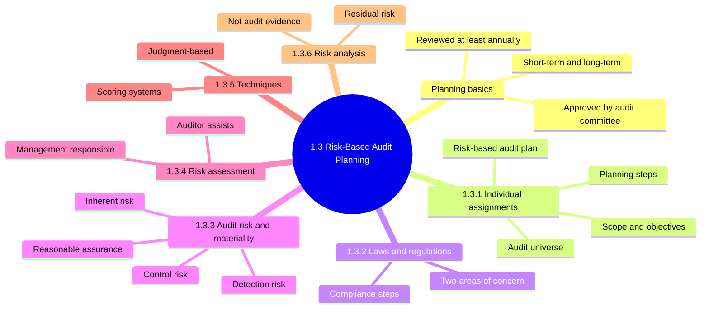

### 1.3 Planning basics

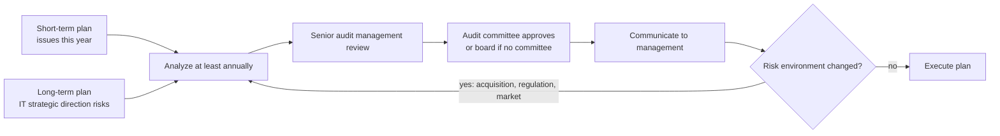

<b>Definitions</b>

- Audit planning sets overall strategy and specific procedures before fieldwork.
- Short-term: audit issues covered during the current year.
- Long-term: risk issues from changes in IT strategic direction.

<b>Example</b>

- Short-term: this year's access reviews.
- Long-term: a planned cloud migration.

### 1.3.1 Individual audit assignments

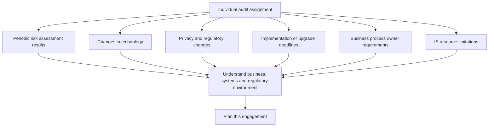

#### Audit universe 📓⭐

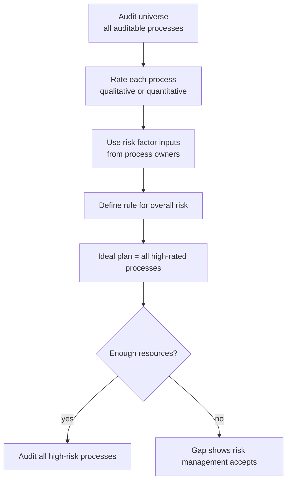

| Reputation rating | Recovery time |
|---|---|
| High | Over six months |
| Medium | Three to six months |
| Low | Under three months |

<b>Exam traps</b>

- First step of annual plan is the audit universe.
- Threat and vulnerability analysis comes after the universe.
- Sampling approach and control environment come in detailed planning.
- Selected process then moves to control objectives; do not confuse the two.

<b>Definitions and example</b>

- Audit universe: complete list of all processes that could be audited. 📓
- It is the foundation of the annual audit plan. 📓
- Time frame is objective; owners judging duration is subjective.
- Example: retailer lists sales, payments, inventory, payroll, IT operations.

#### Risk-based audit plan

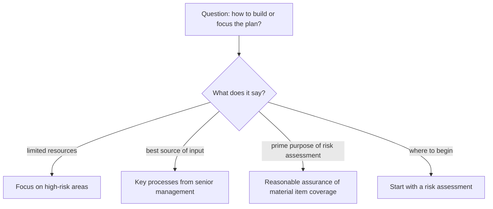

<b>Exam traps</b>

- Process owners are self-interested, so their view is less reliable.
- Prior audit findings alone look backward.
- Management assurance of controls skips independent risk assessment.
- Allocating resources is a use, not the prime purpose.

<b>What a risk-based plan does</b>

- Prioritizes high-risk areas. 📓
- Aligns with strategic organizational objectives. 📓
- Uses key business processes identified by senior management. 📓⭐
- Decides compliance versus substantive testing and nature and extent of testing.

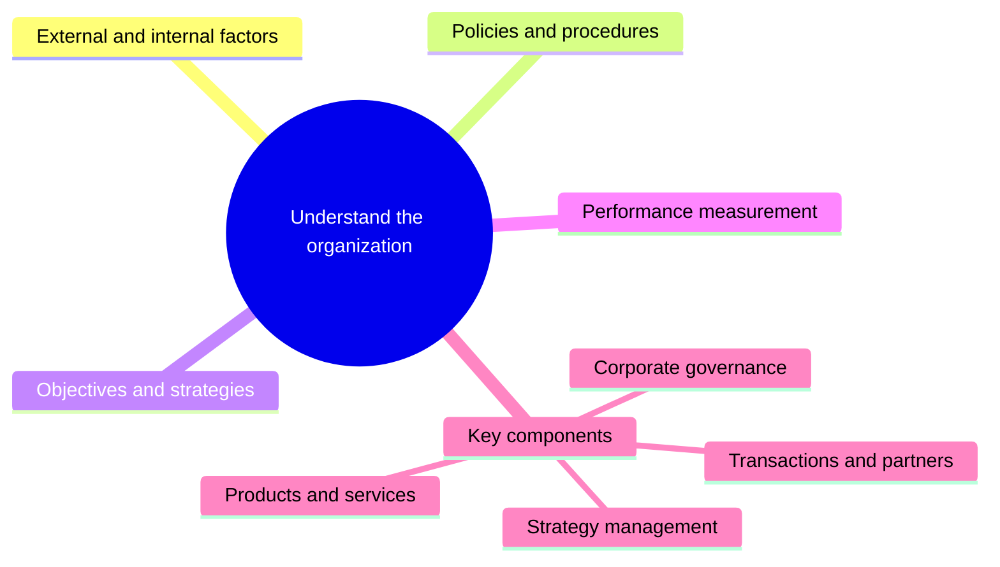

| Test type | Checks | Effect of strong controls |
|---|---|---|
| Compliance | Controls operate as designed | Less substantive work needed |
| Substantive | Actual data or transactions for errors | Needed more when controls weak |

#### Audit planning steps

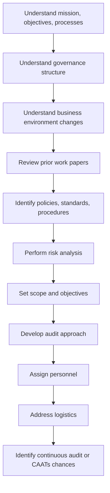

<b>Exam traps</b>

- First planning step is risk assessment, not designing the program.
- Resource allocation and stakeholders come after risk analysis.

#### Audit scope and objectives

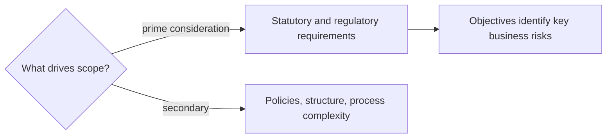

<b>Exam traps</b>

- Law outranks internal preference because noncompliance creates liability.

### 1.3.2 Effect of laws and regulations on IS audit planning

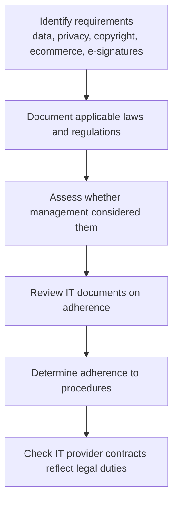

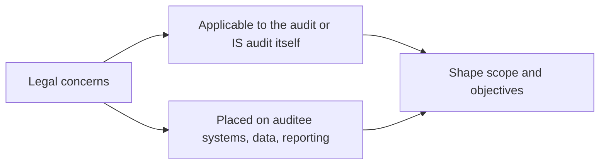

<b>SOX note</b>

- SOX: US law on financial reporting accuracy and controls. 📓
- Section 302 and 404 detail is from my notes (unverified).
- Regulatory data quality as top priority is unverified.
- Manual does not ask about specific laws.

<b>Exam traps</b>

- Exam asks how to audit compliance, not what laws say.
- Start by identifying and documenting requirements, not testing controls.

<b>Example</b>

- Cloud host contract should assign breach notification duties.
- Stock exchange and central bank rules affect data processing and storage.

### 1.3.3 Audit risk and materiality

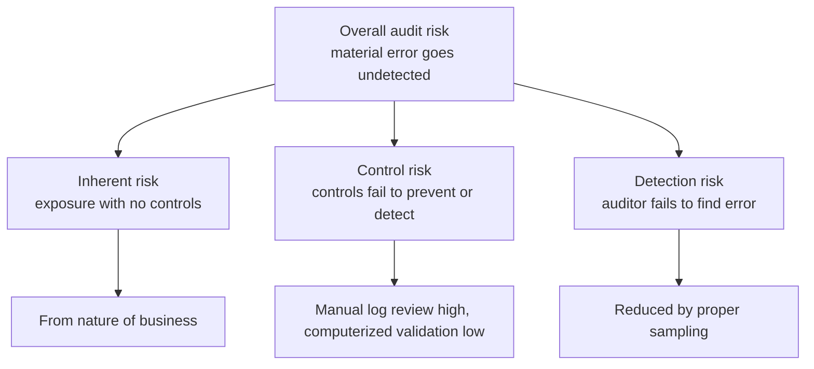

| Risk | Source | Auditor control |
|---|---|---|
| Inherent ⭐ | Nature of business, no controls | None |
| Control | Weak or failing internal controls | None |
| Detection | Auditor procedures and sampling | Yes |

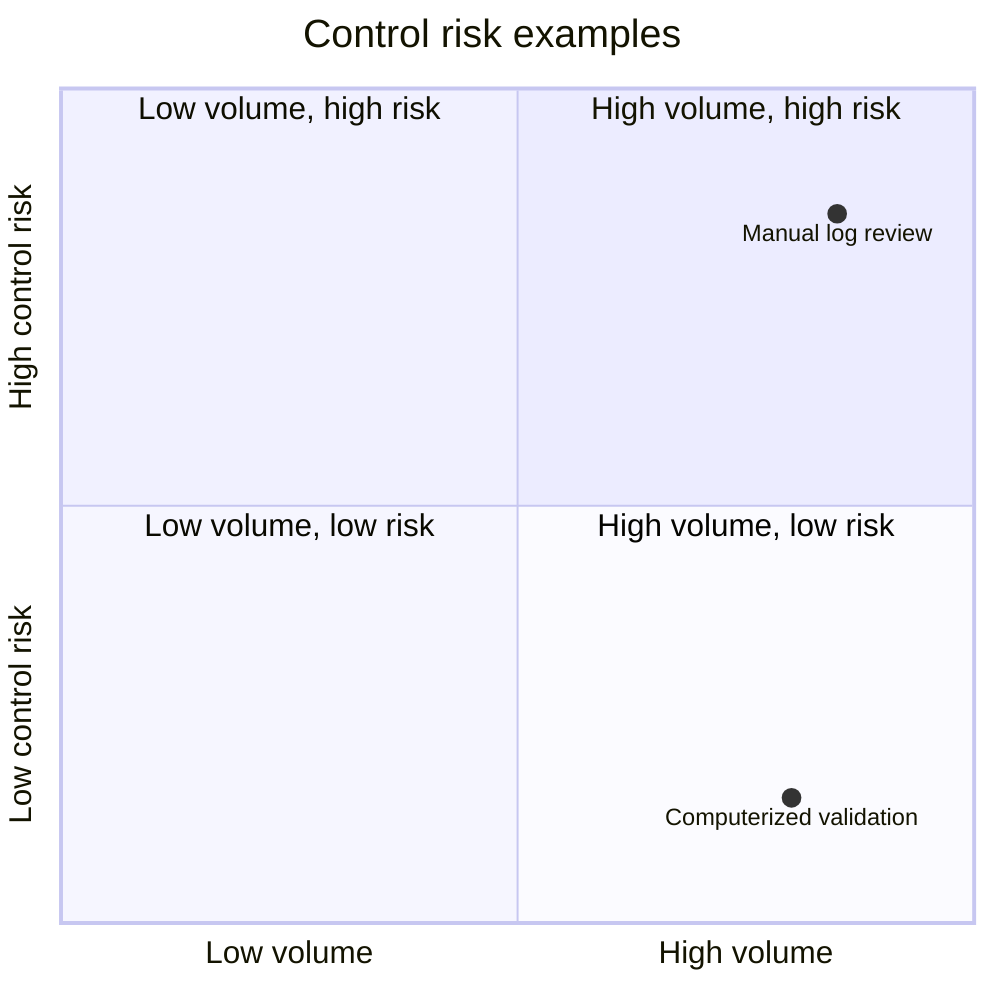

<b>Exam traps</b>

- Exposure without regard to controls is inherent risk.
- Residual risk is after controls; it belongs to section 2.5.
- First analysis in a risk-focused audit is inherent risk.
- Audit risk is not sampling risk.
- Multiplication formula for the three risks is unverified. ➕

#### Materiality and assurance

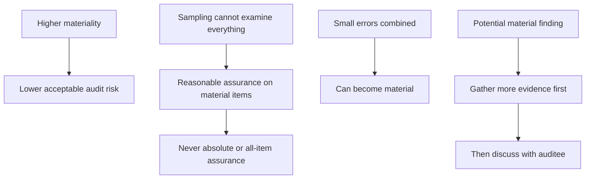

<b>Definitions</b>

- Materiality: relative importance of a matter to the whole enterprise.
- Material items focus audit effort. 📓
- Material findings significantly affect objectives. 📓
- Reasonable assurance applies because of sampling limits. 📓⭐

<b>Example</b>

- A large ledger balance is more material, so less risk is tolerated.

### 1.3.4 Risk assessment

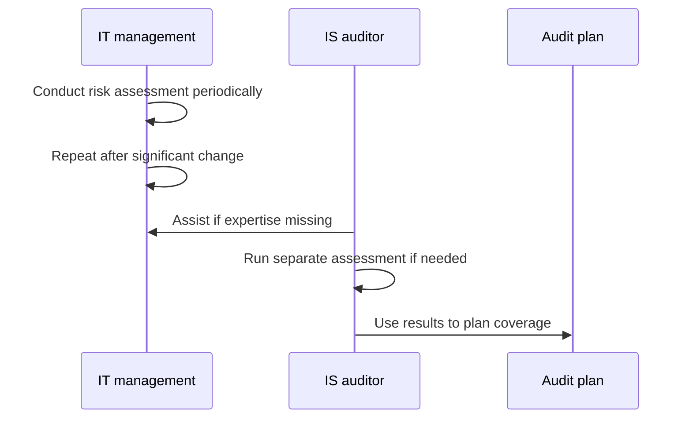

<b>Definitions</b>

- Risk assessment: identify, quantify, and prioritize risk against acceptance criteria.
- Purpose: identify, evaluate, and mitigate risks through controls. 📓
- Gives coverage of material items. 📓
- Management remains ultimately responsible.
- Doing management's assessment threatens independence.
- Owner of the assessment per notes versus manual differs (unverified).

### 1.3.5 IS audit risk assessment techniques

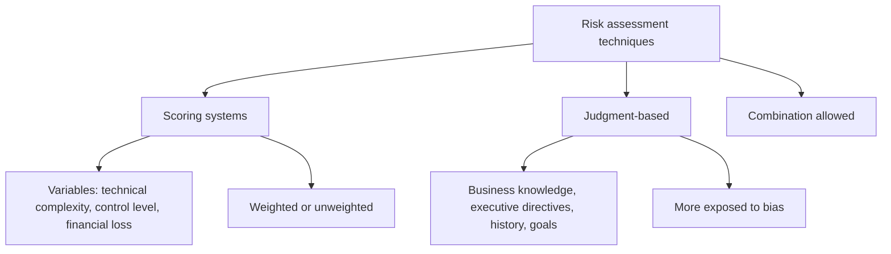

| Method | Form | Note |
|---|---|---|
| Qualitative | High, medium, low | Categories |
| Quantitative | Numeric ratings | Calculated scores |
| Management assessments | Used to supplement | Apply professional skepticism |

<b>Benefits of risk assessment</b>

- Allocates limited audit resources effectively.
- Gathers information from all management levels.
- Basis for managing the audit department.
- Links audit subject to organization and business plans.

<b>Exam traps</b>

- Relying on management assessment without skepticism weakens independence.

### 1.3.6 Risk analysis

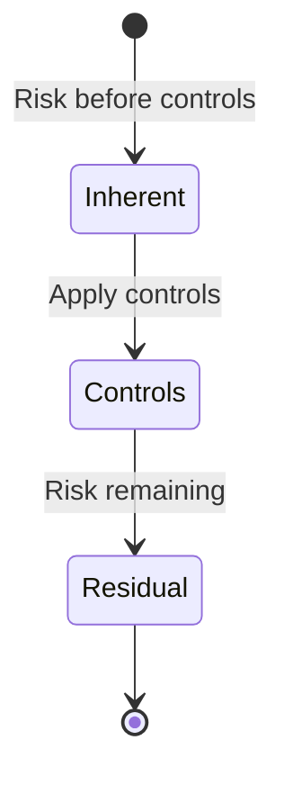

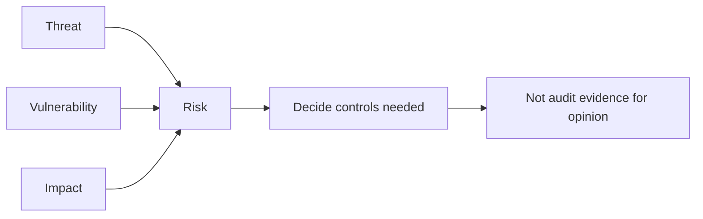

<b>Definitions and traps</b>

- Risk analysis is a subset of risk assessment.
- Threat x vulnerability x impact formula is unverified. ➕
- Residual risk: remaining after controls. 📓
- Evidence for the opinion comes from testing, not risk analysis.
- Risk also exists within the audit process itself.

<b>Example</b>

- After adding MFA, leftover phishing risk is residual risk.

### Quick recall

| Fact | Detail |
|---|---|
| ⭐ First step of annual plan | Audit universe |
| ⭐ Plan source | Key processes from senior management |
| ⭐ Risk assessment starts the plan | Focus on high-risk areas when resources limited |
| ⭐ Inherent risk | Exposure without controls |
| ⭐ Assurance | Reasonable, on material items, never absolute |
| Scope priority | Statutory and regulatory requirements |
| Detection risk | Only risk the auditor controls |
| Risk analysis | Not evidence supporting the opinion |
| Management assessments | Use with professional skepticism |
