# 1.4 Types of Controls and Considerations: Diagrams

[← Domain 1](../README.md) · [Study notes](../Study-Notes/1.4-Study-Notes.md)

Markers: 📓 in my notes, ⭐ frequently tested, ➕ unverified.

## Section map

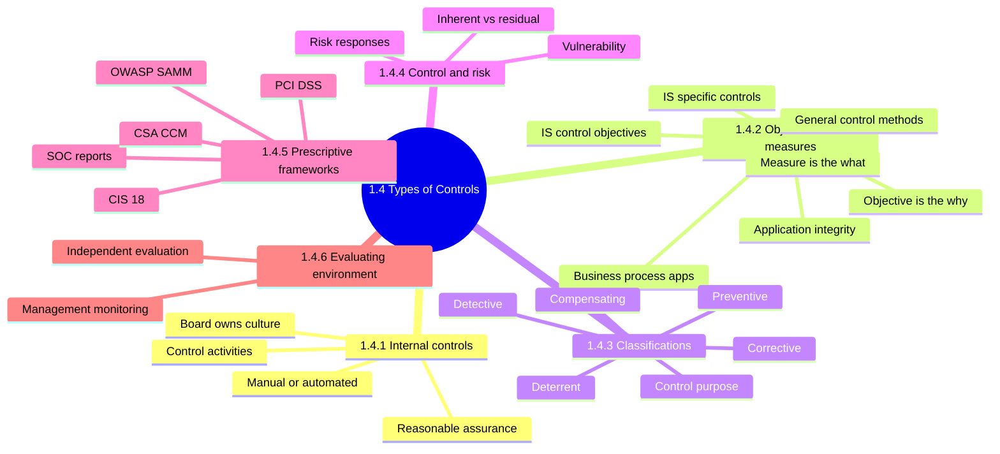

### 1.4.0 Opening idea: what an effective control does

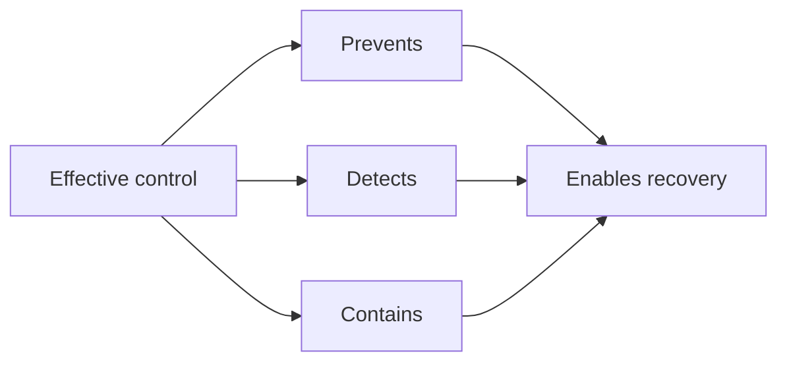

<details>
<summary><b>Definitions and example</b></summary>

- Control: policy, procedure, practice or structure that reduces risk.
- Auditors judge whether a control reduces risk, not whether it exists.
- Example: locked server room, visitor log, written access policy.
- (unverified) Recovery is an outcome, not a control class.

</details>

### 1.4.1 Internal controls

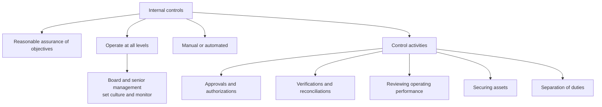

| Control activity | Plain meaning | Example |
|---|---|---|
| Approvals | Sign-off before proceeding | Change approved by correct authority |
| Reconciliations | Compare records to agree | Bank statement vs cash ledger |
| Operating review | Actual vs expected results | Management variance review |
| Securing assets | Restrict physical and logical access | Locks, access rights |
| Separation of duties | No one controls all steps | Vendor creator cannot approve payment |

<details>
<summary><b>Definitions</b></summary>

- Internal control: rules and structures ensuring management directions are carried out.
- Reasonable assurance: high but not absolute confidence.
- SoD gaps are a classic high-risk finding.

</details>

<details>
<summary><b>Exam traps</b></summary>

- Control culture sits with board and senior management, not IT.
- "Reasonable" assurance is right; "absolute" or "complete" is wrong.
- Automated controls still need manual oversight.

</details>

### 1.4.2 Control objectives and control measures

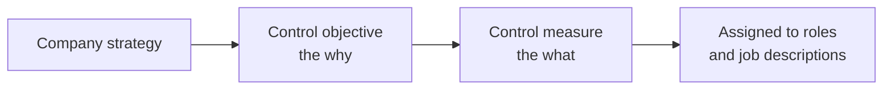

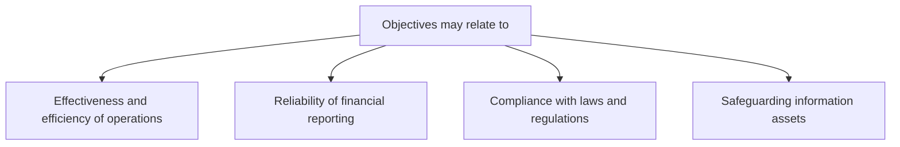

| | Control objective | Audit objective |
|---|---|---|
| Meaning | Result a control should achieve | What the audit must accomplish |
| Set by | Management | Auditor |
| Example | Accurate payroll | Conclude on payroll control design |

<details>
<summary><b>Example and exam traps</b></summary>

- Example: objective accurate payroll; measure dual review of payroll register.
- Objectives are the same in IS and manual settings.
- Only implementation differs between manual and IS environments.
- Four objective areas are examples, not a closed set (unverified as exhaustive).
- Do not mix up audit objective and control objective.

</details>

#### IS control objectives

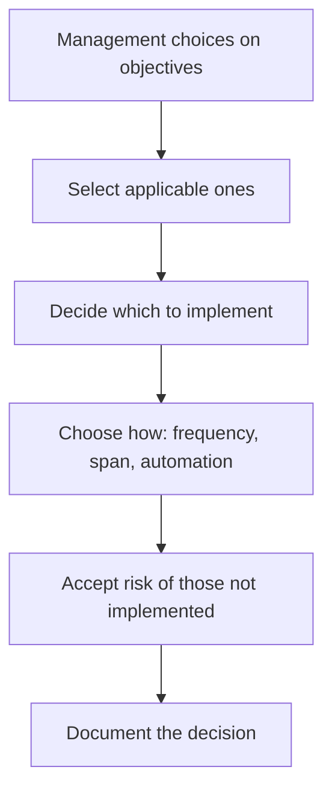

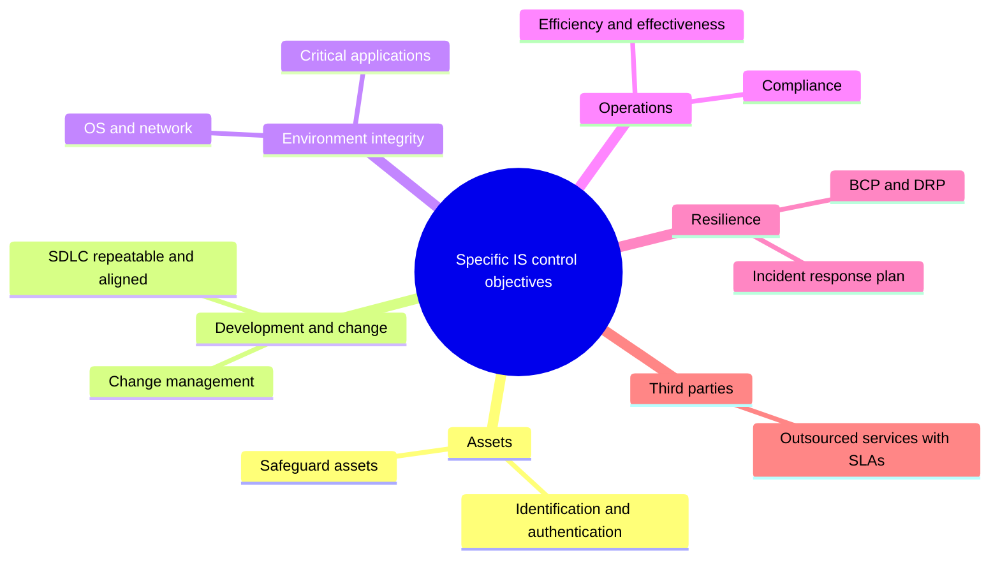

<details>
<summary><b>Exam traps</b></summary>

- Accepted risk must be a conscious, documented management decision.
- The four-item IS objectives list in the outline is not verbatim (unverified).

</details>

#### Application integrity objectives

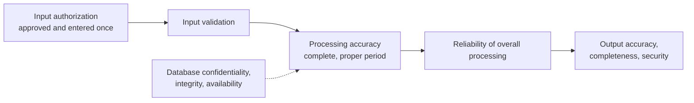

<details>
<summary><b>Example and exam traps</b></summary>

- Example: a payment file keyed twice is an input authorization failure.
- Input controls come first; output checks cannot repair weak input.
- Duplicate or unapproved entries point to authorization, not validation.
- Wrong-period posting distorts financial reporting.

</details>

#### General control methods

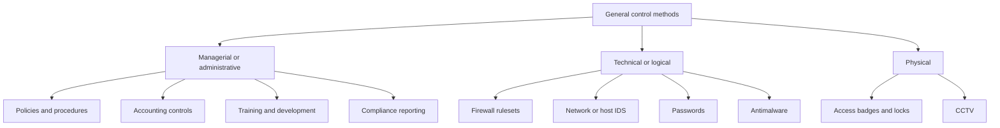

| Category | Delivered through | Depends on |
|---|---|---|
| Managerial | Oversight, procedures, training | Management commitment |
| Technical | Technology, devices | Managerial controls |
| Physical | Barriers, badges, locks | Maintenance, monitoring, reaction |

<details>
<summary><b>Examples of general controls</b></summary>

- Systems development methodologies and change control.
- Operations procedures.
- Systems programming and technical support.
- Quality assurance procedures.
- Physical access controls.
- BCP and DRP.
- Networks and communications: LAN, WAN, wireless.
- Database administration.
- Protective and detective mechanisms against attacks.

</details>

<details>
<summary><b>Exam traps</b></summary>

- Firewall needs trained staff, procedures, monitoring and testing.
- Missing coinciding controls create a false sense of security.
- Technology alone is not a complete answer.
- Category (managerial, technical, physical) differs from function (preventive, detective).

</details>

#### IS-specific controls

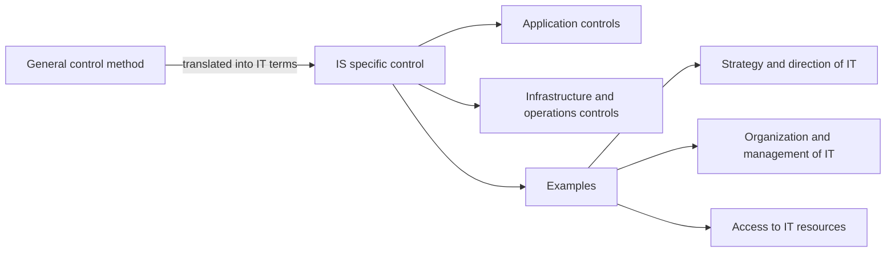

<details>
<summary><b>Notes</b></summary>

- Example: "safeguard assets" becomes access controls over programs, data, equipment.
- Auditors map general methods to concrete IT procedures.
- "Infrastructure and operations" is outline framing (unverified in manual).

</details>

#### Business process applications and controls

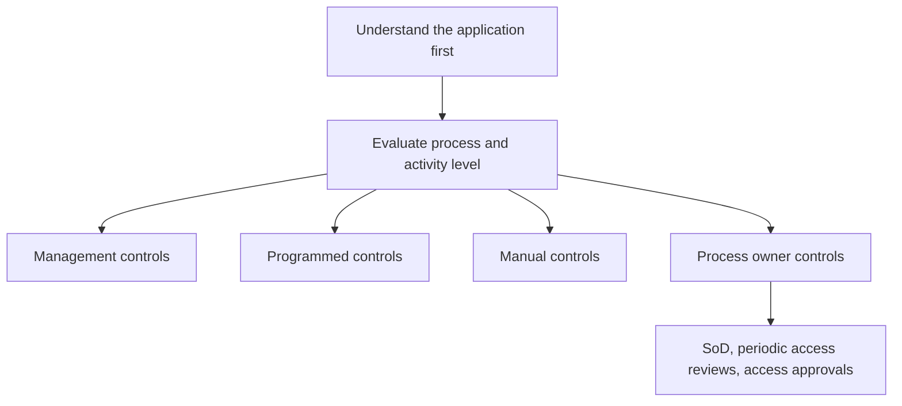

| Application | Risk | Control |
|---|---|---|
| Ecommerce | SQL injection | Secure coding training, code reviews, input checks |
| EDI | Interception, manipulation | Encryption |
| Email | Social engineering | Spam filter, link checks, phishing training |
| ICS (SCADA, DCS, PLC) | Harm to human life | Network segmentation, multifactor authentication |
| AI and expert systems | Inherent bias | Verify expertise behind assumptions |

<details>
<summary><b>Audit challenges and traps</b></summary>

- Challenges: limited audit trails, instantaneous updating, information overload.
- Use authoritative guidance such as OWASP for ecommerce.
- Missing skills means engaging external experts.
- Match control to risk: encryption for interception, input checks for injection.
- ICS risk is safety related; segmentation beats a cost-only answer.
- Input, processing, output controls are covered in 3.4 (unverified cross-reference).

</details>

### 1.4.3 Control classifications ⭐

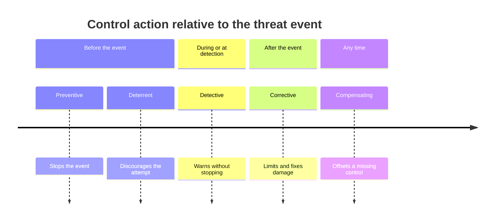

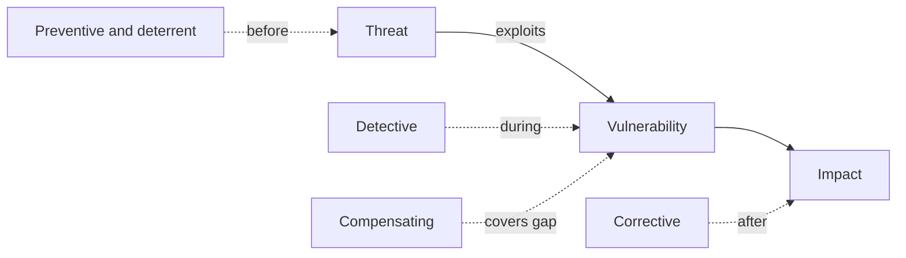

| Class | Goal | Examples | Reduces |
|---|---|---|---|
| Preventive ⭐📓 | Stop it happening | SoD, encryption, authentication | Likelihood |
| Detective 📓 | Find it after | Audit trails, IDS, checksums | Likelihood |
| Corrective 📓 | Limit damage | Backups, failover, error correction | Consequences |
| Deterrent 📓 | Discourage | Warning banners, visible cameras | Likelihood |
| Compensating 📓 | Offset a gap | Log and review developer access | Exposure |

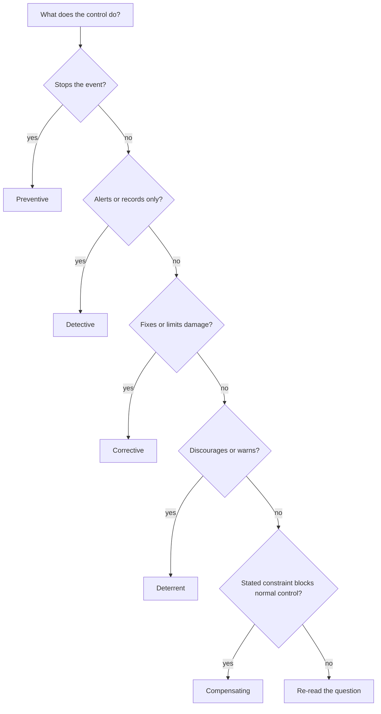

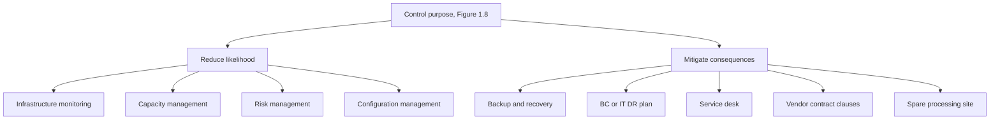

<details>
<summary><b>Preventive 📓</b></summary>

- Stops errors, fraud or omissions proactively.
- Segregation of duties, qualified resources, well-designed documentation.
- Encryption, user authentication, vault-construction doors.
- Example: multifactor authentication blocks a login with a stolen password.
- Generally the strongest class; gaps here carry highest severity.

</details>

<details>
<summary><b>Detective 📓</b></summary>

- Identifies errors after they occur and gives visibility.
- Checkpoints in production jobs, echo messages in telecom protocols.
- Audit trails, IDS, checksums.
- Example: an IDS raises an alert but does not block the packet.
- Only useful if someone reviews alerts and responds.

</details>

<details>
<summary><b>Corrective 📓</b></summary>

- Corrects errors and lets processing continue.
- Check routine that fixes errors automatically.
- Data backups, error correction, automated failover.
- Example: isolate a breached machine to protect the network.

</details>

<details>
<summary><b>Deterrent 📓</b></summary>

- Warning signs, visible barriers, login warning banners.
- Acceptable use policies; rewards for arrest of hackers.
- My notes: visible cameras deter, hidden cameras only detect.
- Manual files CCTV under deterrent without that split (unverified).
- Weak alone; never stops a determined attacker.

</details>

<details>
<summary><b>Compensating 📓</b></summary>

- Offsets a deficiency in the control structure.
- Does not fix the vulnerability; makes exploitation harder.
- Isolated network segment with strong perimeter security.
- Third-party challenge-response for devices without individual logins.
- Example: logging and independent review of developer production access.
- Developers may need emergency access, so review replaces prohibition.

</details>

<details>
<summary><b>Recovery ➕ and Directive ➕ (unverified)</b></summary>

- Recovery (unverified): restoring a server from backup media 📓.
- Not a separate manual class; backups appear under corrective.
- Directive (unverified): policies and procedures that direct behavior.
- Absent from the manual classification; unlikely as an ISACA answer.

</details>

<details>
<summary><b>Exam traps</b></summary>

- Classify by when the control acts, not by its technology.
- Stops the event means preventive; alerts only means detective.
- Detective alone is wrong when the question asks to stop the event.
- Corrective follows detection; a fix with no detection cannot work.
- Compensating fits only when a stated constraint blocks the normal control.
- A compensating control that weakens the objective is wrong, even if cheaper.
- A mix of control types beats any single type.

</details>

### 1.4.4 Control relationship to risk

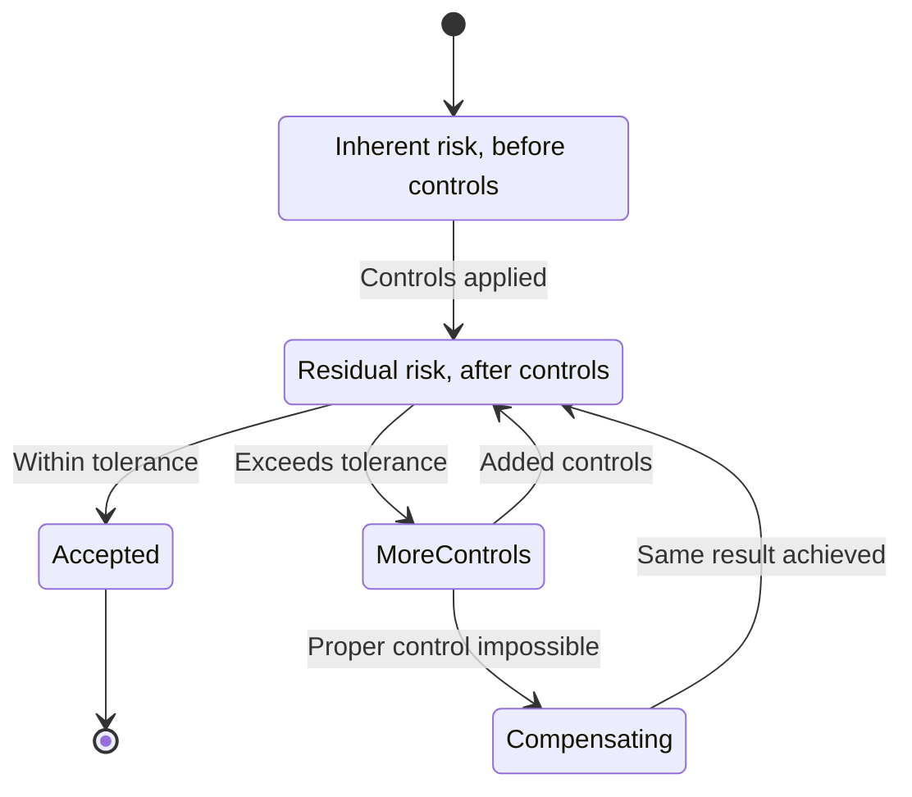

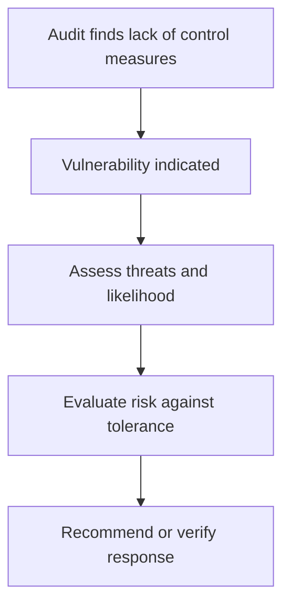

| Risk response | Meaning | Example |
|---|---|---|
| Avoidance ⭐📓 | Stop or move away from risk | Move data center out of flood zone |
| Reduction or mitigation 📓 | Lower probability, activity continues | Add safeguards |
| Transfer | Shift financial impact | Insurance, outsourcing |
| Acceptance ⭐📓 | Knowingly keep risk | Needs documented senior approval |

<details>
<summary><b>Definitions</b></summary>

- Vulnerability: weakness a threat can exploit. 📓
- Lack of control measures indicates a vulnerability. ⭐📓
- Inherent risk: level before management controls. 📓
- Residual risk: remaining after controls; compare to tolerance. 📓
- Manual 1.4 does not define inherent or residual (unverified).
- Senior business management owns risk levels. 📓

</details>

<details>
<summary><b>Exam traps</b></summary>

- After spotting a vulnerability, assess threats and likelihood first.
- Auditors verify acceptance is documented; they do not accept risk.
- Moving the asset is avoidance; adding safeguards is reduction.
- Transfer leaves accountability with the owners.
- Compensating control must achieve the same result as the weak control.
- Non-IT compensating controls can exist.
- Response list comes from my notes, not the manual (unverified).

</details>

### 1.4.5 Prescriptive controls and frameworks

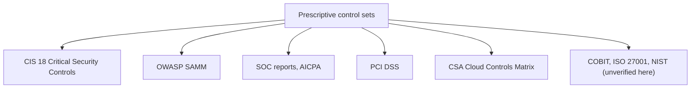

| Framework | Focus |
|---|---|
| CIS 18 | Prioritized cybersecurity best practices |
| OWASP SAMM | Open framework for software security strategy |
| SOC reports | Service organization controls reporting |
| PCI DSS | Credit card data security |
| CSA CCM | Cloud security controls |

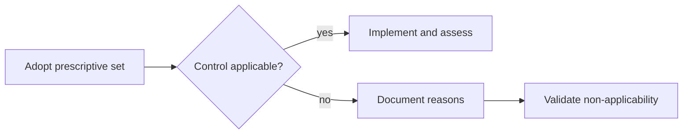

<details>
<summary><b>Example and exam traps</b></summary>

- Example: merchant storing no card data skips stored-data controls.
- Undocumented non-applicability is a finding, even if truly not applicable.
- A framework gives a baseline; it replaces no risk assessment.
- Gives auditors clear criteria for assessing compliance.

</details>

### 1.4.6 Evaluation of the control environment

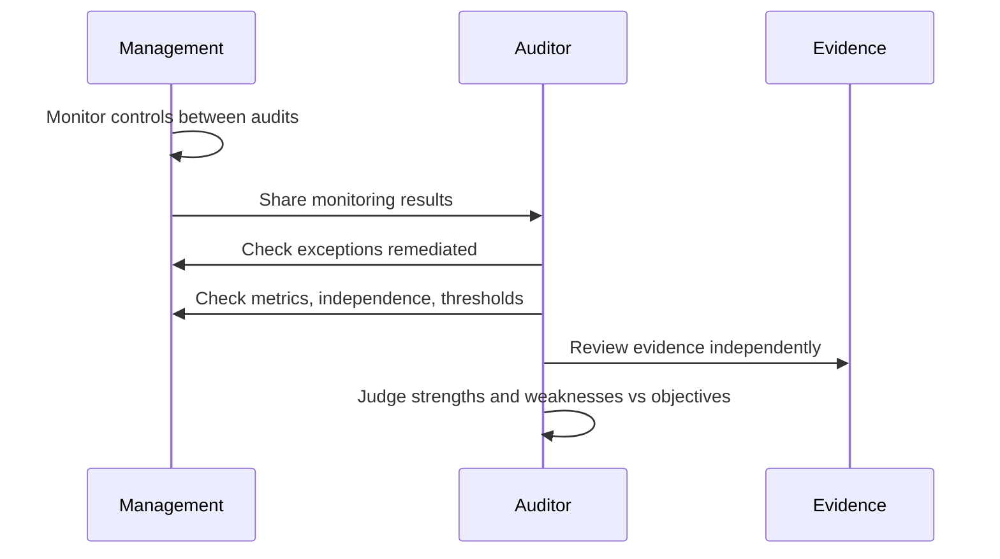

```mermaid
flowchart TD
    A["Management control monitoring"] --> B["Requirements met"]
    A --> C["Standards followed"]
    A --> D["Policies complied with"]
    E["Auditor reviews monitoring"] --> F["Exceptions remediated, lessons applied"]
    E --> G["Metrics based on risk assessment"]
    E --> H["Quantifiable outputs"]
    E --> I["Independence considered"]
    E --> J["Thresholds tracked over time"]
```

| | Management monitoring | Independent evaluation |
|---|---|---|
| Who | Management | Auditor |
| Purpose | Catch deviations early | Conclude on effectiveness |
| Basis | Metrics from risk assessment | Evidence and judgment |

<details>
<summary><b>Example and exam traps</b></summary>

- Example: monthly access recertification reviewed by security manager.
- Relying on monitoring without checking independence is weak logic.
- Metrics must come from risk assessment, not what is easy to count.
- Conclusions rest on evidence, not management assertions alone.
- Judge effectiveness against objectives, not number of controls.

</details>

### Quick recall

| # | Fact |
|---|---|
| 1 ⭐ | Classes: preventive, detective, corrective, deterrent, compensating |
| 2 ⭐ | Preventive is strongest; corrective reduces consequences |
| 3 ⭐ | Lack of control measures indicates a vulnerability |
| 4 ⭐ | After finding a vulnerability, assess threats and likelihood |
| 5 ⭐ | Risk acceptance needs documented senior approval |
| 6 ⭐ | Avoidance means moving away from the risk |
| 7 | Compensating control must achieve the same result |
| 8 | Reasonable assurance, never absolute |
| 9 | Technical controls need managerial and physical support |
| 10 | Undocumented non-applicable framework controls are a finding |
