# 1.5 Audit Project Management: Diagrams

[← Domain 1](../README.md) | [Study notes](../Study-Notes/1.5-Study-Notes.md)

Markers: 📓 in my notes, ⭐ frequently tested, ➕ unverified in manual.

## Section map

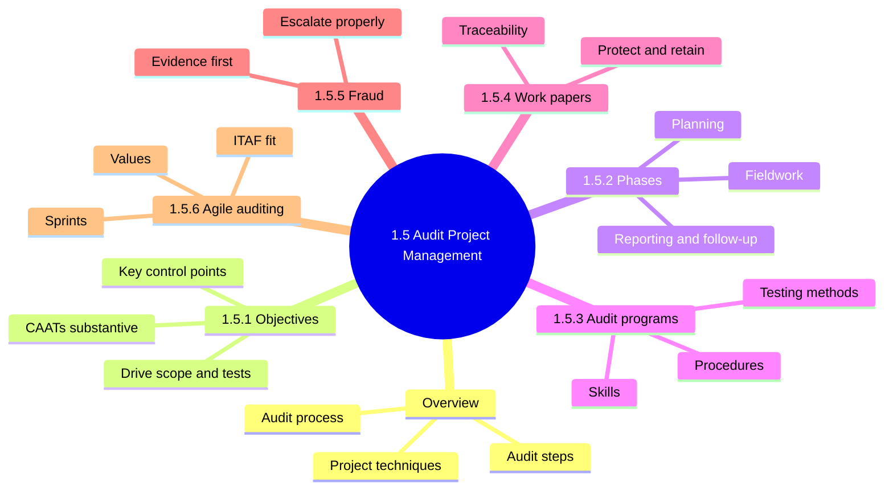

### 1.5 Overview: the audit as a project

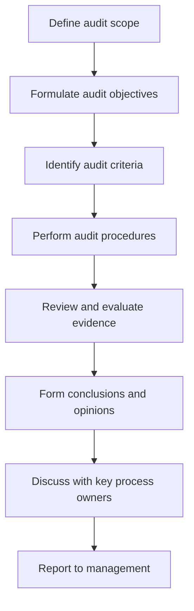

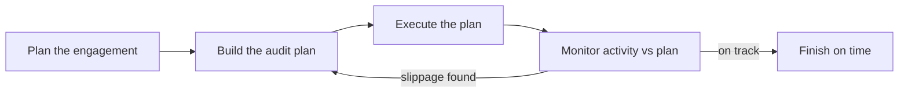

| Core duty | Meaning |
|---|---|
| Gather evidence | Evidence comes from audit tests |
| Evaluate controls | Judge strengths and weaknesses |
| Report objectively | Issues plus remediation recommendations |

<b>Definitions</b>

- Audit process: ordered work of gathering evidence and judging controls.
- Audit management: people running the audit function, schedule and follow-up.
- Audit criteria: the standard the subject is measured against.
- Follow-up reviews check corrective actions (mainly internal IS audit).

<b>Example</b>

- Password policy requires twelve characters: that policy is the criterion.
- Testing slips two weeks: reallocate a colleague to stay on schedule.

<b>Exam traps</b>

- Correct order: plan, schedule, execute, then monitor against plan.
- Wrong: treating monitoring as an end-of-audit task.
- Planning is the necessary first step of an effective IS audit.

### 1.5.1 Audit objectives

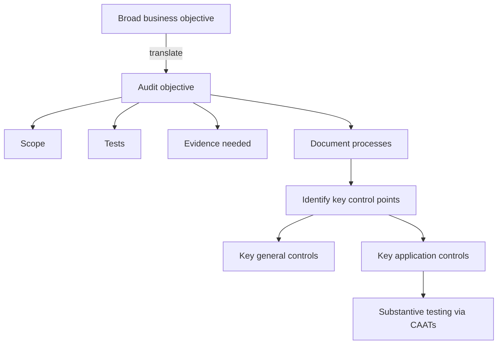

| Objective focus | Example |
|---|---|
| Controls exist and work | Minimize business risk |
| Compliance | Legal and regulatory |
| Information and IT resources | Confidentiality, integrity, availability |

<b>Definitions</b>

- Audit objective: purpose of the audit, what must be concluded. 📓
- Control objective: states the aim; key controls achieve it.
- CAATs: computer-assisted audit techniques for substantive testing.

<b>Example</b>

- Finance wants correct ledger posting; IS objective becomes edit checks.

<b>Exam traps</b>

- Objectives come first; scope, tests and evidence follow.
- Wrong: choosing tools or sample sizes before the objective.
- Wrong: assuming objectives cover only technical controls.
- Manual adds "reliability" alongside CIA (outline shows only CIA).
- CAATs use is optional, auditors "may assist".

### 1.5.2 Audit phases

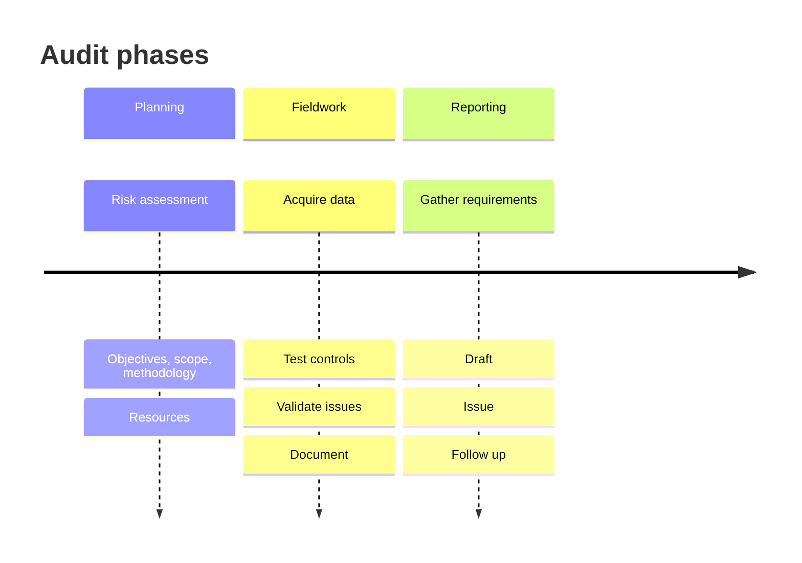

Outline lists plan, define, perform, report. Manual figure shows three phases (define is a planning step, ➕).

#### Planning

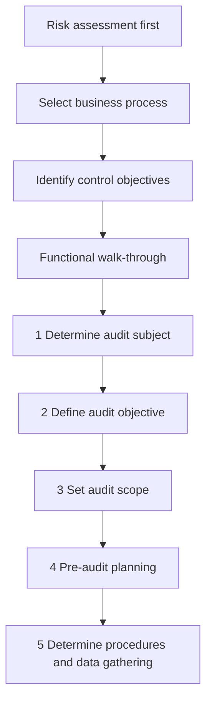

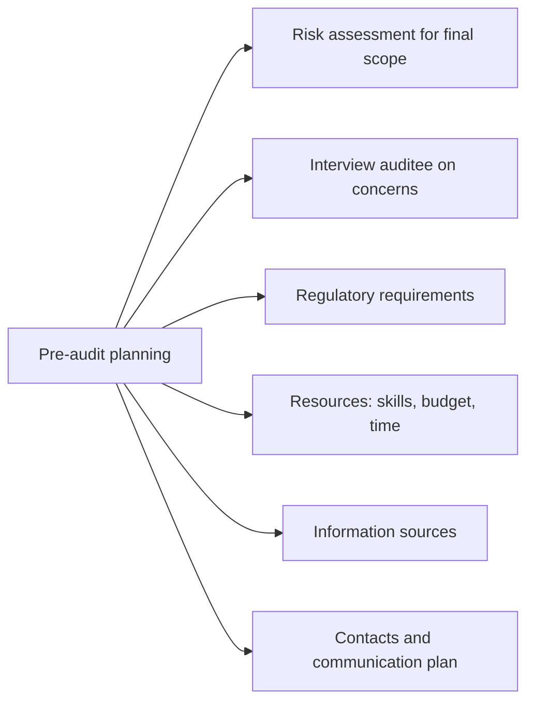

<b>Planning step 5 details</b>

- Obtain policies, standards and guidelines.
- List individuals to interview.
- Select methods and tools.
- Develop test scripts and evaluation criteria.
- Define how to verify test accuracy and repeatability.

<b>Exam traps: planning</b>

- Risk assessment drives resource allocation and final scope.
- Wrong: detailed testing before understanding the process.
- Wrong: picking controls to test before documenting the process.
- Walk-through builds understanding; it does not prove control effectiveness.
- Risk assessment: critical for risk-based audits, good practice for compliance audits.

#### Fieldwork / documentation

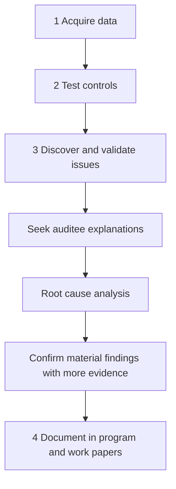

| Technique | Use |
|---|---|
| Interviews | Gather explanations |
| Observation | See control in operation |
| Inspection | Examine records |
| Sampling | Review subset of population |

<b>Definitions and example</b>

- Advance request list: evidence and interviews requested before fieldwork.
- Issue: deviation from expected outcome, basis for recommendations.
- Collect evidence securely, for example by fileshare; a GRC tool can help.
- Example: sample servers, observe antimalware installed per policy.

<b>Exam traps: fieldwork</b>

- Gather more assurance and find root cause before recommending.
- Wrong: redesigning process or stopping operations on first observation.
- Wrong: presenting a finding unverified.

#### Reporting / follow-up

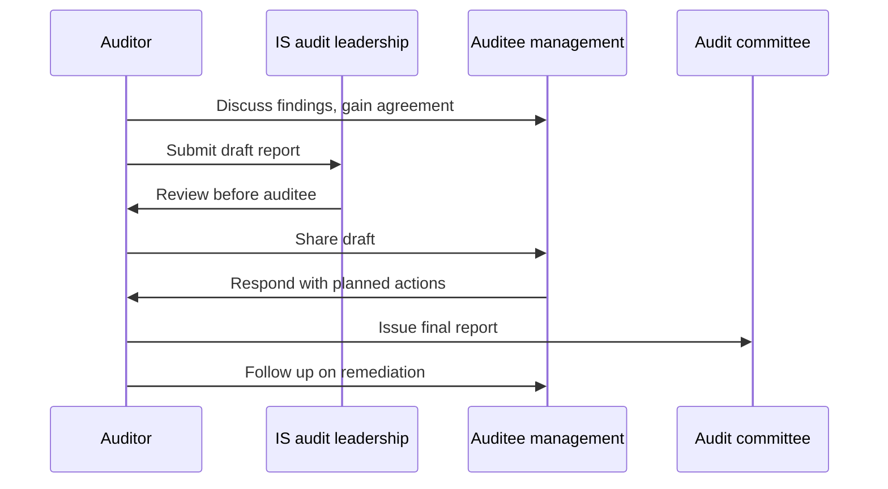

<b>Exam traps: reporting</b>

- Validate and agree facts with management, then issue.
- Wrong: sending a draft straight to the audit committee.
- Wrong: issuing before auditee gives planned actions.
- Retain the final report per internal or external requirements.
- Formal report details are in 1.9.

### 1.5.3 Audit programs

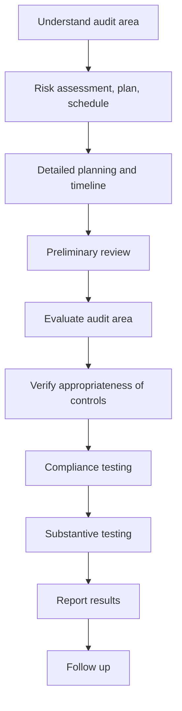

| Testing method | Purpose |
|---|---|
| GAS | Survey data files such as logs |
| Specialized software | Assess OS, databases, parameter files |
| Flowcharting | Document processes and automated controls |
| Audit logs and reports | Evaluate parameters |
| Documentation review | Check written support |
| Inquiry and observation | Gather understanding |
| Walk-through | Trace process end to end |
| Reperformance | Auditor repeats the control |

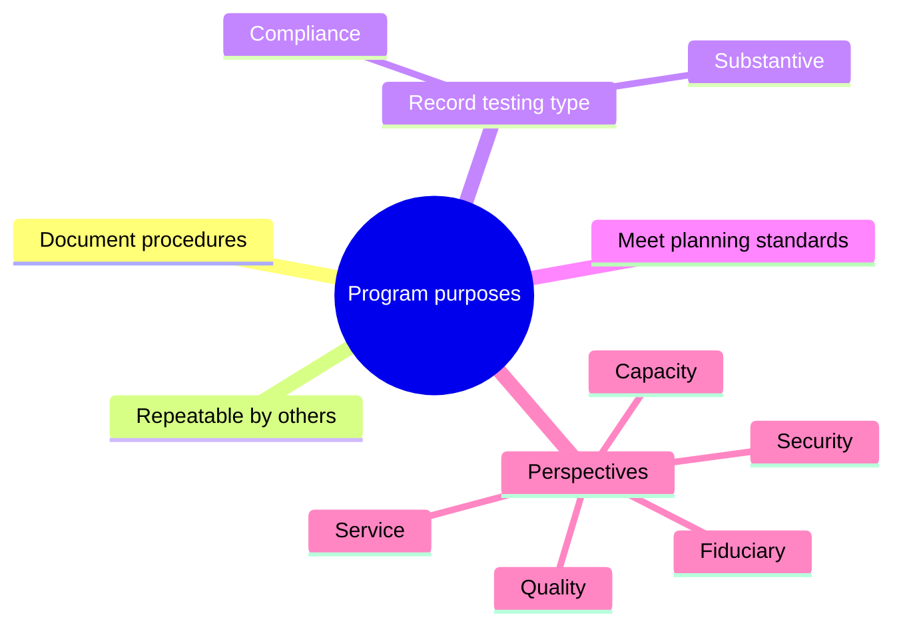

<b>Minimum skills to develop a program</b>

- Know the enterprise, industry, risk and threat.
- Understand the IT space and technologies.
- Understand business risk to IT risk link.
- Basic risk assessment knowledge.
- Know IS control testing procedures.
- Procedures per control objective (unverified) ➕.

<b>Definitions and example</b>

- Compliance testing: controls implemented and consistently applied.
- Substantive testing: information accuracy (detail in 1.6).
- Security: CIA. Quality: effectiveness and efficiency. Fiduciary: compliance and reliability.
- Example: recalculate an interest accrual to confirm system output.

<b>Exam traps</b>

- Program matches scope and objective and records testing type.
- Wrong: one generic program for every audit.

### 1.5.4 Audit work papers

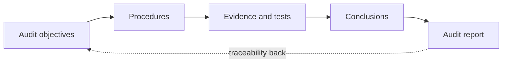

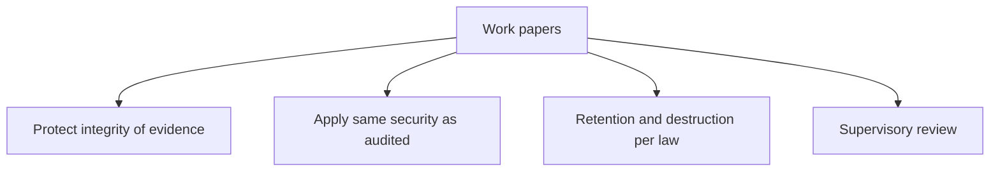

<b>Key facts</b>

- Record plans, programs, tests, findings and incidents.
- The audit report itself counts as a work paper.
- Papers may hold sensitive information useful to attackers.
- Supervisory review is not stated in 1.5.4 (unverified).
- Example: manager signs off tested samples before report issues.

<b>Exam traps</b>

- Wrong: destroying papers after report, ignoring legal retention.
- Wrong: leaving papers unsecured because they are internal.

### 1.5.5 Fraud, irregularities and illegal acts

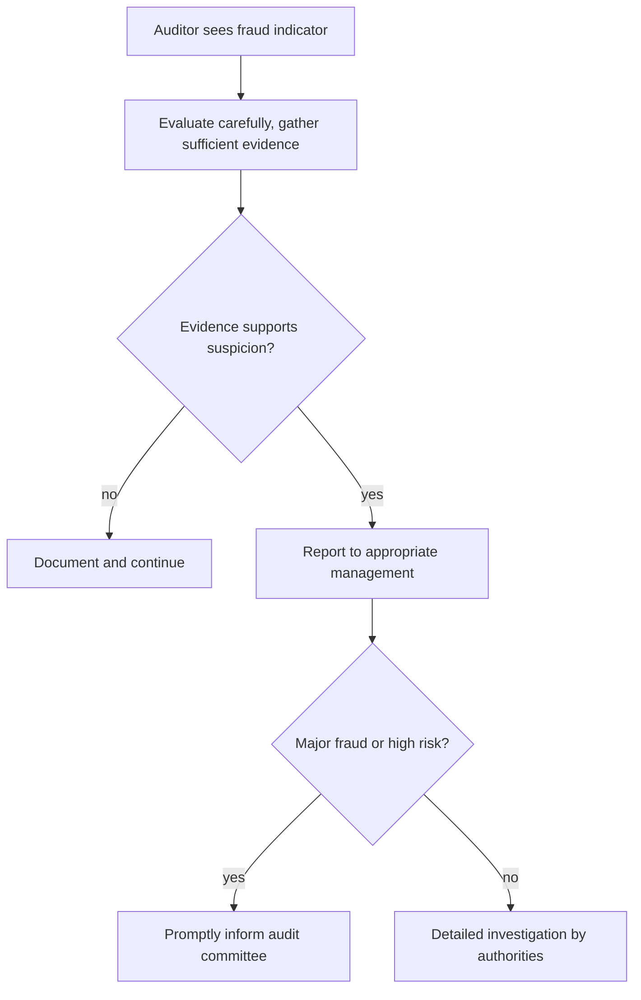

| Control failure route | Note |
|---|---|
| Exploited vulnerabilities | IT weaknesses |
| Management-perpetrated weaknesses | Control override |
| Collusion | Two or more defeat a control |

<b>Key facts</b>

- Management owns controls that deter or detect fraud.
- Controls reduce but never eliminate fraud.
- Auditor needs fraud indicator knowledge and due professional care.
- Know legal requirements on fraud detection and reporting.
- Related: ITAF 1207 and guideline 2207.
- Example: unusual vendor payments, evaluate, gather support, inform audit management.

<b>Exam traps</b>

- Wrong: reporting bare suspicion straight to the audit committee.
- Wrong: confronting the suspect or investigating personally.
- Wrong: assuming strong controls rule out fraud.

### 1.5.6 Agile auditing 📓

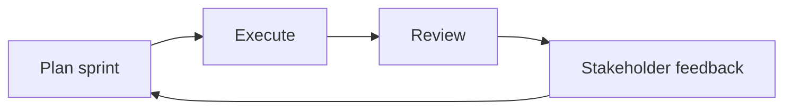

| Aspect | Traditional | Agile |
|---|---|---|
| Structure | Linear, rigid | Short iterative cycles |
| Planning and fieldwork | Separate | Run in parallel |
| Planning time | Months | Weeks or days |
| Customer input | At milestones | Daily standup scrum |
| Findings | Draft report near end | Shared as discovered |
| Plan review | Annual | Quarterly or more |
| Scope change | Fixed plan | Flexible with management approval |

| ITAF item | Agile link |
|---|---|
| 1002 Independence | Direct communication, no conflicts |
| 1003 Objectivity | Skepticism and final decisions kept |
| 1005 Due care | Backlog prioritized more often |
| 1006 Proficiency | Staff learn business faster |
| 1402.3 Follow-up | Executives learn accepted risks |
| 2001.2.6 QA | Sprint retrospective |

<b>Agile values</b>

- Individuals and interactions over processes and tools.
- Working software over comprehensive documentation.
- Customer collaboration over contract negotiation.
- Responding to change over following a plan.

<b>Definitions and example</b>

- Sprint: time-boxed segment on specific risks. 📓
- Daily standup scrum: short daily meeting giving auditees a seat.
- Sprint retrospective: review of last sprint, supports QA.
- Example: auditees prepare user lists while auditors finalize program steps.
- Two-week sprints appear only as a manual example.

<b>Exam traps</b>

- Agile never removes independence or objectivity.
- Wrong: Agile skips documentation or evidence requirements.
- Wrong: findings wait for a final report.
- Wrong: scope changes need no approval.

### Quick recall

| # | Fact |
|---|---|
| 1 | ⭐ Risk assessment is the first planning step |
| 2 | ⭐ Identify control objectives after selecting the business process |
| 3 | ⭐ Root cause analysis before reporting |
| 4 | ⭐ Confirm material findings with additional evidence |
| 5 | ⭐ Agree findings with auditee management before formal report |
| 6 | ⭐ Suspected fraud: gather sufficient evidence, then report to management |
| 7 | Objectives drive scope, tests and evidence |
| 8 | Work papers give traceability, protect and retain per law |
| 9 | Agile: sprints, parallel tasks, independence kept |
