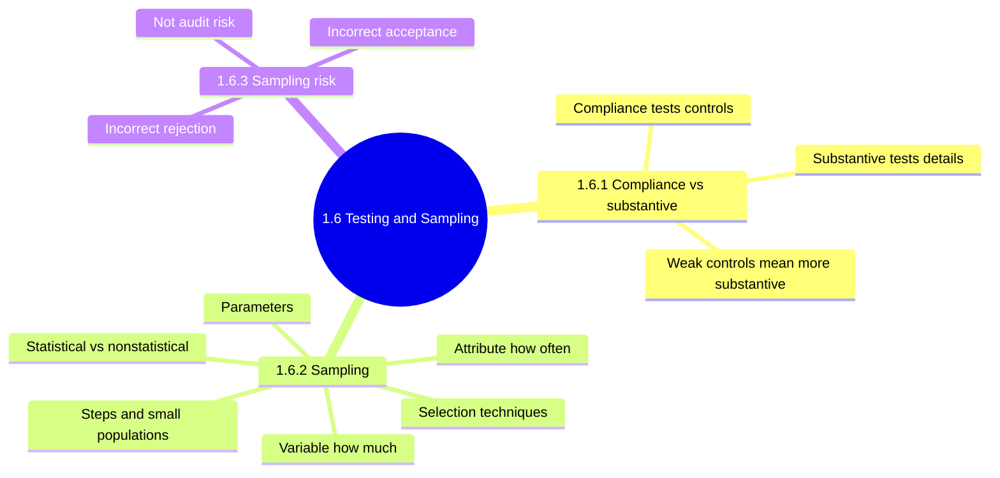
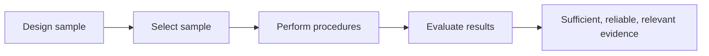
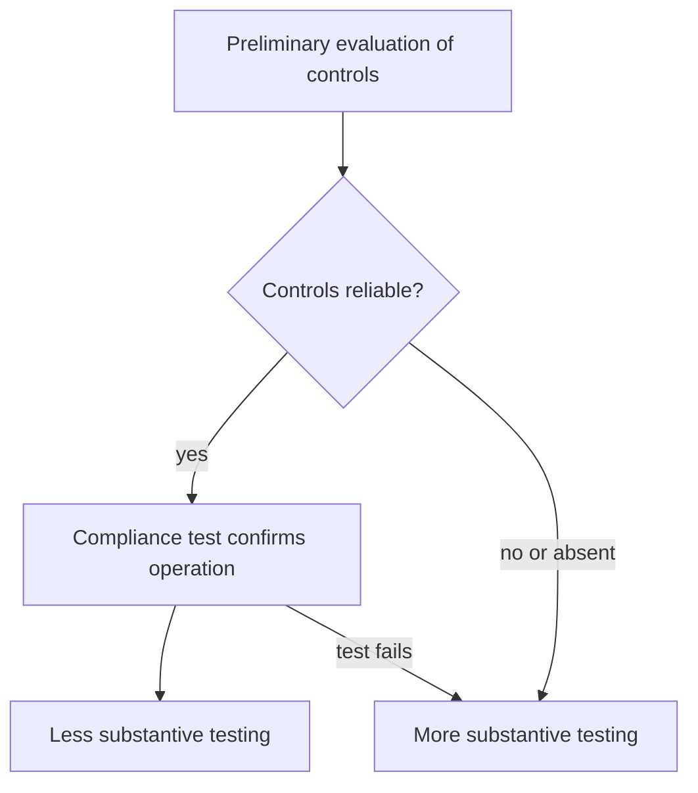
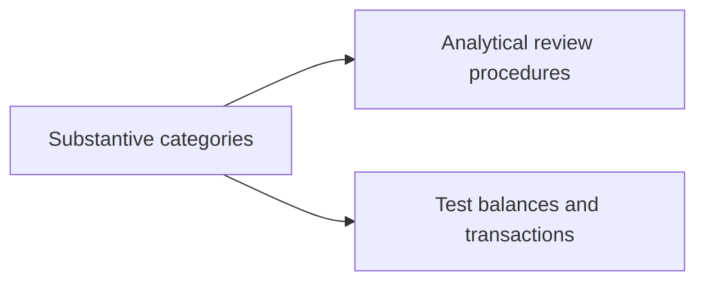
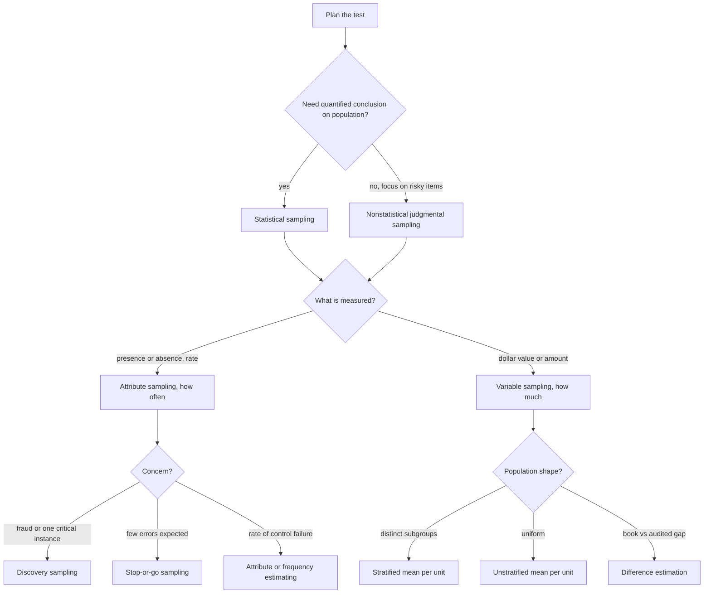
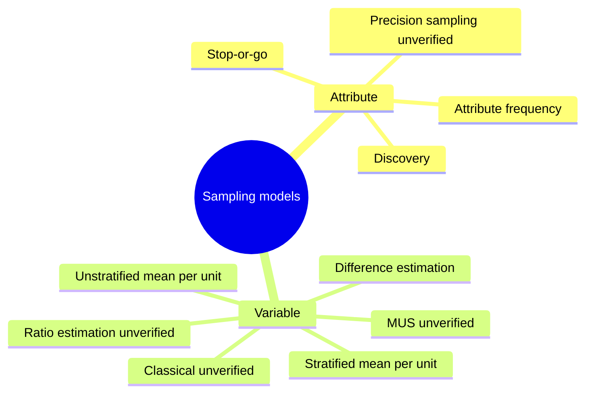
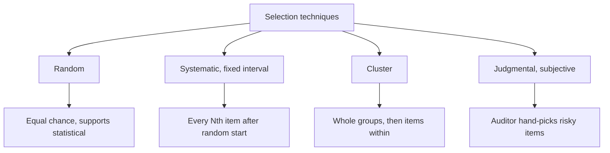
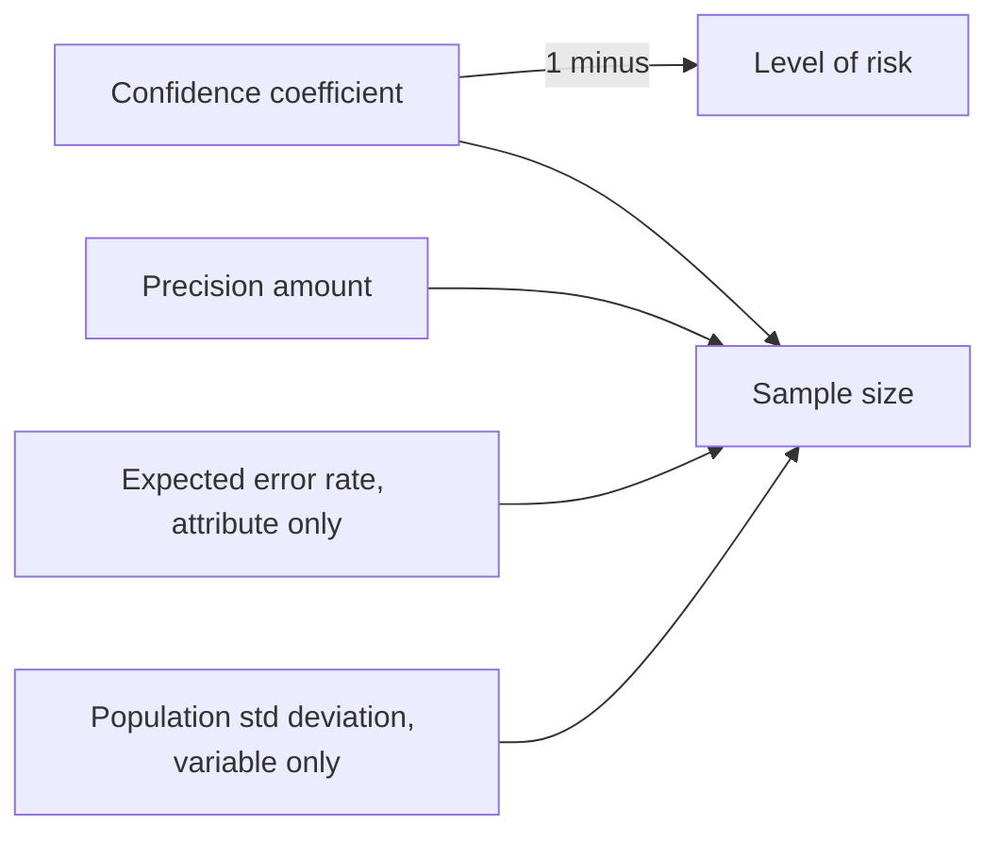
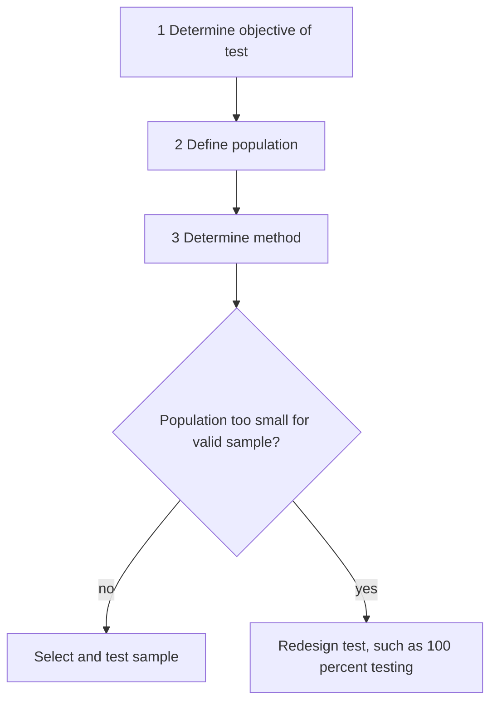
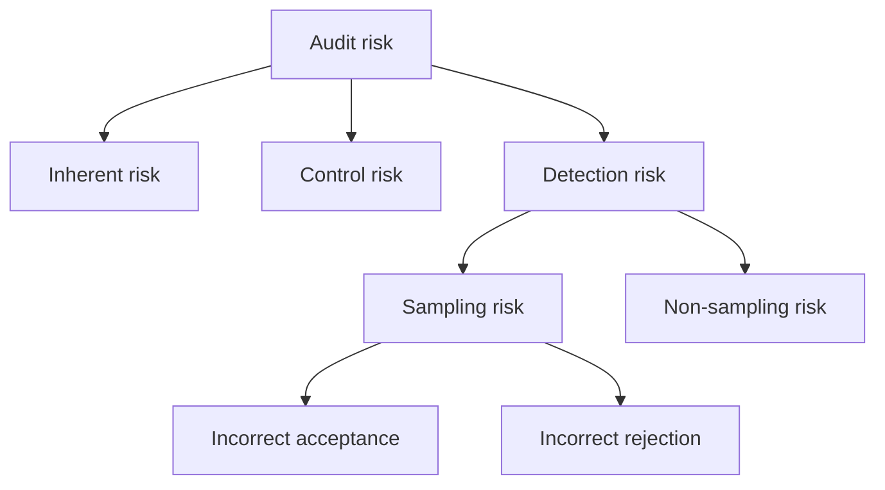

# 1.6 Audit Testing and Sampling Methodology: Diagrams

[← Domain 1](../README.md) | [Study notes](../Study-Notes/1.6-Study-Notes.md)

Markers: 📓 in my notes, ⭐ frequently tested, ➕ unverified in manual.

## Section map

### 1.6 Overview: why sampling exists

<b>Definitions and example</b>

- Audit sampling: testing part of a group to judge the whole.
- Used when full verification costs too much in time and money.
- Use statistical sampling to conclude on the entire population.
- Example: check 60 of 5,000 change tickets.

<b>Exam traps</b>

- Sampling gives reasonable assurance, never absolute assurance.
- Judgment is needed in both statistical and nonstatistical methods.

### 1.6.1 Compliance vs substantive testing ⭐

| Aspect | Compliance test | Substantive test |
|---|---|---|
| Also called | Test of controls | Test of details |
| Question | Are controls operating? | Are balances and transactions correct? |
| Evaluates | Operating effectiveness | Integrity of actual processing |
| Detects | Control failures | Material weaknesses at assertion level |
| Sampling type | Generally attribute | Generally variable |
| Example | Compare source and object versions | Recompute interest, vouch transactions |

<b>Definitions and examples</b>

- Compliance test: is the control working as designed.
- Substantive test: is the number right.
- Sampling examples for compliance: user access rights, change control, logs, license audits.
- Example: strong change control found, reduce detail testing of outputs.

<b>Exam traps</b>

- Control test result drives the amount of substantive work.
- Weak controls justify more detail testing, never less testing.
- Do not skip substantive tests just because controls exist, unless tested.

### 1.6.2 Sampling 📓

#### Sampling decision flowchart

| Question wording | Choose |
|---|---|
| Control operating, how often it fails | Attribute (compliance) |
| Estimate dollar value or total | Variable (substantive) |
| Fraud or circumvention suspected | Discovery sampling ⭐ |
| Few errors expected, stop early | Stop-or-go |
| Two distinct customer types | Stratified ⭐ |
| Population too small | Redesign test, such as 100 percent ⭐ |

#### Statistical vs nonstatistical

| Feature | Statistical 📓 | Nonstatistical (judgmental) 📓 |
|---|---|---|
| Basis | Mathematical probability | Auditor judgment |
| Selection | Each item equal chance | Focus on material, risky items |
| Results | Quantifiable, confidence coefficient | Error probability not quantifiable |
| Projection | Can project to population | Cannot project statistically |
| Example | Random 100 purchase orders at 95 percent | Ten largest vendor payments |

#### Attribute vs variable

| Feature | Attribute | Variable |
|---|---|---|
| Asks | How often | How much |
| Used in | Compliance testing | Substantive testing |
| Measures | Presence or absence, rate | Monetary value or weight |
| Concludes | Rate of incidence | Deviation from norm |
| Example | Approval signature on access forms | Total inventory value |
| Own parameter | Expected error rate | Population standard deviation |

<b>Attribute models</b>

- Attribute sampling: counts presence or absence, gives a rate.
- Stop-or-go: stop at earliest point when few errors expected.
- Discovery: find at least one instance, used for fraud. ⭐
- Error-free discovery sample means no fraud assumed.
- A single error found taints the entire sample.
- Precision sampling: size set by desired accuracy (not a named manual model).

<b>Variable models</b>

- Unstratified mean per unit: sample mean projected to estimated total.
- Stratified: split into subgroups, prevents large values dominating. ⭐
- Stratified gives smaller overall sample than unstratified.
- Difference estimation: total difference between audited and book values.
- Ratio estimation: audited to book ratio projected (not in manual's three).
- MUS: each dollar is a unit, large items likelier picked (unverified).
- Classical variable sampling: normal distribution to estimate totals (unverified).

<b>Exam traps: classification</b>

- Statistical means probability-based, not just bigger or computer-selected.
- Judgmental sampling cannot give a mathematical confidence level.
- Fraud concern means discovery, never stop-or-go.
- Stop-or-go is efficiency when errors are few.
- Discovery gives probability of finding one example, not an error rate.
- Two distinct customer types point to stratified.
- Systematic or cluster sampling do not guarantee subgroup representation.

#### Selection techniques ➕

| Technique | Watch out |
|---|---|
| Random | Unbiased, supports statistical conclusion |
| Systematic | Periodic patterns can bias results |
| Cluster | Clusters may not mirror population |
| Judgmental | Cannot project statistically |

#### Sampling parameters ➕

| Factor | Change | Sample size |
|---|---|---|
| Confidence coefficient | Higher | Larger |
| Precision amount | Higher | Smaller |
| Expected error rate | Higher | Larger |
| Population standard deviation | Higher | Larger |

<b>Parameter definitions</b>

- Confidence level: chance sample represents the population, 95 percent is high assurance.
- Strong internal controls allow lower confidence.
- Level of risk: one minus confidence coefficient.
- Tolerable error rate: maximum error without material misstatement.
- Expected error rate: estimated likely errors, attribute only.
- Precision: acceptable gap between sample and population.
- Sample mean: sum of sample values divided by sample size.
- Sample standard deviation: spread of sample values around mean.
- Population standard deviation: spread of population, variable only.

<b>Formulas and worked examples</b>

- Level of risk = 1 minus confidence: 95 percent gives 5 percent.
- Estimated total = sample mean times population size.
- Example: 12,500 over 50 is 250; times 2,000 is 500,000.
- Estimated difference = average difference times population size.
- Example: minus 800 over 40 is minus 20; times 1,000 is minus 20,000.
- Systematic interval = population divided by sample: 2,000 over 50 is 40.
- Deviation rate = deviations over sample: 3 of 60 is 5 percent.
- 5 percent exceeds 4 percent tolerable: do not rely, extend substantive tests.
- MUS interval = book value over sample size (unverified).

<b>Exam traps: parameters</b>

- Expected error rate is attribute, not variable.
- Population standard deviation is variable, not attribute.
- Higher confidence or smaller precision amount enlarges the sample.
- Precision range and precision mean the same in substantive testing.

#### Sample selection steps and special situations

<b>Exam traps: steps and small populations</b>

- Objective comes first, it drives population and method.
- Do not pick items before the population is defined.
- Small population: do not conclude deficient merely because sampling fails.
- Do not fabricate simulated items to reach a sample size.
- Manual is silent on small populations (unverified) ➕.

### 1.6.3 Sampling risk

#### Sampling-risk comparison

| Aspect | Incorrect acceptance | Incorrect rejection |
|---|---|---|
| Meaning | Weakness judged unlikely, population materially misstated | Weakness judged likely, population not materially misstated |
| Result | Wrongly clean result | Extra work, false alarms |
| Effect | Problems stay hidden | Inefficiency |
| Danger | Usually seen as more dangerous (unverified) | Usually efficiency cost |

| Aspect | Sampling risk | Non-sampling risk |
|---|---|---|
| Cause | Sample misrepresents population | Human error, wrong procedures |
| Fixed by larger sample? | Yes, reduced | No |
| Part of | Detection risk | Detection risk |

<b>Definitions and example</b>

- Sampling risk: chance the sample points to a wrong conclusion.
- Conclusion may differ from testing the whole population.
- Example: sample shows no exceptions, unsampled records hold major errors.

<b>Exam traps</b>

- Do not confuse audit risk with statistical sampling risk.
- Human error is non-sampling risk, a larger sample will not fix it.
- Sampling risk sits inside detection risk, not inherent or control risk.

### Quick recall

| # | Fact |
|---|---|
| 1 | ⭐ Compliance tests controls, substantive tests numbers |
| 2 | ⭐ Weak controls mean more substantive testing |
| 3 | ⭐ Fraud concern means discovery sampling |
| 4 | ⭐ Distinct subgroups mean stratified sampling |
| 5 | ⭐ Tiny population means redesign test, such as 100 percent |
| 6 | Attribute means how often, variable means how much |
| 7 | Higher confidence or expected error enlarges sample |
| 8 | Larger precision amount shrinks sample |
| 9 | Level of risk = 1 minus confidence coefficient |
| 10 | Sampling risk is part of detection risk, not audit risk itself |
