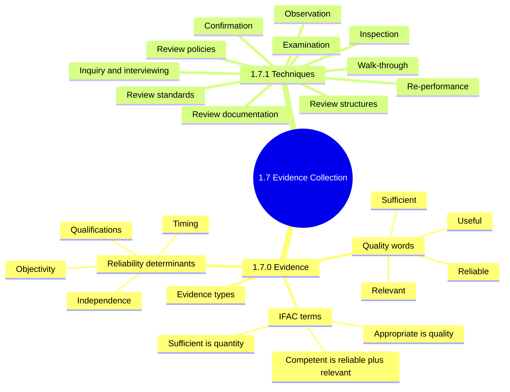
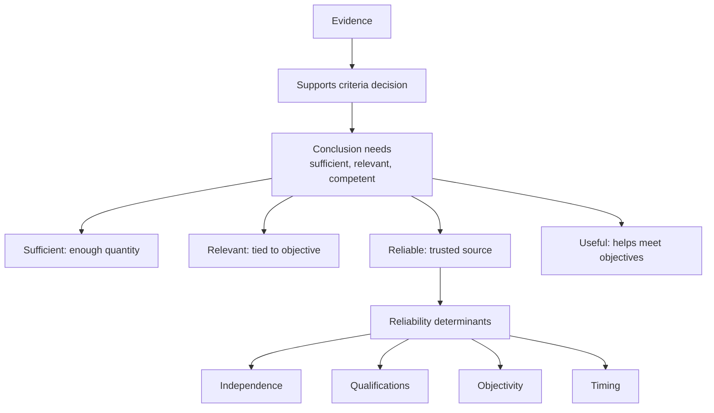
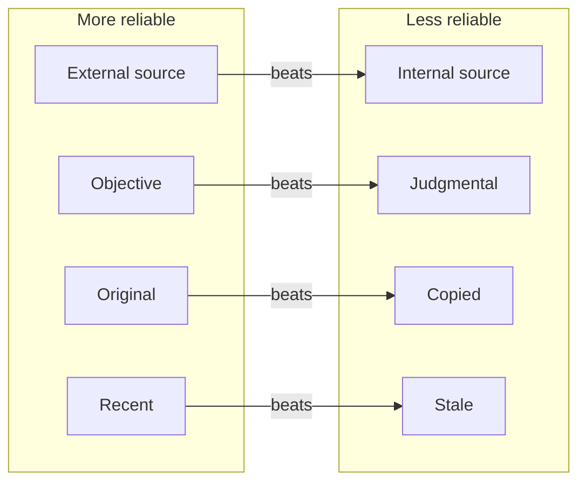
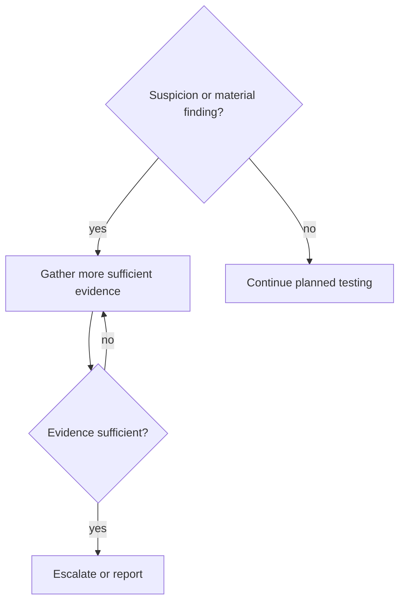
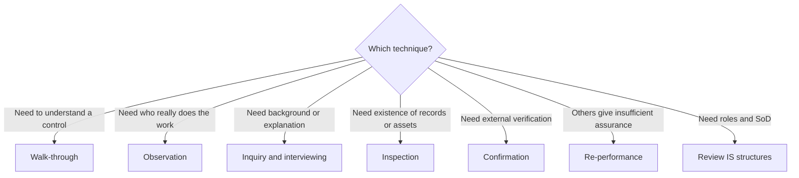
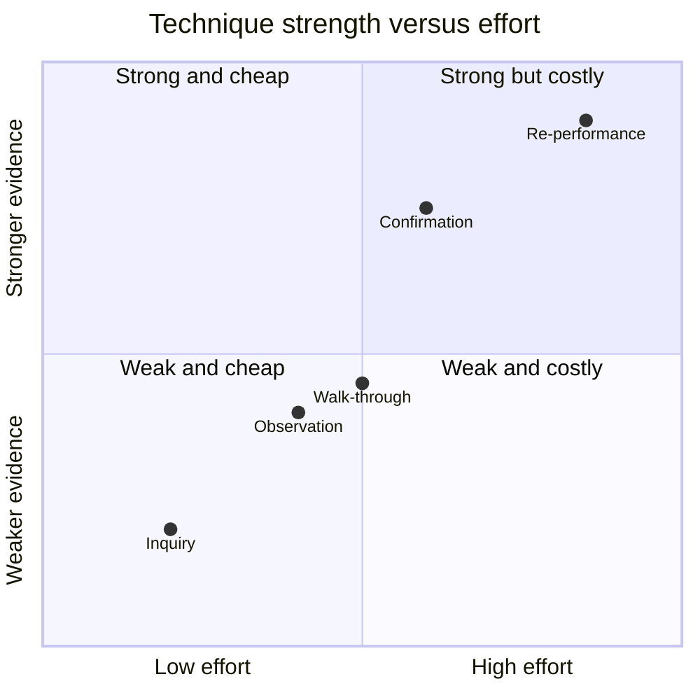
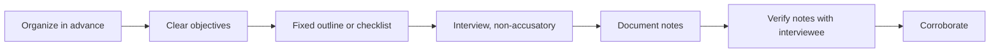
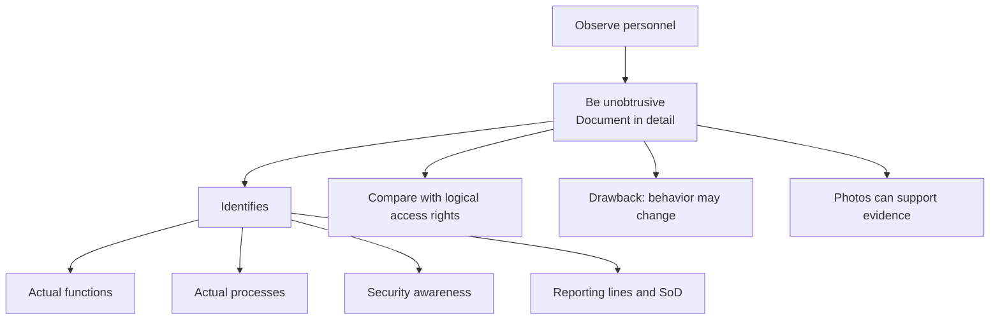
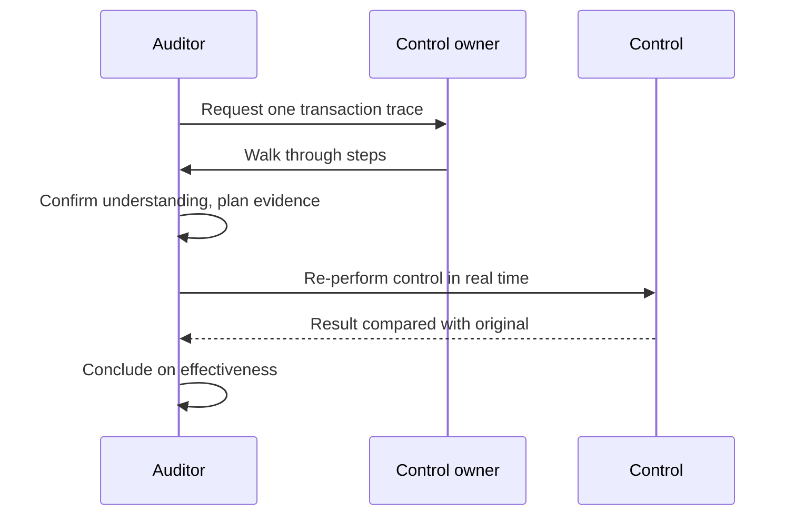

# 1.7 Audit Evidence Collection Techniques: Diagrams

[← Domain 1](../README.md) · [Study notes](../Study-Notes/1.7-Study-Notes.md)

> Markers: 📓 = in my notes, ⭐ = frequently tested, ➕ = unverified.

## Section map

---

### 1.7.0 Evidence

Reliability hierarchy ⭐ (a derived study aid, not a ranked list in the manual):

| Determinant | Stronger evidence | Weaker evidence |
|---|---|---|
| Independence | Bank confirmation letter | Management assurance |
| Qualifications | Skilled, responsible provider | Unqualified speaker |
| Objectivity | Direct review of media inventory | Staff opinion on efficiency |
| Timing | Captured promptly | Uncontrolled spreadsheet, later changed |

| Evidence type | Example |
|---|---|
| Auditor observations | Presented to management |
| Interview notes | Taken during inquiry |
| Third-party assessor results | Independent and qualified |
| Documents | Correspondence, contracts with partners |
| Test results | Output of audit test procedures |

Suspected fraud decision logic 📓:

<b>Definitions</b>

- Appropriate means quality; sufficient means quantity.
- Competent means reliable plus relevant.
- Independence: evidence from outside the auditee is more reliable.
- Objective evidence needs little judgment or interpretation.
- Plan evidence type, purpose and reliability during planning.

<b>Example</b>

- Customer confirmation of receivables beats a copy from the client.
- Reviewing a media inventory directly is objective evidence.
- Ten reliable samples may outweigh a hundred unreliable screenshots.

<b>Exam traps</b>

- Quantity alone never fixes poor quality.
- Photocopies from the auditee do not equal original external documents.
- Management assurance is internal, so it ranks low.
- Dynamic data needs early capture; do not postpone collection.
- On suspicion, gather more evidence first; do not accuse.
- Manual says competent, not useful; "useful" is an outline addition.

---

### 1.7.1 Techniques

The chart is illustrative only. The manual says re-performance is generally better evidence.

| Technique | Purpose | Key point |
|---|---|---|
| Review IS structures | Judge SoD | Adequate SoD is a key general control |
| Review policies | Exist, understood, followed | Management owns the policies |
| Review standards | Know standards in place | Manual gives one sentence |
| Review documentation | Understand systems | Evaluate integrity controls on e-documents |
| Inquiry and interviewing | Gather answers | Never accusatory; verify notes |
| Observation | See real practice | Staff may change behavior |
| Inspection | Examine records or assets | Manual gives no separate definition |
| Re-performance | Redo control in real time | Generally better evidence |
| Walk-through 📓 | Confirm understanding | Does not prove effectiveness |
| Confirmation | Direct third-party reply | Highly reliable, external |
| Examination | Includes control testing | Test results are evidence |

Interviewing steps:

Observation:

Walk-through versus re-performance sequence:

<b>IS documentation reviewed</b>

- Feasibility studies and initiating documents.
- External supplier documentation.
- SLAs with IT providers.
- Functional requirements and design specifications.
- Test plans and reports.
- Program and operations documents; program change logs.
- User and operations manuals.
- Security plans and risk assessments.
- BCPs, QA reports, security metrics reports.
- CASE and prototyping may automate documentation.

<b>Example</b>

- Developers who also deploy to production signal weak SoD.
- Re-run an interest calculation and compare with system output.
- Follow one purchase order from request to payment.
- A photograph of a server room with doors open.

<b>Exam traps</b>

- Policy existence is not enough; test understanding and compliance.
- Auditors verify management's policy duty; they do not write policies.
- Interview answers rank below objective, independent evidence.
- Observation proves practice only at one moment.
- Re-performance is used when lesser techniques fall short.
- Inquiry alone never proves a control operates effectively.
- Walk-through confirms understanding; testing confirms operation.
- Document review alone is not a full examination.
- Outline numbering differs from the manual.

---

### Quick recall

| Fact | Note |
|---|---|
| ⭐ Reliability hierarchy | External, objective, original, recent wins |
| Competent evidence | Reliable plus relevant |
| Appropriate vs sufficient | Quality vs quantity |
| Four determinants | Independence, qualifications, objectivity, timing |
| Suspected fraud | Gather more evidence before escalating |
| Observation drawback | Behavior may change |
| Re-performance | Generally better evidence |
| 📓 Walk-through | Confirms understanding only |
| Interviews | Weak alone, corroborate |
