# 1.8 Audit Data Analytics: Diagrams

[← Domain 1](../README.md) · [Study notes](../Study-Notes/1.8-Study-Notes.md)

> Markers: 📓 = in my notes, ⭐ = frequently tested, ➕ = unverified.

## Section map

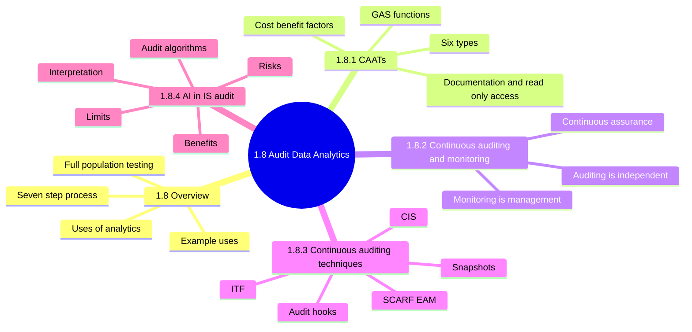

---

### 1.8 Overview

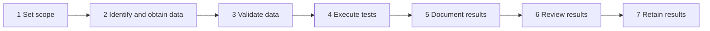

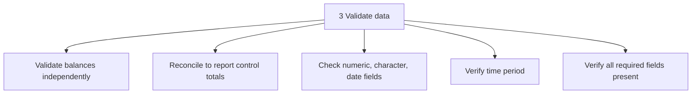

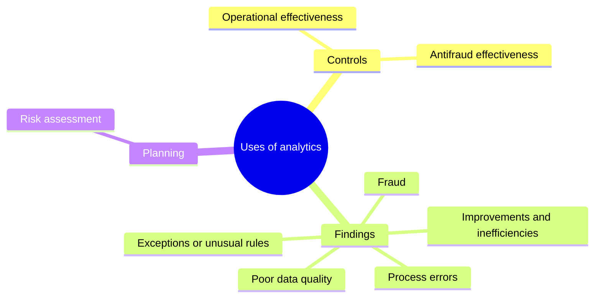

| Example use | What it reveals |
|---|---|
| Logical access files plus HR master | Terminated staff with active accounts |
| File library settings vs change dates | Changes outside approved windows |
| Ingress vs egress records | Tailgating |
| Table or system configuration review | Weak settings |
| System log review | Unauthorized access |
| System conversion testing | Conversion errors |
| AD groups vs job descriptions | SoD conflicts |

<b>Definitions</b>

- Analytics selects and analyzes full data sets with technology.
- Full-population testing lowers sampling risk.
- Retain scripts, macros, program files and data files.

<b>Example</b>

- Test every payment in a year, not forty samples.
- Extract total differs from ledger total, so completeness fails.
- Duplicate invoice matching shows errors and possible fraud.

<b>Exam traps</b>

- Validation comes before test execution.
- Independent balance validation beats trusting the extract's totals.
- Retention covers scripts and data, not only the report.
- Analytics supports judgment; it never replaces the conclusion.
- Analytics is valid in planning, not only fieldwork.

---

### 1.8.1 Computer-Assisted Audit Techniques (CAATs)

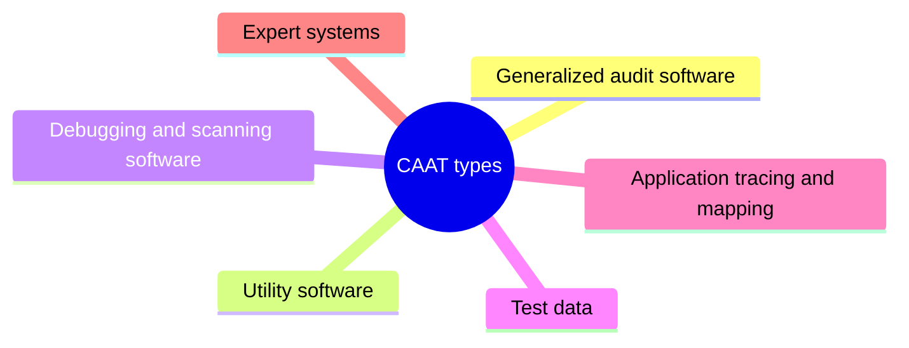

| GAS function | Meaning |
|---|---|
| File access | Reads different record formats |
| File reorganization | Index, sort, merge, link |
| Data selection | Global filters and criteria |
| Statistical | Sampling, stratification, frequency |
| Arithmetical | Operators and functions |
| Also | Sequence and duplicate checks, recomputation |

| CAAT | Use |
|---|---|
| GAS | Independent analysis of auditee files |
| Utility software | Details, analytical review, compliance tests, vulnerability scans, pen testing |
| Test data | Check program logic errors |
| Expert system | Senior auditor knowledge guides staff |

Safe handling of data:

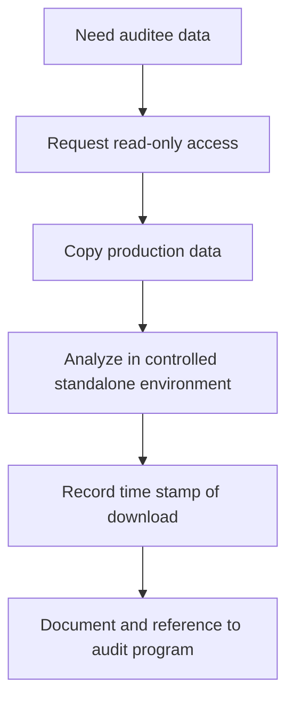

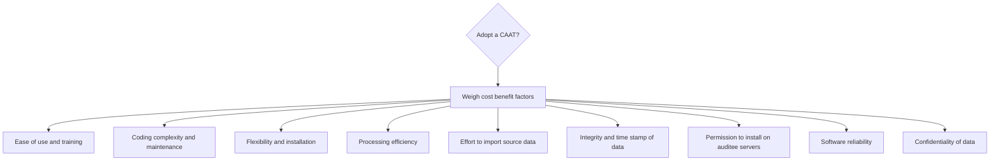

<b>CAAT documentation to retain</b>

- Online reports on high-risk issues.
- Commented program listings.
- Flowcharts and sample reports.
- Record and file layouts; field definitions.
- Operating instructions.
- Descriptions of source documents.

<b>Definitions</b>

- CAAT: tool the auditor uses to gather and analyze audit data.
- Gives the auditor independent access to data.
- Needed when hardware, software or data structures differ.
- Continuous online approach: auditor joins system development early.

<b>Exam traps</b>

- Relying on auditee reports weakens independence.
- Test data checks logic, not live data completeness.
- Read-only access is the answer; update access is never justified.
- Testing on production files risks change and disruption.
- Do cost-benefit analysis before buying a tool.
- Manual names debugging and tracing types without detail (check).

---

### 1.8.2 Continuous auditing and monitoring

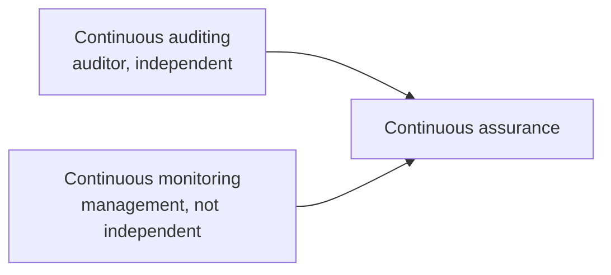

| Term | Who | Independent? |
|---|---|---|
| Continuous auditing | Auditor | Yes |
| Continuous monitoring | Organization | No, never replaces audit |
| Continuous assurance | Both together | Auditing stays independent |

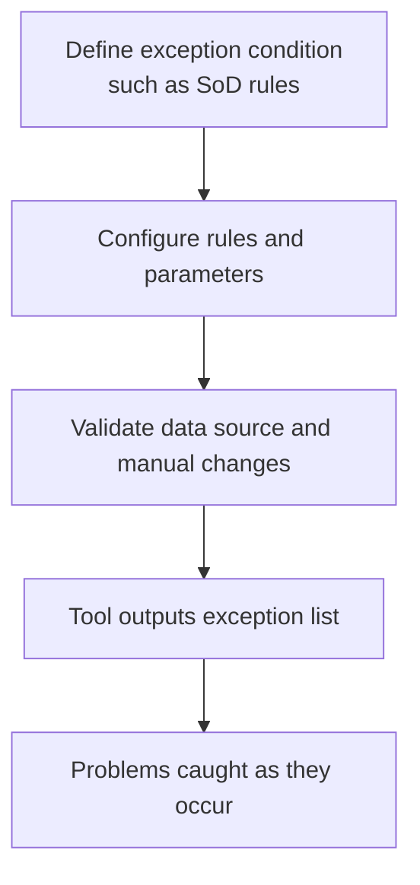

<b>Definitions</b>

- Continuous auditing: real-time or near-real-time tests and reporting.
- Monitoring example: real-time antivirus or IDS.
- Tools are built into ERP, OS and network security packages.
- Audit often hands techniques to the business for monitoring.

<b>Exam traps</b>

- Monitoring is a management control, not an audit.
- Handing techniques to business does not transfer independence.
- Real-time detection is the advantage over periodic audit.
- Vague conditions are hard to define as exceptions.

---

### 1.8.3 Continuous auditing techniques

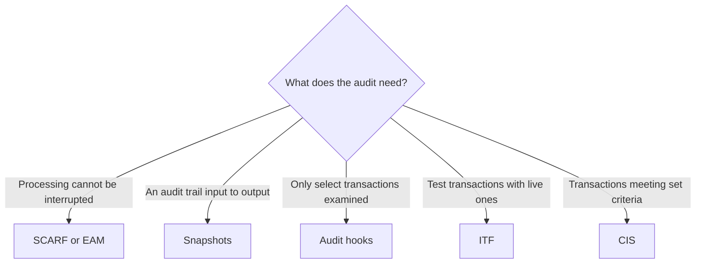

| Technique | How it works | Use when |
|---|---|---|
| SCARF/EAM | Audit software embedded in host application | Processing cannot be interrupted |
| Snapshots | Tag transactions, record path | Audit trail required |
| Audit hooks | Red flag hooks in applications | Select transactions need review |
| ITF | Dummy entities in production files | Compare to independent calculation |
| CIS | Simulator mimics application logic | Criteria-based transactions |

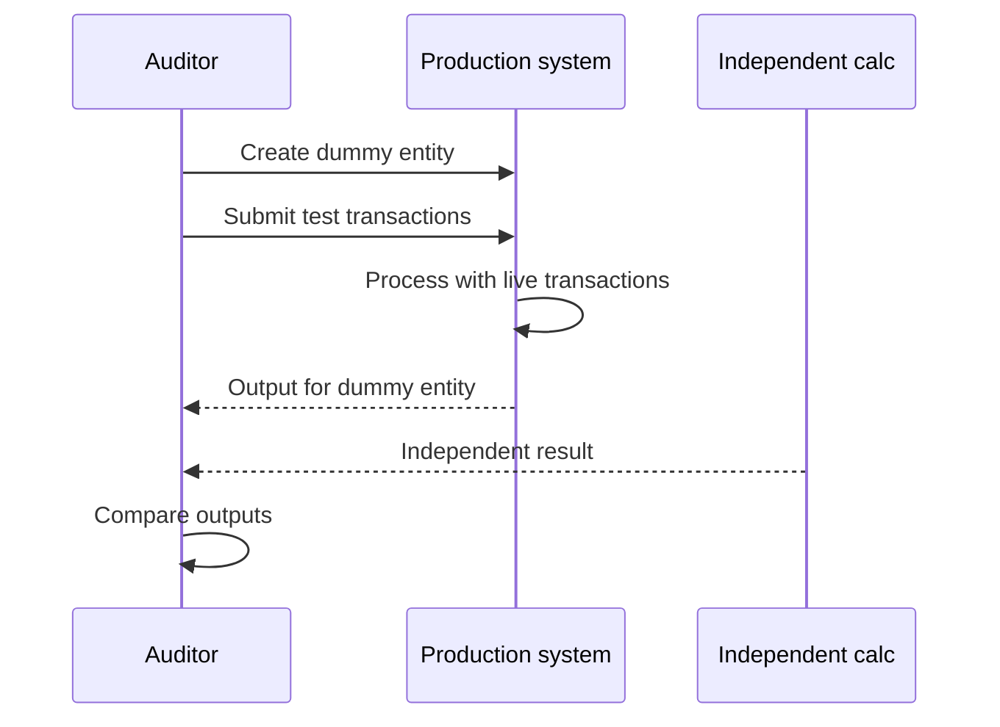

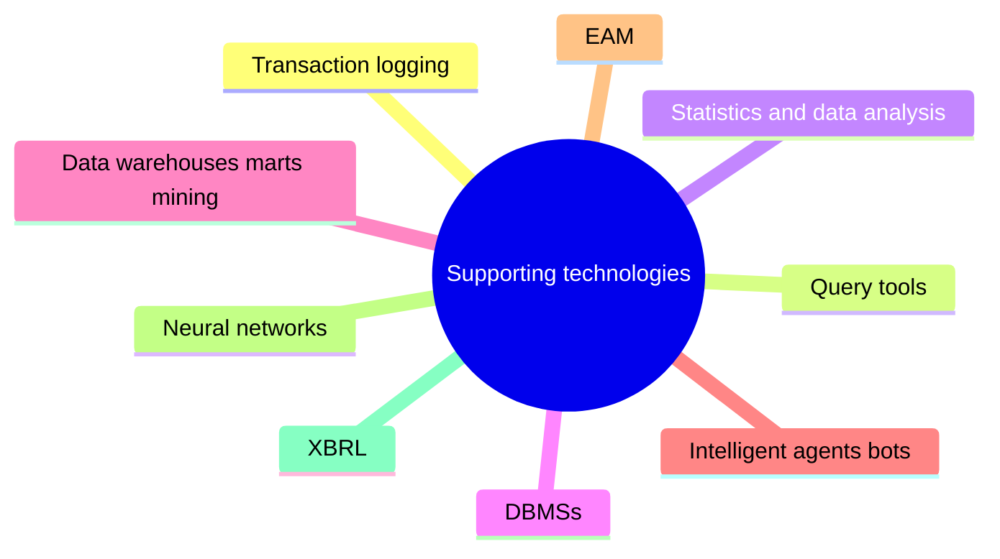

<b>Definitions</b>

- Reduce lag between misuse and detection.
- Give only limited assurance, not a cure-all.
- Work at input, transaction and database levels.
- Need management support and technical knowledge.
- Intelligent agents (bots) send threshold alerts.

<b>Example</b>

- Fictitious customer account receives test invoices during live billing.
- Reporting a withdrawal from an inoperative account promptly.

<b>Exam traps</b>

- ITF test transactions run with live data; snapshots tag real ones.
- Hooks examine selected items; CIS examines items meeting criteria.
- Compare ITF output to independent calculation, not system output.
- Dummy data must not contaminate real totals.
- Disadvantages: cost, distrust of tools, false positives and negatives.
- False negatives are the dangerous error.
- ITF use-case wording in manual is garbled (check).

---

### 1.8.4 Artificial Intelligence in IS audit 📓

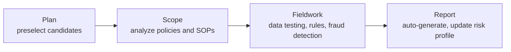

| Benefit 📓 | Limit 📓 |
|---|---|
| ⭐ Analyzes large datasets rapidly | Humans retain professional judgment |
| Automates repetitive tasks | AI does not guarantee compliance |
| Identifies anomalies automatically | Person interprets the results |

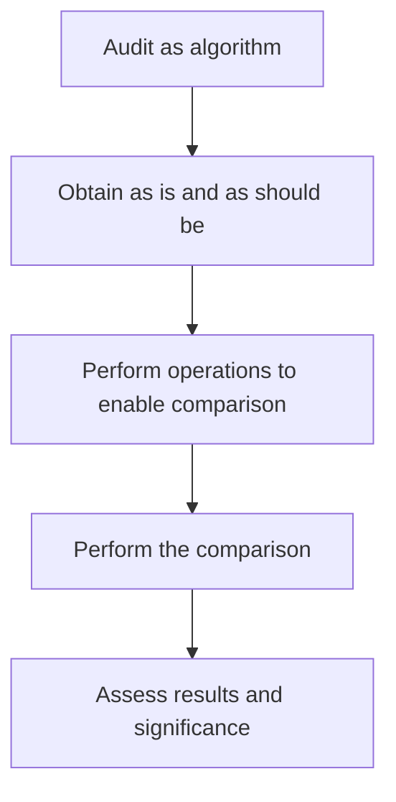

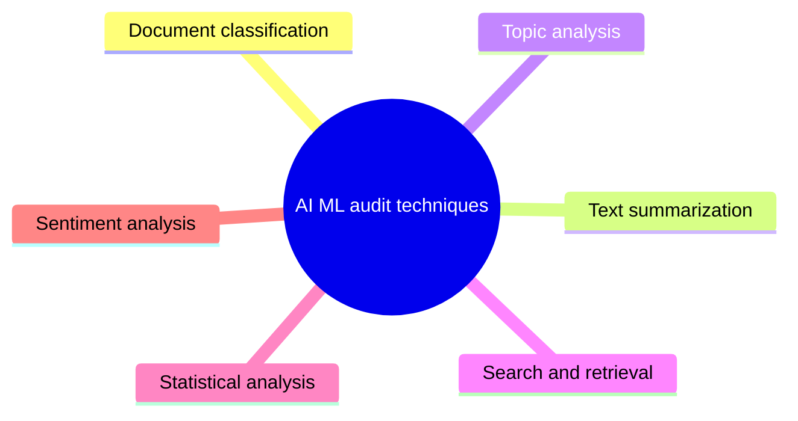

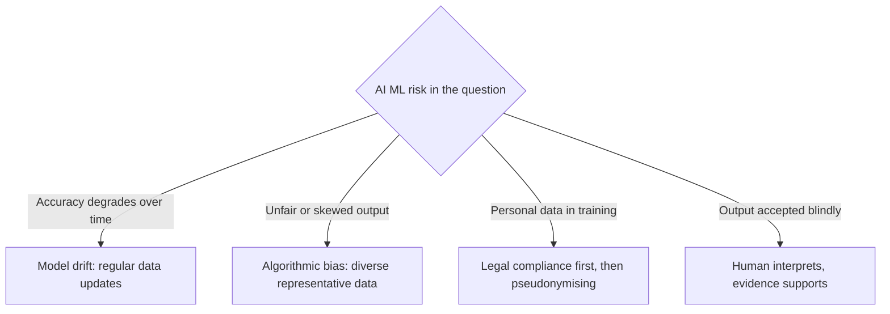

<b>Interpreting results</b>

- A person should interpret results.
- Validate inputs at implementation and periodically.
- Obtain raw data to check conclusions.
- Understand statistical significance.
- Results should represent the whole audit universe.
- Beware hidden assumptions and caveats.

<b>Definitions</b>

- RPA: software robots doing rule-based repetitive tasks.
- Enablers: NLP, natural language generation, predictive analysis, RPA.
- Algorithm: a defined way to solve a specific problem.
- Homomorphic encryption: compute on encrypted data without decrypting.
- AI/ML is an evolution of CAATs.
- Model drift, bias and pseudonymising are from notes (unverified).

<b>Exam traps</b>

- Computer output alone is never sufficient evidence.
- "Guarantees compliance" or "replaces auditors" are false benefits.
- Legal compliance outranks pseudonymisation as top consideration.
- Regular data updates fix drift; extra staff training does not.
- A single data source worsens bias.
- Parallel manual audits do not remove bias inside the model.
- Proprietary algorithms often have thin documentation.

---

### Quick recall

| Fact | Note |
|---|---|
| ⭐ AI main benefit | Analyzes large datasets rapidly |
| ⭐ Fix model drift | Regular data updates |
| ⭐ Fix algorithmic bias | Diverse, representative training data |
| ⭐ Top AI consideration | Legal compliance with data protection laws |
| Analytics process order | Scope, obtain, validate, execute, document, review, retain |
| CAAT data access | Read-only, work on copies |
| Monitoring | Management control, never replaces audit |
| ITF | Dummy entities, compare to independent calculation |
| Snapshots | Used when audit trail required |
