# 1.9 Reporting and Communication Techniques: Diagrams

[← Domain 1](../README.md) | [Study notes](../Study-Notes/1.9-Study-Notes.md)

## Section map

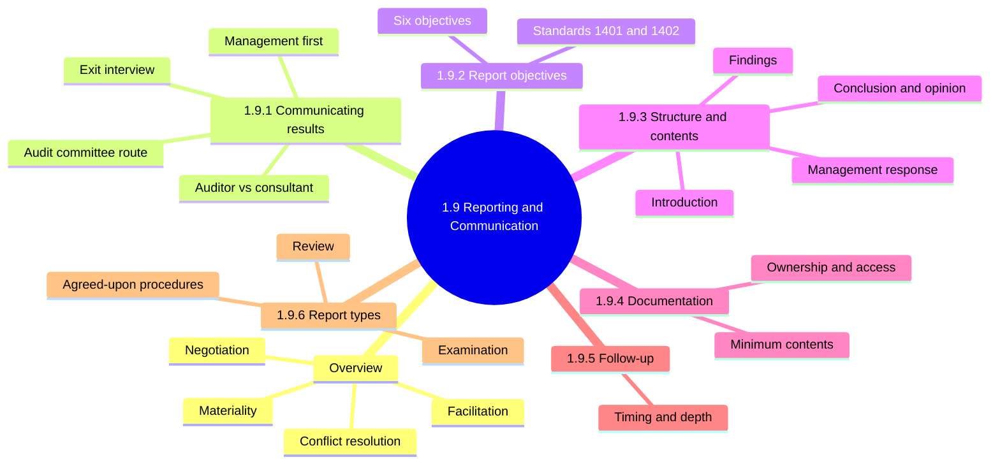

### 1.9 Overview: communication skills and materiality

| Skill | Purpose | Example |
|---|---|---|
| Facilitation | Guide group to agreed outcome | Run an exit interview |
| Negotiation | Agree realistic fix and dates | Accept a compensating control |
| Conflict resolution | Settle disputes, keep relationship | Dispute over finding severity |
| Materiality | Decide what goes to which level | Weak branch lock, local only |

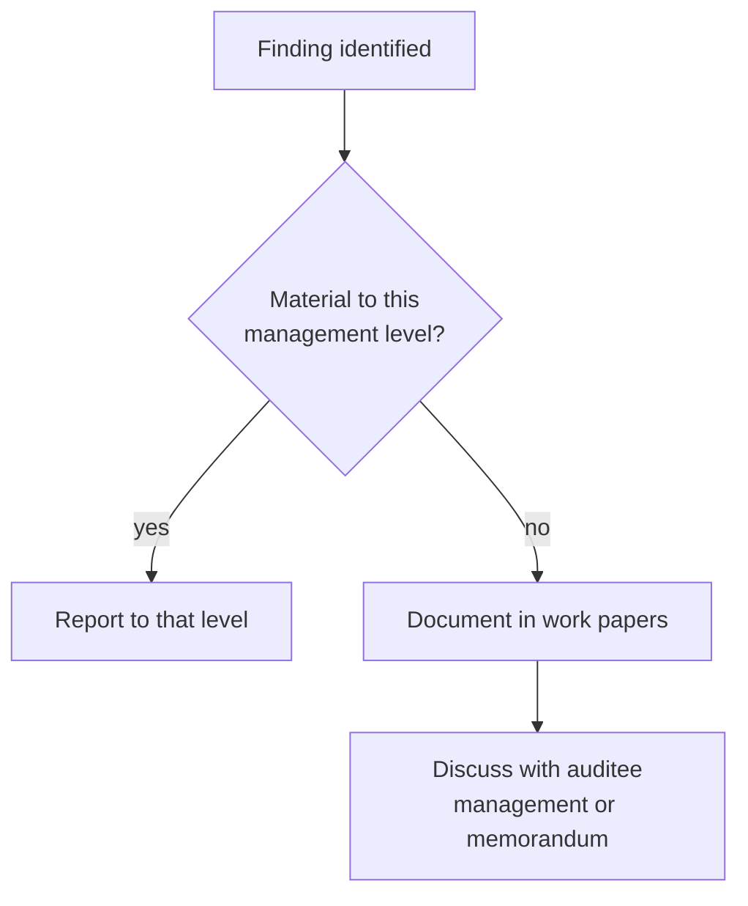

<b>Exam traps</b>

- Best answer: clear, tactful, business-impact communication.
- Dropping a finding to avoid conflict breaks integrity.
- Reporting every minor issue upward ignores materiality.
- Auditor may adjust the fix, never the finding.

### 1.9.1 Communicating audit results

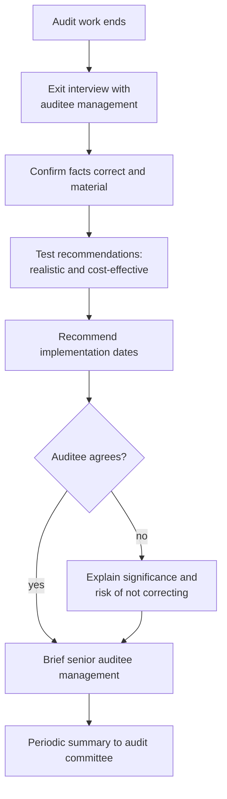

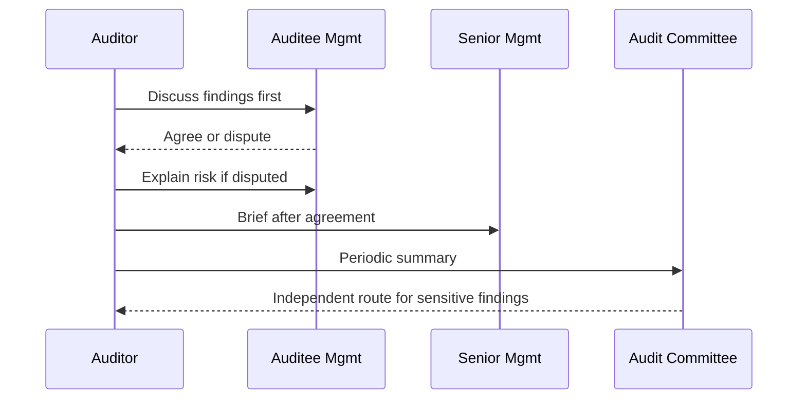

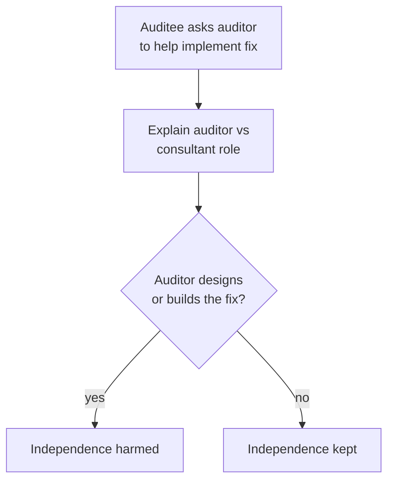

<b>Definitions</b>

- Exit interview: closing meeting with auditee management at audit end.
- Audit committee: board-level group, usually non-employees, overseeing audit.
- Blocking access by levels below senior management limits independence.

<b>Exam traps</b>

- Discuss findings with management first. 📓⭐
- Going straight to the audit committee skips agreement and fact checks.
- Implementing the fix yourself harms independence.
- Agreement is sought, not required, before reporting.
- Check (unverified): fraud involving management may need different escalation.

### 1.9.2 Audit report objectives

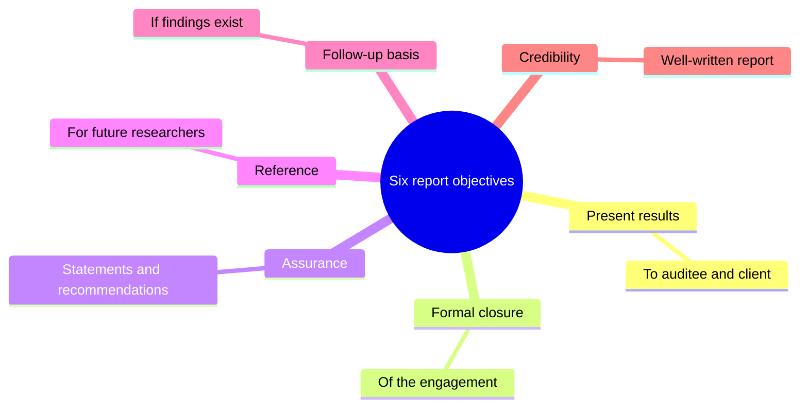

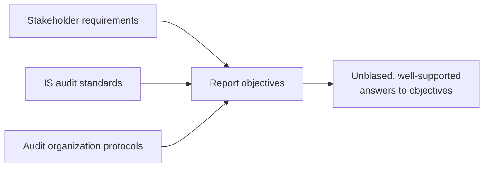

| Standard | Topic |
|---|---|
| 1401 | Reporting |
| 1402 | Follow-up activities |

<b>Exam traps</b>

- Report must answer stated objectives, not what seemed interesting.
- A list of tests without a conclusion fails the objective.

### 1.9.3 Audit report structure and contents

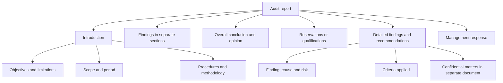

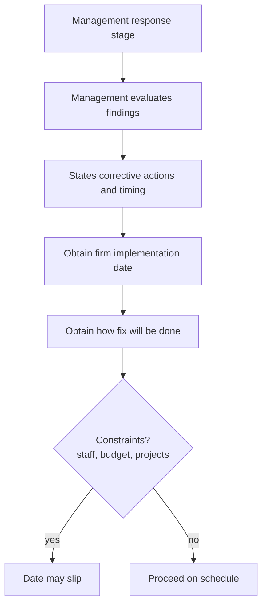

<b>Definitions</b>

- Overall opinion: judgment on adequacy of controls, including actual potential risk.
- Reservations: stated limits that reduce certainty of conclusions.
- Findings often grouped by materiality, recipient, or both.
- Minor findings may go to management by memorandum.

<b>Exam traps</b>

- Auditor owns report content; management owns the response.
- Removing a finding because management objects violates independence.
- Delaying the report until fixes finish defeats timeliness.
- Early communication must not change report content.
- A negative-only report is unbalanced; note effective controls.
- Grouping is often done, not mandatory (check).

### 1.9.4 Audit documentation

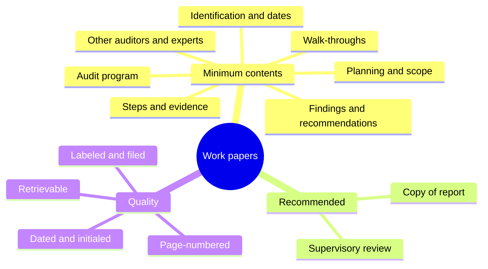

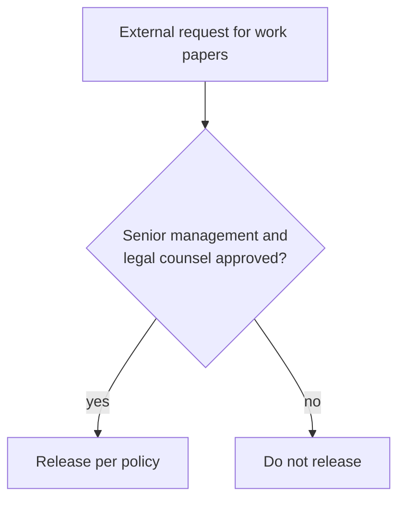

<b>Materiality examples</b>

- Remote-site access weakness matters locally, maybe not at headquarters.
- Deprovisioning caught by management review: document, not escalate.
- Still discuss such findings with auditee management.

<b>Exam traps</b>

- Document everything, escalate only what is material.
- Minor findings are documented, not discarded.
- Never release work papers on the auditor's own authority.
- Documentation is generally auditee property (check).

### 1.9.5 Follow-up activities

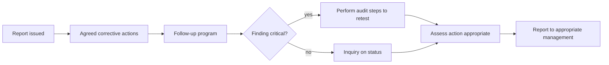

<b>Exam traps</b>

- Verify action is appropriate, not merely reported done. 📓
- Management statement alone is weak for high-criticality findings.
- Identical depth for every finding ignores criticality.
- External auditors follow up only if agreed with auditee.

### 1.9.6 Types of IS audit reports

| Engagement | Evidence and opinion |
|---|---|
| Review | Less testing than examination (inferred) |
| Examination (audit) | Stronger evidence for formal opinion |
| Agreed-upon procedures | Narrower scope; opinion may not be expressed |

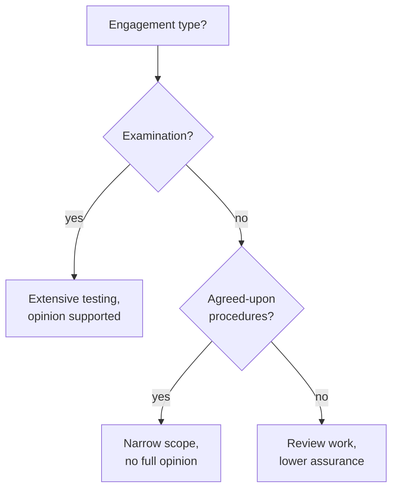

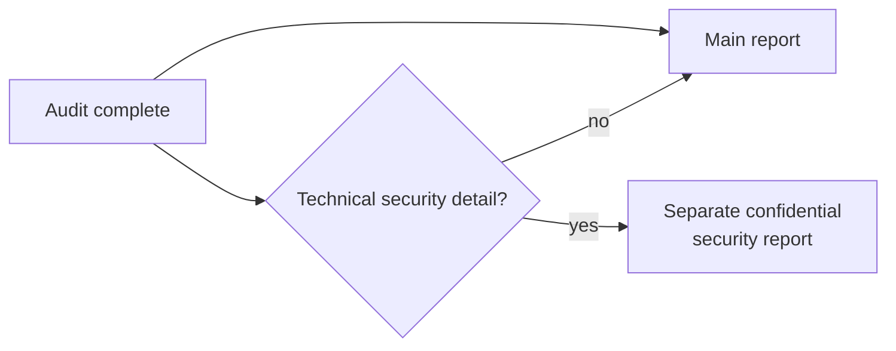

<b>Exam traps</b>

- Full opinion after limited agreed-upon procedures is wrong.
- Technical vulnerability detail does not belong in the widely distributed report.
- Client may set content and format, and may differ from auditee.

### Quick recall

| Fact | Answer |
|---|---|
| ⭐ First audience for findings | Auditee management |
| Purpose of exit interview | Confirm facts, recommendations, dates |
| Auditor assisting implementation | Harms independence |
| Who decides final report content | Auditor |
| Report objectives count | Six |
| Standards | 1401 Reporting, 1402 Follow-up |
| Which findings reach report | Material ones |
| Follow-up depth | Scaled to criticality |
| Agreed-upon procedures | Opinion may not be expressed |
| Technical detail | Separate confidential report |
