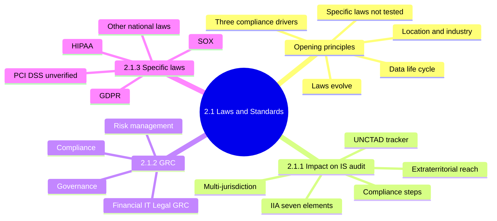
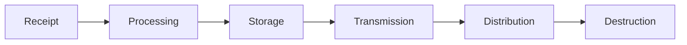
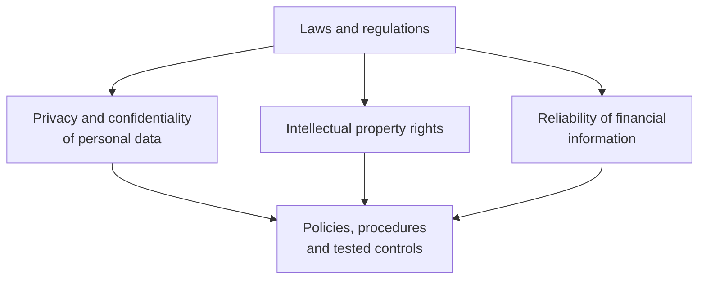
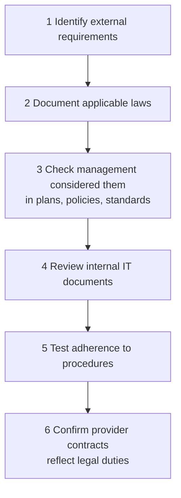
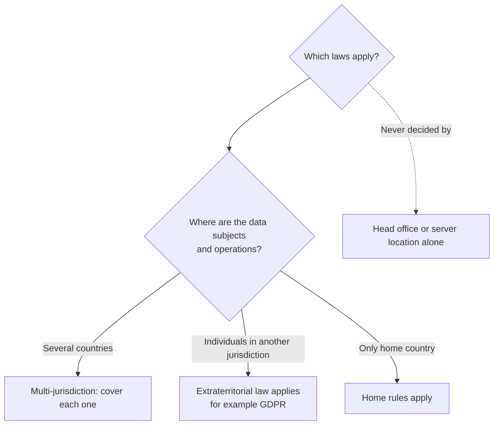
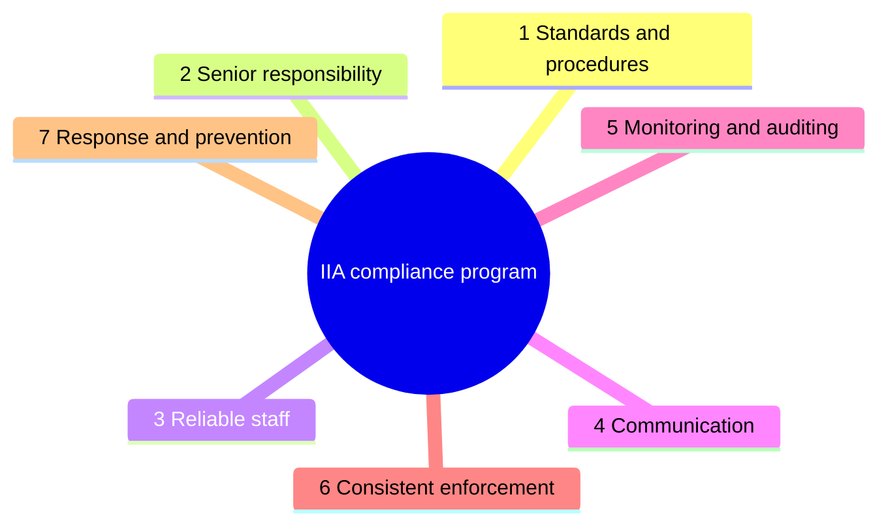
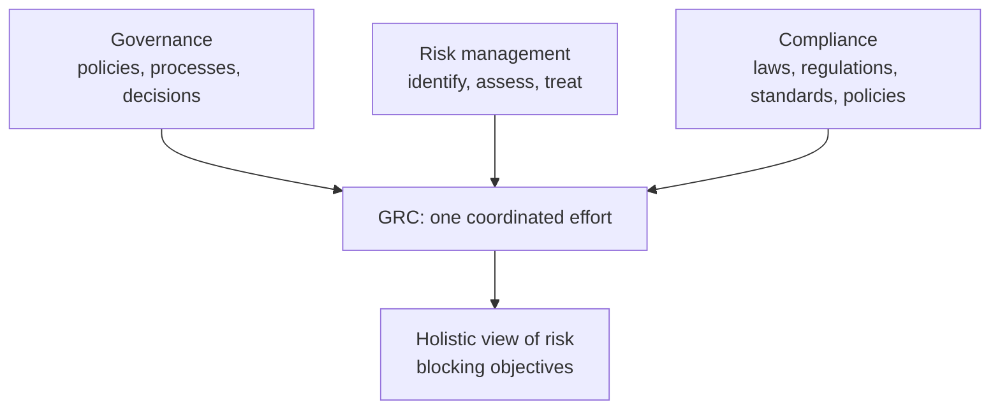
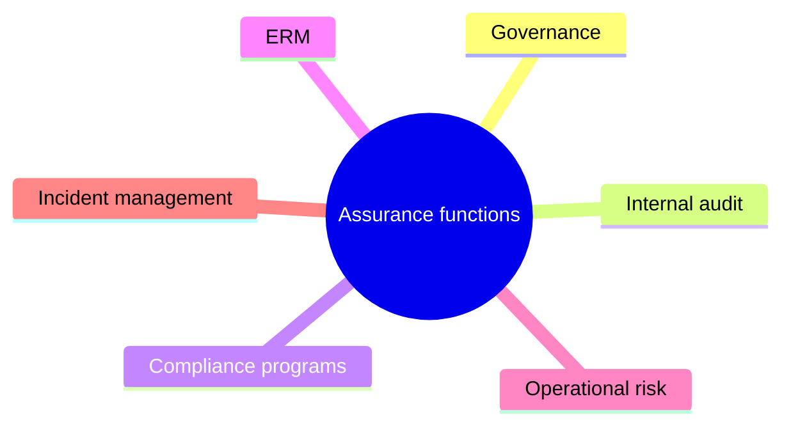
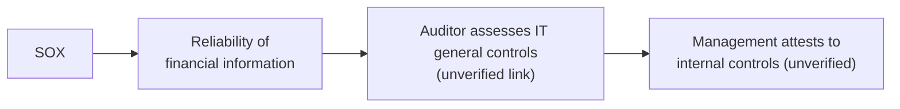
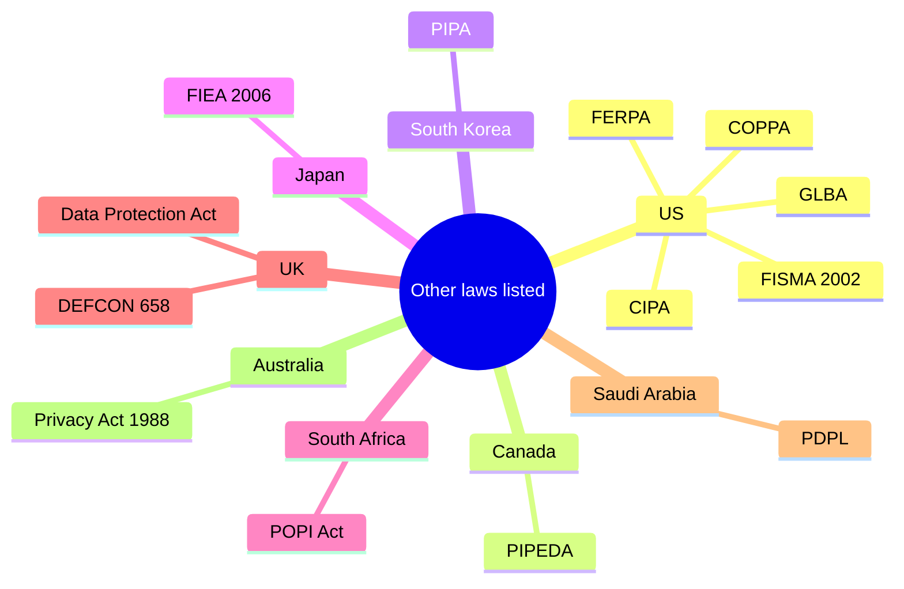

# 2.1 Laws, Regulations and Industry Standards - Diagrams

[← Domain 2](../README.md) | [Study notes](../Study-Notes/2.1-Study-Notes.md)

Markers: 📓 in my notes, ⭐ frequently tested, ➕ unverified. Items marked "(unverified)" carry a Check flag in the study notes.

### Section map

### 2.1 Opening principles

⭐ Specific legislation is not tested; how to audit for compliance may be.

<b>Key points</b>

- Governance must consider laws of its location and industry.
- Laws touch every stage of the data life cycle.
- Laws evolve; the IS auditor must stay current.
- Management may accept noncompliance risk (unverified); the auditor reports it.

<b>Exam traps</b>

- Choosing an answer because it names a famous law is usually wrong.
- Memorizing statute numbers or penalties has no exam value.
- Know concepts and audit steps, not specific laws.

### 2.1.1 Impact of laws, regulations and standards on IS audit

| Element | Auditor looks for |
|---|---|
| Standards and procedures | Rules reducing risk of criminal activity |
| Senior responsibility | Named senior manager owns compliance |
| Reliable staff | Background checks before authority roles |
| Communication | Training or documentation |
| Monitoring and auditing | Reasonable monitoring and reporting |
| Consistent enforcement | Fair disciplinary action |
| Response and prevention | Report offenses, prevent repeats |

<b>Definitions</b>

- Statutory requirements: duties written into law by a legislature.
- Regulatory requirements: rules issued by an authority under a law.
- Industry standards: agreed practices, often contractual.
- GEIT, EGIT, governance of IT and ITG mean the same.
- UNCTAD Global Cyberlaw Tracker: first global mapping of cyberlaws.
- Tracker topics: e-transactions, consumer protection, data protection, cybercrime.
- Tracker covers 194 UNCTAD member states.

<b>Exam traps</b>

- Identify and document requirements before testing controls.
- Vendor assurance alone leaves contract coverage unverified.
- Outsourcing does not transfer legal accountability.
- Written policy without training or enforcement is insufficient.
- Background checks come before authority roles, not after an incident.

<b>Example</b>

- A retailer in three countries follows three data-protection regimes.
- Discipline applied only to junior staff breaks consistent enforcement.

### 2.1.2 Governance, Risk and Compliance (GRC)

| GRC focus | Purpose |
|---|---|
| Financial GRC | Proper financial processes, SOX compliance |
| IT GRC | Proper IT operation and policy compliance |
| Legal GRC | Regulatory compliance for location and industry |

<b>Definitions</b>

- OCEG coined the term GRC.
- GRC: reliably achieve objectives, address uncertainty, act with integrity.
- OCEG outcome: "Principled Performance".
- Assurance processes cannot work well in silos.

<b>Exam traps</b>

- GRC integrates; it does not replace independent audit.
- Separate tools per department contradict the silo-removal purpose.
- Auditors may leverage other functions' work to reduce duplicate testing.

### 2.1.3 Specific laws and standards (reference only)

| Law or standard | What it is | Note |
|---|---|---|
| SOX 2002 📓 | US law against fraudulent financial reporting | US public companies |
| SOX section 302 📓 | Officers certify reports | (unverified) not in manual |
| SOX section 404 📓 | Internal control assessment | (unverified) not in manual |
| GDPR ➕ | EU data protection law, global reach | Applies to EU individuals' data |
| HIPAA ➕ | US health information law | Listed in manual |
| PCI DSS ➕ | Payment card security standard | (unverified) not in 2.1; not a law |
| Basel Accords | International banking supervision | (unverified) manual covers it in 2.2 |

<b>Exam traps</b>

- SOX concerns financial information reliability, not general privacy.
- SOX does not apply to private non-listed firms by default.
- PCI DSS is a standard, not a law.
- These laws show that laws are local; they are not exam content.

<b>Example</b>

- A CFO signs a quarterly report after testing ledger access controls.

### Quick recall

| Fact | Detail |
|---|---|
| ⭐ Specific laws not tested | Audit method for compliance is |
| ⭐ Audit order | Identify, document, then test adherence |
| ⭐ Extraterritorial | Follows data subjects, not head office |
| Three drivers | Privacy, intellectual property, financial reliability |
| Data life cycle | Receipt to destruction, six stages |
| IIA | Seven program elements |
| GRC | Governance, risk, compliance unified |
| Outsourcing | Legal accountability stays with enterprise |
