# 2.10 IT Performance Monitoring and Reporting - Diagrams

[← Domain 2](../README.md) | [Study notes](../Study-Notes/2.10-Study-Notes.md)

Markers: 📓 in my notes, ⭐ frequently tested, ➕ unverified (not in manual), ⚠ Check = flagged in study notes.

## Section map

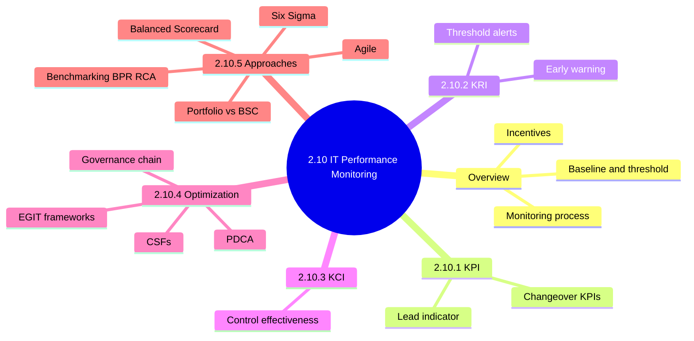

### 2.10 Overview: why measure IT performance

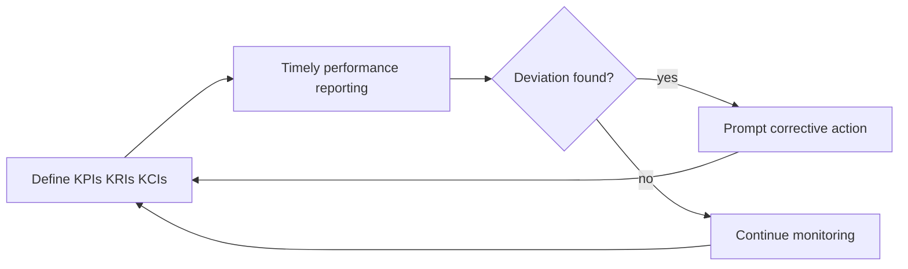

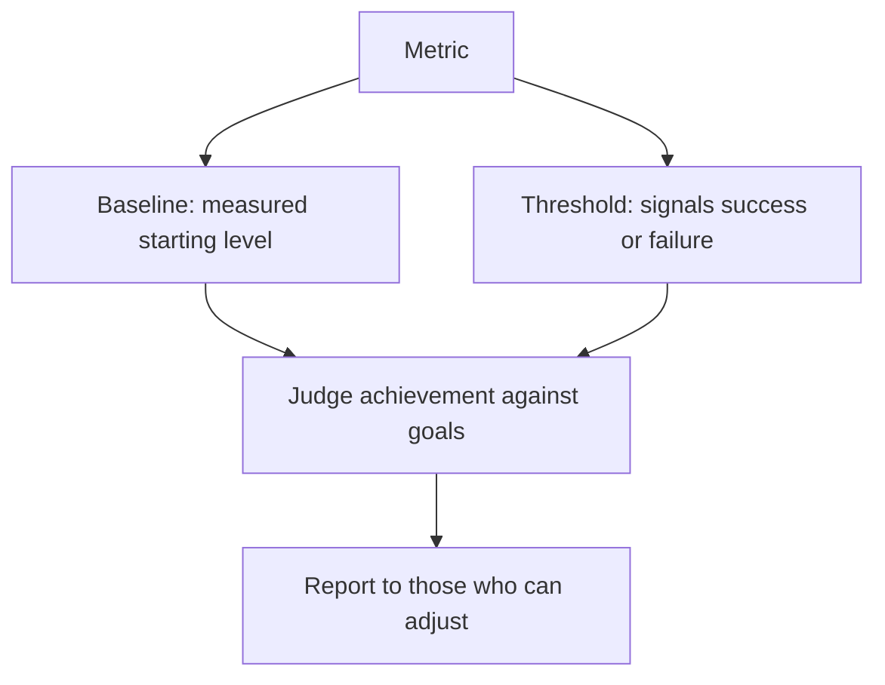

<b>Definitions</b>

- Measurement may be statutory or contractual.
- Outcome measures show business value and competitive advantage.
- Incentives link rewards to performance measures.
- Share results with employees, customers and stakeholders.
- Baseline is the starting level; threshold marks success or failure.

<b>Exam traps</b>

- A metric without baseline or target cannot show success.
- Reporting without action on deviations is a monitoring weakness.
- Badly chosen incentives can drive gaming of results.

<b>Example</b>

- Help-desk baseline is 8 hours; threshold is 6 hours.
- Outsourcing contract requires monthly uptime reports from vendor.

### 2.10.1 Key Performance Indicators (KPI) 📓

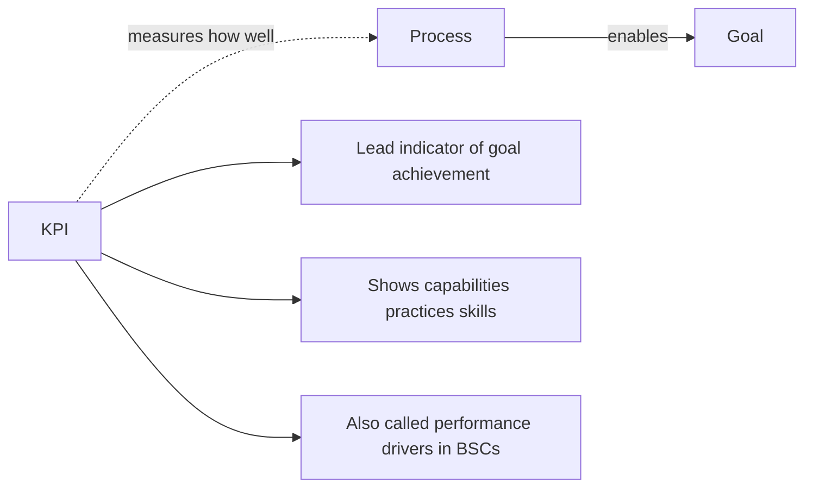

| Changeover KPI example | Meaning |
|---|---|
| Percentage of errors | Quality of the change |
| Number of trouble reports | Post-change problems |
| Duration of system outage | Disruption caused |
| Customer satisfaction | User acceptance |

<b>Definitions</b>

- KPI measures how well a process enables a goal.
- Control criteria are often based on KPIs.
- Example: employee satisfaction with IT services.

<b>Exam traps</b>

- KPIs measure process performance; they do not forecast threats.
- Threat-warning indicators belong to KRIs.
- ⚠ Check: manual calls KPIs lead indicators; KGIs not covered here.

### 2.10.2 Key Risk Indicators (KRI)

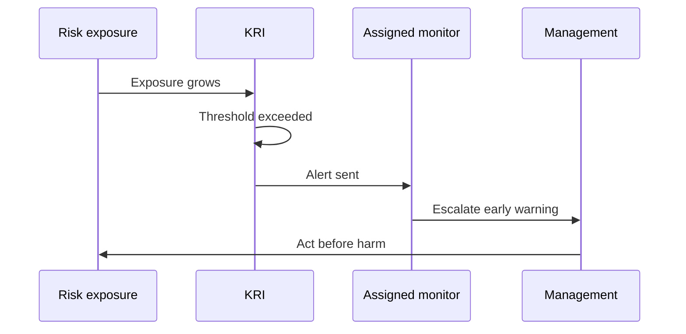

<b>Definitions and example</b>

- KRI warns of growing exposure to risk events.
- Example: percentage increase in phishing attempts.
- Threshold triggers alerts to assigned monitors.

<b>Exam traps</b>

- KRI is forward-looking exposure; KCI is control effectiveness.
- A KRI without an assigned owner gives no real warning.

### 2.10.3 Key Control Indicators (KCI)

| Indicator | Question answered | Example |
|---|---|---|
| KPI | Is the process enabling the goal? | Employee satisfaction with IT |
| KRI | Is risk exposure rising? | Phishing attempts up |
| KCI | Is the control reducing risk? | Assets compliant with policy |

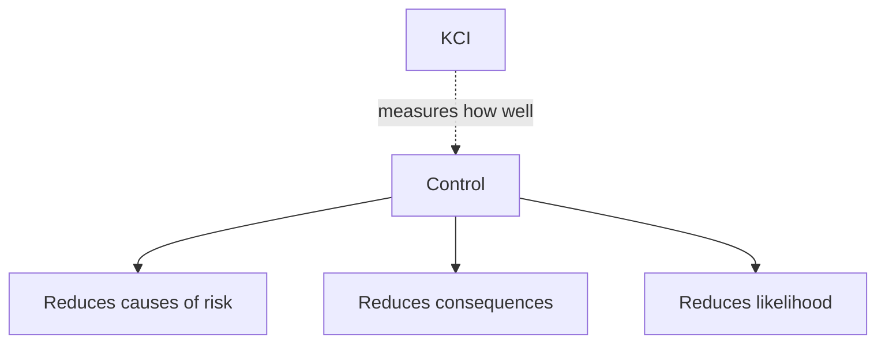

<b>Exam traps</b>

- Compliance percentage of controls is a KCI, not a KPI.
- Do not confuse KCI control works with KRI risk rising.

#### Developing metrics

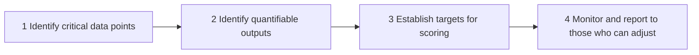

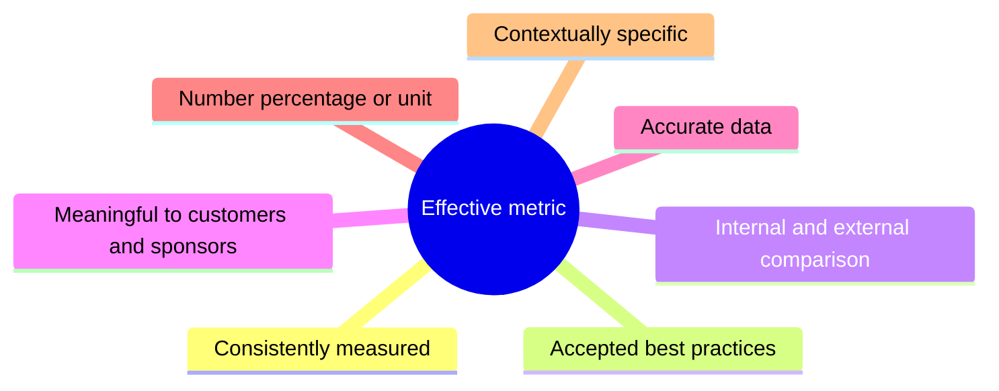

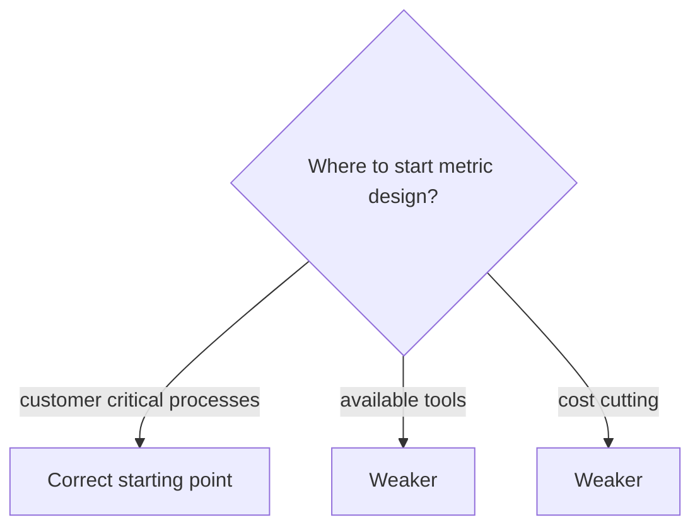

<b>What the auditor checks metrics cover</b>

- Long-term organizational objectives.
- Short-term business and IT plan performance.
- Risk and regulatory compliance.
- Internal and external user satisfaction.
- IT processes, solution and service delivery.
- Future-oriented activities.
- Continuous monitoring of performance and capacity of IT resources.

<b>Exam traps</b>

- Start from customer-critical processes ⭐📓.
- ⚠ Check: starting-point rule comes from my notes, not the manual 2.10 text.
- Financial-only metrics miss users, processes and future readiness.

### 2.10.4 Performance optimization

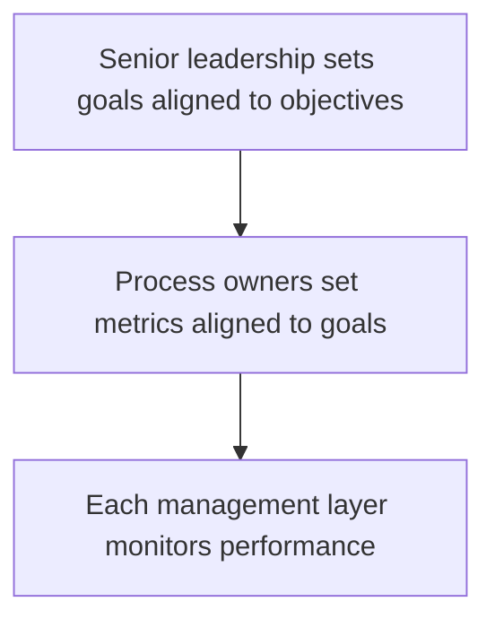

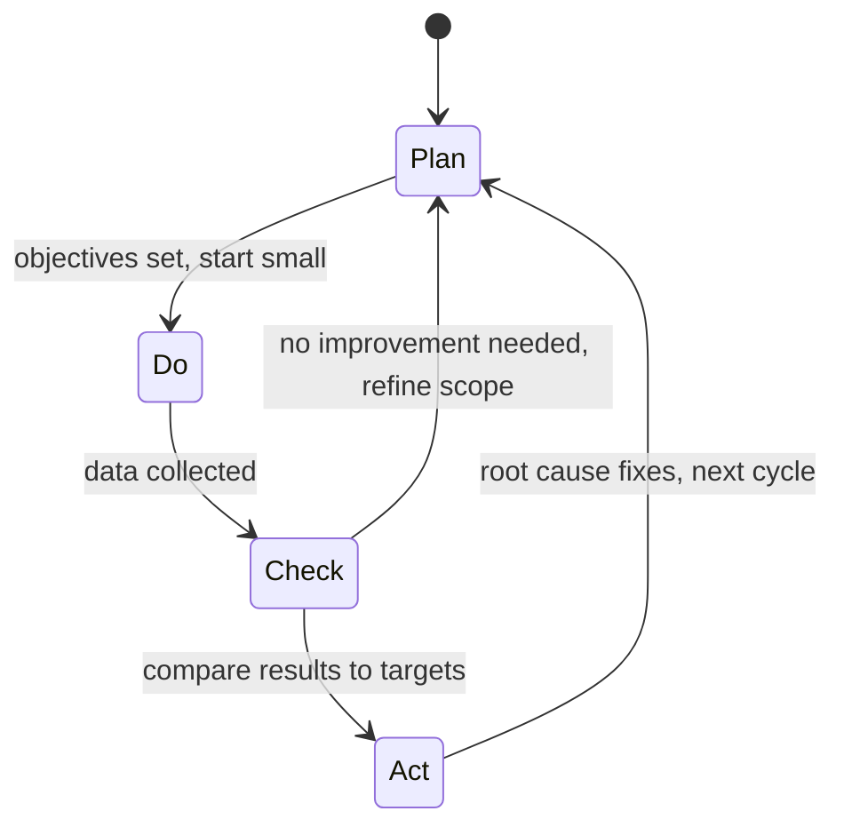

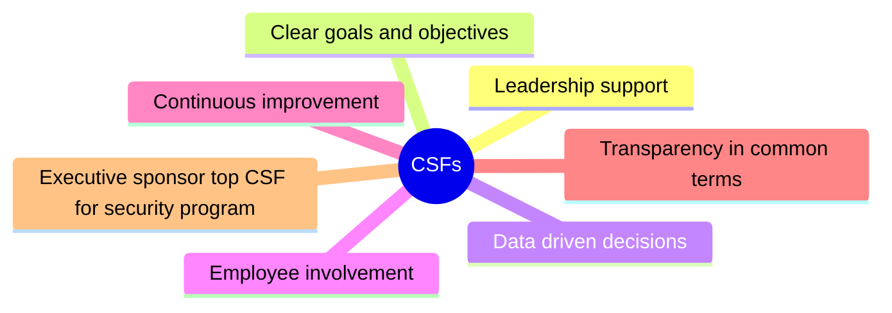

| Framework | Purpose |
|---|---|
| COBIT | Align IT with business, manage IT risk |
| ISO/IEC 27000 | Information security programs |
| ITIL | Operational IT service management |
| O-ISM3 | Security management maturity model |
| ISO/IEC 38500 | Governing bodies on use of IT |
| ISO/IEC 20000 | Service management, aligned with ITIL |
| ISO 31000 | Risk management guidelines |

<b>Definitions</b>

- Performance: how well a system works, including satisfaction.
- Optimization: better efficiency at minimal added investment.
- Measures are not used to assign accountability or meet reporting duties.
- PDCA with agile reassesses direction through sprints.
- Agile is iterative and incremental; waterfall is a single pass.

<b>Exam traps</b>

- Executive sponsor is top CSF for a security program ⭐📓.
- ⚠ Check: manual lists leadership support, not executive sponsor by name.
- Goals come from leadership; process owners set metrics.
- Corrective action without root cause analysis is weak.
- Data collection is Do; comparison with targets is Check.
- Match framework to purpose: security 27000, service 20000, governance 38500, risk 31000.

### 2.10.5 Approaches and techniques

#### Six Sigma

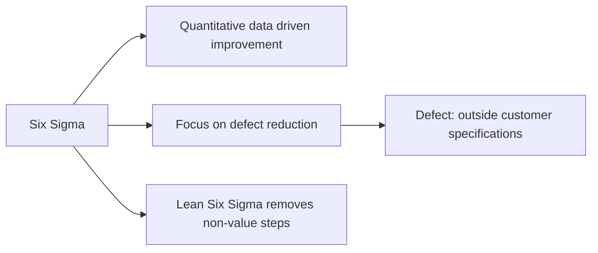

#### Agile

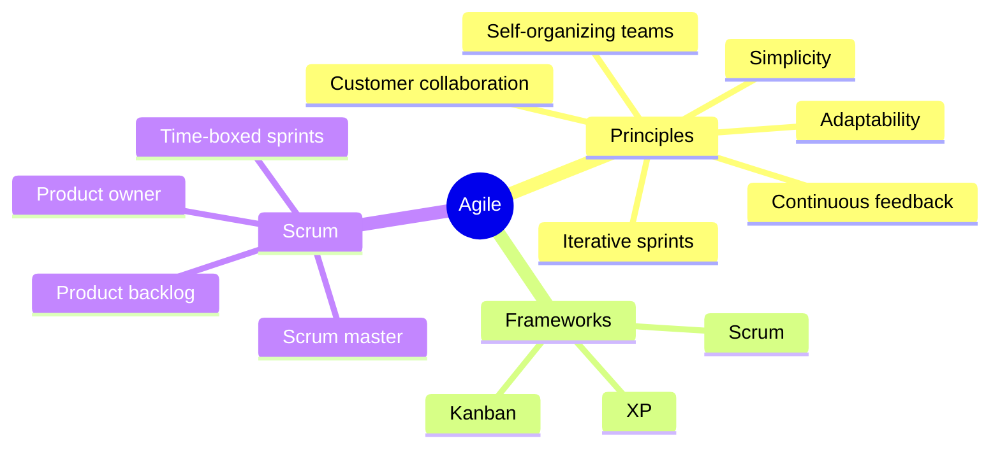

<b>Six Sigma and Agile traps</b>

- Agile does not mean no documentation or controls.
- Waterfall is a single pass; agile revisits each aspect.
- Example: login feature in two weeks, then add MFA.

#### IT Balanced Scorecard 📓⭐

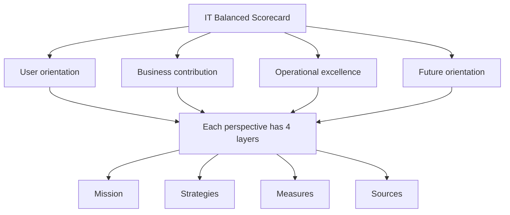

| Perspective | Focus | Memory aid |
|---|---|---|
| User orientation | End user view of IT | How users view IT (unverified) |
| Business contribution | Business value of IT investments | How management views the organization (unverified) |
| Operational excellence | Processes that deliver IT resources | None |
| Future orientation | Resources needed for future delivery | Is IT positioned for future needs (unverified) |

| Layer | Examples |
|---|---|
| Mission | Preferred supplier, economic IT services |
| Strategies | User partnerships, control IT expenses, staff training |
| Measures | KPIs, KRIs as early warning, KCIs for controls |
| Sources | End-user personnel, COO, process owners |

<b>BSC objectives and traps</b>

- Vehicle for management reporting to the board.
- Fosters stakeholder consensus on strategic aims.
- Shows effectiveness and added value of IT.
- Aids IT strategy committee in alignment.
- Primary benefit: align IT objectives and metrics with strategy.
- It does not calculate exact ROI or replace financial reporting.
- ⚠ Check: the "Asks" phrasings are not manual wording.

#### IT portfolio management vs BSC

| Aspect | Portfolio management | Balanced Scorecard |
|---|---|---|
| Strength | Agility adjusting investments | Operationalizes strategic plan |
| Feedback loop | Whole program investment | Tied to strategic planning |
| Not its goal | None stated | IT value or budget control |

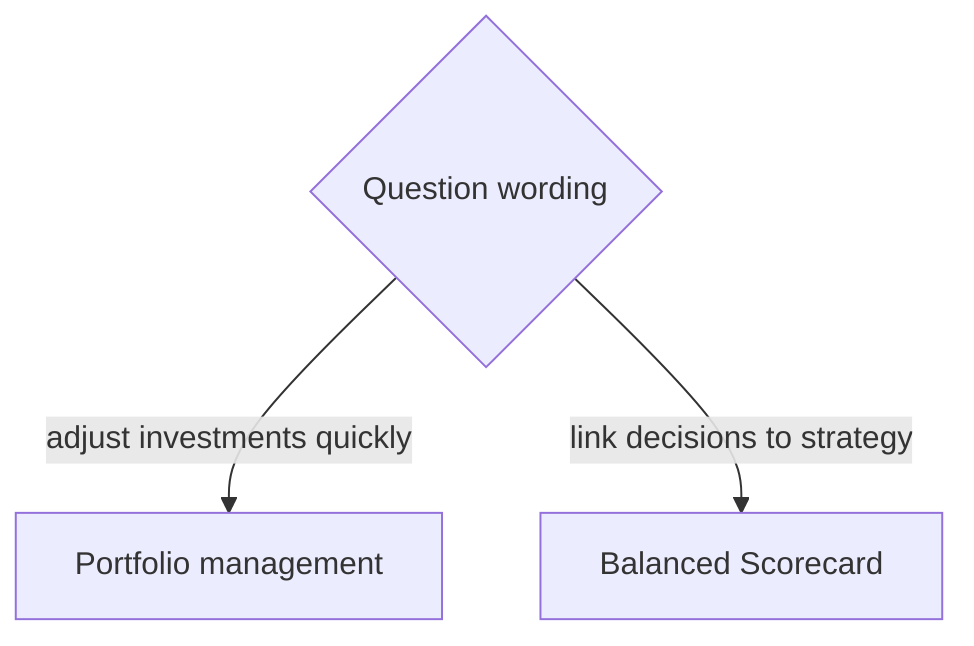

#### Additional approaches

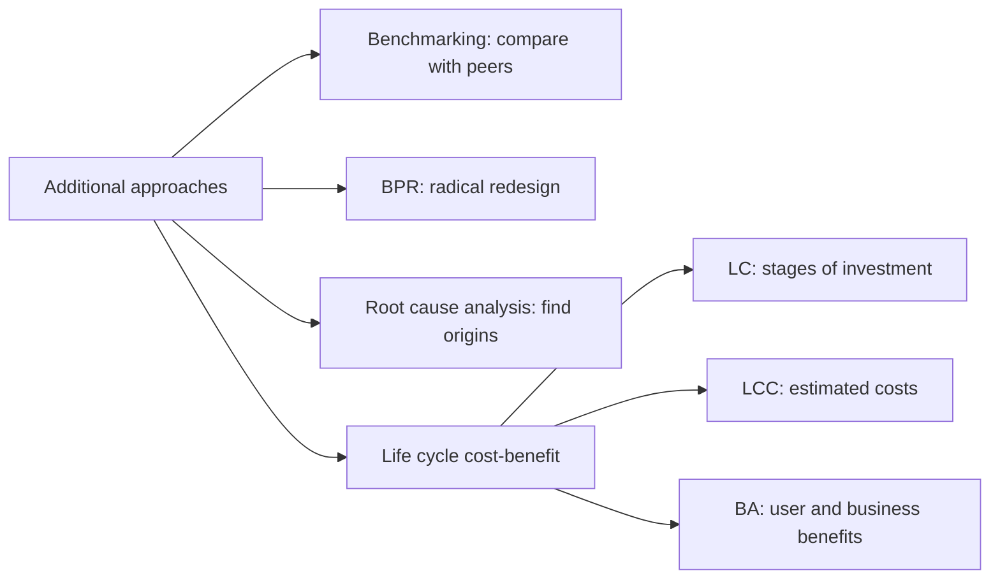

<b>Exam traps</b>

- BPR is radical; incremental tuning is continuous improvement.
- BPR can remove old controls; check replacements.
- Benchmarking is external; root cause analysis explains internal failures.
- Fixing symptoms only means problems recur.

### Quick recall

| Fact | Answer |
|---|---|
| ⭐ Top CSF for security program | Executive sponsor (⚠ Check: from my notes) |
| ⭐ Start metrics with | Customer-critical processes (⚠ Check) |
| ⭐ BSC perspectives | User, business, operational, future |
| KPI | Process enables goal, lead indicator |
| KRI | Early warning of risk exposure |
| KCI | Control reduces risk |
| Metric needs | Baseline, threshold, reporting owner |
| PDCA | Plan, Do, Check, Act on root causes |
| Portfolio vs BSC | Adjust investments vs operationalize strategy |
