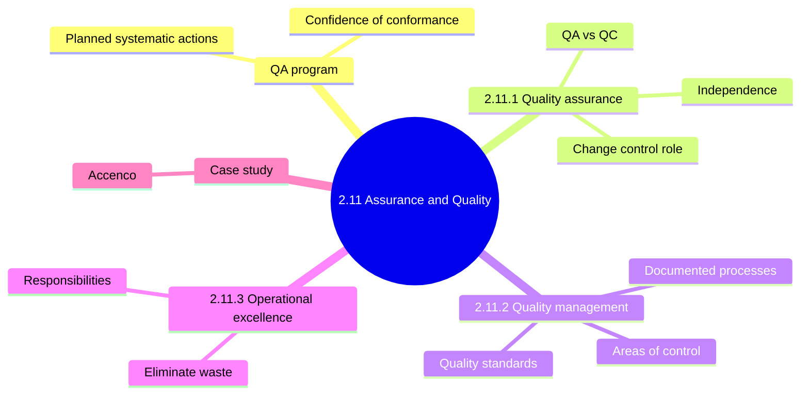
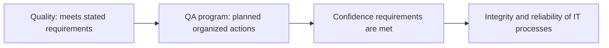
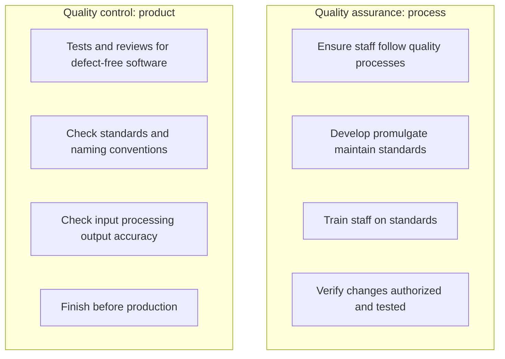
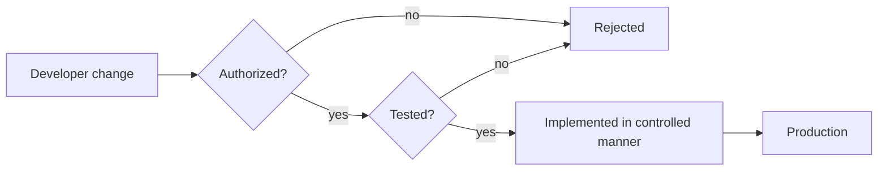
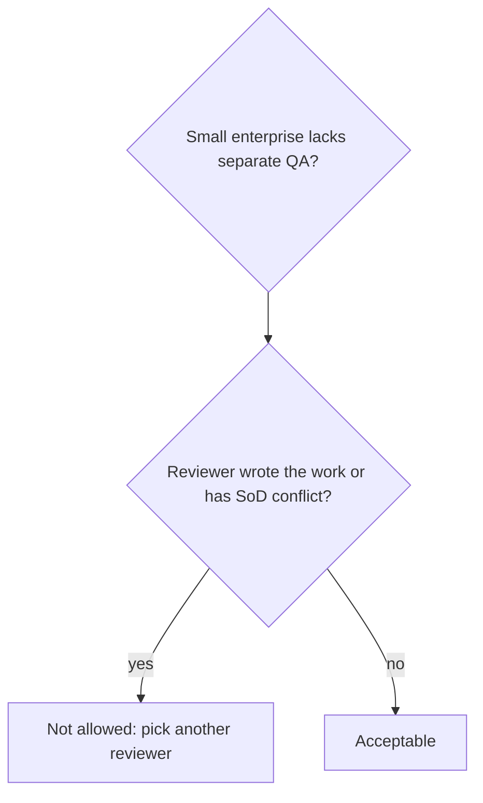
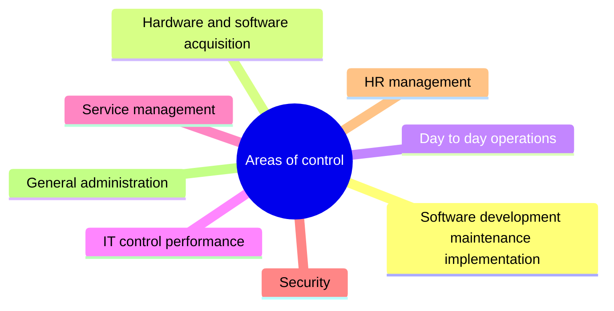
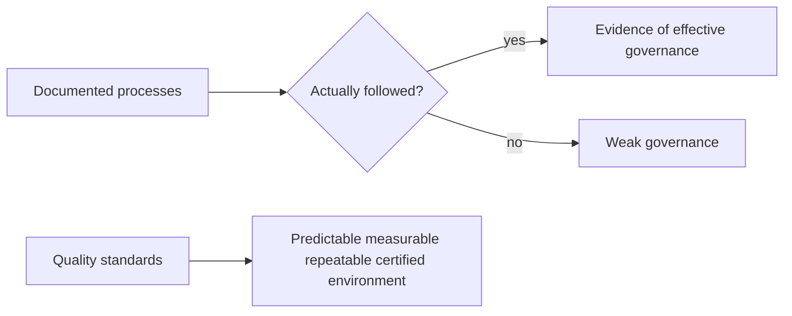
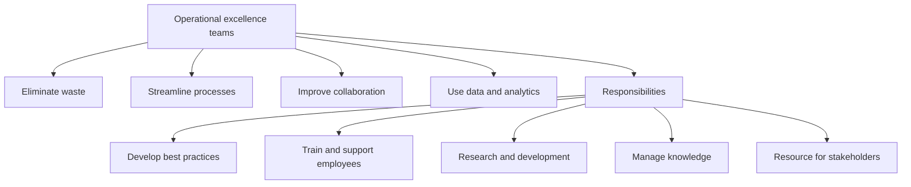

# 2.11 Assurance and Quality Management of IT - Diagrams

[← Domain 2](../README.md) | [Study notes](../Study-Notes/2.11-Study-Notes.md)

Markers: ⚠ Check = flagged in study notes. No 📓, ⭐ or ➕ marks exist in this outline.

## Section map

### 2.11 Introduction: QA program

<b>Definitions</b>

- QA program gives confidence of conformance to requirements.
- IS auditor must understand QA concepts, structures, roles and responsibilities.
- Example: bank requires tested, approved changes before every release.

<b>Exam traps</b>

- ⚠ Check: my notes cover audit QA in 1.10, not IT QA.
- Do not mix audit QA program with IT department QA function.

### 2.11.1 Quality assurance

| Aspect | QA | QC |
|---|---|---|
| Focus | Process and standards | Product testing and review |
| Example | ISO 9001 compliant procedures | Naming convention checks |
| Timing | Ongoing | Before production |

<b>Definitions</b>

- QA: planned systematic actions giving confidence requirements will be met.
- QC: observation techniques and activities to meet quality requirements.
- Source code tools track versions and control who changes code.
- QA oversees developer segregation from production and source code integrity.
- Segregation of duties: no one person controls a whole process.

<b>Exam traps</b>

- QA tests the software: wrong, testing is QC.
- QC sets enterprise standards: wrong, QA maintains standards.
- QC may happen after go-live: wrong, it precedes production.
- Small firm lets author review own work: wrong.
- DBA reviewing database-impacting changes creates a conflict.
- ⚠ Check: QA/QC split is a memory aid; QC also checks processing accuracy.

<b>Example</b>

- Hotfix reaches production with no test record: a QA failure.
- Small enterprise: one person holds multiple roles but never self-reviews.

### 2.11.2 Quality management

<b>Definitions</b>

- Quality management: how IT processes are controlled, measured, improved.
- Area list says may include, so it is illustrative.
- Use the list as a scoping checklist for quality reviews.

<b>Exam traps</b>

- Quality management covers only software development: wrong, list is wider.
- Certification proves controls work: wrong, test operating effectiveness.
- Documents alone do not show governance.
- ⚠ Check: only ISO 9001 named in manual; other standards unverified.

### 2.11.3 Operational excellence

<b>Exam traps</b>

- Targets efficiency and waste, not compliance checking.
- It complements QA and QC; it does not replace them.
- Cost cutting never justifies removing needed controls.
- Improvement must not weaken segregation of duties.

<b>Example</b>

- Analytics show slow approval step; team removes a redundant sign-off.

### Case study: Accenco (stem summary only)

| Observation | Concern |
|---|---|
| Risk committee met three times in two years | No minutes kept |
| IT initiatives missing from budget | Strategy and budget misaligned |
| No full-time CIO | IS manager reports to CFO |
| Programmers need only DBA approval for production data | Segregation of duties weak |
| Programmers give code to librarian for migration | Change path to review |
| Internal audit reports to CFO | Independence question |

<b>Notes</b>

- Accenco is a small, fast-growing financial institution.
- Answers omitted; manual answer key not summarized.
- Concerns column is my reading, not manual answers.

### Quick recall

| Fact | Answer |
|---|---|
| QA | Builds confidence in process |
| QC | Tests the product before production |
| Independence | Nobody reviews own work |
| SoD example | DBA must not review database changes |
| Quality management | Controlled, measured, improved IT processes |
| Governance evidence | Documented and followed processes |
| Operational excellence | Reduces waste, keeps controls |
| Standards owner | QA develops and maintains standards |
