# 2.2 Organizational Structure, IT Governance and IT Strategy: Diagrams

[← Domain 2](../README.md) | [Study notes](../Study-Notes/2.2-Study-Notes.md)

Markers: 📓 in my notes, ⭐ frequently tested, ➕ unverified in the manual, "(unverified)" in a label means the same.

## Section map

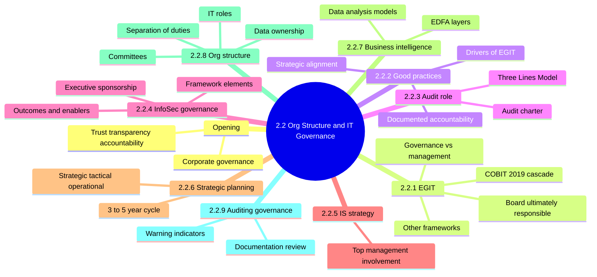

### Opening: Corporate governance basics

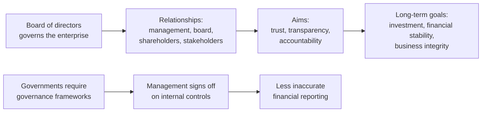

<details>
<summary><b>Definitions and example</b></summary>

- Corporate governance: system by which an enterprise is directed and controlled.
- Auditors test whether direction and control operate as designed.
- Example: a CFO certifies controls over financial reporting each year.

</details>

### 2.2.1 Enterprise Governance of Information and Technology (EGIT)

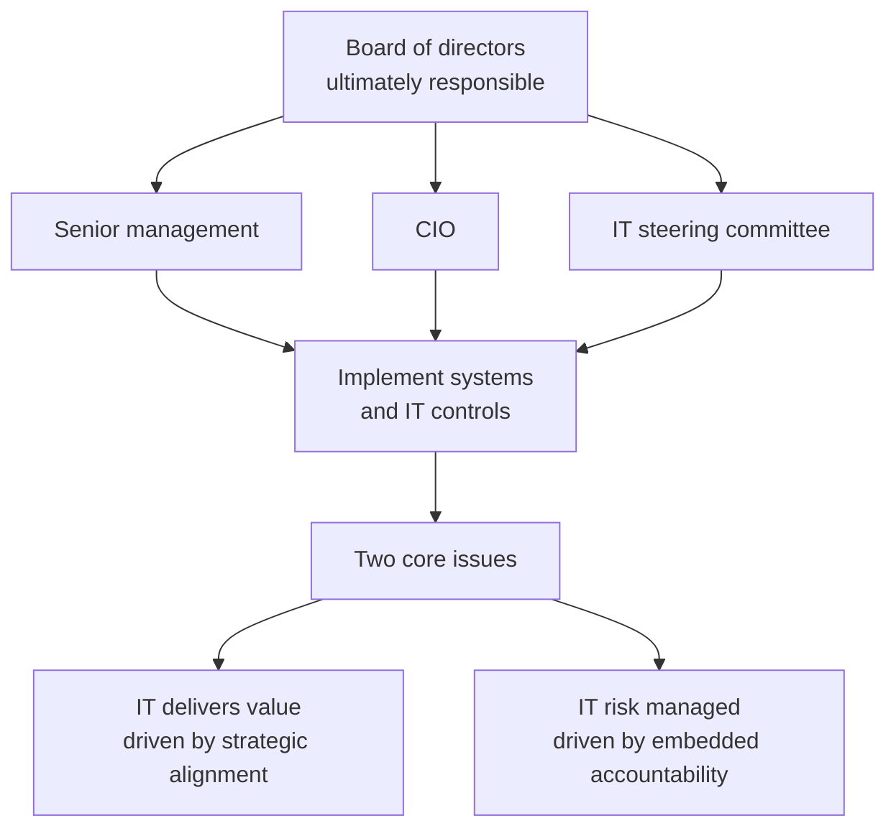

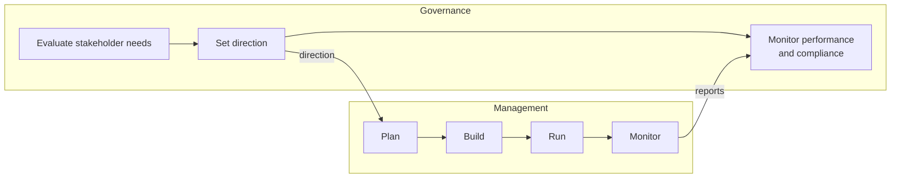

COBIT 2019 goals cascade 📓 (the cascade itself is from my notes, not the manual text, so treat as unverified):

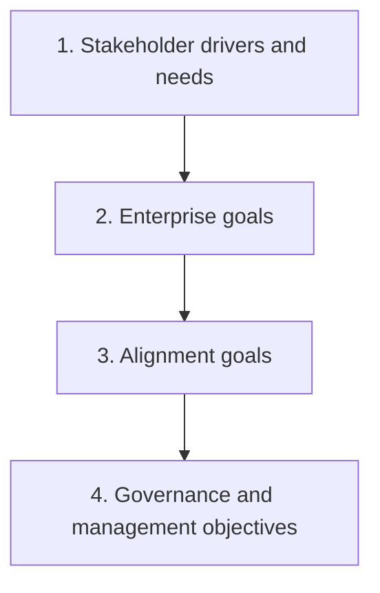

COBIT domains (unverified, ➕):

| Domain | Meaning | Type |
|---|---|---|
| EDM ➕ | Evaluate, Direct and Monitor | Governance |
| APO ➕ | Align, Plan and Organize | Management |
| BAI ➕ | Build, Acquire and Implement | Management |
| DSS ➕ | Deliver, Service and Support | Management |
| MEA ➕ | Monitor, Evaluate and Assess | Management |

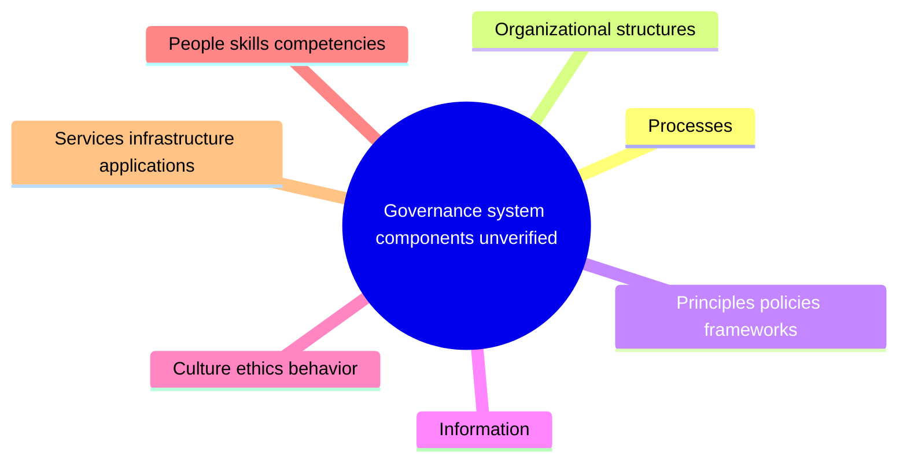

| Framework | Focus |
|---|---|
| ISO/IEC 38500 ➕ | Principles for governing bodies on IT use |
| ISO/IEC 27000 series | Information security program practices |
| ITIL | Operational IT service management |
| O-ISM3 | Process-based security maturity model |
| ISO/IEC 20000 | Service management specification aligned with ITIL |
| ISO 31000:2018 | Risk management guidelines |

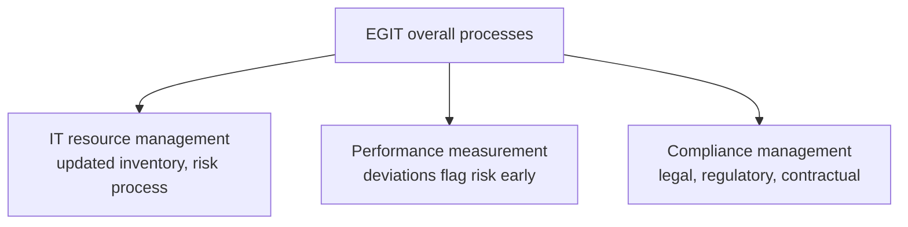

<details>
<summary><b>Exam traps</b></summary>

- ⭐ Board is ultimately responsible for IT governance, not IT staff.
- Setting direction is governance; executing and operating is management.
- Value balances benefits, risk and resources.
- Cascade starts with stakeholder needs, never technology choices.
- ISO/IEC 38500 targets governing bodies, not technical staff.
- ITIL and ISO/IEC 20000 cover service operations, not board oversight.

</details>

<details>
<summary><b>Definitions and example</b></summary>

- EGIT: stewardship of IT resources for all stakeholders.
- Stakeholders: board, management, internal customers, finance.
- Strategic alignment: IT goals and investments serve business goals.
- Example: shareholders expect IT spending to deliver promised returns.
- Other frameworks are listed near 2.10 in the manual (check).

</details>

### 2.2.2 Good practices for EGIT

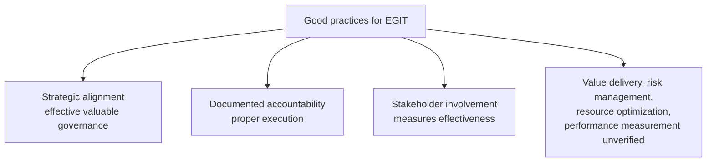

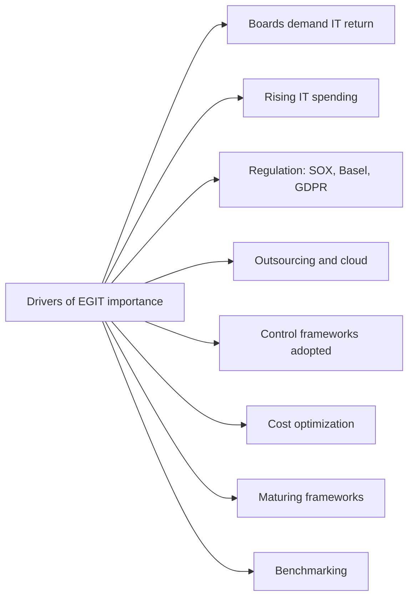

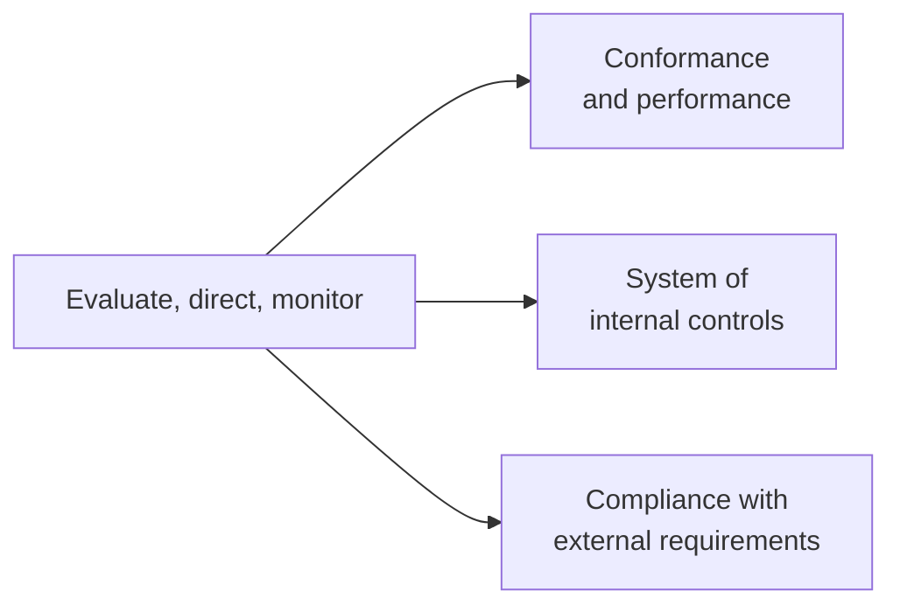

<details>
<summary><b>Exam traps</b></summary>

- ⭐ Strategic alignment is the key driver of effective governance.
- Best proof of effectiveness is stakeholder involvement, not tool purchases.
- Budget, documentation and technology are enablers, not the main driver.
- Best single step to improve alignment: top management involvement.

</details>

### 2.2.3 Audit's role in EGIT

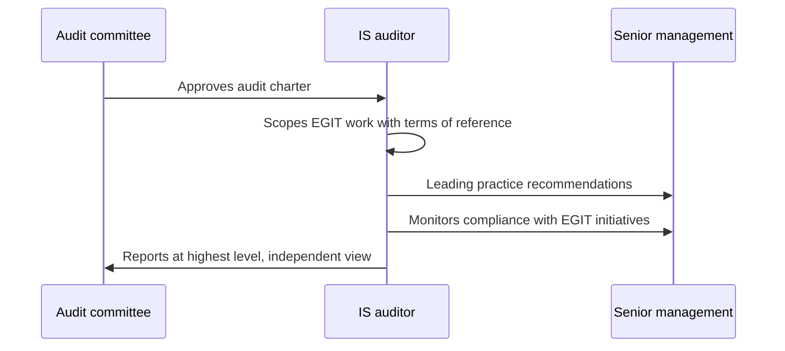

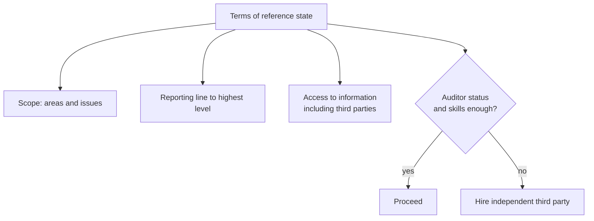

Three Lines Model (IIA):

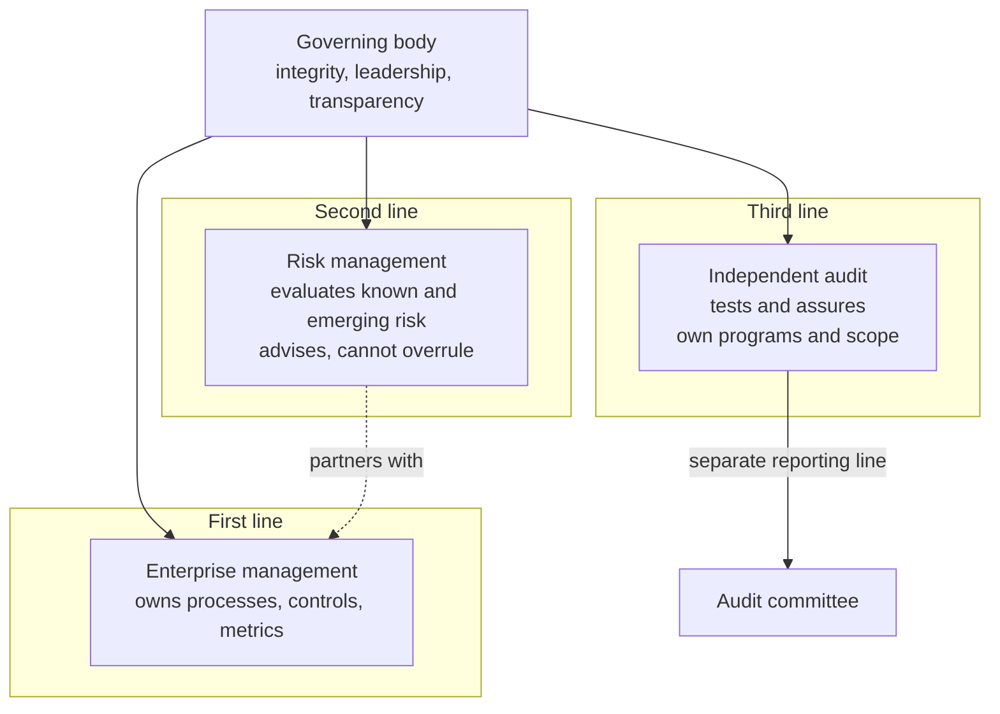

| Line | Role | Key point |
|---|---|---|
| First | Management | Owns controls, never auditors |
| Second | Risk management | May advise, not overrule management |
| Third | Internal audit | Independent, reports to audit committee |

<details>
<summary><b>Aspects the IS auditor assesses</b></summary>

- Alignment of enterprise governance and EGIT.
- Alignment of IT with mission, vision, values, objectives, strategies.
- Performance objectives: effectiveness and efficiency.
- Legal, environmental, information quality, fiduciary, security, privacy requirements.
- Control environment and inherent risk in the IS environment.
- IT investment and expenditure.

</details>

<details>
<summary><b>Exam traps</b></summary>

- Audit committee approves the charter, not IT management.
- Insufficient auditor skill means outside help, not proceeding anyway.
- Independence belongs to the third line.
- Manual wording may still say "lines of defense" (check).

</details>

### 2.2.4 Information security governance

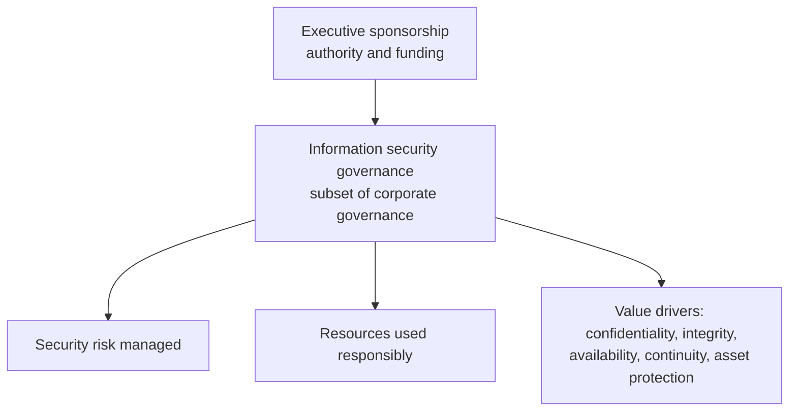

Policy hierarchy within the governance framework:

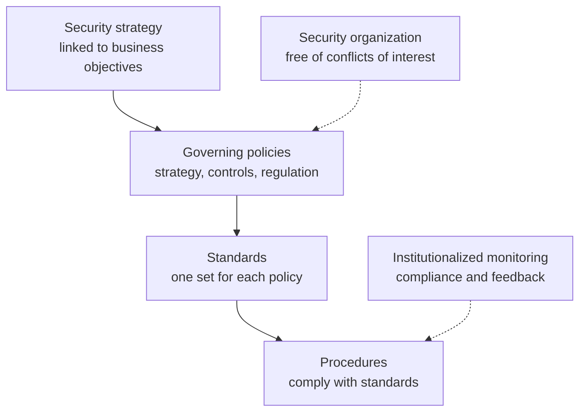

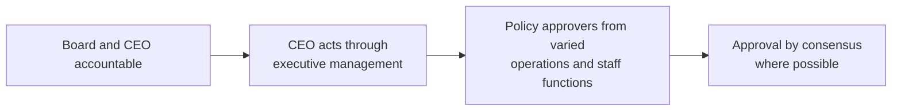

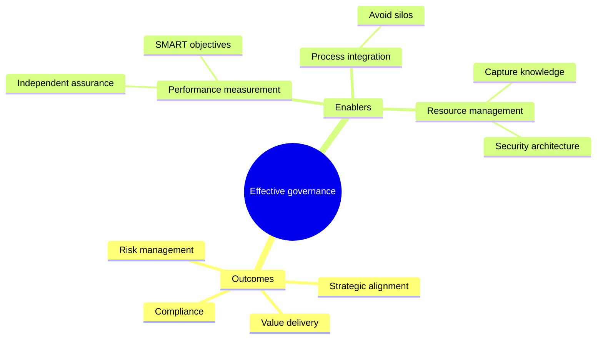

<details>
<summary><b>What executives strive for</b></summary>

- High-quality information for decisions.
- Business value from IT investments.
- Operational excellence.
- IT risk at an acceptable level.
- Optimized IT cost.
- Compliance with laws, contracts, policies.

</details>

<details>
<summary><b>Exam traps and notes</b></summary>

- ⭐ Lack of executive sponsorship is the usual root cause of weak programs.
- Policy approval belongs to senior management, not the security team alone.
- Program scope extends to outsourcing, cloud, onshoring and offshoring.
- SMART: specific, measurable, attainable, realistic, timely.

</details>

### 2.2.5 Information systems strategy

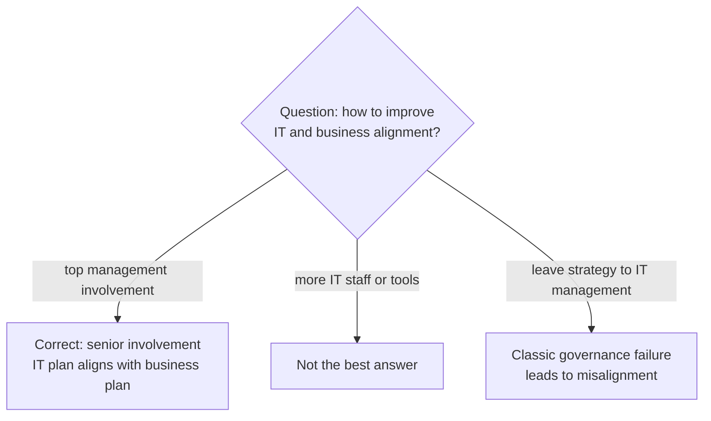

<details>
<summary><b>Key points</b></summary>

- ⭐ IT plans must align with the business plan. 📓
- ⭐ Top management involvement improves alignment. 📓
- Boards cannot leave IS strategy only to functional management.
- Threats: resource abuse, cybercrime, fraud, errors and omissions.
- Example: a retailer's board reviews cloud strategy before approving spend.

</details>

### 2.2.6 Strategic planning

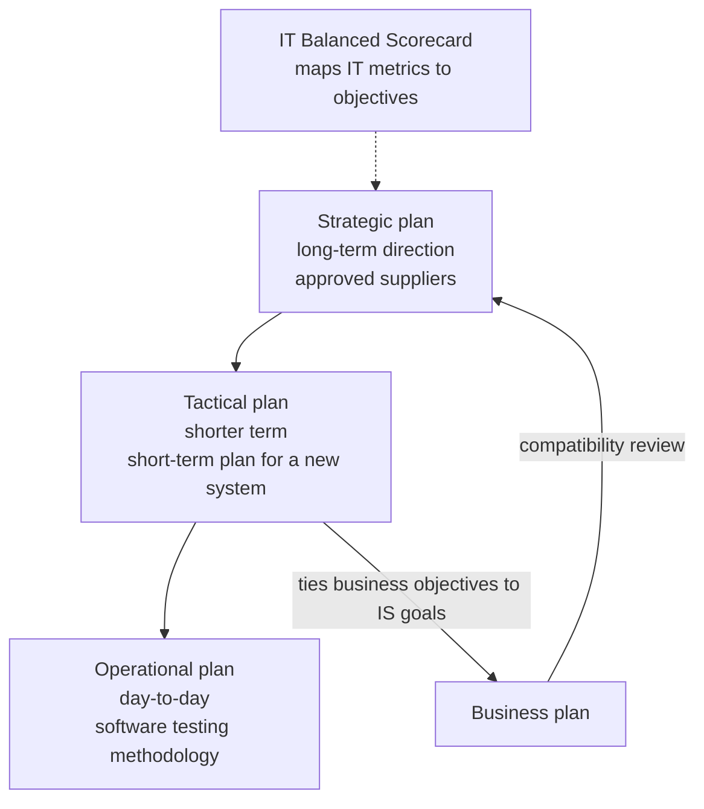

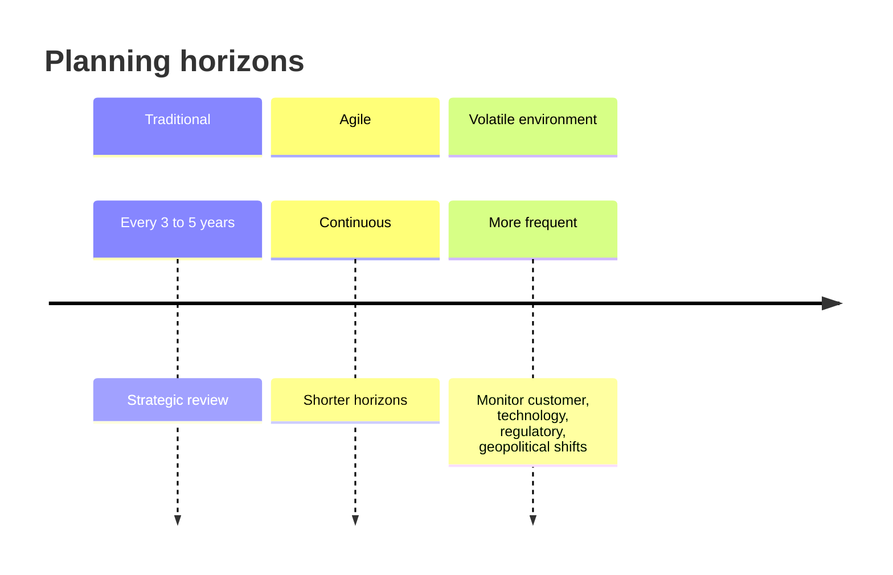

```mermaid
flowchart TD
    A{"Question mentions"} -->|"long-term direction, suppliers"| B["Strategic"]
    A -->|"short-term plan for a new system"| C["Tactical"]
    A -->|"testing methodology, daily work"| D["Operational"]
    A -->|"best alignment test"| E["Business plan compatibility review"]
    A -->|"map IT metrics to business"| F["IT Balanced Scorecard"]
```

```mermaid
flowchart LR
    A["New or revised systems"] --> B["Strategic intentions<br/>and needed capabilities"]
    A --> C["Review portfolio:<br/>fit, cost, risk"]
    A --> D["Assess IT capacity"]
    A --> E["ROI and legacy<br/>decommissioning"]
    A --> F["Maintenance cost vs<br/>new initiative cost"]
```

<details>
<summary><b>Audit considerations</b></summary>

- Check a strategic planning process or framework exists.
- Check how operational, tactical and development plans feed IT strategy.
- Check plan contents, updating, communication and monitoring.
- Check how CIO or senior IT shapes business strategy.
- Weak IT involvement in business strategy risks misalignment.

</details>

<details>
<summary><b>Exam traps</b></summary>

- ⭐ IT needs both long- and short-term plans.
- Short-range plan review: tie business objectives to IS goals.
- Software testing methodology: your note says tactical, source says operational (check).
- Balanced scorecard and enterprise architecture belong to 2.10 and 2.4 in the manual.
- Biggest risk of weak top management support is misalignment.

</details>

### 2.2.7 Business intelligence

```mermaid
flowchart TD
    A["Data sources<br/>operational, external, nonoperational"] --> B["Data staging and quality<br/>copy, transform, check, load"]
    B --> C["Core data warehouse<br/>normalized relational"]
    C --> D["Data preparation<br/>precalculate OLAP, mining"]
    D --> E["Data mart<br/>subset per business unit"]
    E --> F["Presentation layer<br/>spreadsheets, BSCs, dashboards"]
    M["Metadata repository<br/>data about data, rules"] -.-> B
    W["Warehouse management<br/>schedules and security"] -.-> C
    X["Application messaging<br/>data and control messages"] -.-> D
```

| EDFA layer | Purpose |
|---|---|
| Presentation/desktop access | Spreadsheets, direct queries, BSCs, dashboards |
| Data source | Operational, external, nonoperational data |
| Core data warehouse | Normalized relational data for reporting |
| Data mart | Subset per business unit, relational or OLAP cube |
| Data staging and quality | Only reliable data is loaded |
| Data access | Hides source organization |
| Data preparation | Assembles marts, precalculates OLAP |
| Indexing layer ➕ | Appears in figure 2.3, not described |
| Metadata repository | Business context, transformation and validation rules |
| Warehouse management | Schedules build, administers security |
| Application messaging | Transports data and control messages |
| Internet/intranet | Browser UI, TCP/IP networking |

```mermaid
flowchart LR
    A["Data architecture"] --> B["EDFA<br/>enterprise data flow"]
    A --> C["Logical data architecture<br/>built by business domain"]
    C --> D["Seek most granular<br/>atomic data"]
```

| Data analysis model | Shows |
|---|---|
| Context diagram | Major processes and external parties |
| Activity or swim-lane diagram | Deconstructed processes |
| Entity relationship diagram | Data entities and relations |

<details>
<summary><b>BI benefits, measures, drivers</b></summary>

- Benefits: trends, customer behavior, performance, better decisions.
- Measures: process cost, efficiency, quality, customer satisfaction.
- Measures: customer profitability, KPI achievement, unusual transactions and losses.
- Drivers: enterprise size, competitive advantage, legal reporting.
- Data lake ➕: not covered in manual 2.2.7 (unverified).
- ETL ➕: manual describes this as staging (unverified).

</details>

<details>
<summary><b>Exam traps</b></summary>

- Quality checks occur at staging; only reliable data reaches the warehouse.
- Metadata describes data, not business results.
- Seek atomic data because summarizing loses attributes.
- "Ad hoc queries" wording is unverified; manual says direct querying.

</details>

### 2.2.8 Organizational structure

```mermaid
flowchart TD
    B["Board of directors"] --> SC["IT strategy committee<br/>board level"]
    SC -->|"advises board on strategy"| B
    B --> EM["Executive and senior management"]
    EM --> ST["IT steering committee<br/>management level, implementation"]
    ST --> PR["Project teams and IT delivery"]
    ST -->|"reports on IS activities"| B
```

| Feature | IT strategy committee | IT steering committee |
|---|---|---|
| Level | Board | Management (manual says executive, check) |
| Focus | Current and future strategy | Implementation |
| Members | Board members and non-board specialists | Sponsor, business executives, CIO, advisors |
| Role | Advises board on alignment, risk, return | Approves projects, budgets, priorities |
| Output | Prepares strategy approval | Monitors value, time, budget |

```mermaid
flowchart TD
    A["Steering committee duties"] --> B["Review long and short range IT plans"]
    A --> C["Approve major hardware and software"]
    A --> D["Approve and monitor projects and budgets"]
    A --> E["Approve sourcing: in, out, offshore"]
    A --> F["Review resource adequacy"]
    A --> G["Decide centralization"]
    A --> H["Support security program"]
    A --> I["Report to board"]
```

```mermaid
flowchart TD
    A{"Question says"} -->|"advise board on IT strategy"| B["IT strategy committee"]
    A -->|"approve projects, monitor budgets"| C["IT steering committee"]
    A -->|"who accepts risk level"| D["Senior business management"]
    A -->|"ultimate IT governance"| E["Board of directors"]
    A -->|"unclear committee name"| F["Judge by function, not title"]
```

```mermaid
flowchart LR
    subgraph RB["Board of directors"]
        B1["Know assets and criticality"]
        B2["Receive risk assessment and BIA"]
        B3["Approve key assets, due care"]
        B4["Tone at the top, enforce penalties"]
    end
    subgraph RS["Senior management"]
        S1["Leadership for security governance"]
        S2["Integrate with process owners"]
    end
    subgraph RC["CISO"]
        C1["Implementable auditable policies"]
        C2["Function may be CIO CTO CFO CEO"]
    end
    RB --> RS --> RC
```

<details>
<summary><b>ISSC and CISO</b></summary>

- ISSC members: C-level, IT, application owners, business owners, operations, HR, audit, legal.
- ISSC deliberates control suitability and secure OS and database configuration.
- Auditor ensures audit trails and logs; legal advises on liability.
- CISO function exists even without the title.
- Legal responsibility ultimately rests with senior management and board.

</details>

<details>
<summary><b>RACI matrix (unverified)</b></summary>

- RACI: responsible, accountable, consulted, informed ➕.
- Manual shows outcomes matrix as figure 2.5 (check).
- Outcomes: alignment, risk, value, resources, performance, process assurance.
- Levels: board, executive management, steering committee, CISO, audit executives.
- Matrix is informational, not specifically tested.

</details>

<details>
<summary><b>Exam traps (committees and governance)</b></summary>

- Strategy committee advises board; steering committee implements and monitors.
- Risk acceptance belongs to business management, not IT, security or audit.
- Board is accountable and liable for the enterprise.

</details>

#### IT organizational structure and data ownership

```mermaid
flowchart TD
    A["IT structure aligns<br/>with business requirements"] --> B["Org chart shows<br/>roles, reporting lines, SoD"]
    B --> C["Job descriptions, RACI,<br/>swimlane diagrams"]
    C --> D{"Formal descriptions match<br/>actual practice?"}
    D -->|"yes"| E["Roles reliable"]
    D -->|"no"| F["Control weakness"]
```

```mermaid
sequenceDiagram
    participant DO as Data owner
    participant SA as Security administrator
    participant DU as Data user
    participant DC as Data custodian
    DU->>DO: Requests access
    DO->>SA: Written authorization
    SA->>DU: Grants and monitors access
    DC->>DC: Stores and safeguards data
    DO->>DO: Reviews access rules regularly
```

| Role | Responsibility |
|---|---|
| Data owner | Classifies data, authorizes access, reviews rules |
| Data custodian | Stores and safeguards data |
| Data user | Uses authorized data, follows guidelines |
| Security administrator | Implements and monitors access under policy |

<details>
<summary><b>Data ownership details and user obligations</b></summary>

- Auditor checks ownership assigned and owner aware.
- Auditor samples authorizations; only owners give written authority.
- Owners secure data from origination to disposal.
- New users sign: follow policies, keep IDs secret, lock screens.
- Users also report violations, keep physical security, use IT for business only.
- Example: finance director owns payroll data and approves viewers.

</details>

<details>
<summary><b>Exam traps</b></summary>

- ⭐ Org chart reveals reporting lines and incompatible duties.
- Owner authorizes; custodian stores; administrator implements and monitors.
- Data owners are business managers, not IT staff.
- CISA exam does not test specific job responsibilities; answer by principle.

</details>

#### IT roles and responsibilities

| Role | Key responsibilities |
|---|---|
| Systems development manager | Manages programmers and analysts |
| Project management | Plans projects, reports to steering committee |
| Help desk | Logs, escalates, analyzes user problems |
| End-user support manager | Liaison between IT and users |
| Data management | Data architecture, data as asset |
| QA manager | Facilitates quality activities |
| Information security management | Separate from IT, headed by CISO |
| Operations manager | Runs data center, control group, media |
| Systems administration | Accounts, systemwide software, storage |
| Security administration | Access rules, IDs, violations, awareness |
| DBA | Custodian of data structures, can override controls |
| Systems analyst | Designs from user needs, writes specifications |
| Security architect | Designs network, access, identity security |
| System security engineer | Lifecycle and enterprise security, ISO/IEC 21827 |
| Network management | Routers, switches, firewalls, remote access |
| Vendor and outsourcer management | Prime contact, service levels, contract changes |

```mermaid
flowchart TD
    A["DBA can override controls<br/>and access all data"] --> B{"Prohibit DBA access<br/>to production?"}
    B -->|"usually impractical"| C["Use compensating controls"]
    C --> D["Separation of duties"]
    C --> E["Management approval"]
    C --> F["Supervisor log review"]
    C --> G["Detective controls on tools"]
```

```mermaid
flowchart LR
    A["Developers"] -->|"work only in test environment"| B["Test"]
    B -->|"another group moves changes"| C["Production"]
    D["Infrastructure staff<br/>broad access"] --> E["Tamper-resistant logs"]
    D --> F["Access only to libraries they maintain"]
    D --> G["Control domain admin and superuser"]
```

<details>
<summary><b>More role details</b></summary>

- CISO may report to CIO or dotted line; CIO values cost, CISO protection.
- Best independence: security outside IT, not under the operations head.
- Control group collects input, balances output, works in separate restricted area.
- Media management records, issues, receives, safeguards removable media.
- SCADA: central monitoring; RTUs or PLCs; HMI; history log.
- SCADA internet connectivity exposes critical infrastructure to attack.
- LAN administrator should have no application programming duties.
- Security administration ideally full-time, reports to infrastructure director.

</details>

#### Separation of duties within IT

```mermaid
flowchart TD
    A["Segregate duties"] --> B["Custody of assets"]
    A --> C["Authorization"]
    A --> D["Recording transactions"]
    A --> E["Without SoD"]
    E --> F["Asset misappropriation"]
    E --> G["Misstated financials"]
    E --> H["Undetected improper fund use<br/>or data change"]
    E --> I["Undetected unauthorized<br/>program or data changes"]
```

```mermaid
flowchart TD
    A{"Duties cannot be separated?"} -->|"yes"| B["Compensating controls"]
    B --> C["Audit trails"]
    B --> D["Reconciliation"]
    B --> E["Exception reporting with supervisor evidence"]
    B --> F["Transaction logs"]
    B --> G["Supervisory reviews"]
    B --> H["Independent reviews"]
    B --> I["Log developer access to production<br/>and review independently"]
```

```mermaid
mindmap
  root((SoD control mechanisms))
    Transaction authorization
      User department
      Periodic checks
    Asset ownership
      Assigned in writing
    Access to data
      Physical system application layers
      Policy SoD least privilege
      Sensitivity labels
      Mandatory vs discretionary
    Authorization forms
      Management approved requests
      Signature logs
      Periodic privilege reviews
    User authorization tables
      System transaction field levels
      Protect with passwords or encryption
      Review control log
```

<details>
<summary><b>SoD notes and exam traps</b></summary>

- SoD control matrix is a guideline, not an industry standard.
- Automated tools test access against a tailored matrix.
- Remote logging stops privileged users reaching their own logs.
- Sensitivity levels: top secret, secret, confidential, unclassified.
- ⭐ Combined roles need compensating controls, not an automatic ban.
- ⭐ Best compensating control pairs logging with independent review.
- Access control policy review confirms conflicting duties are separated.
- Small IT teams rely heavily on compensating controls.

</details>

### 2.2.9 Auditing the IT governance structure and implementation

```mermaid
flowchart TD
    A["Review documentation"] --> B["IT strategies, plans, budgets"]
    A --> C["Security policy"]
    A --> D["Org and functional charts"]
    A --> E["Job descriptions"]
    A --> F["Steering committee reports"]
    A --> G["SDLC and change procedures"]
    A --> H["Operations, HR, QA procedures"]
    A --> I{"Authorized and current?"}
    I -->|"no"| J["Report finding"]
    I -->|"roles unclear"| K["Recommend defining accountability"]
```

| Warning indicators |
|---|
| Excessive costs, budget overruns, late projects |
| High staff turnover, inexperienced staff, lack of training |
| Frequent hardware or software errors, slow response |
| Excessive user request backlog |
| Aborted or suspended development projects |
| Unsupported or unauthorized purchases, frequent upgrades |
| Extensive exception reports, or not followed up |
| No succession plans, reliance on one or two key people |

<details>
<summary><b>Exam traps</b></summary>

- ⭐ Unclear roles: recommend documenting and assigning accountability first.
- Effectiveness is gauged by stakeholder involvement, not committee count.
- Warning signs mean expand testing.

</details>

### Quick recall

| # | Fact |
|---|---|
| 1 ⭐ | Board is ultimately responsible for IT governance |
| 2 ⭐ | Strategic alignment drives effective governance |
| 3 ⭐ | Top management involvement improves alignment |
| 4 ⭐ | Executive sponsorship gives security authority and funding |
| 5 ⭐ | IT needs both long- and short-term plans; check business plan compatibility |
| 6 ⭐ | IT Balanced Scorecard maps IT metrics to business objectives |
| 7 ⭐ | Strategy committee advises board; steering committee implements |
| 8 ⭐ | SoD gaps need logging plus independent review |
| 9 ⭐ | Unclear roles: define accountability |
| 10 | Three lines: management owns, risk oversees, audit assures independently |
