# 2.3 IT Policies, Standards, Procedures and Guidelines - Diagrams

[← Domain 2](../README.md) | [Study notes](../Study-Notes/2.3-Study-Notes.md)

Markers: 📓 in my notes, ⭐ frequently tested, ➕ unverified. Items marked "(unverified)" carry a Check flag in the study notes.

### Section map

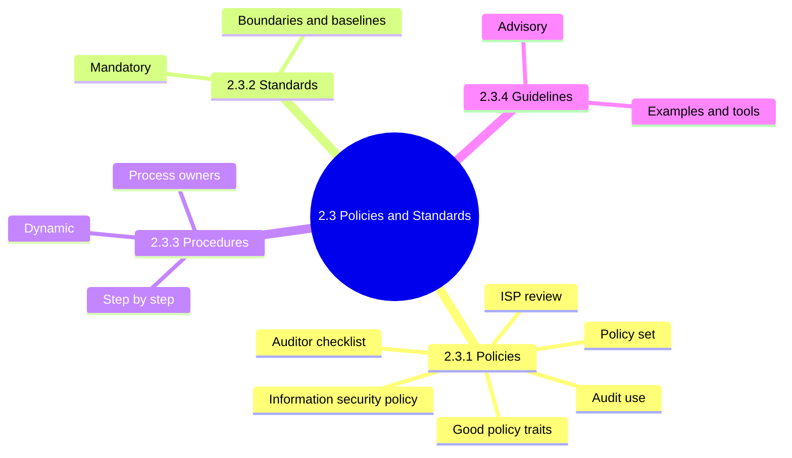

### 2.3 Overview: the four document types

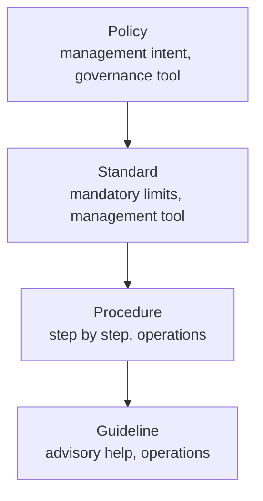

| Type | Nature | Audit impact |
|---|---|---|
| Policy | High-level intent | Benchmark for compliance |
| Standard | Mandatory specification | Systems tested against it |
| Procedure | Documented steps | Test that controls operate |
| Guideline | Advisory help | Deviation alone is not a violation |

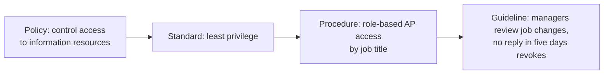

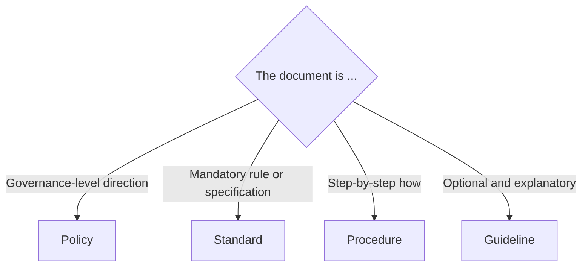

<b>Exam traps</b>

- A mandatory, enforceable rule is a standard or policy, never a guideline.
- Step-by-step "how" content is a procedure, not a policy.
- Terms differ across organizations; adopt standard-setting bodies' meanings.
- Five-day auto-revoke is a guideline in the manual but acts mandatory (unverified).

### 2.3.1 Policies

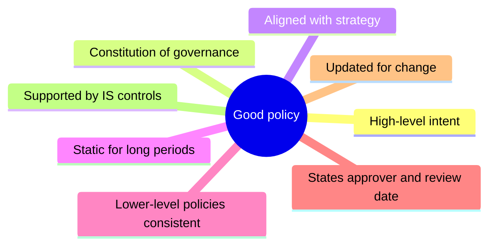

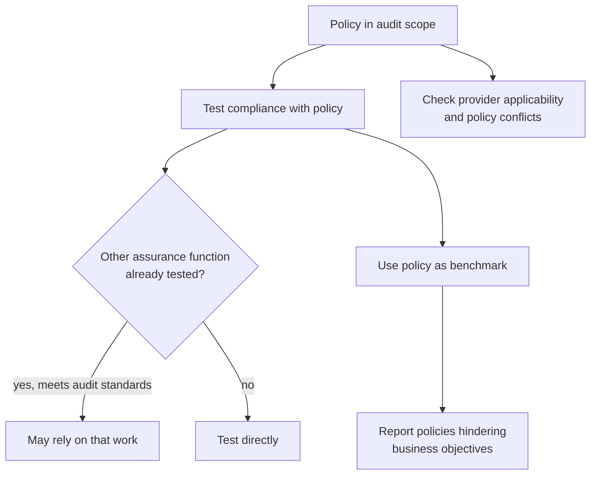

| Success factor | Why it matters |
|---|---|
| Bottom-up development 📓⭐ | Reflects real risk (unverified, not in manual section) |
| Employee comprehension 📓⭐ | Understood policy drives compliance (unverified) |
| Missing policy 📓 | Systemic risk, not single failure |
| Employee policy manual 📓 | Behavior standards, discipline grounds (unverified) |

<b>Definitions</b>

- Information security policy is approved and reviewed by senior management 📓⭐.
- OSP: outsourced service provider running functions for the enterprise.
- Missing policy example: no backup policy leaves all backups unmanaged.

<b>Exam traps</b>

- A policy hindering business objectives must be reported.
- Static high-level policy is normal; stale policy ignoring change is a finding.
- Reliance on others' testing needs quality equal to audit standards.
- Management approval alone does not make a policy effective.
- Bottom-up advantage is risk-based relevance.

#### Information security policy (ISP)

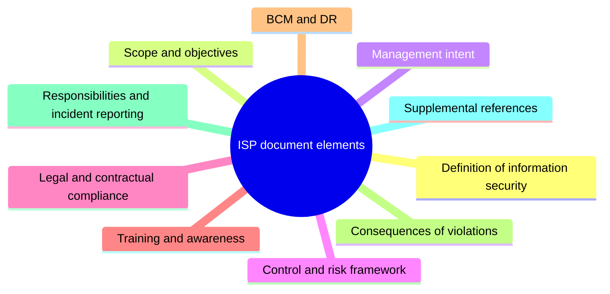

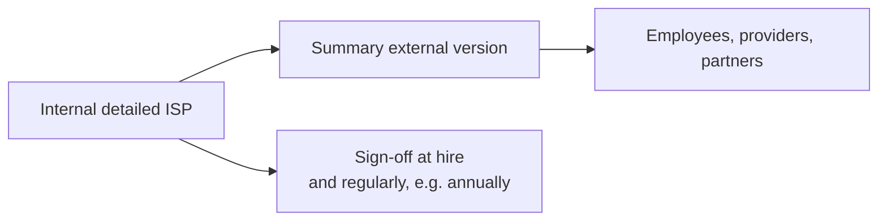

<b>Key points</b>

- ISP is the foundation of security infrastructure.
- Balance control level against productivity.
- Control cost must never exceed expected benefit.
- Senior management must approve the ISP.
- ISO/IEC 27001 and 27002 are content benchmarks.
- ISO 27001 is not mandatory; manual says "or equivalent" (unverified).

<b>Exam traps</b>

- Control costing more than its benefit is wrong.
- Maximum security is not the goal; balance is.
- Full internal ISP to third parties risks disclosure.
- One-time sign-off at hire is weaker than periodic sign-off.

#### Policy set concerns

| Policy | Covers |
|---|---|
| High-level security policy | Confidentiality, integrity, availability |
| Data classification | Classes, control levels, user duties |
| Acceptable use | Permitted use of all resources |
| End-user computing | Desktops, mobile, personal devices |
| Access control | Network, application, remote access |
| Incident response | Steps, limiting exposure, notification |
| Remote access | Public and home networks, VPN |

#### Review of the ISP

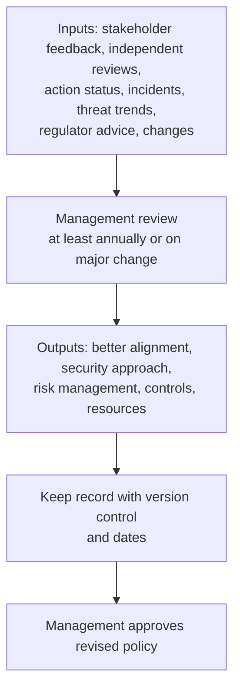

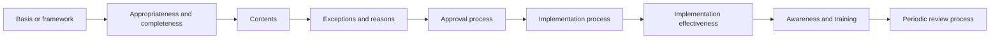

<b>Exam traps</b>

- Annual review is a minimum; major change triggers earlier review.
- Management performs the review; the auditor evaluates it.
- Undocumented exceptions are a finding.

<b>Example</b>

- A documented exception: password rules unsuited to a legacy application.
- A remote-work policy requiring VPN on public Wi-Fi.

### 2.3.2 Standards (mandatory specifications)

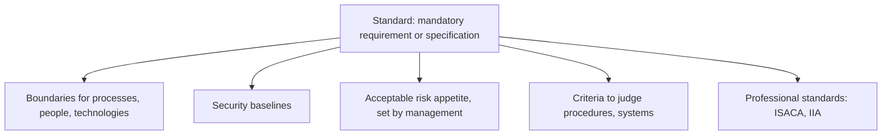

<b>Key points</b>

- Policies are the constitution; standards are the laws.
- Standards govern how procedures and guidelines are created.
- Updated for latest thinking and technology.
- Manual stresses external standards bodies; internal standards also exist (unverified).
- ISACA standards mandatory for members 📓 (unverified in this section).

<b>Exam traps</b>

- ISACA standards are mandatory; ISACA guidelines are advisory 📓⭐.
- Standards are not optional best practice.

### 2.3.3 Procedures (step-by-step)

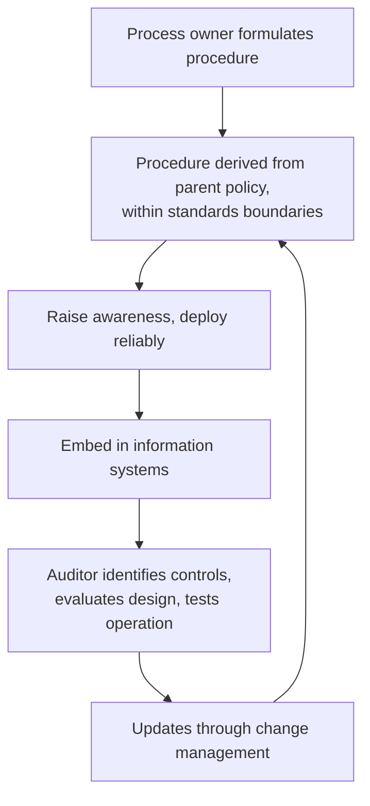

<b>Key points</b>

- Written clearly and concisely.
- More dynamic than policies; reviewed frequently.
- Change management is less formal than for policies.

<b>Exam traps</b>

- Practice differing from procedure is inconsistent execution risk.
- Missing procedures hinder control identification; report them.
- Frequent change in procedures is not itself a defect.

<b>Example</b>

- A system blocks payment release without a second approver.

### 2.3.4 Guidelines (advisory) 📓

| Guideline content | Purpose |
|---|---|
| Clarify policies and standards | Explain intent |
| Dependencies | Show prerequisites |
| Suggestions and examples | Help execution |
| Narrative and background | Explain procedures |
| Tools | Support staff |

<b>Exam traps</b>

- Optional and explanatory document is a guideline.
- Do not report guideline non-adherence as a policy violation.
- Word "advisory" is from my notes, not the manual (unverified).
- ISACA professional guidelines are a separate use of the term.

### Quick recall

| Fact | Detail |
|---|---|
| ⭐ Hierarchy | Policy, standard, procedure, guideline |
| ⭐ ISP approval | Senior management approves and reviews |
| ⭐ ISP review | At least annually or on major change; management performs |
| ⭐ Standards vs guidelines | Standards mandatory, guidelines advisory |
| Policy benchmark | Auditor reports policies hindering business |
| Missing policy 📓 | Systemic risk |
| Procedures | More dynamic; need awareness and change control |
| ISP balance | Control cost never above benefit |
| Sign-off | At hire and regularly |
