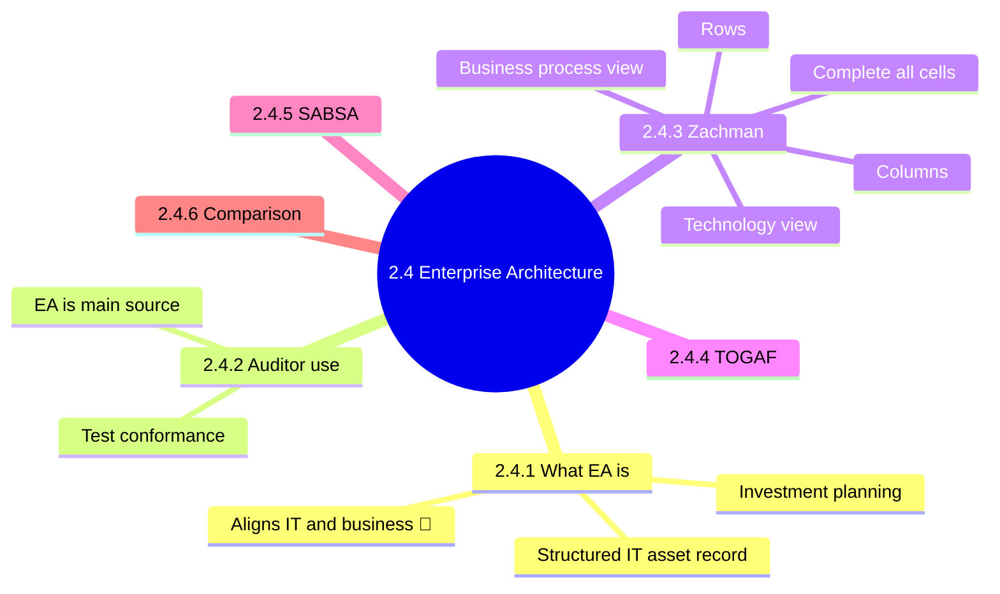
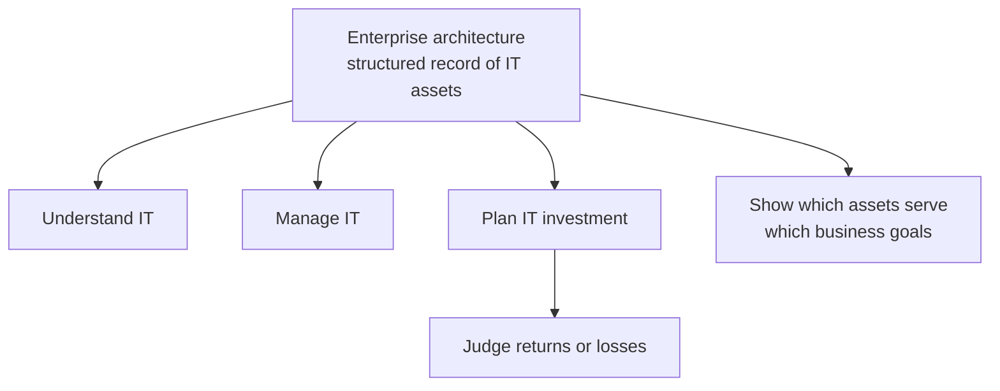
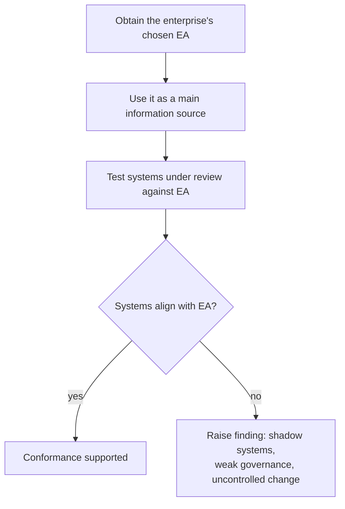
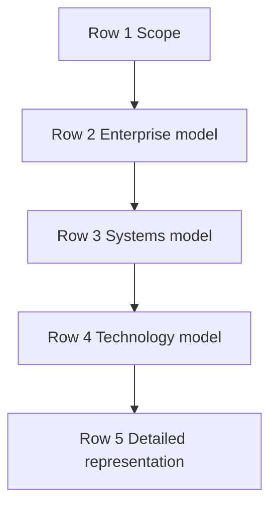
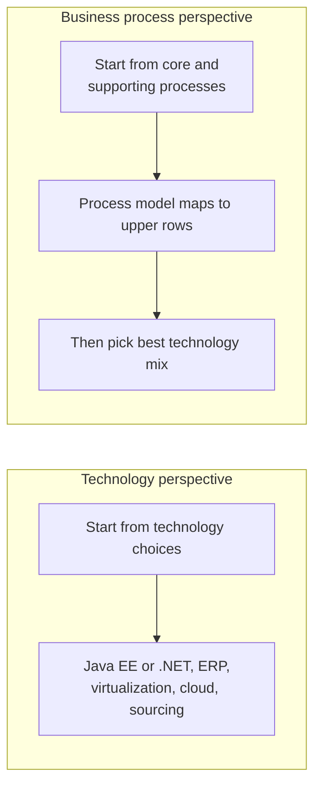
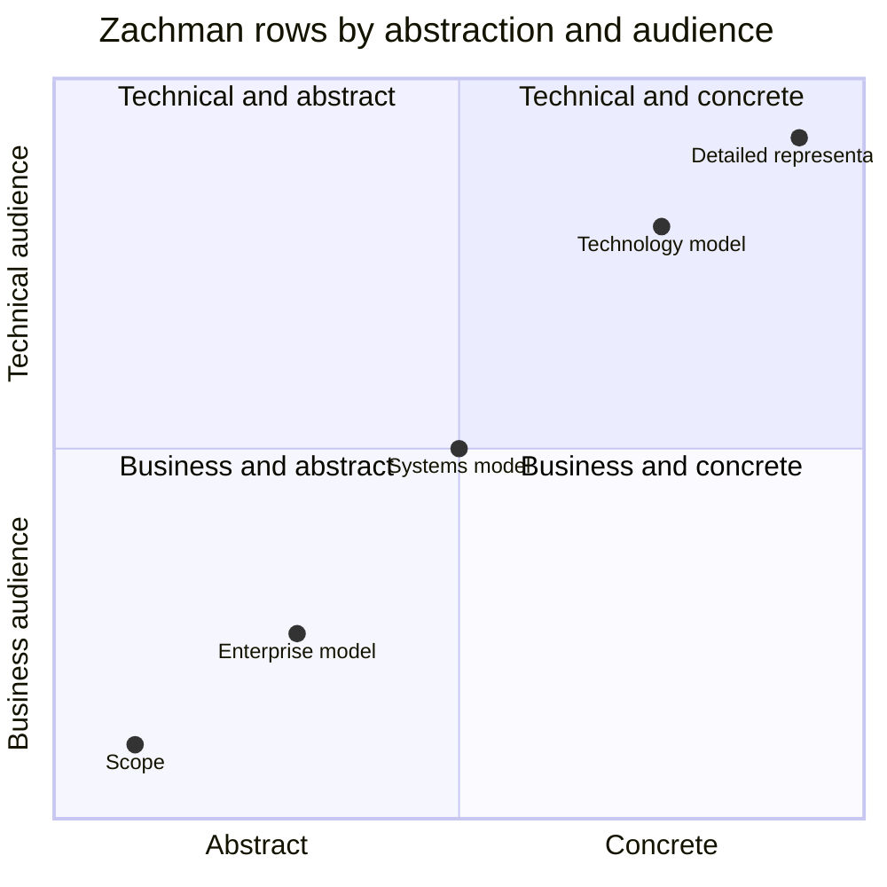
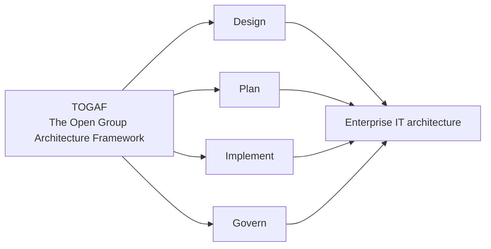
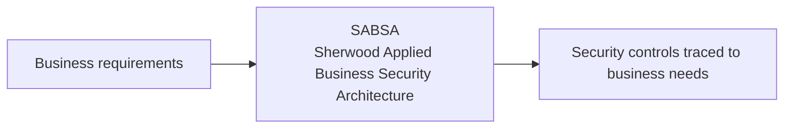
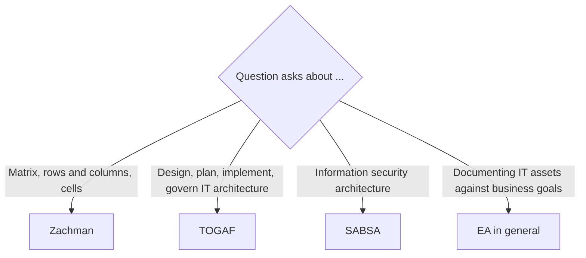

# 2.4 Enterprise Architecture and Considerations - Diagrams

[← Domain 2](../README.md) | [Study notes](../Study-Notes/2.4-Study-Notes.md)

Markers: 📓 in my notes, ⭐ frequently tested, ➕ unverified. Items marked "(unverified)" carry a Check flag in the study notes. Study notes number the topics 2.4.1 to 2.4.6.

### Section map

### 2.4.1 What Enterprise Architecture (EA) is

<b>Definitions</b>

- EA: structured record of an organization's IT assets.
- IT asset: any system, data or network the business relies on.
- Alignment: IT supports what the business is trying to achieve.

<b>Exam traps</b>

- Tool for IT-to-business goal alignment: EA, not metrics alone.
- A balanced scorecard measures performance; it does not map assets to goals.
- Poor EA means unclear ownership, duplicated systems, wasted spend.
- "EA aligns goals" is outline wording (unverified); manual says auditors verify alignment.

<b>Example</b>

- A bank maps core banking, databases, servers and links in one model.

### 2.4.2 Auditor's use of EA

<b>Exam traps</b>

- Start from the enterprise's EA, then test conformance.
- Do not rely only on interviews or vendor documents.
- Auditors assess; management designs the architecture.
- Auditor does not impose a personal framework.

<b>Example</b>

- A new payroll tool the EA never listed is raised by the auditor.

### 2.4.3 Zachman Framework

| Columns (what is asked) | Manual label |
|---|---|
| Data | Data |
| Function | Functional (Application) |
| Network | Network (Technology) |
| People | People (Organization) |
| Process | Process (Workflow) |
| Strategy | Included in manual figure (unverified) |

<b>Definitions</b>

- Zachman: matrix for classifying and developing enterprise architectures.
- First published by John Zachman in the late 1980s.
- Analogy: building construction, from abstract to physical.
- Goal: complete every cell of the matrix.
- Hardest cells are usually at the most abstract level.

<b>Exam traps</b>

- Zachman is a classification matrix, not a security standard.
- Blank cells are a gap, not acceptable design.
- Business process view maps to upper rows.
- Process-first means technology follows process.

<b>Example</b>

- Executives view the scope row; engineers work from the technology row.
- A retailer maps order-to-cash first, then chooses systems.

### 2.4.4 TOGAF

<b>Exam traps</b>

- TOGAF covers enterprise IT architecture generally, not security specifically.
- Example: a firm adopts TOGAF so all projects follow one process.

### 2.4.5 SABSA

<b>Exam traps</b>

- Security architecture question points to SABSA.
- General EA question points to Zachman or TOGAF.
- "Risk-driven" description and layer details are unverified.

### 2.4.6 Comparing the frameworks

| Framework | Main focus | Memory hook |
|---|---|---|
| Zachman | Classifying EA in a matrix | Building blueprints, cells |
| TOGAF | Designing and governing IT architecture | Open Group, method |
| SABSA | Security architecture | Security, business-driven |

Federal Enterprise Architecture appears only in the manual index; not covered (unverified).

### Quick recall

| Fact | Detail |
|---|---|
| ⭐ EA purpose | Structured IT asset record; supports investment planning |
| ⭐ Auditor method | Use the enterprise's EA, test systems against it |
| Alignment tool 📓 | EA maps IT to business goals |
| Zachman | Matrix; complete all cells; abstract to physical |
| Zachman rows | Scope, enterprise, systems, technology, detailed |
| Technology view | Guides technology choices |
| Process view | Maps to upper rows |
| TOGAF | Designs and governs enterprise IT architecture |
| SABSA | Security architecture |
