# 2.5 Enterprise Risk Management (ERM) - Diagrams

[← Domain 2](../README.md) | [Study notes](../Study-Notes/2.5-Study-Notes.md)

Markers: 📓 in my notes, ⭐ frequently tested, ➕ unverified in the manual.

## Section map

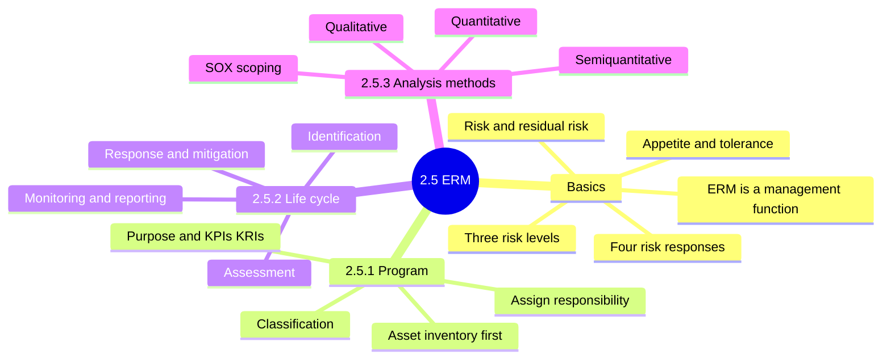

### 2.5 ERM basics: appetite, tolerance, responses, levels

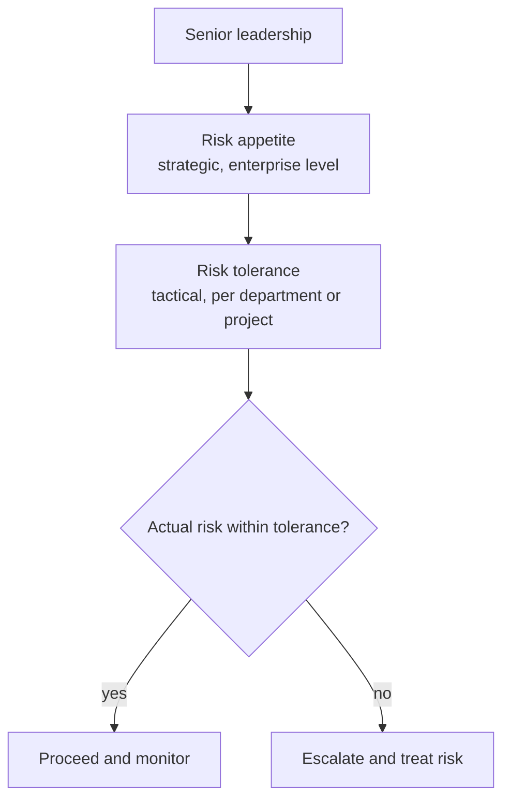

#### Risk response decision tree

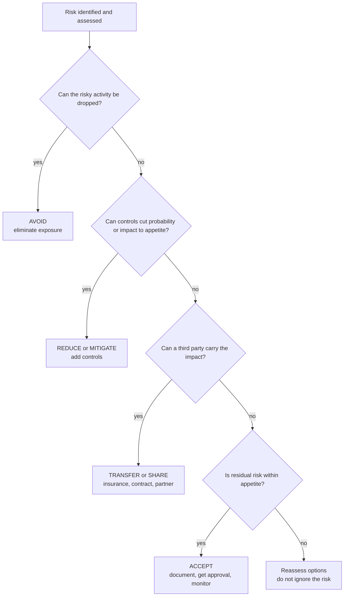

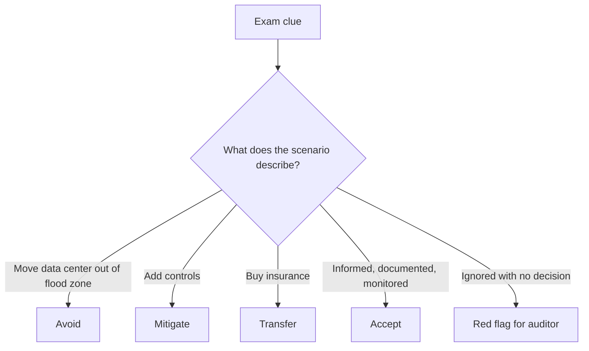

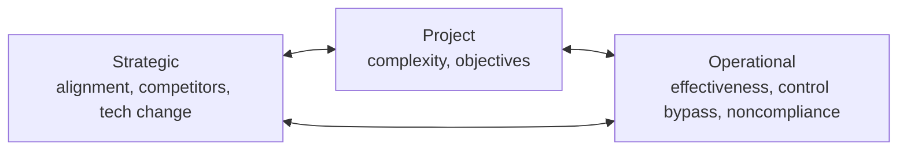

<b>Definitions</b>

- Risk: chance a threat exploits a weakness and harms the business.
- ERM: find threats and weaknesses, then choose safeguards.
- Residual risk: risk left after controls are applied.
- Appetite: risk leadership willingly takes for strategic goals.
- Tolerance: acceptable deviation from appetite.
- Process words: identify, analyze, evaluate, treat, monitor, communicate.

<b>Exam traps</b>

- ERM is a management function, not independent audit.
- Management owns risk; auditor verifies the process.
- Appetite is strategic; tolerance is tactical.
- Relocating away from a hazard is avoidance.
- Transfer moves financial impact, not accountability.
- Ignoring risk is not acceptance.
- Risk at one level can raise risk at another.
- ⚠ Check: mitigate and reduce mean the same (unverified wording).

<b>Example</b>

- Bank board decides how much fraud loss it will live with.
- Rival adopts cloud faster: strategic risk.
- Key server outage stops customer service: operational risk.
- Overrun ERP rollout misses goals: project risk.

### 2.5.1 Developing a risk management program

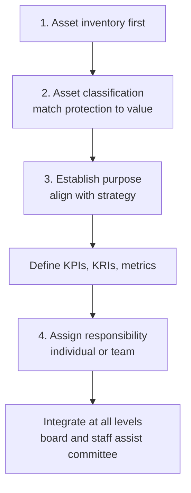

| Indicator | Meaning |
|---|---|
| KPI | Measures how well a process performs |
| KRI | Early signal that risk is rising |
| Metrics | Evaluate whether the program works |

<b>Exam traps</b>

- Before assessing risk, asset inventory leads. ⭐
- Classification follows inventory; you cannot grade unlisted assets.
- Classification prevents over-protection and under-protection. 📓
- Senior management holds ultimate responsibility; the risk team coordinates.
- ⚠ Check: manual lists program purpose first; inventory-first is from my notes.

### 2.5.2 Risk management life cycle

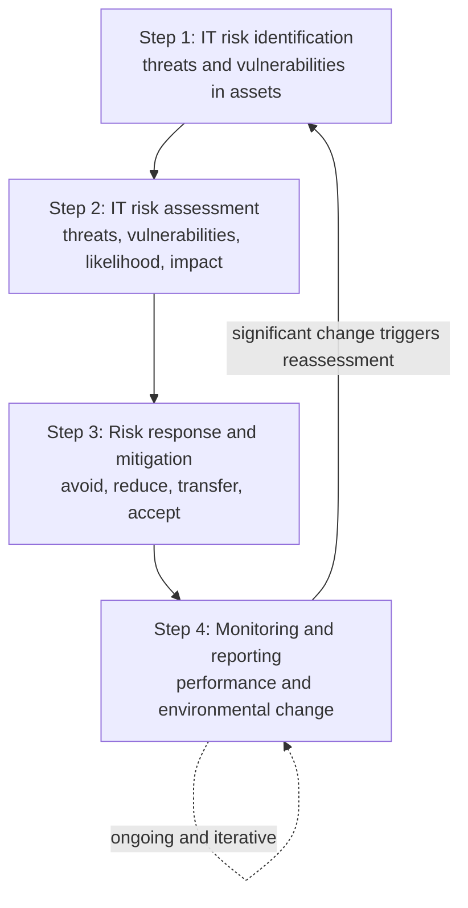

#### Step 1 and 2: identification and assessment

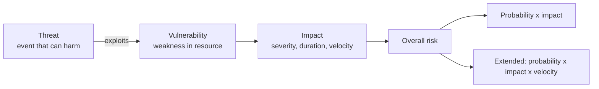

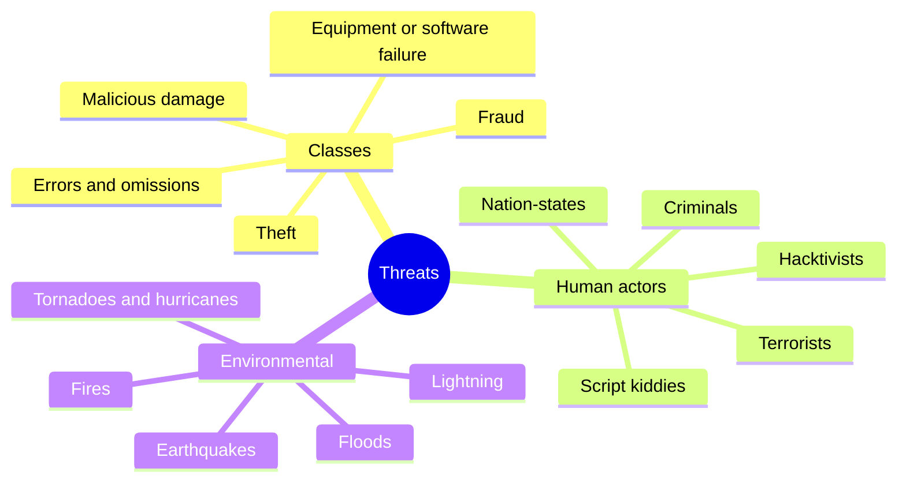

#### Step 3: controls and residual risk

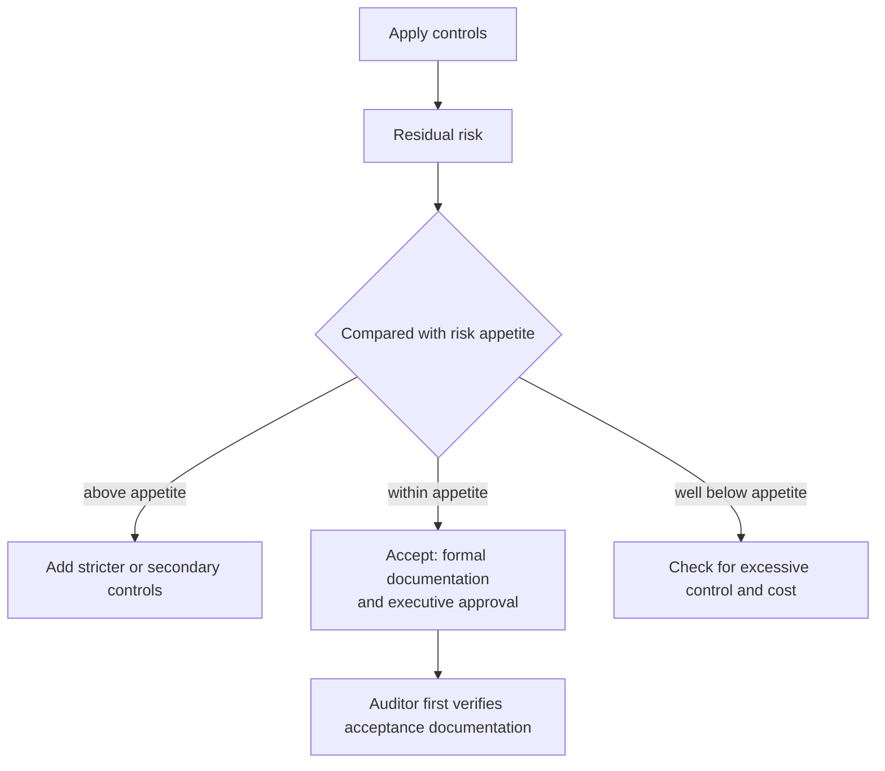

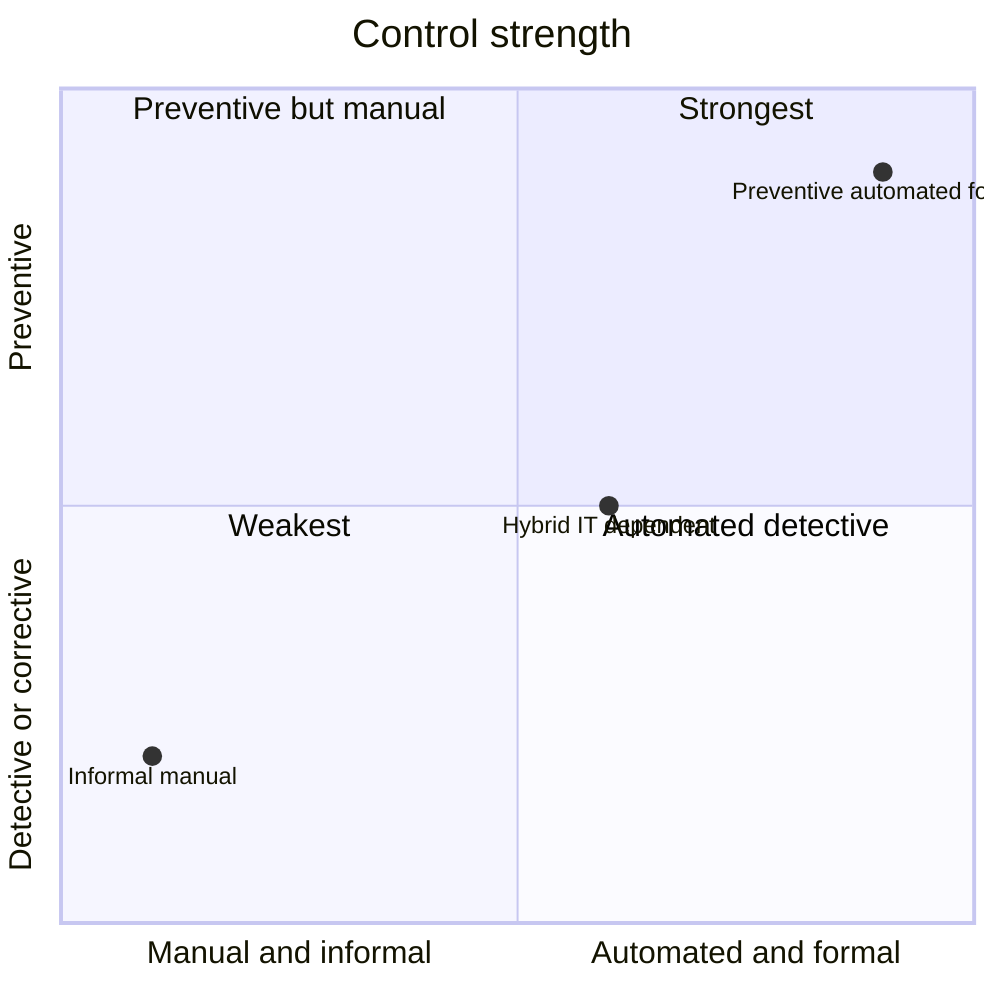

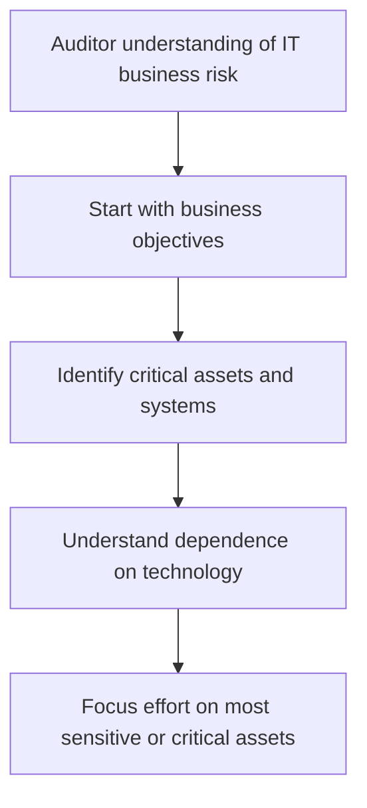

<b>Definitions</b>

- Threat: circumstance or event that can harm an information resource.
- Harm: destruction, disclosure, modification, or denial of service.
- Vulnerability: characteristic of a resource a threat can exploit.
- Impact: result of a threat exploiting a vulnerability.
- Control: safeguard made of people, processes or products.
- Hybrid control: mix of manual and automated steps.
- Reduction methods: terminate, lower probability, lower impact, insure.

<b>Loss types</b>

- Direct money loss.
- Breach of legislation.
- Loss of reputation or goodwill.
- Endangered staff or customers.
- Breach of confidence.
- Lost business opportunity.
- Reduced efficiency.
- Business interruption.

<b>Residual risk acceptance considers</b>

- Organizational policy.
- Risk appetite.
- Risk identification and measurement.
- Uncertainty in the assessment approach.
- Cost and effectiveness of implementation.
- Cost of control versus benefit.

<b>Exam traps</b>

- Vulnerability is internal weakness; threat is the external event.
- Auditor does not accept risk; management does, in writing. ⭐
- Best auditor advice: management documents acceptance of resulting risk. ⭐
- Strongest controls: preventive, automated, formal. Weakest: informal, manual.
- Residual risk is what remains after controls.
- Over-control below appetite is also a finding.
- One-time assessment is wrong; IT risk is dynamic.
- Start with objectives and critical assets, not technical controls.

<b>Example: score ranking (1-5 scales are an illustration, unverified ➕)</b>

- Threat A: probability 4, impact 3, velocity 2.
- Threat A basic 12, extended 24.
- Threat B: probability 2, impact 5, velocity 4.
- Threat B basic 10, extended 40.
- Basic ranks A higher; extended ranks B higher.

### 2.5.3 Risk analysis methods

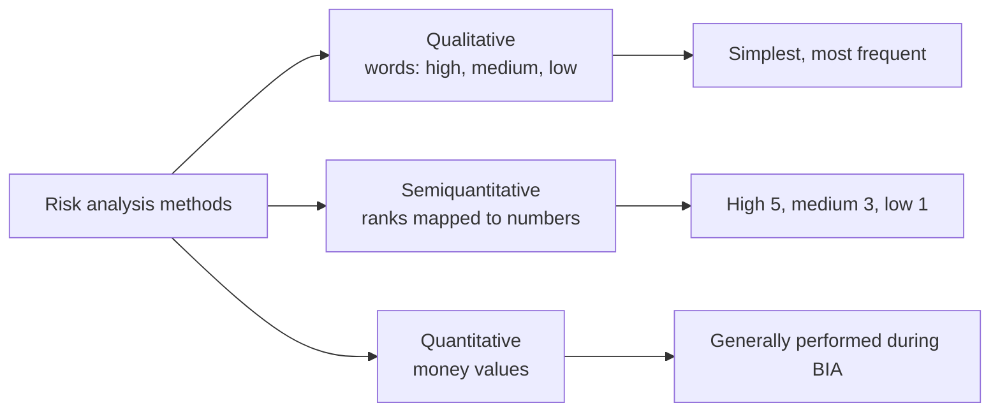

#### Qualitative vs semiquantitative vs quantitative

| Aspect | Qualitative | Semiquantitative | Quantitative |
|---|---|---|---|
| Output | Words: high, medium, low | Numeric scores from ranks | Monetary values |
| Basis | Checklists, interviews, opinion | Weighted ratings, surveys 1 to 5 | Records, statistics, testing |
| Strength | Simplest, most frequent | Reduces subjectivity | Justifies control spending |
| Weakness | Lacks accounting rigor, subjective | Numbers still rest on opinion | Asset valuation is hard |
| Typical use | Quick ranking in workshops | When quantitative is impossible | Cost-benefit, BIA |

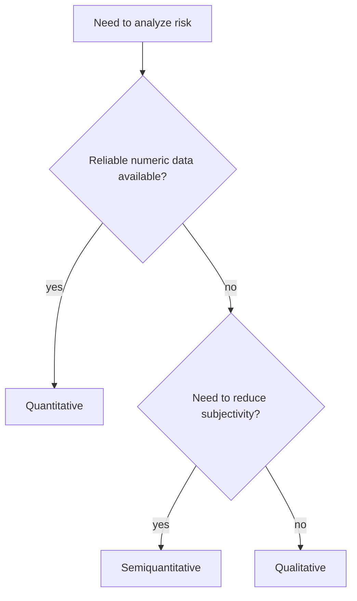

#### Quantitative formulas ➕ (unverified, not defined in section 2.5)

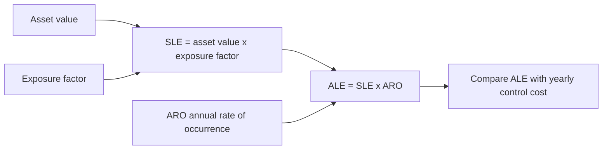

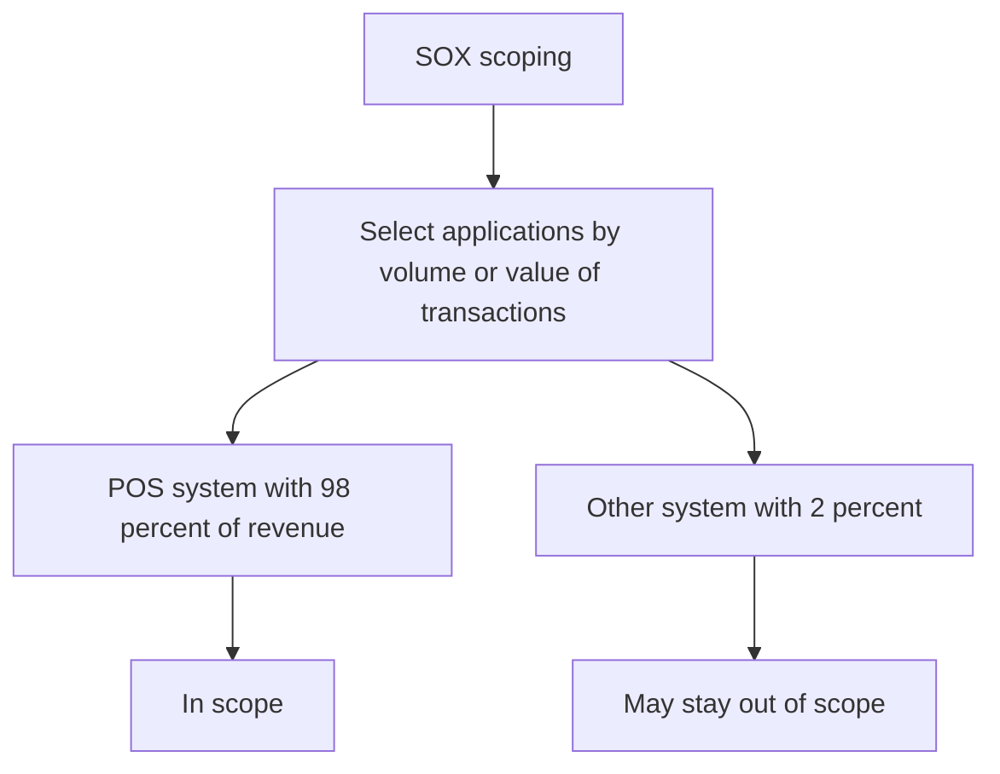

<b>Definitions</b>

- Qualitative: descriptive ranking from checklists and interviews.
- Semiquantitative: descriptive ranks mapped onto a numeric scale.
- Quantitative: numeric likelihood and impact, mainly money.
- SLE: expected money loss from one event ➕.
- ARO: expected number of events per year ➕.
- ALE: expected money loss per year ➕.

<b>Example: ALE and control cost-benefit (unverified ➕)</b>

- Asset 500,000, exposure factor 40 percent, ARO 0.5.
- SLE = 200,000; ALE = 100,000 per year.
- Control cuts ARO to 0.1 at 30,000 per year.
- New ALE 20,000; saving 80,000; net benefit 50,000 per year.
- Buy the control: cost is below benefit.

<b>Exam traps</b>

- Numeric scores on opinions are still semiquantitative.
- Quantitative methods fail mainly on asset valuation.
- Never spend more on a control than the loss it prevents.
- ALE needs annual frequency; per-event loss alone is SLE ➕.
- SOX scope follows transaction value, not system age or size.

### Quick recall

| Fact | Answer |
|---|---|
| ⭐ First step in risk program | Asset inventory |
| ⭐ Who accepts risk | Management, documented with executive approval |
| ⭐ Auditor first checks | Acceptance documentation |
| Four responses | Avoid, reduce, transfer, accept |
| Appetite vs tolerance | Strategic vs tactical deviation |
| Residual risk | Remains after controls; compare to appetite |
| Overall risk | Probability x impact (x velocity) |
| Strongest control | Preventive, automated, formal |
| Quantitative problem | Valuing information assets |
| Ignoring risk | Red flag for auditor |
