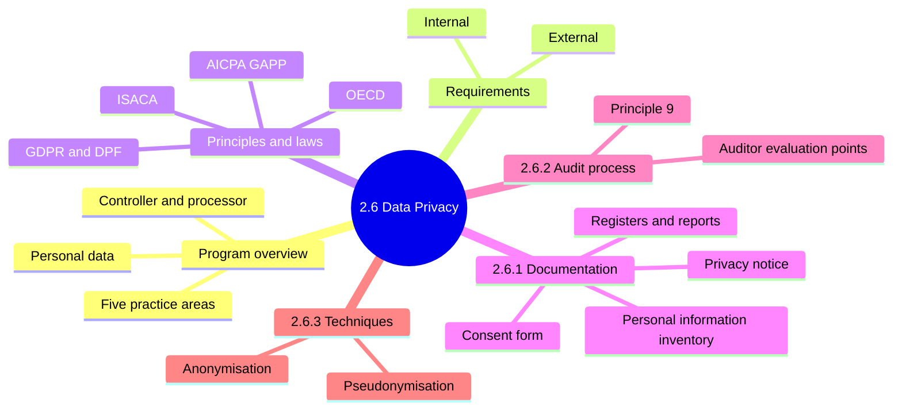
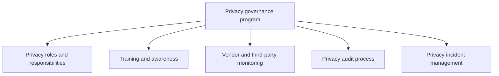
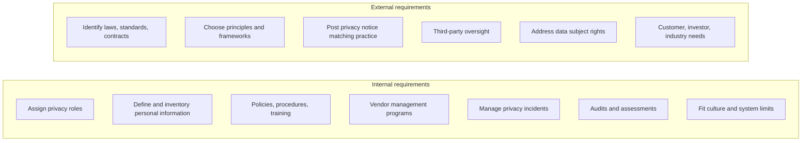
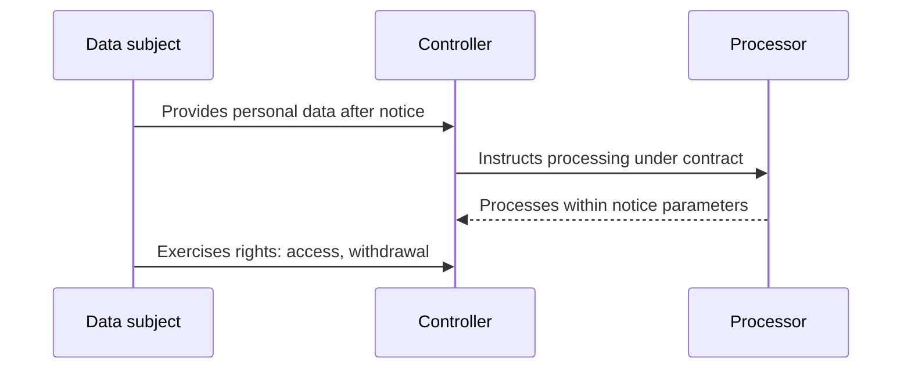
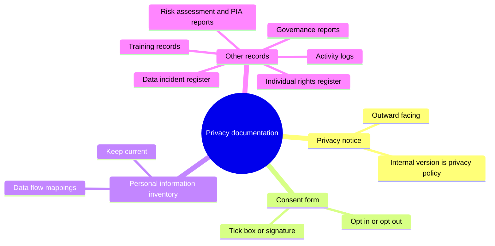
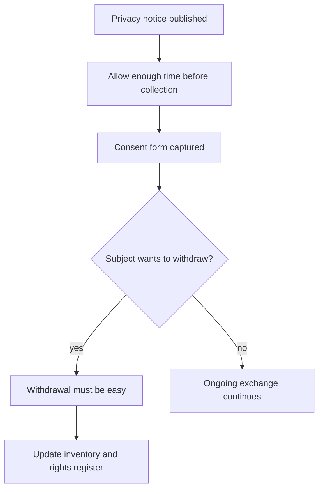
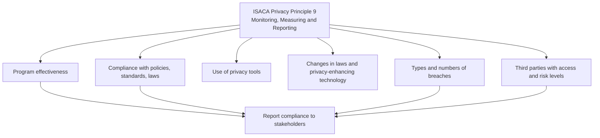
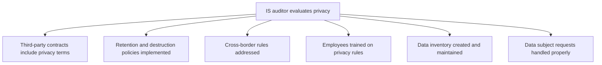
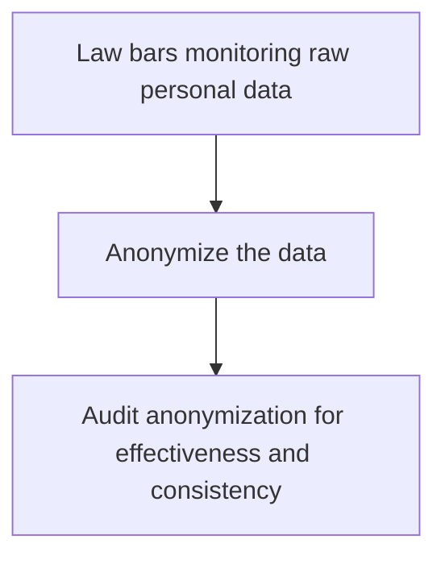
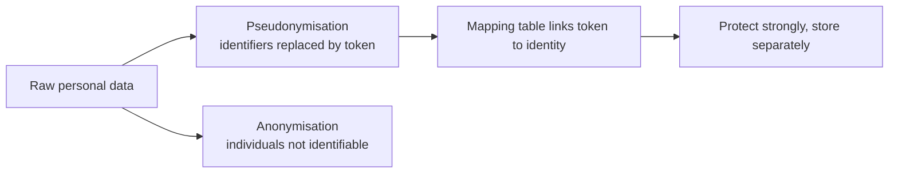

# 2.6 Data Privacy Program and Principles - Diagrams

[← Domain 2](../README.md) | [Study notes](../Study-Notes/2.6-Study-Notes.md)

Markers: 📓 in my notes, ⭐ frequently tested (none marked in the outline), ➕ unverified in the manual.

## Section map

### 2.6 Program overview and requirements

| Principle or law | Note |
|---|---|
| ISO/TS 17975:2022 | Consent for personal health information |
| OECD Privacy Principles | Example framework |
| AICPA GAPP | Example framework |
| ISACA Privacy Principles | Example framework |
| GDPR and DPF | EU data protection and transfer rules |

<b>Definitions</b>

- Personal data: information relating to an identifiable person.
- Data subject: the person the data describes.
- Controller: decides why data is used.
- Processor: handles data for the controller.
- Privacy governance program: identifies and controls all personal information.
- Life cycle protection: controls from collection to destruction.

<b>Exam traps</b>

- Privacy program is governance-led, not an IT-only project.
- Encryption alone ignores roles, notices and audit.
- Legal and contractual requirements come before preferences.
- Notice that differs from real practice creates legal exposure.
- Applicable law follows where data subjects live.
- ⚠ Check: the DPF is a transfer framework, not strictly a law (unverified ➕).
- ⚠ Check: figure 2.12 originates from the CDPSE manual.

<b>Example</b>

- Retailer is controller; outsourced payroll vendor is processor.
- US cloud host storing EU records needs a lawful transfer basis.

### 2.6.1 Privacy documentation

| Document | Audience | Purpose |
|---|---|---|
| Privacy notice | Data subjects, authorities | Legal accountability, explains use |
| Privacy policy | Internal staff | Internal version of the notice |
| Consent form | Data subject | Records agreement to notice |
| Inventory | Internal | Shows what personal data is at risk |
| Incident register | Internal, auditors | Facts, effects, remedial measures |
| Rights register | Internal, auditors | Requests received, how and when |

<b>What the notice explains</b>

- What data is collected and why.
- How data is used and handled.
- Who receives data.
- Retention period and destruction.
- Impact on subjects.
- How to exercise rights.
- Formats: web page, forms, brochures, contracts, CCTV signs.

<b>Exam traps</b>

- Notice is outward facing; policy is its internal counterpart.
- Signature alone does not prove informed consent.
- Inventory is not legally mandated but underpins other controls.
- Keep notice separate from terms of use.
- Stale or unreviewed documents fail due-care tests.
- Withdrawal that is hard raises enterprise risk.

<b>Example</b>

- Hospital leaflet explaining record sharing and access rights.
- Inventory lists HR, customer and marketing data with location and owner.
- Unticked box ticked by user beats pre-ticked box (illustration, unverified ➕).

### 2.6.2 Audit process (privacy)

<b>Exam traps</b>

- Best evidence is implementation proof, not an existing policy.
- Third-party access risk is a core audit area.
- Law forbids raw monitoring: choose anonymization, then audit it.
- Audits can reveal architecture failures against privacy by design.
- ⚠ Check: "annual" audit frequency is manual wording (unverified ➕).

### 2.6.3 Privacy-enhancing techniques ➕ (unverified, not in manual)

| Aspect | Pseudonymisation 📓 | Anonymisation |
|---|---|---|
| Method | Replace identifiers with token | Alter data to remove identity |
| Re-linking | Possible via mapping table ➕ | Not possible ➕ |
| Key risk | Weak mapping table protection | Ineffective or inconsistent use |
| Use | Analytics with limited exposure | Law bars raw data monitoring |

<b>Exam traps</b>

- Pseudonymisation is not a substitute for encryption and access controls. 📓
- Weak mapping-table protection is the typical finding.
- Pseudonymised data is still personal data ➕.

<b>Example</b>

- Patient names replaced by IDs; ID-to-name table kept in a vault.
- Fraud analytics run on anonymized transactions.

### Quick recall

| Fact | Answer |
|---|---|
| Privacy program covers | Roles, training, vendors, audit, incidents |
| Notice | Outward facing; creates legal accountability |
| Notice vs practice | Must match real practice |
| Consent | Ongoing exchange; easy to withdraw |
| Inventory | Internal foundation; include data flows |
| Principle 9 | Monitoring, Measuring and Reporting |
| Audit points | Contracts, retention, cross-border, training, inventory, requests |
| Raw monitoring barred | Anonymize, then audit it |
| Pseudonymisation 📓 | Protect mapping table; still needs encryption |
