# 2.7 Data Governance and Classification: Diagrams

[← Domain 2](../README.md) | [Study notes](../Study-Notes/2.7-Study-Notes.md)

Markers: 📓 in my notes, ⭐ frequently tested, ➕ unverified.

## Section map

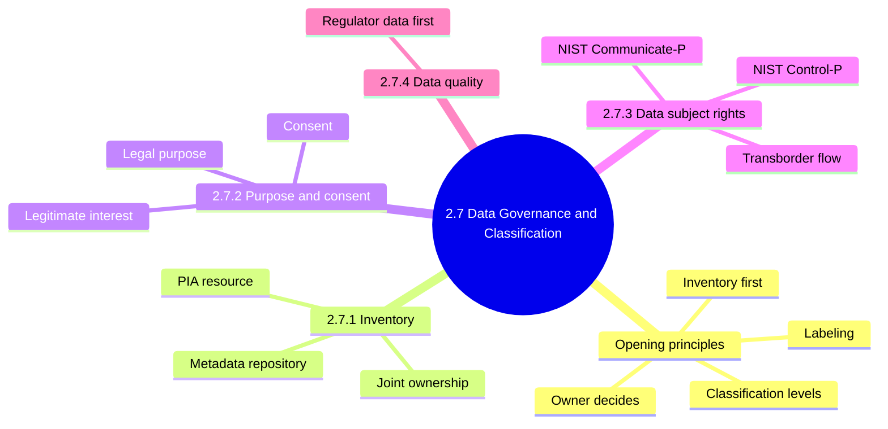

## 2.7 Opening principles

### Classification workflow

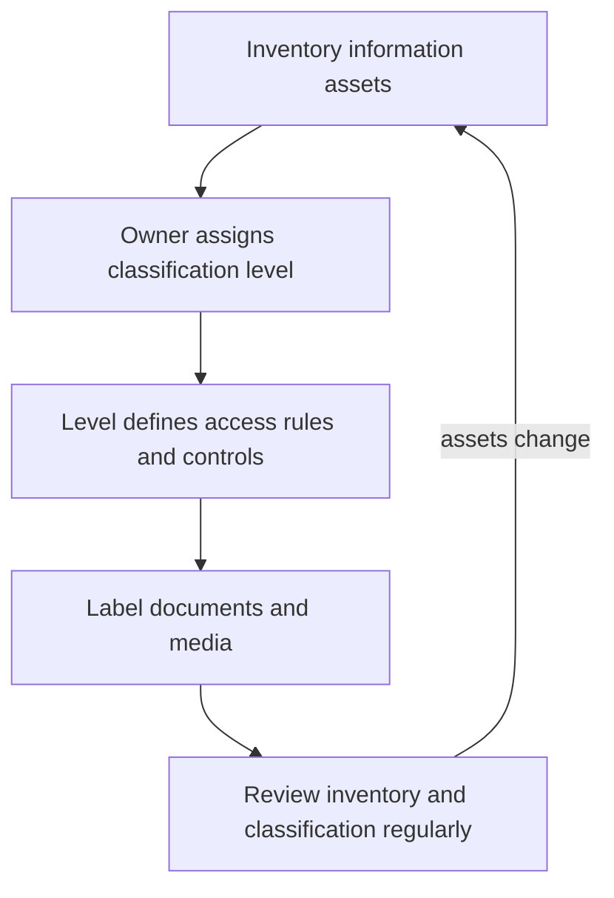

### Who does what

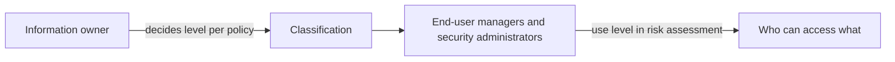

### What classification defines

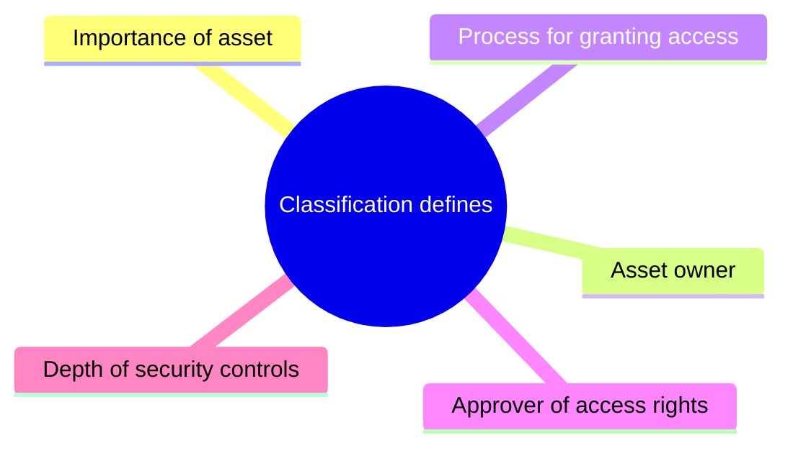

### Classification levels (examples)

| Level | Meaning | Examples |
|---|---|---|
| Public | Freely open to anyone | Marketing material, press releases |
| Internal | Authorized employees only | Business plans, org charts |
| Confidential | Kept private; exposure harms enterprise | Financials, customer lists, card data |
| Restricted | Highly sensitive; legal exposure | Proprietary data, regulated data |

Level names are examples only; three to five levels is typical.

### Exam logic

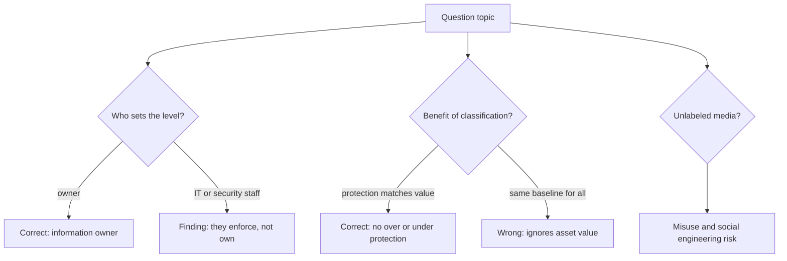

<b>Definitions</b>

- Classification: sensitivity and criticality level assigned to each asset.
- Production data: live data used to run the business.
- Test data: data used in development and testing environments.
- Labeling: marks documents and media with their level.
- Social engineering: manipulating people into revealing information or access.

<b>Example</b>

- Programmer testing payroll change uses masked test records, not live payroll.
- Keep scheme simple; complex schemes get ignored by users.
- Consider legal, regulatory, contractual and internal requirements.
- Developers should not access production data or programs.

<b>Exam traps</b>

- Wrong: same baseline security for all assets.
- Wrong: only critical assets get protected.
- Wrong: security administrator classifies the data.
- ⭐ Unlabeled media indicate potential misuse.
- Manual outline lists only legal fines for Restricted; manual adds criminal charges (unverified).
- Data governance definition is my own summary (unverified).

### 2.7.1 Data inventory and classification

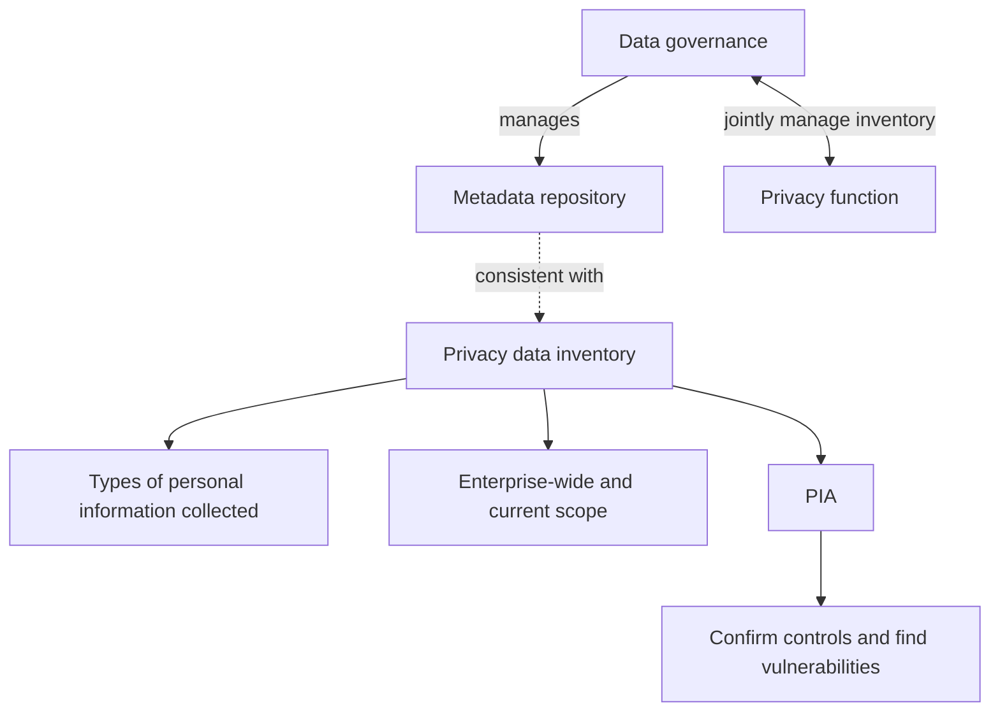

<b>Definitions</b>

- ⭐ Inventory is the most important resource for conducting a PIA.
- PIA: checks personal data is safeguarded in use, sharing, access, destruction.
- Metadata repository: descriptions of data such as source, type, owner.

<b>Example and exam traps</b>

- Example: free-text comment fields holding unplanned customer health details.
- Consider unintentional capture, use and storage of personal data.
- Trap: inventory comes before PIA and classification.
- Trap: partial or outdated inventory makes PIA results unreliable.

### 2.7.2 Legal purpose, consent and legitimate interest

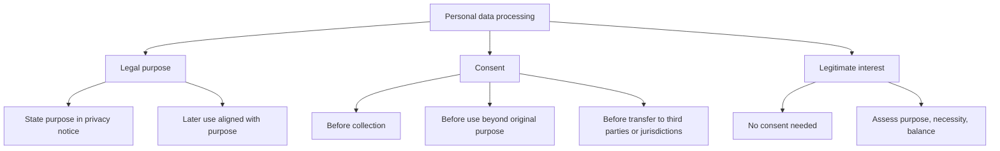

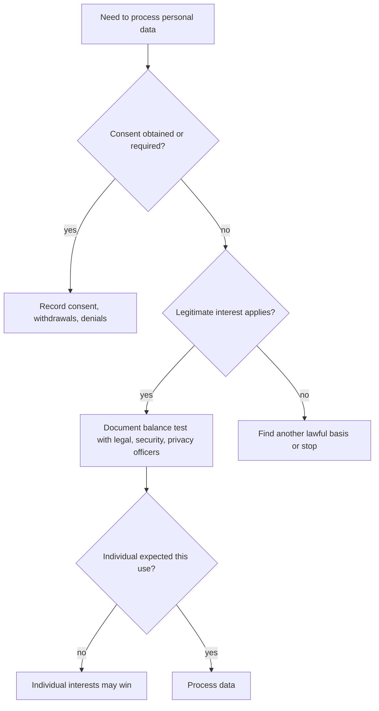

| Basis | Key point | Example |
|---|---|---|
| Legal purpose | Stated purpose, use limitation | Order emails not reused for marketing |
| Consent | Implicit or explicit, per regulation | Clinic logs opt-in, withdrawal, refusal |
| Legitimate interest | Case-by-case balance test | Tax filings, public health stats, forensics |

<b>Definitions</b>

- Data subject: identifiable individual the data is about.
- Data controller: decides why and how data is processed (standard usage, unverified).
- Implicit consent: inferred from actions; explicit is clearly stated.
- Legitimate interest: lawful basis without consent when individual rights do not override.
- GDPR: EU regulation, predominant source of legitimate interest.

<b>Exam traps and notes</b>

- Wrong: original consent covers any later use.
- Wrong: legitimate interest removes need for analysis.
- Wrong: legitimate interest always favors the enterprise.
- GDPR has more processing bases than these three.
- Member states may add requirements; know all countries involved.
- Consent cover sheet is good practice, not law (unverified).
- GDPR and HIPAA specify consent requirements.

### 2.7.3 Data subject rights

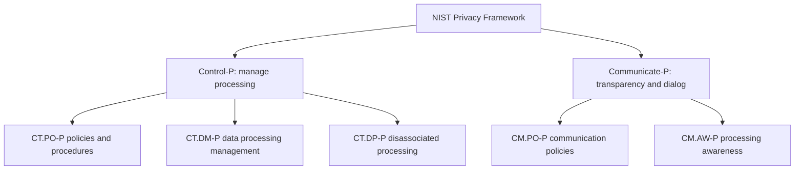

| Category | Function | Meaning |
|---|---|---|
| CT.PO-P | Control-P | Policies, processes, procedures for processing |
| CT.DM-P | Control-P | Data managed to protect privacy |
| CT.DP-P | Control-P | Reduces linkage to individuals |
| CM.PO-P | Communicate-P | Policies for transparency |
| CM.AW-P | Communicate-P | Awareness of practices and risk |

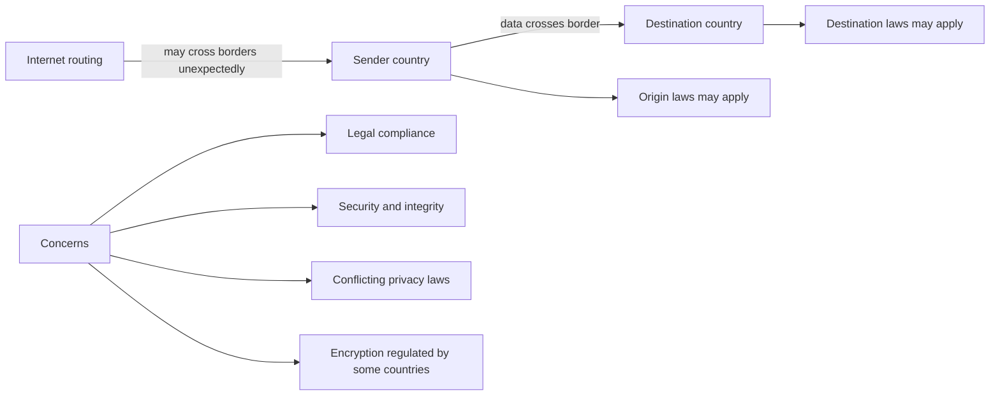

<b>Definitions</b>

- Control-P: manage processing with granularity.
- Communicate-P: reliable understanding and dialog about processing.
- Data minimization: collect and keep only needed data.
- Disassociability: process without tying data to identifiable individuals.
- Transborder data flow: data transmission between two countries.

<b>Exam traps and notes</b>

- Do not swap CT (control) and CM (communicate) prefixes.
- Consider laws of both origin and destination countries.
- Domestic email may still route through a foreign network.
- Framework has other functions; manual names only two here (unverified).
- Access and erasure rights under GDPR are common examples (unverified).

### 2.7.4 Data quality 📓

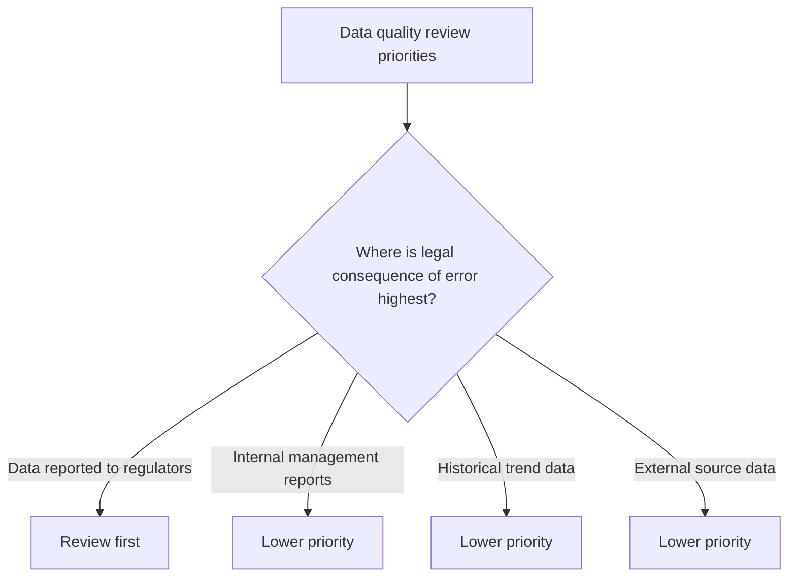

<b>Notes and exam traps</b>

- ⭐ Regulator-reported data is reviewed first.
- Reason: errors create legal and regulatory risk.
- Example: capital ratios filed with a bank regulator.
- Section content comes from my notes, not the manual (unverified).

### Quick recall

| # | Fact |
|---|---|
| 1 | ⭐ Regulator-reported data is reviewed first for quality |
| 2 | ⭐ Inventory is the most important resource for a PIA |
| 3 | ⭐ Unlabeled media suggest misuse and social engineering risk |
| 4 | Inventory first, then classify |
| 5 | Owner decides level; custodians apply controls |
| 6 | Three to five levels is typical |
| 7 | Consent before collection, secondary use, transfer |
| 8 | Legitimate interest needs a documented balance test |
| 9 | Control-P manages; Communicate-P informs |
| 10 | Developers should not access production data |
