# 2.8 IT Resource Management: Diagrams

[← Domain 2](../README.md) | [Study notes](../Study-Notes/2.8-Study-Notes.md)

Markers: 📓 in my notes, ⭐ frequently tested, ➕ unverified.

## Section map

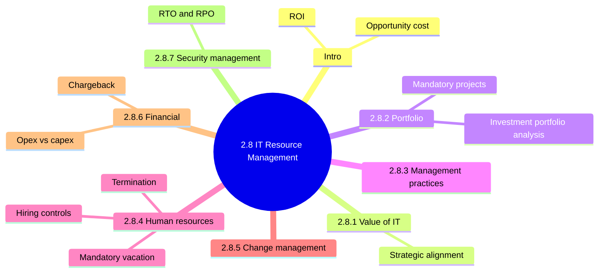

## 2.8 Introduction

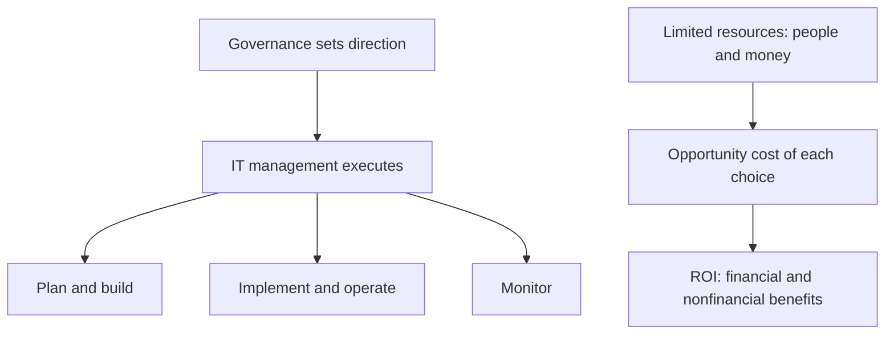

<b>Definitions</b>

- Opportunity cost: value lost by not choosing next-best use.
- ROI: what the enterprise gains compared with what it spends.
- Financial benefits: cost reductions and revenue increases.
- Nonfinancial benefits: operations, customer satisfaction, information quality, cycle times.
- Convert nonfinancial benefits to monetary units where feasible.

<b>Example</b>

- ERP upgrade funded means no budget for customer portal.
- Shorter order cycle valued as saved labor hours times hourly cost.

### 2.8.1 Value of IT

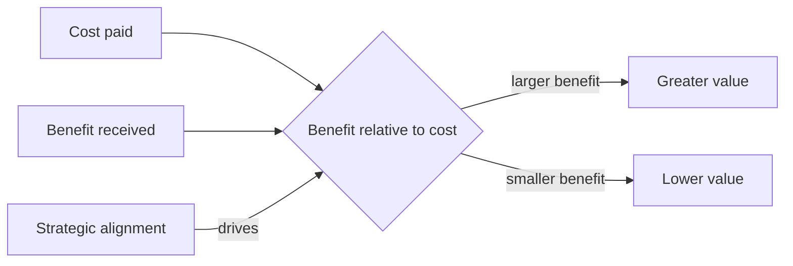

| Discipline | Nature |
|---|---|
| IT portfolio management | Strategic and directive |
| IT financial management | Tracks money and budgets |

<b>Exam traps</b>

- ⭐ IT value depends on strategic alignment.
- Cost alone never defines value.
- Alignment beats technical sophistication as value driver.
- Financial management is not the strategic discipline.
- Example: cheap tool nobody needs has low value.

### 2.8.2 Implementing IT portfolio management

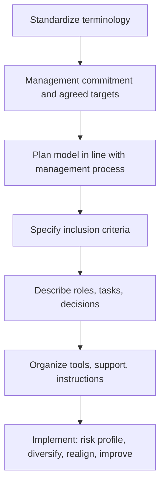

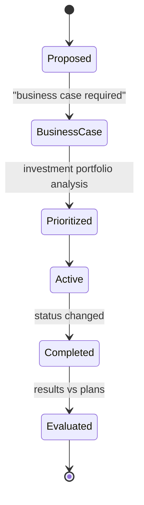

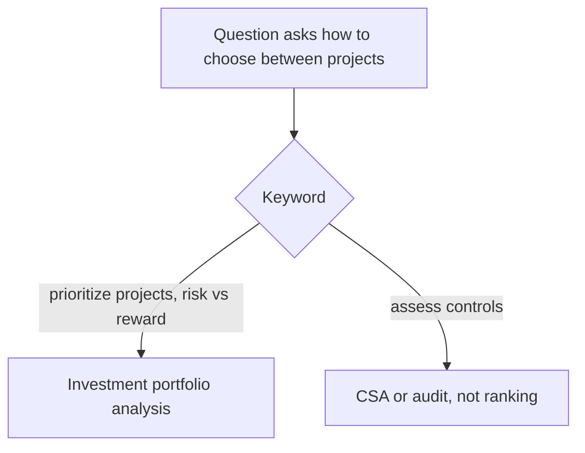

<b>Definitions</b>

- Investment portfolio analysis ⭐📓: balances project risk against financial reward.
- Criteria: financial, strategic or tactical; must be able to change.
- Diversification: spreading across projects, infrastructure, technologies.
- Technical debt: future rework cost from quick or outdated choices.
- Mandatory projects: regulatory compliance, technical debt.

<b>Exam traps</b>

- Mandatory does not mean exempt from business case.
- Do not delete completed programs; keep for benefit evidence.
- CSA and audits do not rank project value.

### 2.8.3 IT management practices

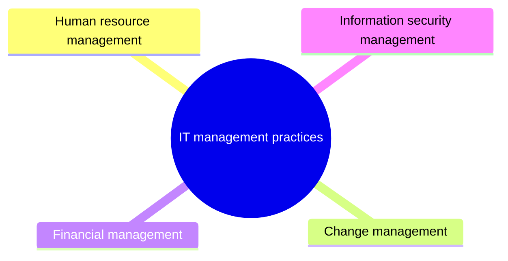

| Staffing model | Meaning |
|---|---|
| Onsite | Staff work in IT department |
| Offsite nearshore | Remote staff in same area |
| Offshore | Remote site in different region |

Staffing models are in the manual but not the outline (unverified).

<b>Notes</b>

- IT began as support function; now integrated across operations.
- Practices turn policies and procedures into daily operation.
- Trap: treating IT as only a cost center.

### 2.8.4 Human resource management

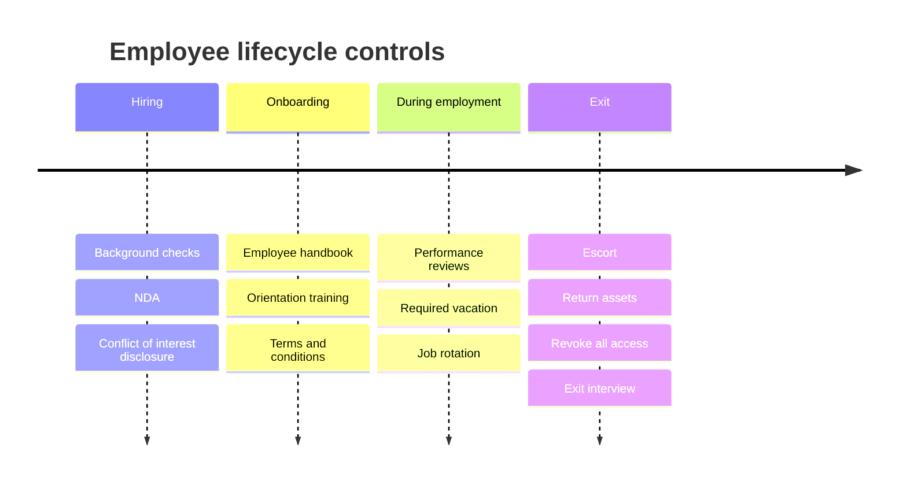

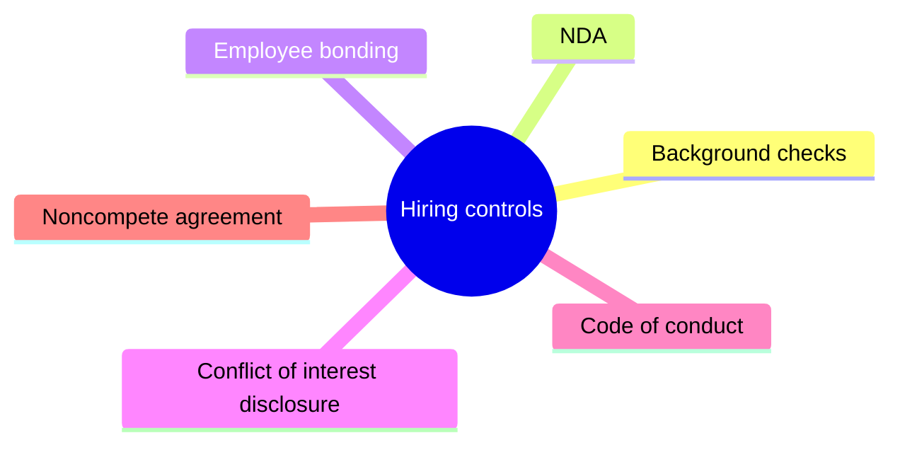

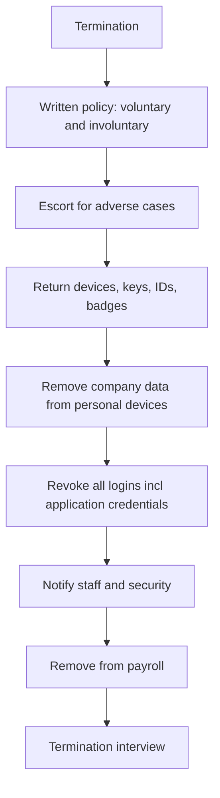

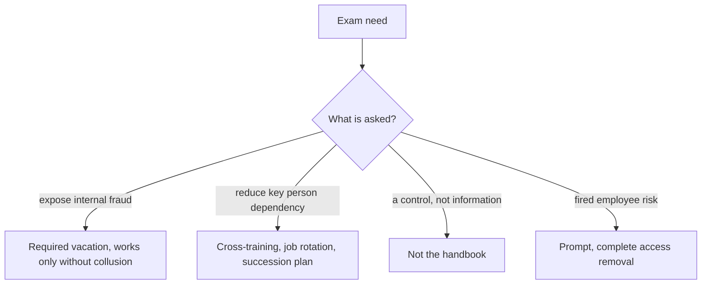

| Topic | Key point |
|---|---|
| Handbook | Information source, not a control |
| SMART goals | Specific, measurable, attainable, relevant, time-bound |
| PIP | Structured plan before harsher discipline |
| Promotion | Fair, objective; auditor checks historical data for bias |
| Retention | Compensation, benefits, mentorship, development |
| Succession | Trained replacement for critical roles |

<b>Residual risk after hiring controls</b>

- Employee may be unsuitable for role.
- Reference checks skipped or fraudulent.
- Temporary staff and contractors add uncontrolled risk.
- Low confidentiality awareness.
- Controls reduce risk; they never eliminate it.

<b>Terms and conditions of employment</b>

- Signed by employees, contractors, third-party users.
- NDA signed before access to internal information.
- Legal rights and duties: copyright, data protection.
- Duties for classifying information and managing assets.
- Responsibilities outside premises and hours, including remote work.
- Obligations may continue after employment ends.

<b>Training and scheduling</b>

- New-hire orientation: cybersecurity, confidentiality, data management, compliance.
- Training required when new hardware or software arrives.
- Cross-training reduces dependence but can concentrate knowledge.
- Time reporting supports chargebacks, KPIs, staffing checks.

<b>Exam traps and notes</b>

- Manual says HR content is untested, yet mandatory leave is expected.
- Bonding is illegal in some countries.
- Noncompete enforceability varies by jurisdiction (unverified).
- ⭐📓 Required vacation: away at least once a year.
- Disabling only network ID leaves application access open.
- Example: payables clerk on leave reveals fictitious vendor payments.

### 2.8.5 Enterprise change management

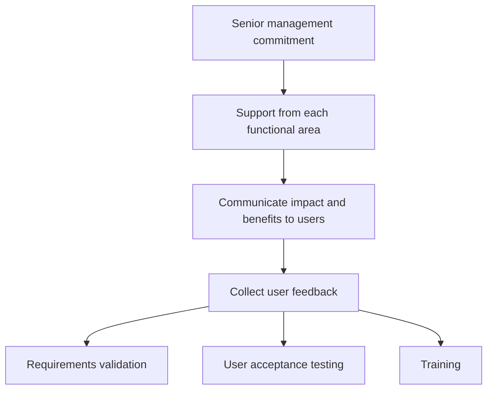

<b>Notes and exam traps</b>

- Defined, documented process to apply technology improvements.
- IT leads or facilitates as focal point.
- Trap: rollout without user involvement is usual failure cause.
- This is organizational change, not IT change control (unverified).

### 2.8.6 Financial management practices

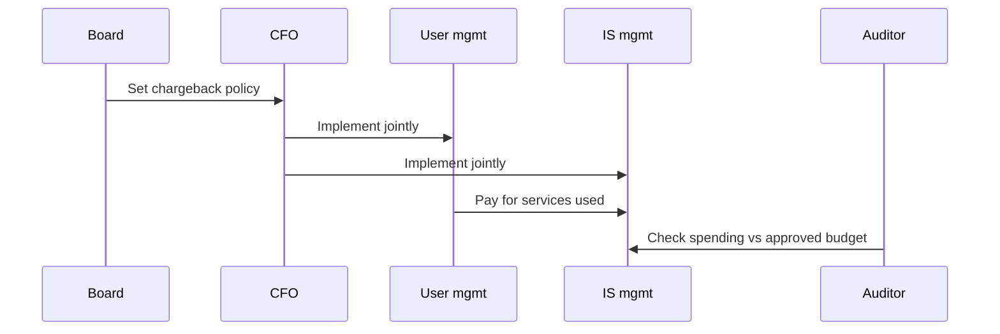

| Item | Typical treatment |
|---|---|
| On-premises purchased software | Generally capital expense |
| Cloud subscription | Usually operating expense |
| Development costs | IAS 38 criteria for capitalizing |

<b>Definitions</b>

- Chargeback: user-pays by standard formula: staff time, computer time, other.
- IS budget: supports forecasting, monitoring, analysis.
- Opex: expensed when incurred; capex: asset spread over life.
- IAS 38: intangible assets standard; needs probable future economic benefits.

<b>Exam traps and notes</b>

- Board sets policy; IT alone does not.
- Generally and usually signal tendencies, not absolutes.
- Auditor confirms tracking and budget; accountants decide treatment.
- Manipulating classification can misstate financials.
- Six IAS 38 criteria not listed in the manual (unverified).

### 2.8.7 Information security management

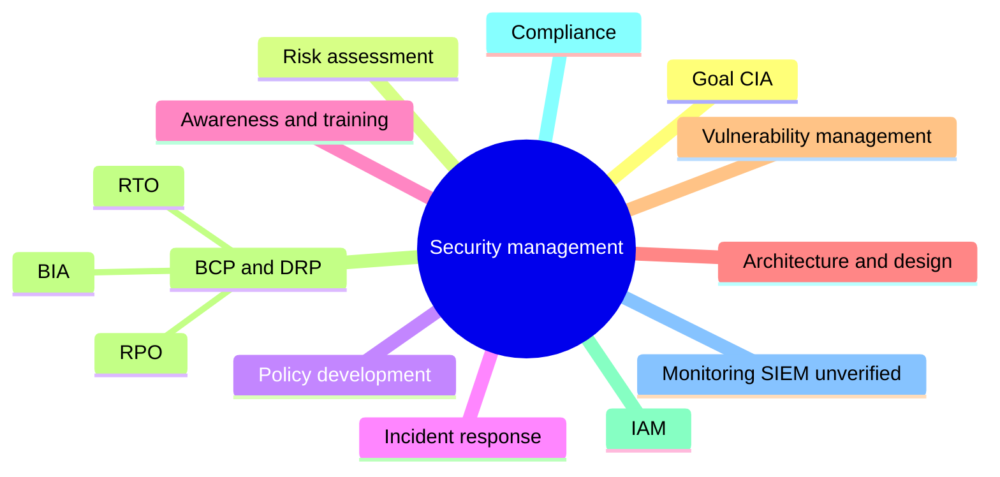

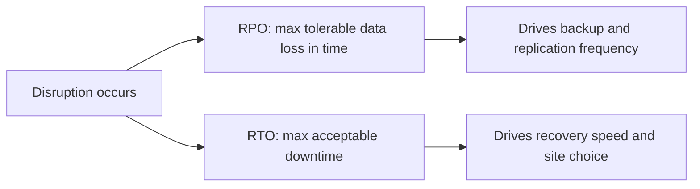

<b>Definitions</b>

- ⭐📓 RTO: maximum acceptable downtime before operations resume.
- ⭐📓 RPO: maximum tolerable data loss, in time units.
- BIA: assesses outage impact; sets recovery priorities.
- IAM: strong authentication, least privilege, monitoring.
- Vulnerability management: scans, patches, penetration tests.

<b>Exam traps and example</b>

- Never swap RTO and RPO.
- Example: RPO of one hour needs hourly backups or replication.
- Backup interval longer than RPO breaches objective.
- Business owners still own risk acceptance.
- SIEM label is an outline addition, not in manual (unverified).

### Quick recall

| # | Fact |
|---|---|
| 1 | ⭐ IT value depends on strategic alignment |
| 2 | ⭐ Investment portfolio analysis supports project prioritization |
| 3 | 📓 Portfolio analysis balances risk against financial reward |
| 4 | Mandatory projects still need a business case |
| 5 | Handbook informs; it is not a control |
| 6 | Required vacation exposes fraud absent collusion |
| 7 | Change management: senior commitment, functional areas, then users |
| 8 | Board sets chargeback policy |
| 9 | RTO is downtime; RPO is data loss |
| 10 | Revoke all access on termination, including application logins |
