# 2.9 IT Vendor Management: Diagrams

[← Domain 2](../README.md) | [Study notes](../Study-Notes/2.9-Study-Notes.md)

> Markers: 📓 = in my notes, ⭐ = frequently tested, ➕ / ⚠ Check = unverified (labelled "unverified").

## Section map

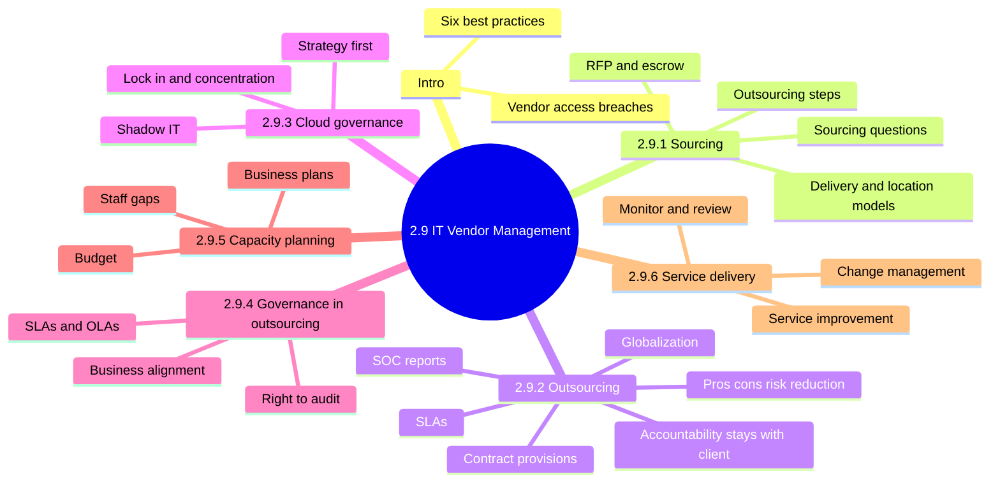

### 2.9 Introduction: Why vendor risk matters

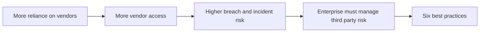

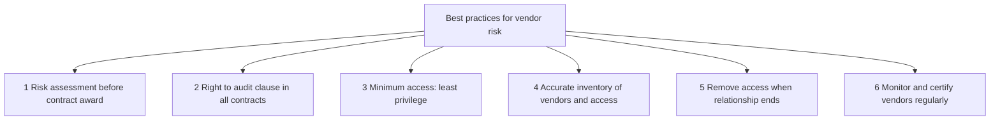

<details>
<summary><b>Definitions</b></summary>

- Vendor: outside company supplying products or services.
- Third-party risk: risk from an outside party touching systems or data.
- Vendor access: permissions given to a vendor.

</details>

<details>
<summary><b>Example</b></summary>

- A maintenance vendor's stolen remote login lets attackers into the network.
- Comparing vendor inventory to active accounts reveals a terminated vendor still enabled.

</details>

<details>
<summary><b>Exam traps</b></summary>

- Best first step: assess risk before contract award.
- Vendor reputation is not a substitute for verification and audit rights.
- Least privilege applies to vendors too.
- Certify and monitor regularly, not once.

</details>

### 2.9.1 Sourcing practices

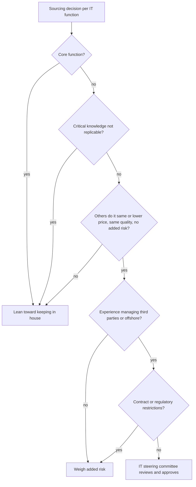

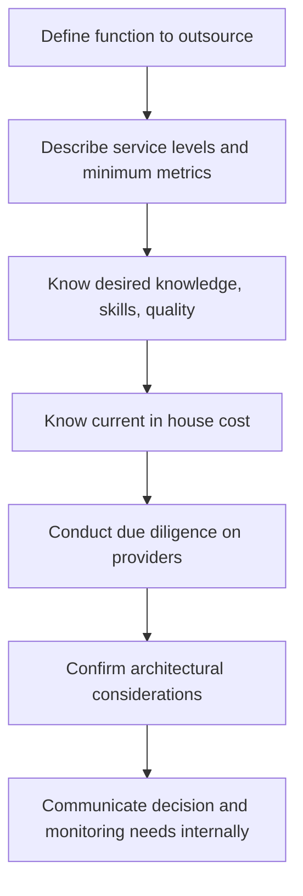

| Delivery model | Who performs the work | Audit point |
|---|---|---|
| Insourced | Enterprise staff | Highest control, possible skill gaps |
| Outsourced | Vendor staff | Control shifts to contract and monitoring |
| Hybrid | Mix, joint ventures, supplemental staff | Unclear roles cause accountability gaps |

| Location model | Where staff work | Audit point |
|---|---|---|
| Onsite | In enterprise IT department | Lowest oversight risk |
| Offsite (nearshore) | Remote, same area | Test remote access controls |
| Offshore | Different geographic region | Legal, tax, continuity, cross-border data risk |

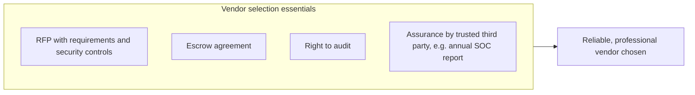

<details>
<summary><b>Definitions</b></summary>

- COTS: ready-made products bought rather than built.
- SLA: contract part setting service levels and support.
- Software escrow: source code held by neutral third party.
- RFP: document asking vendors to bid against requirements.
- Also consider supplier financial viability and licensing scalability.

</details>

<details>
<summary><b>Example</b></summary>

- A bank keeps credit scoring logic in house because it differentiates the business.
- Small vendor goes bankrupt; escrowed source lets client maintain the application.

</details>

<details>
<summary><b>Exam traps</b></summary>

- Auditor understands requirements; auditor does not draft legal contracts.
- Cheapest bid is not the answer; quality, risk, viability matter.
- In house cost baseline is still needed for bid comparison.
- Steering committee approves sourcing, not the auditor.
- Nearshore is same area; offshore is different region.
- Escrow release triggers and verification testing are unverified (common practice).

</details>

### 2.9.2 Outsourcing practices and strategies

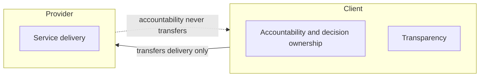

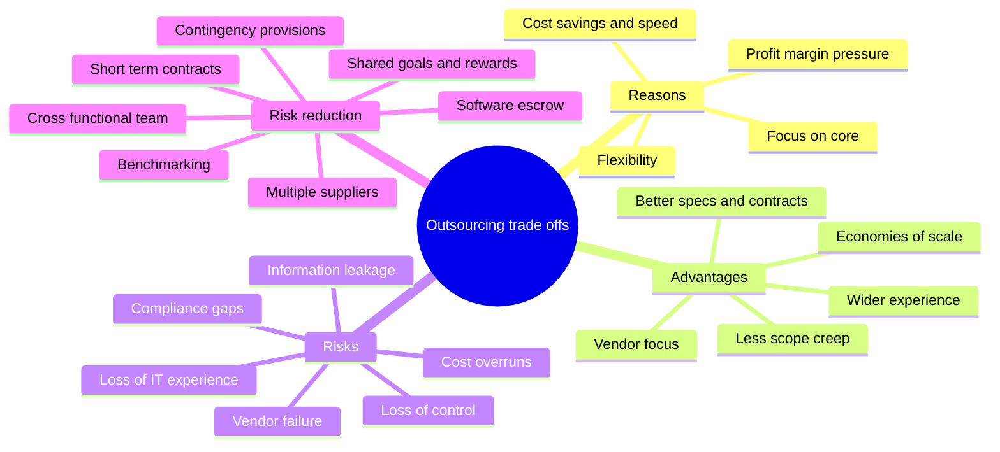

```mermaid
flowchart TD
    CP["Outsourcing contract provisions"]
    CP --> G1["Security and control"]
    CP --> G2["Performance and change"]
    CP --> G3["Legal and protection"]
    CP --> G4["Continuity and roles"]
    G1 --> A1["Access control and security administration"]
    G1 --> A2["Violation reporting and follow up"]
    G1 --> A3["Owner notification and investigation cooperation"]
    G1 --> A4["Network control responsibilities"]
    G2 --> B1["Performance parameters"]
    G2 --> B2["Capacity management criteria"]
    G2 --> B3["Change and version control with testing"]
    G2 --> B4["Contract change and dispute escalation"]
    G3 --> C1["Indemnification"]
    G3 --> C2["NDAs and IP ownership"]
    G3 --> C3["Right to audit"]
    G3 --> C4["Compliance with laws, including later ones"]
    G4 --> D1["BCP and DRP with testing"]
    G4 --> D2["CIA of data and data ownership"]
    G4 --> D3["Roles, warranty, escrow"]
    G4 --> D4["Subcontractors identified, changes approved"]
```

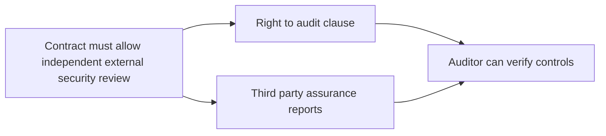

SLAs (📓⭐ monitor outsourced activity through SLA metrics):

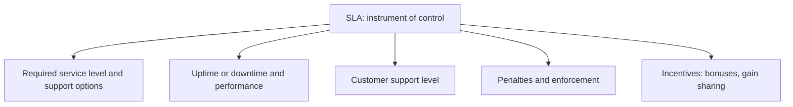

Globalization concerns:

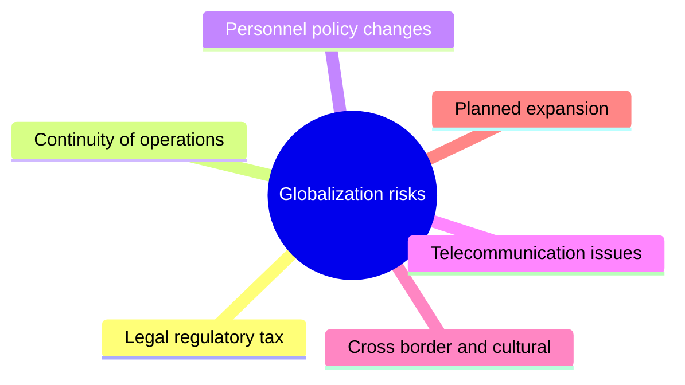

Third-party audit reports:

| Report | Focus | Exam note |
|---|---|---|
| SOC 1 | Controls relevant to user entities' financial reporting | Wrong if concern is security |
| SOC 2 | Security, availability, processing integrity, confidentiality, privacy | Best fit for security assurance |
| SOC 3 | Like SOC 2 without control design and test detail | Too thin for detailed reliance |
| SSAE 18 / AICPA guide | Frames the SOC options | Replaced SAS 70 |
| ISAE 3402 | IAASB standard for service organization reports | International counterpart |

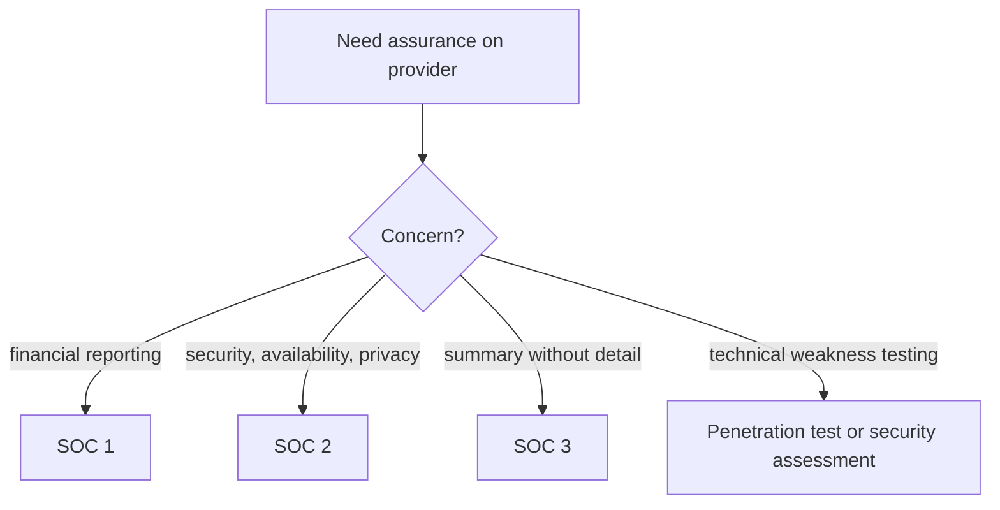

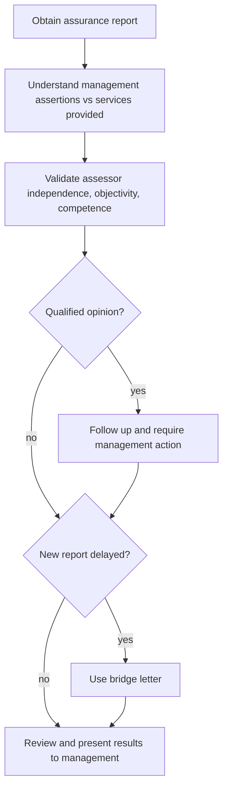

<details>
<summary><b>Definitions</b></summary>

- Outsourcing: handing control of IT functions to an external party.
- Indemnification: vendor compensates for damage it causes.
- NDA: legal promise to keep shared information confidential.
- Right to audit ⭐: covers facilities, records, copies, personnel, computerized files.
- Qualified opinion: assessor reports exceptions or scope limits.
- Bridge letter: covers gap since last report period (definition unverified).
- Globalization: moving IT functions offsite or offshore.
- Industry standards used for benchmarking: ISO 9001:2015, CMMI.
- Quality methods: ISO/IEC TR 33015, ISO/IEC TS 33061, CMMI, ITIL.

</details>

<details>
<summary><b>Example</b></summary>

- Retailer outsources payroll but remains liable for payroll errors.
- Vendor swaps in unvetted offshore subcontractor without approval.
- Offshore call center lacks tested recovery plan and loses service in an outage.
- Cloud provider's annual SOC 2 report reviewed before renewing hosting.

</details>

<details>
<summary><b>Exam traps</b></summary>

- Accountability never transfers; client stays responsible. 📓⭐
- Best assurance for outsourced security: contractual right to external review. 📓⭐
- Provider claiming compliance is weaker than independent verification.
- Auditor monitors via SLA metrics, not by running the service. 📓⭐
- Vendor policy applies only if enterprise agreed in advance.
- Subcontractor changes need approval; notification alone is insufficient.
- Short contracts and multiple suppliers reduce lock in; they are not flaws.
- SOC 2 Type I tests design, Type II tests operation over time (unverified).
- Legal team must review and approve outsourcing.

</details>

### 2.9.3 Cloud governance

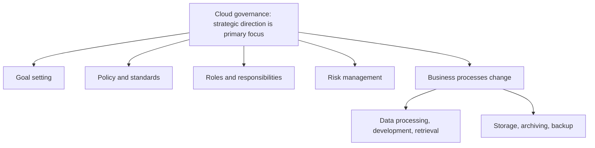

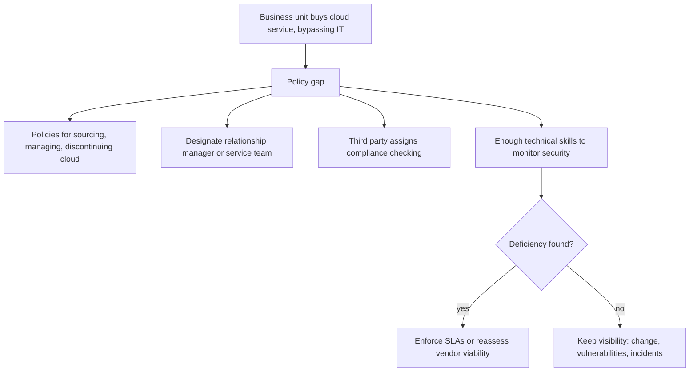

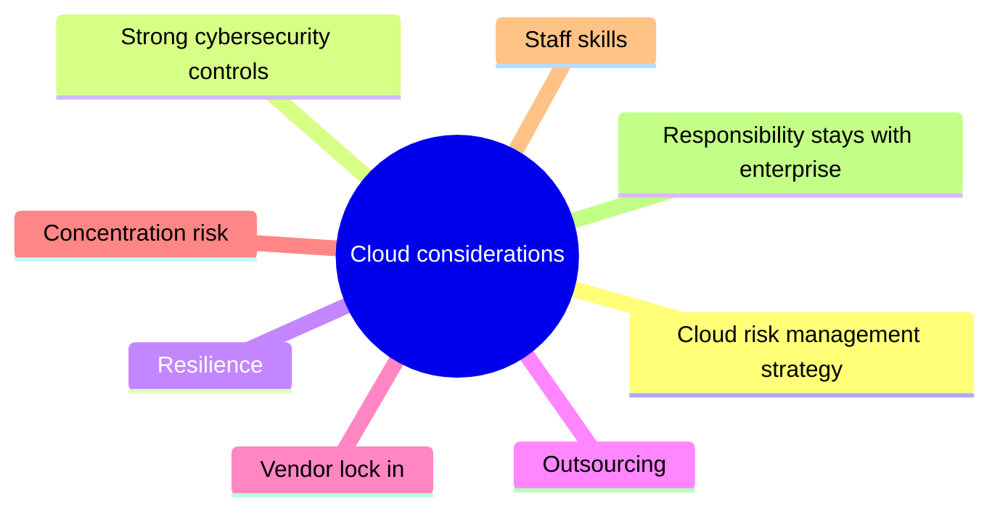

<details>
<summary><b>Definitions</b></summary>

- Cloud governance: governance applied to cloud provider services.
- Concentration risk: too much dependence on one provider.
- Vendor lock in: difficulty leaving a provider once dependent.
- Shadow IT: technology used without IT approval (term unverified in manual).
- Data portability terms for lock in are unverified (common practice).

</details>

<details>
<summary><b>Example</b></summary>

- Marketing signs up for a cloud tool; IT never reviews its security.

</details>

<details>
<summary><b>Exam traps</b></summary>

- Moving data to cloud never transfers responsibility.
- Governance starts with strategy, not technical configuration.
- Business unit cloud purchases outside IT signal a policy gap.
- Provider failures: enforce SLAs or reassess viability.
- Technical cloud models belong to Domain 5.

</details>

### 2.9.4 Governance in outsourcing

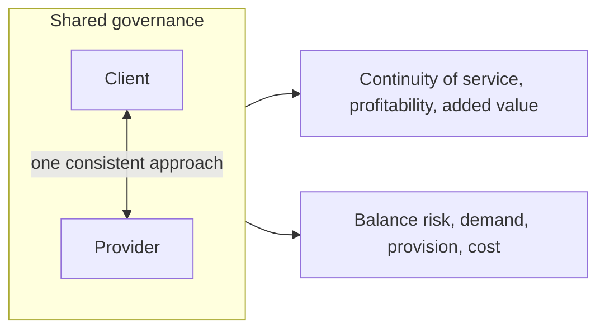

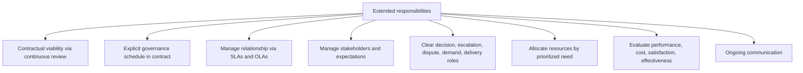

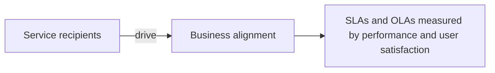

```mermaid
flowchart TD
    RA["Right to audit understanding"] --> R1["How contract permits auditing the provider"]
    RA --> R2["Visibility into internal controls: CIA, preventive, detective, corrective"]
    RA --> R3["Documented SLAs for problem and incident management"]
    R3 --> R4["Communicated to affected parties"]
```

<details>
<summary><b>Definitions</b></summary>

- OLA: service level agreement between internal support groups (definition unverified).
- Business alignment: IT services reflect what business users need.

</details>

<details>
<summary><b>Example</b></summary>

- Quarterly governance meeting reviews SLA misses and adjusts service priorities.

</details>

<details>
<summary><b>Exam traps</b></summary>

- Governance is shared, but accountability stays with client.
- Detailed contract wording cannot replace a governance process.
- Alignment is judged by service recipients, not the vendor.
- Right to audit without control visibility gives weak assurance.
- Enterprises often assume the proposal includes more than it does.

</details>

### 2.9.5 Capacity and growth planning

```mermaid
flowchart LR
    BP["Long and short range business plans"] --> CP["Capacity and growth planning"]
    BUD["Budgeting process"] --> CP
    INF["Infrastructure and staff changes"] --> CP
    CP --> OK["Services and projects on schedule"]
    CP -.->|"if neglected"| ST["Lack of qualified staff"]
    ST --> D1["Delayed projects"]
    ST --> D2["Missed service levels"]
    ST --> OUT["May drive outsourcing for growth"]
```

<details>
<summary><b>Example</b></summary>

- Hiring shortage delays a rollout, so management contracts a vendor team.

</details>

<details>
<summary><b>Exam traps</b></summary>

- Capacity planning ties to business plans and budget, not only hardware.
- Staff shortage is a capacity problem too.

</details>

### 2.9.6 Third-party service delivery management

```mermaid
stateDiagram-v2
    [*] --> Agreed
    Agreed --> Monitored: check implementation
    Monitored --> Reviewed: reports, audit trails, meetings
    Reviewed --> Resolved: problems identified
    Resolved --> Monitored: continue monitoring
    Monitored --> ChangeAssessed: change proposed
    ChangeAssessed --> Monitored: risk reassessed and approved
    Reviewed --> Improved: SLA baseline met
    Improved --> Monitored: new targets set
```

```mermaid
flowchart TD
    M["Monitoring and review"] --> M1["Monitor service performance levels"]
    M --> M2["Review service reports, hold progress meetings"]
    M --> M3["Share and review security incident information"]
    M --> M4["Review audit trails and records of events and failures"]
    M --> M5["Resolve identified problems"]
```

| Changes by enterprise | Changes by provider |
|---|---|
| Service enhancements | Network changes and enhancements |
| New applications and systems | New technologies |
| Updated policies and procedures | New products or versions |
| New controls after incidents | New development tools |
| IT security policy updates | Facility location change |
| | Vendor or subcontractor change |

```mermaid
flowchart LR
    SLA["SLA sets baseline"] --> IMP["Improvement expectations"]
    IMP --> PR["Penalties and rewards"]
    IMP --> EX["Fewer help desk calls, fewer errors, better availability"]
    SLA --> SAT["Satisfaction by interviews and surveys at SLA intervals"]
```

<details>
<summary><b>Definitions</b></summary>

- Service delivery management system: keeps third party service and security at agreed levels.
- It checks implementation, monitors compliance, manages changes.

</details>

<details>
<summary><b>Example</b></summary>

- Monthly review shows repeated outages, triggering corrective action plan.
- Provider moves data center to another country without notifying client.

</details>

<details>
<summary><b>Exam traps</b></summary>

- Monitor reports, audit trails, incident data; do not trust self reports.
- Provider changes need risk reassessment, even if called minor.
- SLA is baseline; improvement targets go beyond it.
- Satisfaction surveys follow SLA periods, not ad hoc.

</details>

### Quick recall

| # | Fact |
|---|---|
| 1 ⭐ | Accountability stays with client whatever is outsourced |
| 2 ⭐ | Contract must allow independent external security review 📓 |
| 3 ⭐ | Monitor outsourced activity through SLA metrics 📓 |
| 4 ⭐ | Right to audit covers facilities, records, personnel, files |
| 5 | SOC 1 financial, SOC 2 security, SOC 3 summary |
| 6 | Risk assessment before contract award |
| 7 | Steering committee approves sourcing decision |
| 8 | Nearshore is same area; offshore is different region |
| 9 | Cloud move never transfers responsibility for information |
| 10 | Provider changes require risk reassessment |
