# 3.1 Project Governance and Management - Diagrams

[← Domain 3](../README.md) | [Study notes](../Study-Notes/3.1-Study-Notes.md)

Markers: 📓 in my notes, ⭐ frequently tested, ➕ unverified (shown as "unverified" inside diagrams).

## Section map

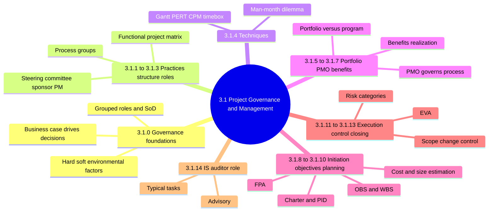

### 3.1.0 Governance foundations

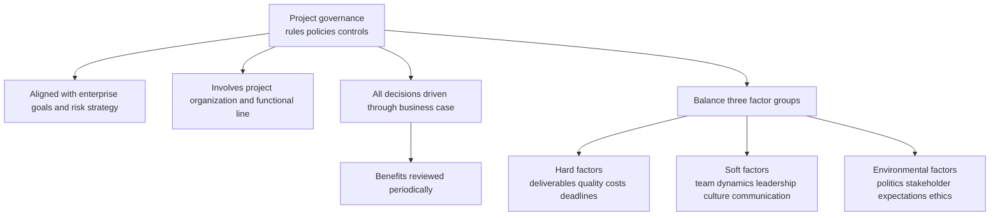

| Topic | Key point |
|---|---|
| Portfolio and program links | Show common objectives, risks, resource connections |
| Third-party transformation teams | Solution must fit the business, not one-size-fits-all |
| Small enterprises | Roles may be grouped; auditor ensures SoD intact |
| Exam scope | No specific PM standard tested; know structures and controls |

<details>
<summary><b>Example and exam traps</b></summary>

- Example: on-budget project fails as sponsor's department resists new process.
- Example: one person develops and approves code changes is a red flag.
- Trap: choose the control principle, not a named methodology's terms.
- Trap: projects often fail on soft or environmental factors.

</details>

### 3.1.1 Project management practices

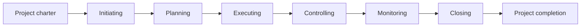

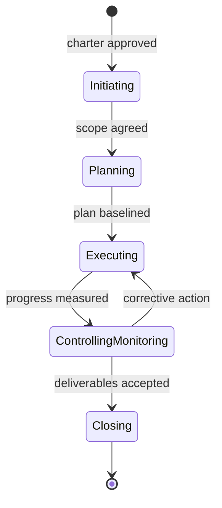

<details>
<summary><b>Definitions and exam traps</b></summary>

- Project management applies knowledge, skills, tools, techniques to meet objectives.
- It begins with the charter and ends with project completion.
- Apply business process engineering design issues to the PM process itself.
- Most IS projects divide into explicit phases such as the SDLC.
- Unverified: manual lists controlling and monitoring separately; some standards merge them.

</details>

### 3.1.2 Project management structure

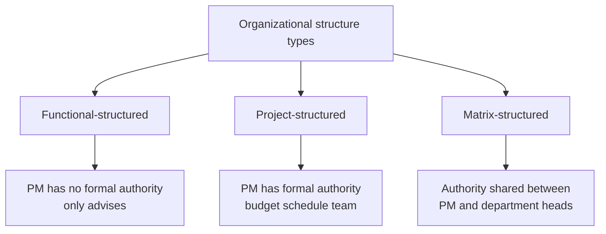

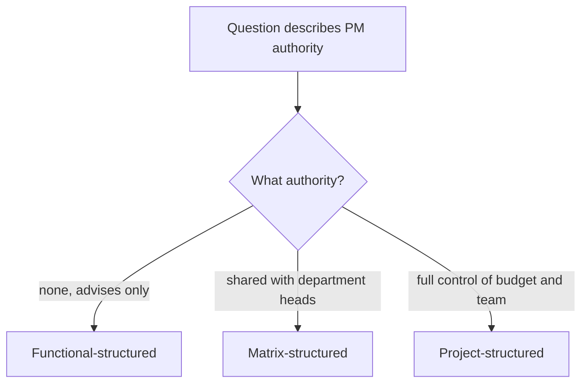

Sample project organization chart (figure 3.1). Box details are unverified because the source text is garbled.

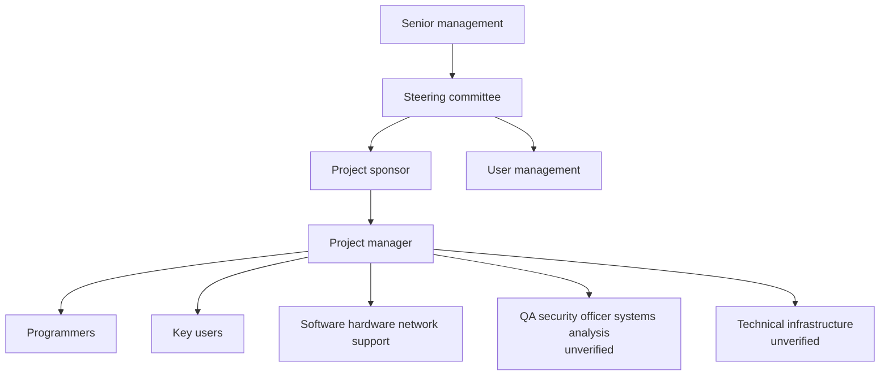

<details>
<summary><b>Initiation and governance points</b></summary>

- IT steering committee prioritizes major project requests and picks the project manager.
- Project manager need not be IT staff.
- Project manager needs full operational control and resources.
- IS auditor may join as control expert in an advisory role.
- Heavy auditor involvement may make auditor ineligible to audit the application later.
- IS projects may start anywhere in the enterprise, including IT.
- Trap: the auditor does not prioritize projects.
- Unverified: support groups footnote reading system development management.

</details>

### 3.1.3 Project management roles and responsibilities

Role overview (steering committee, sponsor, user and project roles):

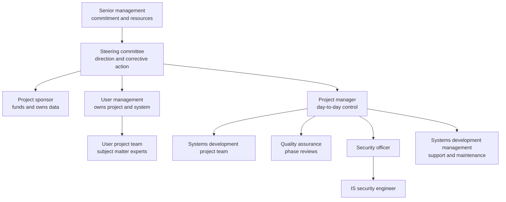

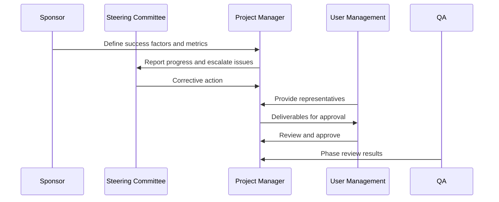

| Role | Core duties |
|---|---|
| Steering committee | Direction; responsible for deliverables, costs, schedules; sponsor chairs |
| Senior management | Shows commitment; approves resources |
| Project sponsor | Funds project; owns data and application |
| User management | Owns project and system; approves deliverables |
| User project team | Completes tasks; advises on deviations |
| Project manager | Day-to-day leadership; budget, schedule, conflicts |
| Quality assurance | Reviews deliverables each phase; checks SDLC adherence |
| Systems development management | Technical support; takes over operations and maintenance |
| Systems development project team | Completes tasks; involves users |
| Security officer | Data protection per classification; reviews security test plans |
| IS security engineer | Finds and contains vulnerabilities; privacy and data subject rights |

<details>
<summary><b>Steering committee details</b></summary>

- Includes senior representative from each significantly affected business area.
- Project manager is a member; sponsor chairs.
- Members may decide on designs affecting their departments.
- Meets regularly and in emergencies.
- Audit check: minutes show reviews and escalation decisions.

</details>

<details>
<summary><b>Exam traps</b></summary>

- Sponsor funds and owns data; the project manager does not.
- IT operations do not own business data or project outcome.
- Match the duty to the owner: ownership sits with sponsor and users.
- QA independent of developers supports SoD.

</details>

### 3.1.4 Project management techniques ⭐

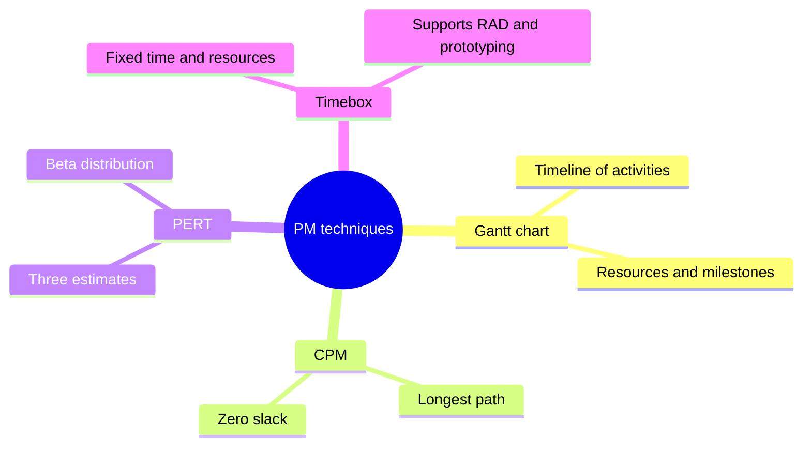

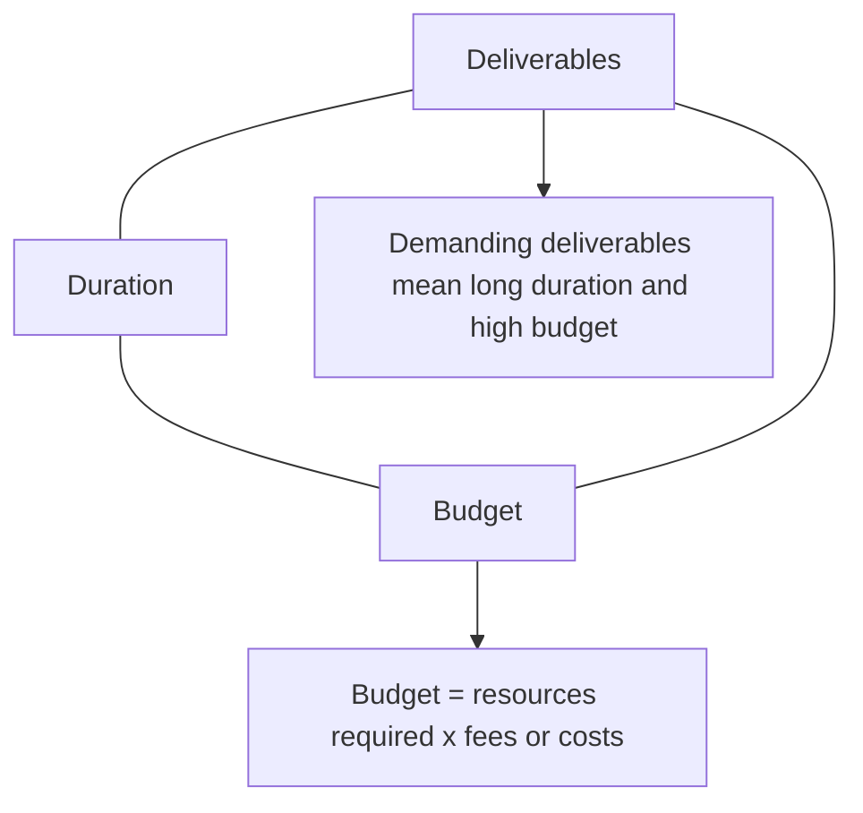

Man-month dilemma, R x D = TR (TR constant). Worked example with TR = 24 person-months:

| Resources R | Duration D | R x D |
|---|---|---|
| 4 | 6 months | 24 |
| 8 | 3 months | 24 |
| 12 | 2 months | 24 |

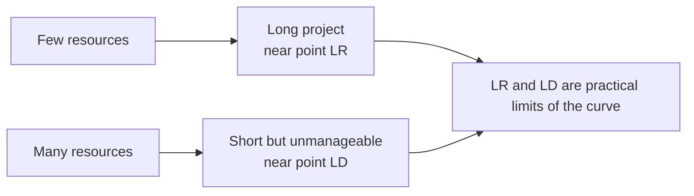

<details>
<summary><b>Exam traps and notes</b></summary>

- Adding people does not always shorten the schedule; manageability limits it.
- Rectangle area at any point is proportional to budget.
- Unverified: real teams add coordination overhead beyond the formula.

</details>

### 3.1.5 Portfolio / program management

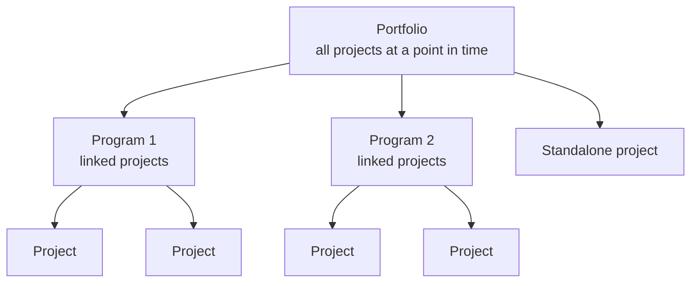

| Aspect | Program | Portfolio |
|---|---|---|
| Coupling | Closely coupled | Projects need not be linked |
| Scale | Complex, longer, higher budget and risk | All underway activities |
| Start | Written assignment from program sponsor | Ongoing |
| Examples | ERP rollout; mergers and acquisitions | Everything the enterprise runs |

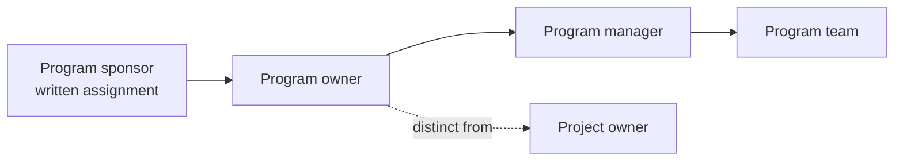

<details>
<summary><b>Program details and traps</b></summary>

- Objectives: scope, financials, schedules, deliverables, context, culture, communication.
- Program and project methodologies run in parallel, not combined.
- Structures: expert pools, PMO, project portfolio groups.
- Integrative tools: PM guidelines and standard project plans.
- Trap: tightly linked projects form a program; unrelated ones only share the portfolio.

</details>

### 3.1.6 Project Management Office (PMO)

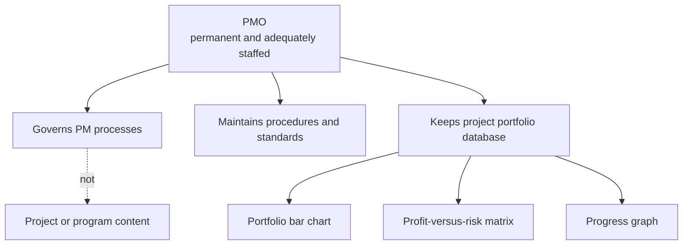

<details>
<summary><b>Portfolio objectives, database and traps</b></summary>

- Optimize portfolio results, not individual projects.
- Prioritize and schedule projects.
- Coordinate internal and external resources.
- Transfer knowledge across projects.
- Database is mandatory: owner, schedule, objectives, type, status, cost.
- Auditor separates content aspects from procedural aspects.
- Trap: PMO checks how projects run, not whether the solution is correct.

</details>

### 3.1.7 Project benefits realization

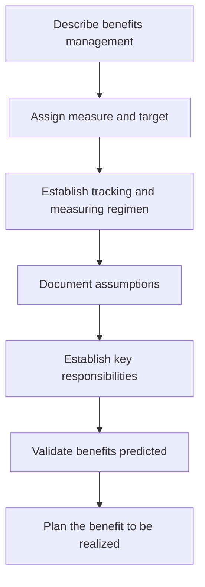

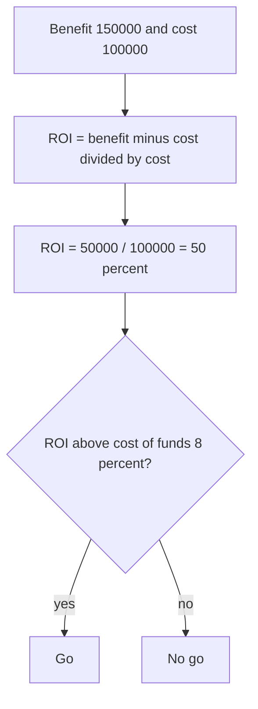

<details>
<summary><b>Related points and traps</b></summary>

- Ensures IT investments deliver promised, measurable business value.
- Plan covers total benefits and costs over system life.
- Compromise among cost, quality, delivery time, reliability, dependability.
- Repeated ROI failure suggests weak SDLC and PM practices.
- Unverified: four phases at project level appear only in figure 3.4.
- Unverified: it is continuous and needs business sponsorship.
- Unverified: allow time for technical problems to settle before measuring.
- Unverified: ROI formula is common practice, not in the manual.
- Trap: after go-live, primary focus is measuring and reporting planned benefits.

</details>

### 3.1.8 Project initiation

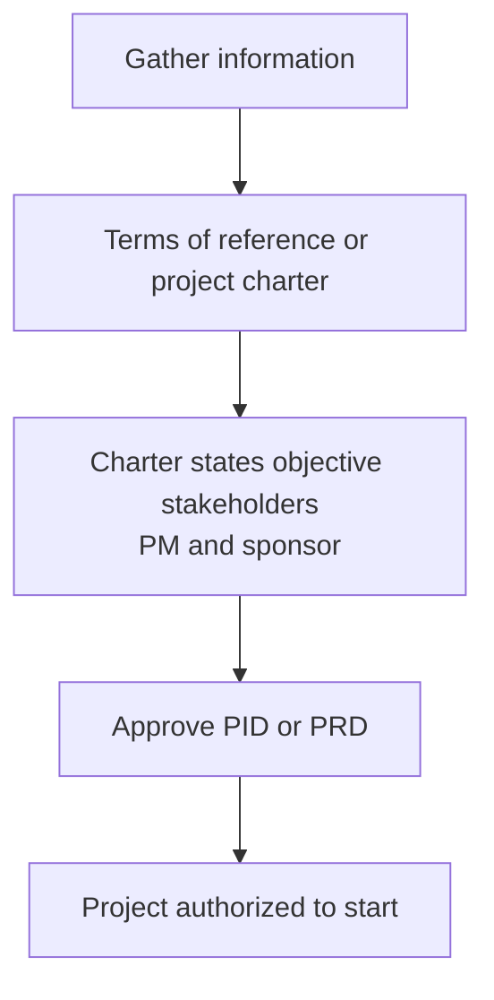

| Initiation method | Purpose |
|---|---|
| One-on-one meetings | Two-way communication manager and member |
| Kick-off meetings | Manager tells team what must be done |
| Project start workshops | Stakeholder buy-in and common overview |
| Combination | Enterprises may mix methods |

<details>
<summary><b>Notes</b></summary>

- Document significant project events as project artifacts.
- Audit: no approved charter means no formal authority or accountability.

</details>

### 3.1.9 Project objectives

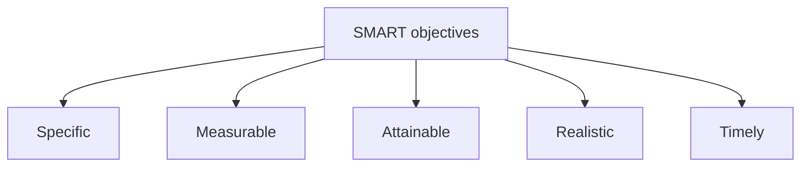

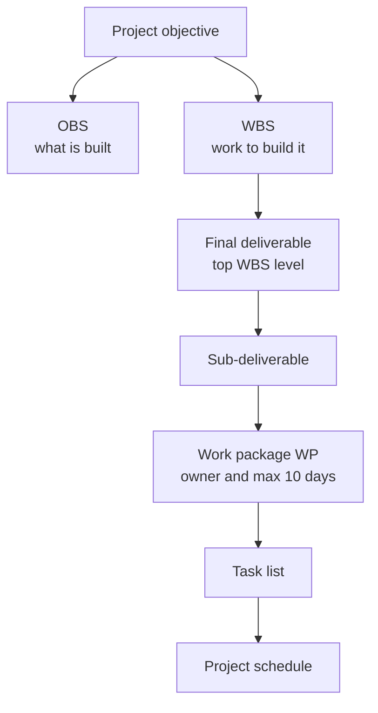

<details>
<summary><b>Work package rules and traps</b></summary>

- Each WP has a distinct owner.
- WP lists main, additional and out-of-scope objectives.
- Specification includes dependencies and performance evaluation.
- WPs not over 10 days; independent; not duplicated.
- WBS: manageable units, communications tool, cost and resource baseline.
- Schedule shows dates, percent complete, dependencies, names, stage boundaries.
- Unverified: figure 3.5 example Services Online with WP1 web page, WP2 sales interface.
- Trap: OBS lists what is built; WBS lists the work to build it.

</details>

### 3.1.10 Project planning

```mermaid
flowchart LR
    A["Scope agreed with stakeholders"] --> B["Tasks sequence duration priority"]
    B --> C["IT and non-IT resources"]
    C --> D["Budget and funding source"]
```

Cost estimation methods (qualitative placement, speed versus accuracy):

```mermaid
quadrantChart
    title Cost estimation methods
    x-axis Quicker --> Slower
    y-axis Less accurate --> More accurate
    quadrant-1 Slow and accurate
    quadrant-2 Quick and accurate
    quadrant-3 Quick and rough
    quadrant-4 Slow and rough
    Analogous: [0.15, 0.2]
    Parametric: [0.5, 0.55]
    Bottom-up: [0.9, 0.9]
```

| Method | Basis | Trait |
|---|---|---|
| Analogous | Prior similar projects | Quickest, least precise |
| Parametric | Statistical data | More accurate than analogous |
| Bottom-up | Each activity costed | Most accurate, most time-consuming |
| Actual costs | Past costs of same system | Extrapolation |

#### Software size estimation and Function Point Analysis ⭐

```mermaid
flowchart TD
    A["Software size estimation"] --> B["Single-point such as SLOC"]
    A --> C["Multiple-point"]
    B --> D["Fails on complex systems"]
    C --> E["Function Point Analysis"]
    E --> F["Business applications"]
    E -.->|"weaker for OS control comms"| G["COCOMO suits those"]
```

FPA steps flowchart:

```mermaid
flowchart TD
    A["1. Identify the five counts<br/>inputs outputs inquiries files interfaces"] --> B["2. Rate each entry<br/>simple average complex"]
    B --> C["3. Apply weights to each count"]
    C --> D["4. Sum to unadjusted function points"]
    D --> E["5. Apply complexity adjustment<br/>reliability criticality complexity<br/>reusability changeability portability"]
    E --> F["6. Adjusted function points"]
    F --> G["7. Derive metrics<br/>FP per person-month<br/>defects per FP<br/>cost per FP"]
```

| Count | Simple | Average | Complex |
|---|---|---|---|
| User inputs | 3 | 4 | 6 |
| Outputs | 4 | 5 | 7 |
| Inquiries | 3 | 4 | 6 |
| Files | 7 | 10 | 15 |
| External interfaces | 5 | 7 | 10 |

<details>
<summary><b>FPA worked example from the study notes</b></summary>

- 4 simple inputs x 3 = 12; 3 average outputs x 5 = 15.
- 2 complex inquiries x 6 = 12; 2 average files x 10 = 20.
- 1 simple interface x 5 = 5; unadjusted total = 64.
- Unverified: adjusted FP = count x (0.65 + 0.01 x rating sum).
- Unverified: rating sum 42 gives 1.07; adjusted 68.48; 8.56 FP per person-month at 8 months.
- Exam does not test FPA calculation specifics.

</details>

#### Cost budgets and software cost estimation

```mermaid
flowchart TD
    A["Cost budget"] --> B["Personnel hours<br/>analyst programmer clerical"]
    A --> C["Machine hours<br/>computer time and equipment"]
    A --> D["External costs<br/>software licences contractors training space"]
    B --> E["Step 1 sum effort per phase"]
    C --> E
    D --> E
    E --> F["Step 2 multiply by hourly rate"]
    F --> G["Revisit at milestones and report variances"]
```

<details>
<summary><b>Costing example and cost drivers</b></summary>

- Design: analyst 100h x 80 = 8,000; programmer 200h x 60 = 12,000.
- Build: programmer 400h x 60 = 24,000; clerical 50h x 30 = 1,500.
- Build machine time 100h x 20 = 2,000.
- Phase totals 20,000 and 27,500; project total 47,500.
- Cost drivers: language, execution time and storage constraints.
- Cost drivers: computer access, target machine, security environment, staff experience.

</details>

#### Scheduling: Gantt, CPM, PERT, timebox

Gantt-style visual, using the PERT example durations from the study notes (illustrative dates only; critical path A, C, D):

```mermaid
gantt
    title Illustrative schedule from PERT example
    dateFormat YYYY-MM-DD
    axisFormat Week %W
    section Critical path
    Activity A 6 weeks :crit, a1, 2025-01-06, 6w
    Activity C 6 weeks :crit, c1, after a1, 6w
    Activity D 3 weeks :crit, d1, after c1, 3w
    section Slack
    Activity B 5 weeks, 1 week slack :b1, after a1, 5w
    section Milestone
    Project end week 15 :milestone, m1, after d1, 0d
```

Critical path and PERT explanation (flowchart of the worked example, durations in weeks):

```mermaid
flowchart LR
    S["Start"] --> A["A<br/>6 weeks<br/>ES 0 EF 6"]
    A --> B["B<br/>5 weeks<br/>EF 11 slack 1"]
    A --> C["C<br/>6 weeks<br/>EF 12 slack 0"]
    B --> D["D<br/>3 weeks<br/>ES 12 EF 15"]
    C --> D
    D --> F["Finish at week 15"]
```

```mermaid
flowchart TD
    A["1. List all activities events and sequence"] --> B["2. Estimate O M P per activity"]
    B --> C["3. Expected time = O + P + 4M divided by 6"]
    C --> D["4. Forward pass gives earliest completion"]
    D --> E["5. Backward pass gives latest completion"]
    E --> F["6. Slack = latest minus earliest"]
    F --> G{"Slack is zero?"}
    G -->|"yes"| H["Critical activity"]
    G -->|"no"| I["Noncritical activity"]
    H --> J["Critical path = longest path = shortest project time"]
```

| Activity | O / M / P weeks | Expected |
|---|---|---|
| A | 2 / 5 / 14 | 6 |
| B | 3 / 4 / 11 | 5 |
| C | 4 / 6 / 8 | 6 |
| D | 1 / 2 / 9 | 3 |

Path A-B-D = 14 weeks; path A-C-D = 15 weeks, so A-C-D is critical.

```mermaid
flowchart TD
    A["Question on scheduling"] --> B{"What is described?"}
    B -->|"three duration estimates, uncertain"| C["PERT"]
    B -->|"longest path, zero slack"| D["CPM"]
    B -->|"bars on timeline, milestones, resources"| E["Gantt chart"]
    B -->|"fixed short time, preset resources, RAD"| F["Timebox"]
```

<details>
<summary><b>Gantt, CPM, PERT, timebox details</b></summary>

- Gantt: concurrent versus sequential activities, resource percent, baseline comparison, milestones.
- CPM: usually one critical path in nonmanipulated schedules.
- CPM: activities are branches; nodes join them.
- Resource leveling smooths peaks and valleys using heuristics.
- PERT: assumes beta distribution; gives probabilities and confidence levels.
- PERT: events are milestones; activities are arrows.
- PERT used for uncertain durations, such as pharmaceutical research.
- Timebox: scope flexes, not the deadline; quality process still needed.
- Timebox: system test and UAT normally performed together.
- Unverified: CPM says usually one critical path; PERT says only one.

</details>

<details>
<summary><b>Exam traps</b></summary>

- Delay on a critical activity delays the project; delay within slack does not.
- Critical path is longest, yet gives the shortest completion time.
- Fast and rough means analogous; precise and slow means bottom-up.

</details>

### 3.1.11 Project execution

```mermaid
flowchart LR
    A["Program manager with PMO starts planned tasks"] --> B["Monitor production and quality metrics"]
    B --> C["Internal team"]
    B --> D["Contractors and vendors"]
    C --> E["Key success factor<br/>oversight of integrated team"]
    D --> E
    E --> F["Requirements through transition to production"]
```

<details>
<summary><b>Audit note</b></summary>

- Confirm vendor deliverables are measured, not trusted.

</details>

### 3.1.12 Project controlling and monitoring

```mermaid
sequenceDiagram
    participant S as Stakeholder
    participant PM as Project Manager
    participant CAB as Change Advisory Board
    participant SP as Sponsor
    S->>PM: Formal change request
    PM->>PM: Archive request and judge impact
    PM->>CAB: Submit for evaluation
    CAB->>SP: Recommendation
    SP->>PM: Decision
    PM->>PM: Update plan if accepted
    PM->>SP: Updated plan
    SP->>PM: Formal confirmation
```

```mermaid
flowchart TD
    A["Controlling covers"] --> B["Scope"]
    A --> C["Resource usage"]
    A --> D["Risk"]
    C --> E["Earned value analysis EVA"]
    E --> F["Budget to date"]
    E --> G["Actual spending to date"]
    E --> H["Estimate to complete"]
    E --> I["Estimate at completion"]
    D --> J["Category 1 hits business benefits<br/>sponsor mitigates"]
    D --> K["Category 2 hits the project<br/>PM mitigates"]
```

<details>
<summary><b>EVA example and traps</b></summary>

- Task: 3 days x 8 hours = 24 hours planned.
- After day 1: spent 8, remaining 16; worker needs 20 more.
- 20 exceeds 16, so the task is overrunning.
- Unverified: estimate at completion 8 + 20 = 28; overrun 4 hours.
- Scope is documented in the WBS as part of the baseline.
- Only stakeholders may submit change requests.
- Trap: developers never approve scope changes.
- Trap: benefit-threatening risk is the sponsor's; delivery risk is the PM's.
- First step of monitoring: identify resources such as skills, tools, facilities.

</details>

### 3.1.13 Project closing

```mermaid
flowchart TD
    A["Hand over system to users or support"] --> B["Assign outstanding issues"]
    B --> C["Sponsor satisfied system is acceptable"]
    C --> D["Hand off documentation and duties"]
    D --> E["Release team and identify lessons learned"]
    E --> F["Post project review<br/>formal at closing"]
    F --> G["Postimplementation review<br/>later, measures benefits and costs"]
```

<details>
<summary><b>Notes and traps</b></summary>

- Closure questions: who issues notice, when, team release, open actions, funding.
- Value metrics: total cost of ownership TCO and ROI.
- Open issues without owners or funding signal weak closure.
- Trap: benefit measurement belongs in the postimplementation review, not handover.

</details>

### 3.1.14 IS auditor's role in project management

```mermaid
mindmap
  root((IS auditor role))
    Advise
      Project team
      Senior management
    Understand system
      Vulnerabilities
      Control points
    Review
      Documentation and deliverables
      Audit trails
      Test plans and results
      Maintenance standards
    Test
      Production library security
    Participate
      Postimplementation reviews
```

```mermaid
flowchart LR
    A["Change management tracking"] --> B["Work orders<br/>date programmer changes close date"]
    A --> C["Programmer logons and logoffs"]
    A --> D["Program deletions"]
    A --> E["Adequacy of SoD and QA"]
```

<details>
<summary><b>Typical tasks and traps</b></summary>

- Meet key team members on components, objectives, user requirements.
- Discuss control selection to rank major risks and exposures.
- Discuss authoritative sources to identify mitigating controls.
- Evaluate controls; advise on design and implementation.
- Confirm methodology is followed through periodic reviews.
- Analyze test results to evaluate the maintenance process.
- Trap: auditor advises and tests; does not make project decisions.

</details>

### Quick recall

| Fact | Detail |
|---|---|
| ⭐ Critical path | Longest path, zero slack, shortest possible project time |
| ⭐ PERT formula | Optimistic + pessimistic + 4 x most likely, divided by 6 |
| ⭐ FPA | Multiple-point; five counts; business apps; calculations not tested |
| ⭐ Cost estimating | Analogous quickest; bottom-up most accurate |
| Structures | Functional no authority; matrix shared; project-structured full |
| Sponsor | Funds project and owns data and application |
| PMO | Governs process, not content |
| Scope change | Request, PM impact, board recommends, sponsor confirms |
| Timebox | Fixed time and resources; scope flexes |
| Auditor | Advisory; heavy involvement may impair later independence |
