# 3.2 Business Case and Feasibility Analysis - Diagrams

[← Domain 3](../README.md) | [Study notes](../Study-Notes/3.2-Study-Notes.md)

Markers: the outline carries no 📓, ⭐ or ➕ marks. Unverified points from the notes are labelled "unverified".

## Section map

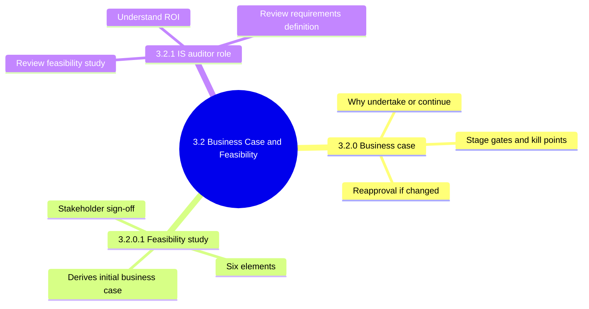

### 3.2.0 Business case

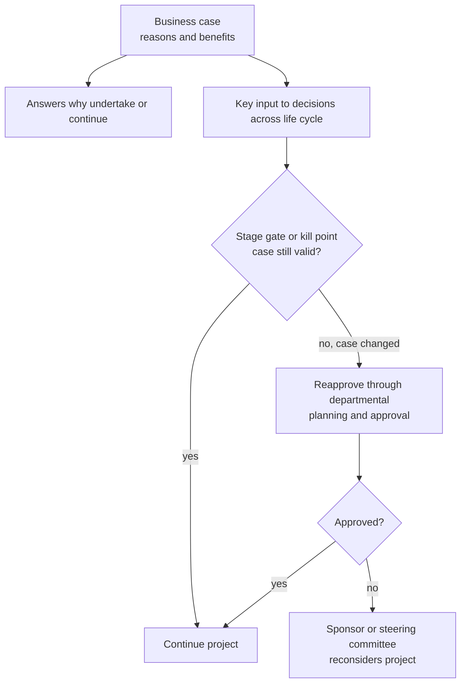

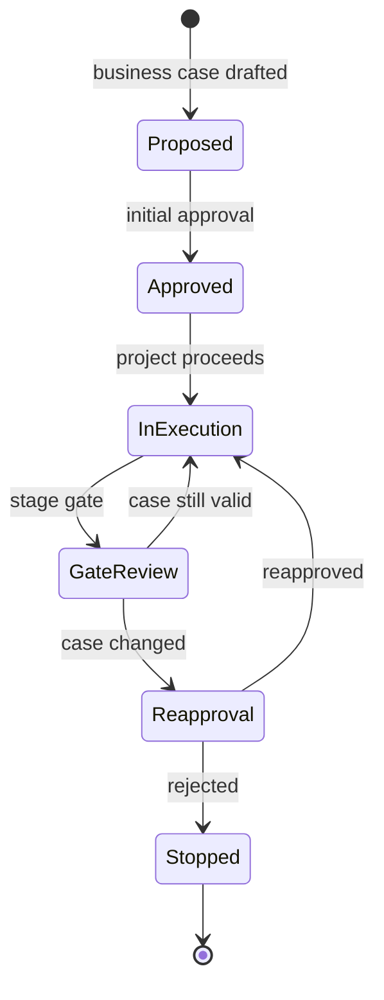

<b>Definitions and example</b>

- Business case is a document giving reasons and benefits for a project.
- Must be detailed enough to justify starting and continuing.
- May be the first project step or a precursor to it.
- Timing depends on enterprise and size of investment.
- Example: bank justifies new loan system by savings and faster approvals.
- Example: costs double mid-project, so sponsor resubmits for approval.

<b>Exam traps</b>

- Changed business case needs reapproval, not continued execution.
- Gate reviews belong to governance, not only the project manager.
- No gate reviews suggests weak project governance.

### 3.2.0.1 Feasibility study

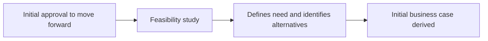

Six elements of a feasibility study, in order:

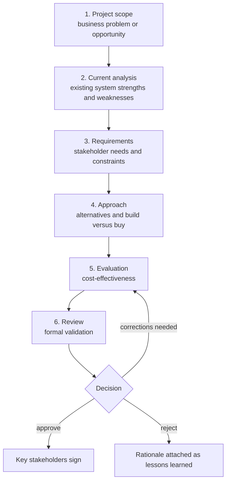

Current analysis outcomes:

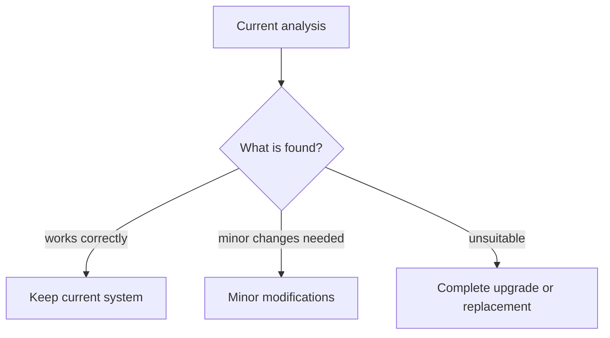

| Element | Content |
|---|---|
| Project scope | Clear, concise statement of the problem or opportunity |
| Current analysis | Understand existing system; three possible outcomes |
| Requirements | Business, contractual, regulatory; user functional; technical and physical |
| Approach | Course of action, alternatives, rationale, build versus buy |
| Evaluation | Costs of preferred solution and alternates; cost-benefit analysis; ROI |
| Review | Formal check of completeness; approve or reject |

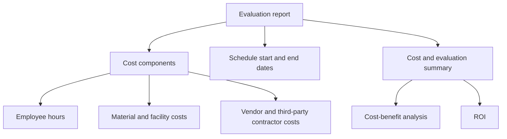

<b>Element details</b>

- Scope keeps the study focused on one defined need.
- Software requirements differ from whole-system requirements.
- Technical attributes mean operational and engineering parameters.
- Approach considers existing structures and commercial alternatives.
- Example: custom payroll build versus packaged payroll product.
- ROI is return gained relative to investment made.
- Unverified: manual gives no ROI formula or figures.
- Review involves all key stakeholders.

<b>Exam traps</b>

- Replacement is not assumed; current system may suffice.
- Rejection is documented as lessons learned, not discarded.
- Approval needs key stakeholders' sign-off, not only the IT team.
- Vague scope leads to unreliable cost and benefit estimates.

### 3.2.1 IS auditor's role in business case development

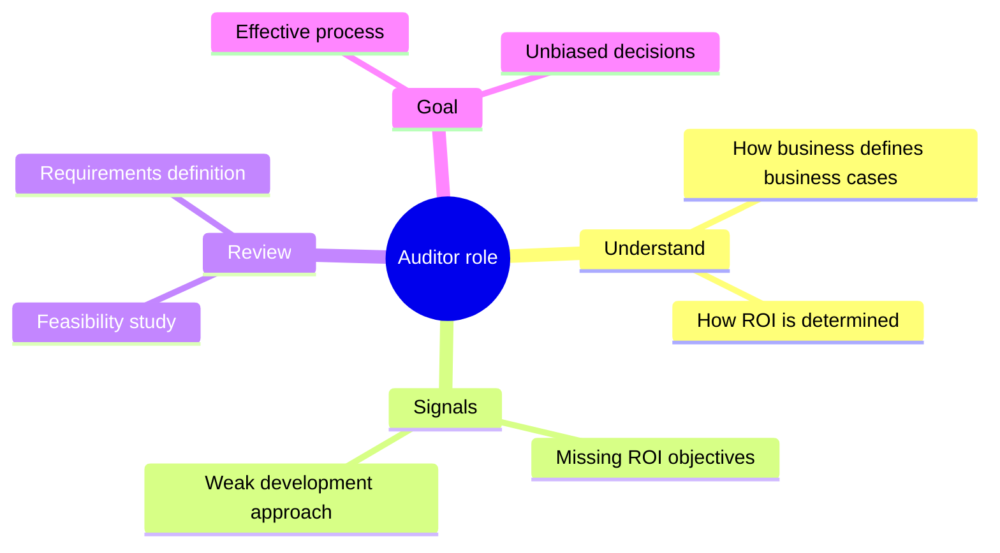

#### Reviewing the feasibility study

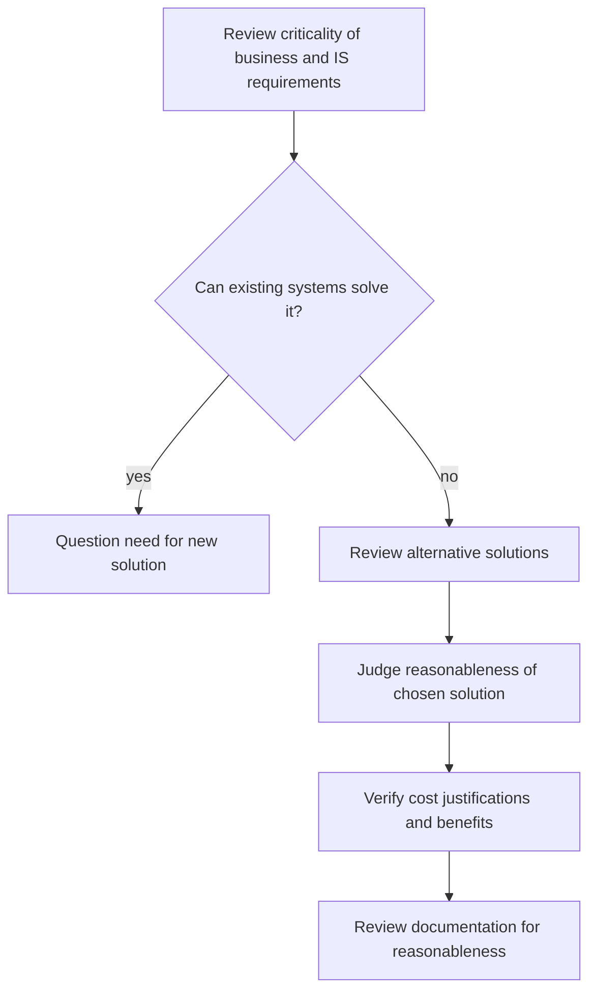

#### Reviewing the requirements definition

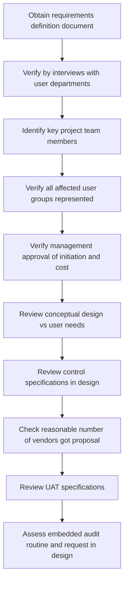

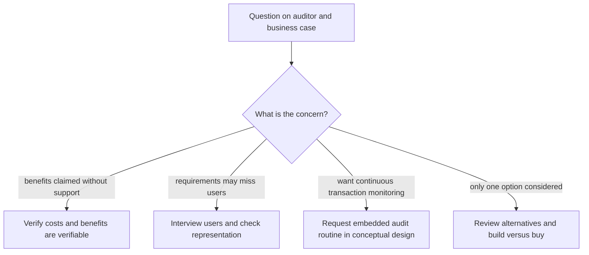

<b>Definitions and example</b>

- UAT is testing by users to confirm the system meets their needs.
- Embedded audit routine is audit code built into the application.
- It gives continuous monitoring of transactions.
- Adding it late is costly, so request it early.
- Example: savings claims rely on unsupported vendor statements.

<b>Exam traps</b>

- Auditor reviews and evaluates; does not make the project decision.
- Auditor assesses bias and must stay independent.
- Check whether current systems can solve it before judging a new one.
- Verify requirements by user interviews, not only by reading the document.
- Controls are specified at conceptual design, not after build.
- Embedded audit routine requests belong in design, not implementation.

### Quick recall

| Fact | Detail |
|---|---|
| Business case | Answers why undertake or continue the project |
| Stage gates | Formal business case reviews, also called kill points |
| Changed case | Reapprove via departmental planning and approval |
| Feasibility study | Source of initial business case |
| Six elements | Scope, current analysis, requirements, approach, evaluation, review |
| Review outcome | Approve with stakeholder signatures; rejection kept as lessons learned |
| Auditor focus | Verifiable costs and benefits; alternatives; user representation |
| Early requests | Control specifications and embedded audit routine at conceptual design |
