# 3.3 System Development Methodologies: Diagrams

[← Domain 3](../README.md) | [Study notes](../Study-Notes/3.3-Study-Notes.md)

Markers: 📓 in my notes, ⭐ frequently tested, ➕ / ⚠ Check = unverified in the manual (labelled "unverified" in diagrams).

## Section map

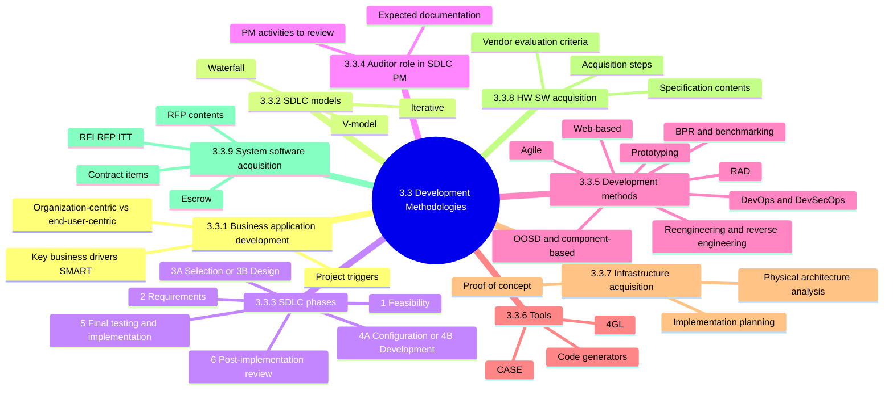

### 3.3.0 Methodology basics

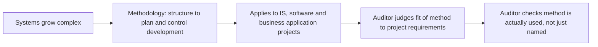

<details>
<summary><b>Definitions</b></summary>

- Methodology: structure an enterprise uses to plan and control development.
- Auditor must know models to assess development controls.

</details>

### 3.3.1 Business application development

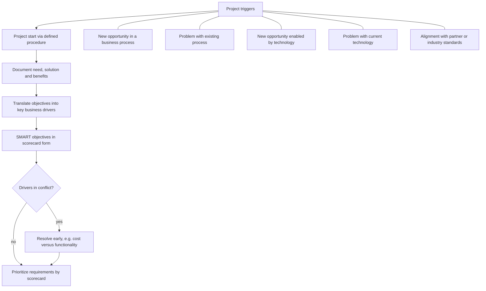

| Application type | Purpose | Built with |
|---|---|---|
| Organization-centric | Collect, store, archive, share information | SDLC or software engineering |
| End-user-centric | Different data views, e.g. DSS and GIS | Alternative approaches, SDLC controls may be absent |

<details>
<summary><b>Definitions</b></summary>

- Life cycle: phases for build, deployment, maintenance, retirement.
- Each phase is an incremental foundation for the next.
- Key business driver: attribute pushing a function toward strategic goals.

</details>

### 3.3.2 SDLC models ⭐

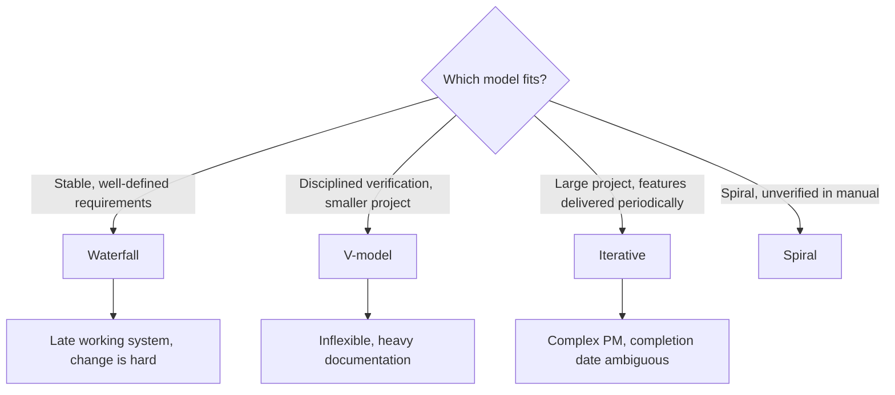

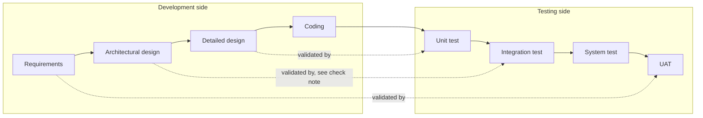

| Model | Best when | Main problems |
|---|---|---|
| Waterfall ⭐ | Requirements stable and well defined | Working system late, changes costly |
| V-shaped | Smaller projects needing strong assurance | Inflexible, dependencies delay, documentation heavy |
| Iterative | Large projects, independent features | Complex PM, risk analysis often, date ambiguous |

<details>
<summary><b>Exam traps</b></summary>

- Stable requirements point to waterfall, not agile or prototyping.
- Late working software is a waterfall weakness.
- UAT maps to requirements; unit test maps to detailed design.
- Ambiguous completion date signals iterative or agile.
- ⚠ Check: integration vs system test pairing with architecture differs (unverified).
- Spiral is not named in the manual here (unverified).

</details>

### 3.3.3 SDLC phases ⭐

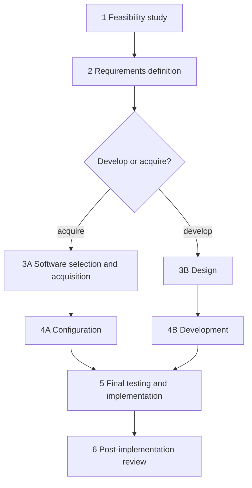

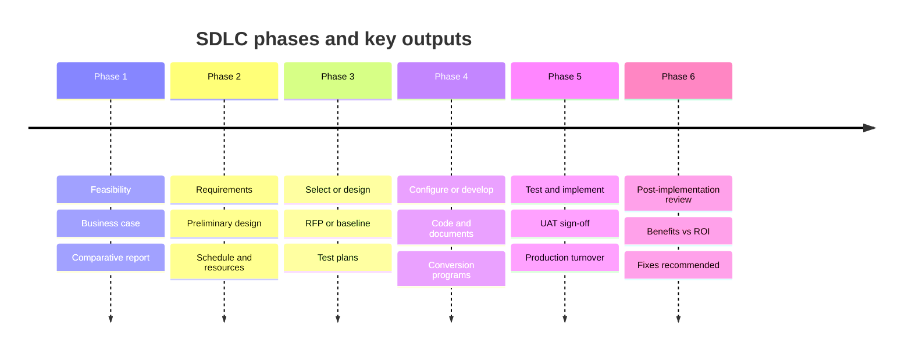

<details>
<summary><b>Notes</b></summary>

- Six phases; phases and deliverables set in early planning.
- Maintenance may need fewer phases.
- Purchased packages replace design and development with selection and configuration.
- Software acquisition is not a standard SDLC phase.

</details>

#### Phase 1: Feasibility study

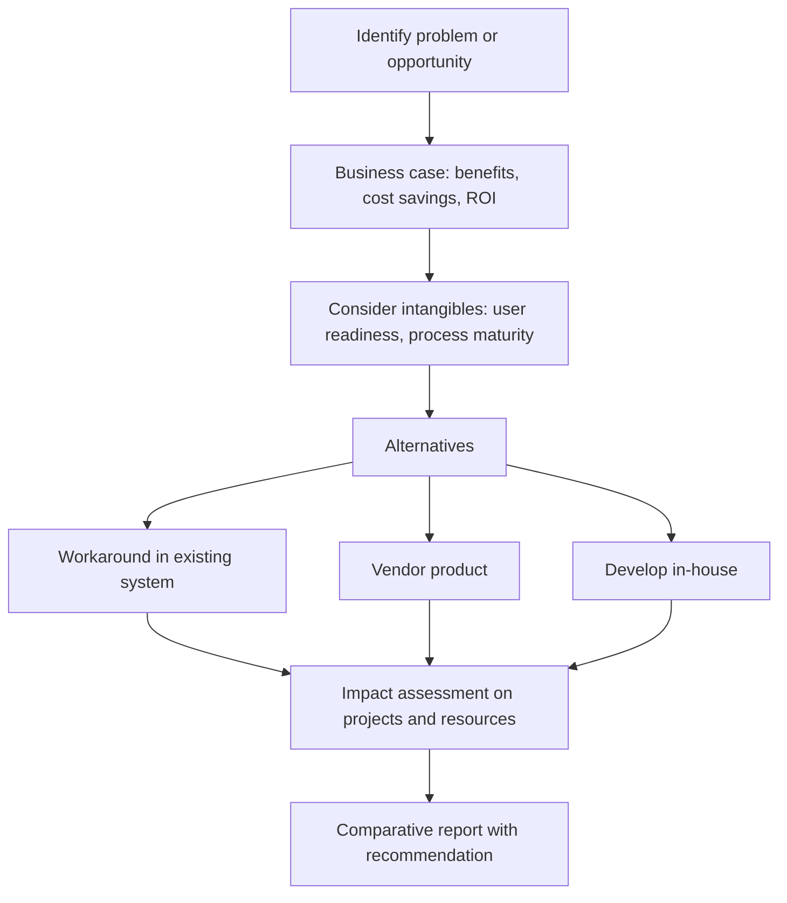

<details>
<summary><b>Develop-or-acquire factors</b></summary>

- Date system must be functional.
- Cost to develop versus buy.
- Staff, skills, hardware needed.
- License type and maintenance cost.
- Interfaces with other systems.
- Strategic fit, risk appetite, regulatory compliance.
- Infrastructure compatibility, future change, domain expertise.

</details>

<details>
<summary><b>Exam traps</b></summary>

- Feasibility asks "should we, and build or buy", not "how to design".

</details>

#### Phase 2: Requirements definition 📓⭐

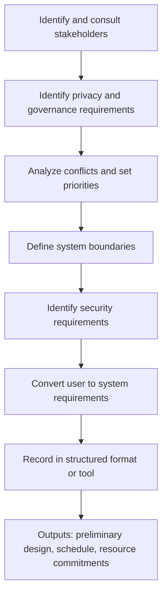

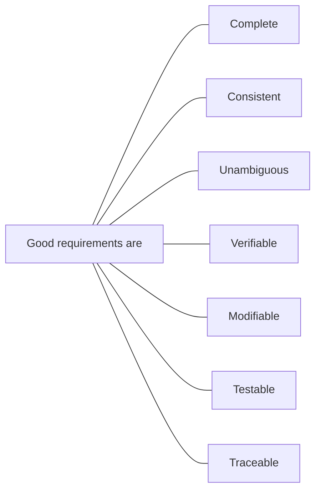

<details>
<summary><b>Auditor checks</b></summary>

- Security engineering involved across data life cycle.
- Audit trails defined.
- Regulatory, statutory, legal requirements identified.

</details>

<details>
<summary><b>Exam traps</b></summary>

- Auditor is consulted here to recommend controls and cost-effectiveness. 📓⭐
- Design, testing or implementation are too late; changes cost more.
- Consulting is advisory; auditor must not design or own controls.

</details>

#### Phase 3A: Software selection and acquisition

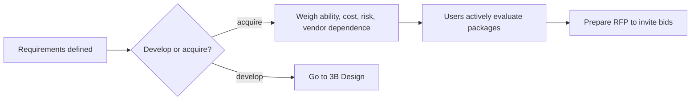

<details>
<summary><b>Decision factors</b></summary>

- Cost differential, generic software availability, time gap.

</details>

#### Phase 3B: Design

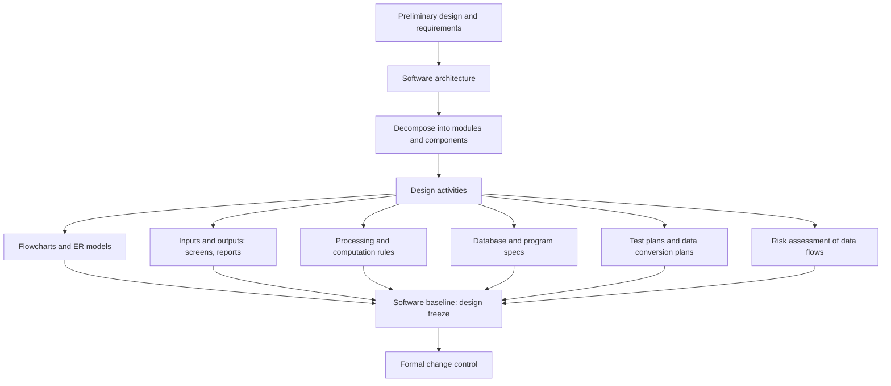

<details>
<summary><b>Test plan levels</b></summary>

- Unit (program), subsystem (module), integration (system), interface.
- Loading and initializing files, stress, security, backup and recovery.

</details>

<details>
<summary><b>Key documents and user role</b></summary>

- System, subsystem, program, database specs; test plans; change control process.
- Users have limited involvement after processes are documented.
- Developers explain how architecture meets requirements.

</details>

##### Software baselining

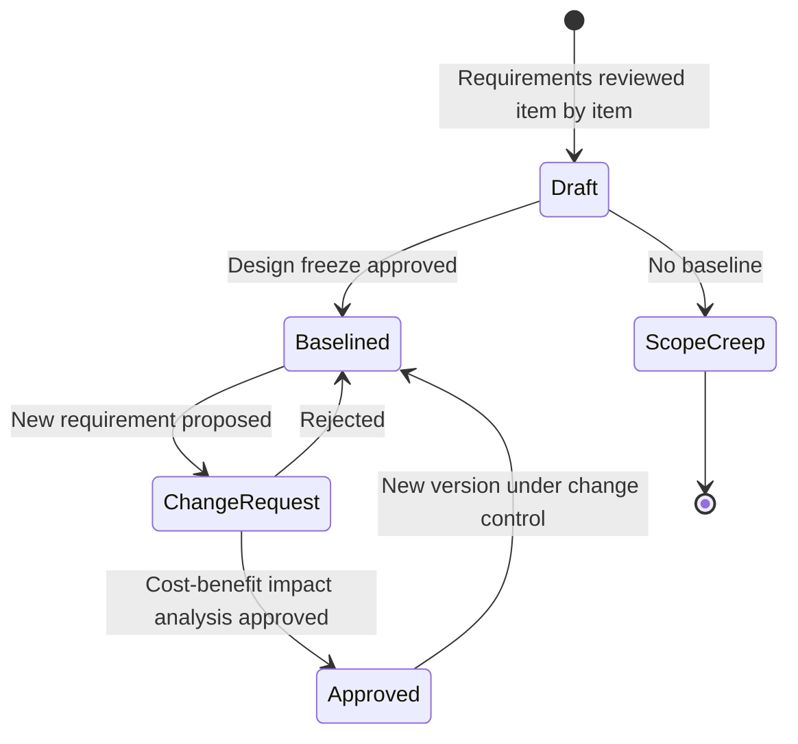

<details>
<summary><b>Exam traps</b></summary>

- Failure to baseline leads mainly to scope creep.
- Baselined items become configuration items with version numbers.
- Changes need formal approval based on cost-benefit impact analysis.

</details>

##### Risks of software development

| Risk | Meaning |
|---|---|
| Strategic | Goals weighted without considering enterprise strategy |
| Business (benefit) | System fails to meet user needs |
| Project (delivery) | Exceeds budget, late, or never finished |

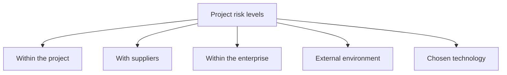

<details>
<summary><b>Notes</b></summary>

- Primary cause: lack of discipline or inappropriate methodology.
- Low maturity: successes not repeatable.
- Following an SDLC alone does not guarantee success.

</details>

<details>
<summary><b>Auditor review of PM discipline</b></summary>

- Project meets cooperative goals.
- Planning estimates resources, budget, time.
- Scope creep controlled; software baseline exists.
- Management tracks design and development.
- Senior management support; periodic review and risk analysis per phase.

</details>

##### Structured techniques and ERDs

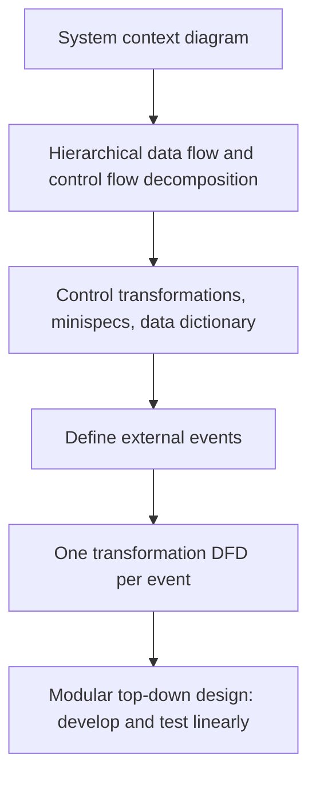

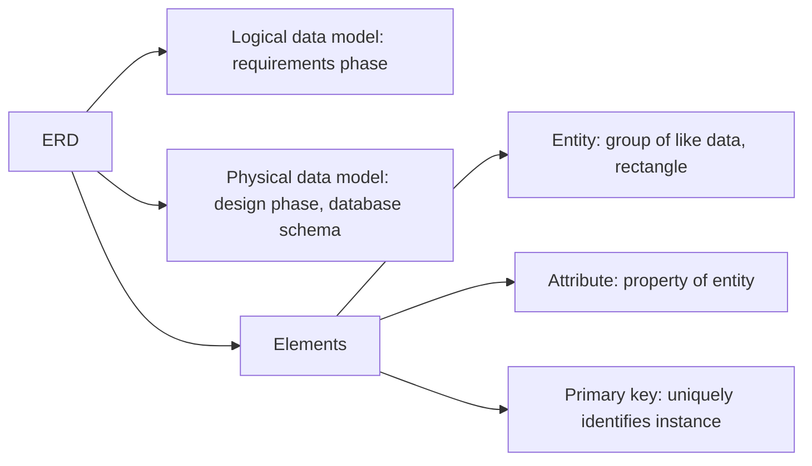

<details>
<summary><b>Exam traps</b></summary>

- Logical model belongs to requirements; physical model to design.
- Auditor checks structured processes are defined, documented, followed.

</details>

##### IS auditor's role in project design

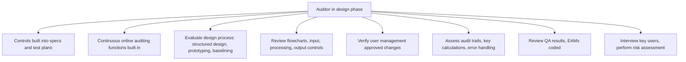

#### Phase 4A: Configuration

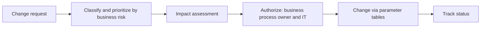

<details>
<summary><b>Notes</b></summary>

- Change management policy defines roles and responsibilities.
- ERP: edit configuration tables plus some integration development.
- On-premises versus cloud limits options.
- Data changes happen under system control, not direct user action.
- Direct code change breaks vendor support and weakens control.

</details>

#### Phase 4B: Development

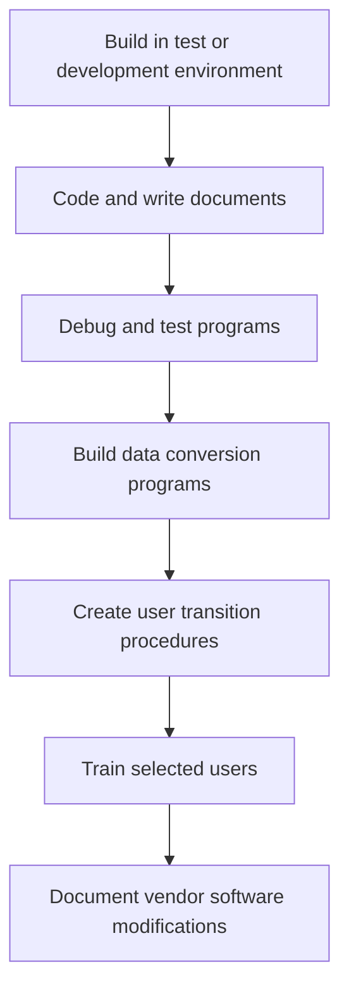

##### Programming methods

| Concept | Meaning | Audit point |
|---|---|---|
| Coding standards | Rules for documentation, declarations, statements, I/O | Essential control, eases turnover |
| Structured programming | Subsystems, modules, subroutines, units | Easier to maintain |
| Cohesion | Single dedicated function per item | Want high |
| Coupling | Independence from other items | Want low |

##### Online programming facilities and languages

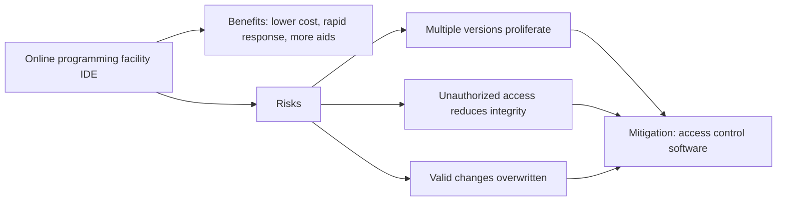

```mermaid
mindmap
  root((Programming languages))
    High-level general
      COBOL
      C
    Object-oriented
      C++
      Eiffel
      Java
    Web scripting
      HTML
      JavaScript
      CSS
    Data-centric
      R
      Scala
      IDL
      SAS
    Scripting
      Shell
      Perl
      Tcl
      Python
      VBScript
    Other
      Assembler for embedded devices
      4GL
      Decision support Lisp Prolog
      Low code no code
```

<details>
<summary><b>Notes</b></summary>

- Source code is compiled to object (machine) code.
- LCNC removes traditional developers; assess control implications.
- CGI scripts extend web servers with dynamic pages.

</details>

##### Program debugging

| Tool | What it does |
|---|---|
| Logic path monitor | Reports sequence of events, hints at logic errors |
| Memory dump | Memory snapshot at failure |
| Trace | Dumps at stages showing counters and registers |
| Output analyzer | Compares expected with actual results |

<details>
<summary><b>Exam traps</b></summary>

- Abend: unplanned program ending from errors.
- A compiler is not a debugging tool.
- Good design is high cohesion and low coupling.

</details>

#### Phase 5: Final testing and implementation

```mermaid
flowchart TD
    A["Full-system test and final UAT"] --> B["Security testing: penetration test, controls validation"]
    B --> C["Site acceptance test in real operations environment"]
    C --> D["User sign-off, certification and accreditation if used"]
    D --> E["Production turnover on set migration date"]
    E --> F["Each step: owner, verification, backout"]
    F --> G["Remove test transactions from production"]
```

<details>
<summary><b>Exam traps</b></summary>

- Do not delegate whole implementation to the vendor.
- Risk of delegation: unauthorized changes or malicious code.
- Every step needs a backout procedure.
- Commissioning tests prove end-to-end connectivity.

</details>

#### Phase 6: Post-implementation review

```mermaid
flowchart LR
    A["Go-live"] --> B["Adequacy: requirements, objectives, controls"]
    A --> C["Cost benefits or ROI vs feasibility"]
    A --> D["Project process: methods, standards, PM techniques"]
    B --> E["Recommend fixes and plan them"]
    C --> E
    D --> E
```

<details>
<summary><b>Exam traps</b></summary>

- 📓 Primary focus: are planned cost benefits measured and reported.
- Control design and integrity also matter; read the stem for priority.

</details>

### 3.3.4 IS auditor's role in SDLC project management

```mermaid
flowchart TD
    A["Auditor role"] --> B["Analyze risk and exposures per phase"]
    A --> C["Controls cost-effective, never above risk"]
    A --> D["Obtain phase documentation, attend meetings"]
    A --> E["Assess team ability to deliver on time"]
    A --> F["Review PM activities"]
    F --> F1["Oversight committee or board"]
    F --> F2["Risk, issue, cost management"]
    F --> F3["Planning and dependencies"]
    F --> F4["Reporting, change control, stakeholders"]
    F --> F5["Sign-off by development and user management"]
```

| Expected SDLC documentation | Content |
|---|---|
| Phase objectives | Goal of each phase |
| Key deliverables | With owners assigned |
| Schedule | Key deliverable dates |
| Economic forecast | Resources and cost per phase |

<details>
<summary><b>Exam traps</b></summary>

- Minimum sign-off: development management and responsible user management.
- Never recommend controls costing more than the risk.

</details>

### 3.3.5 Software development methods

Methods comparison (method choice is independent of project organization model).

| Method | Core idea | Strength | Audit or risk concern |
|---|---|---|---|
| Waterfall | Sequential phases | Stable requirements, early architecture | Late working system |
| Prototyping | Quick working model, user feedback | Reduces requirement risk, saves time and cost | Weak change control, missing controls |
| RAD | Small teams, workshops, prototypes, time limits | Fast, lower cost | No enterprise-wide planning |
| Agile | Time-boxed iterations, replanned each time | Handles changing requirements | Little documentation, no baseline |
| OOSD | Data and procedures grouped in objects | Models complex relationships | Technique, not a methodology |
| Component-based | Assemble from pretested components | Less time and cost, reuse | Interoperability, attack surface, licensing |
| Web-based | Web services with common modules | No redundant code | Classic risks persist |
| Reengineering | Reuse design of existing system | Supports major change | Verify controls survive |
| Reverse engineering | Study application to build similar | Faster SDLC | Licence and tool limits |
| DevOps | Dev and operations integrated | Faster delivery | Segregation of duties |
| DevSecOps | DevOps plus security | Security by design | Pipeline controls |

```mermaid
flowchart TD
    Q{"Exam stem says"}
    Q -->|"Stable, well-defined requirements"| A["Waterfall"]
    Q -->|"Early user feedback on screens and reports"| B["Prototyping"]
    Q -->|"Fast strategic system, rigid time limits"| C["RAD"]
    Q -->|"Requirements not known upfront, sprints"| D["Agile or Scrum"]
    Q -->|"Reuse pretested packages"| E["Component-based"]
    Q -->|"Dev and ops barriers removed"| F["DevOps, check SoD"]
    Q -->|"Security built into pipeline"| G["DevSecOps"]
```

#### Prototyping / evolutionary development

```mermaid
flowchart TD
    P["Prototyping, heuristic or evolutionary"] --> A1["Approach 1: model defines requirements"]
    A1 --> A1b["Then design real system"]
    P --> A2["Approach 2: gradually build real system with 4GL"]
    A2 --> A2b["Suits small applications"]
    P --> R["Risks"]
    R --> R1["Pressure to implement early prototype"]
    R --> R2["Users miss volumes, security, privacy, audit needs"]
    R --> R3["Weak change control, undocumented changes"]
    R --> R4["Extras beyond requirements"]
    R --> R5["Missing backup, security, audit trails"]
```

<details>
<summary><b>Exam traps</b></summary>

- Prototyping risk answer: poor change control and missing controls, not slow delivery.
- Emphasis starts with reports and screens.
- Still can give significant time and cost savings.

</details>

#### Rapid Application Development (RAD)

```mermaid
flowchart LR
    S1["1 Concept definition: functions, data areas, scope"] --> S2["2 Functional design: workshops, prototype"]
    S2 --> S3["3 Development: database, application, conversion, user aids"]
    S3 --> S4["4 Deployment: user testing, training, conversion, implementation"]
```

<details>
<summary><b>RAD techniques</b></summary>

- Small, well-trained teams; evolutionary prototypes.
- Integrated power tools; central repository.
- Interactive workshops; rigid time frame limits.
- Prototyping is core tool.
- Does not support enterprise-wide planning or analysis.

</details>

#### Agile development

```mermaid
flowchart LR
    A["Plan next iteration only"] --> B["Time-boxed sprint with daily meetings"]
    B --> C["Frequent build and test cycle"]
    C --> D["Inspect and review"]
    D --> E["Replan and reprioritize"]
    E --> A
```

<details>
<summary><b>Agile features</b></summary>

- Scrum moves planning from project manager to team.
- Other methods: XP, Crystal, ASD, FDD, DSDM.
- Small co-located teams; pair programming.
- Tacit knowledge over documentation; no requirements baseline.
- Project manager becomes facilitator and advocate.

</details>

<details>
<summary><b>Exam traps</b></summary>

- Agile does not ignore controls; it addresses them differently.
- Lack of formal documentation is an audit risk, not a reason to skip review.

</details>

#### Object-oriented system development

```mermaid
flowchart TD
    OBJ["Object: data plus procedures"] --> AT["Attributes: the data"]
    OBJ --> ME["Methods: the functionality"]
    CL["Class: template for objects"] --> SU["Superclass: parent"]
    SU -->|"inheritance"| SB["Subclass: adds or removes functions"]
    CL --> MS["Message: client class requests service from server class"]
    MS --> PO["Polymorphism: same message interpreted differently"]
    UML["UML: specify and visualize software"] --> CL
```

<details>
<summary><b>Notes</b></summary>

- Advantages: unrestricted data types, complex relationships, changing environments.
- Uses: web, ebusiness, CASE, office automation, AI, CAM.
- Exam trap: OOSD is a programming technique, not a methodology.

</details>

#### Component-based development

```mermaid
flowchart TD
    CB["Component-based development"] --> T["Component types"]
    T --> T1["In-process client: needs host container"]
    T --> T2["Stand-alone client: Excel, Word"]
    T --> T3["Stand-alone server: web services, app servers, LDAP"]
    T --> T4["In-process server: MTS, Enterprise JavaBeans, check note"]
    CB --> BN["Benefits: less time and cost, pretested quality, modularity, reuse"]
    CB --> RK["Risks: interoperability, reliability, attack surface, versions, licensing"]
```

<details>
<summary><b>Notes</b></summary>

- Outgrowth of object-oriented development; compromise between build and buy.
- ⚠ Check: Enterprise JavaBeans vs Oracle JavaBeans wording (unverified).
- Risks also include unintended use and external exposure.

</details>

#### Web-based application development

```mermaid
flowchart LR
    C["Client or application"] -->|"1 find service"| U["UDDI: directory of web services"]
    U -->|"2 service location"| C
    C -->|"3 read description"| W["WSDL: identifies SOAP spec and message formats"]
    C -->|"4 XML request"| S["SOAP: XML API, loose coupling"]
```

<details>
<summary><b>Notes</b></summary>

- Replaces dedicated APIs; CORBA and COM use RPCs.
- One common update process avoids redundant code.
- Same risks persist, e.g. buffer overflows.
- Risks: poor specs, coding, documentation, QA/QC, change control.

</details>

#### Software reengineering and reverse engineering

```mermaid
flowchart TD
    A["Existing system"] --> B["Software reengineering: extract and reuse design and components"]
    A --> C["Reverse engineering: study to build similar system"]
    C --> C1["Decompile object code to source"]
    C --> C2["Black-box test functionality"]
    C --> C3["Risks: licence bans, tool dependence on machine, OS, language"]
    B --> B1["BPR: redesign business processes"]
    B --> B2["Service-oriented reengineering: RAD concepts, RACI charts"]
```

#### DevOps and DevSecOps

```mermaid
flowchart LR
    Dev["Development"] --> DO["DevOps: integrated dev and operations"]
    Ops["Operations"] --> DO
    DO --> DSO["DevSecOps: security by design"]
    DO --> AU["Auditor ensures proper segregation of duties"]
    DSO --> RV["Fewer vulnerabilities introduced in development"]
```

<details>
<summary><b>Exam traps</b></summary>

- DevOps audit concern is SoD, not speed.
- Adoption depends on climate, risk tolerance, culture, scope.

</details>

#### Business Process Reengineering (BPR) and benchmarking

```mermaid
flowchart LR
    B1["Define areas to review"] --> B2["Develop project plan"]
    B2 --> B3["Understand the process"]
    B3 --> B4["Redesign and streamline"]
    B4 --> B5["Implement and monitor"]
    B5 --> B6["Continuous improvement"]
```

```mermaid
flowchart LR
    K1["1 Plan: processes, measures, data"] --> K2["2 Research: baseline own data, find references"]
    K2 --> K3["3 Observe: collect data, visit partner"]
    K3 --> K4["4 Analyze: gap analysis"]
    K4 --> K5["5 Adopt: principles, strategies, action plans"]
    K5 --> K6["6 Improve: continuous improvement"]
```

<details>
<summary><b>BPR auditor concerns</b></summary>

- Major concern: key controls reengineered out.
- Auditor identifies key controls and evaluates impact of removal.
- Management must knowingly accept risk of a removed preventive control.
- Check fit with culture and strategy; minimal negative staff impact.
- Check lessons learned documented.

</details>

<details>
<summary><b>Process profile and definitions</b></summary>

- Elementary process: unit of work with defined input and output.
- Profile: duration, trigger, frequency, effort, responsibility.
- Also input and output, interfaces, risk and control information, root causes.
- Package-enabled reengineering (PER): BPR through ERP.
- Baseline processes documented as flowcharts for comparison.
- Benchmarking: Adopt is often the hardest step.

</details>

### 3.3.6 System development tools and productivity aids

```mermaid
flowchart TD
    T["Development tools"] --> C["CASE"]
    T --> G["Code generators"]
    T --> F["4GL"]
    C --> U["Upper CASE: business and application requirements, data objects"]
    C --> M["Middle CASE: detailed design, screens, reports, process flows"]
    C --> L["Lower CASE: generates code and database definitions"]
    C --> I["IDE spans several categories"]
```

| Tool | Key points | Audit point |
|---|---|---|
| CASE | Automates requirements, design, code, testing, documentation | Does not ensure correct design |
| Code generators | Code from parameters or DFDs and entity diagrams | Be aware of generated source |
| 4GL | Nonprocedural, event-driven, portable | Lacks low-level commands |

<details>
<summary><b>CASE audit checks</b></summary>

- Specification approvals obtained; users involved.
- Benefits in quality and speed realized.
- Project methodology must exist.
- Monitor integrity of data moved between tools.
- CASE repository: need-to-know access, strict version control.
- Auditor may use CASE for DFDs, interrogation software, EAMs.

</details>

<details>
<summary><b>4GL types</b></summary>

- Embedded database 4GLs: FOCUS, RAMIS II, NOMAD 2; poorly integrated.
- Relational database 4GLs: SQL+, MANTIS, Natural.
- Application generators produce 3GL code (COBOL, C).
- Query and report generators extract data, like audit software.
- Programmer workbench equals IDE.

</details>

### 3.3.7 Infrastructure development / acquisition practices

```mermaid
flowchart TD
    A["Review existing architecture"] --> B["Workshop 1: ICT specialists, component list and constraints"]
    B --> C["Draft functional requirements, vendor selection in parallel"]
    C --> D["Analysis and design of physical architecture"]
    D --> E["Write functional requirements"]
    E --> F["Workshop 2: affected parties, last check before sizing and POC"]
    F --> G["Proof of concept: running prototype, documents, test protocols"]
    G --> H["Workshop 3 after prototype delivery"]
```

```mermaid
flowchart LR
    P1["Prototype shows"] --- a["Core security setup"]
    P1 --- b["Auditing components work"]
    P1 --- c["Secured transactions"]
    P1 --- d["Installation constraints"]
    P1 --- e["Performance and failover resiliency"]
    P1 --- f["Funding and costing model"]
    P1 --> N["Then: procurement, delivery plan, installation plan, test plan"]
```

<details>
<summary><b>Suggested solution must</b></summary>

- Align with enterprise ICT standards.
- Provide security and privacy; integrate with current IT.
- Consider trends; allow flexibility and growth.
- Foster standardized hardware and software.
- Maximize ROI, cost transparency, efficiency.

</details>

<details>
<summary><b>Notes and traps</b></summary>

- Choice based on formal reasoning, not price alone.
- No single platform satisfies all conflicting requirements.
- POC uses representative hardware subset and simplified framework.
- Procurement starts service-level management; contracts and SLAs signed.
- Operational constraints: size, weight, power, environment, physical security.

</details>

### 3.3.8 Hardware / software acquisition

```mermaid
flowchart TD
    A["Business need and requirements"] --> B["Specification in ITT or RFP"]
    B --> C["Competitive bidding"]
    C --> D["Analyze bids against criteria"]
    D --> E["Check vendor finances, support, delivery"]
    E --> F["Verify hardware pedigree, avoid gray market"]
    F --> G["Evaluate performance and security facilities"]
    G --> H["Negotiate price, review contract: warranty, penalties, right to audit"]
    H --> I["Formal report justifying selection"]
```

| Vendor evaluation criterion ⭐ | Meaning |
|---|---|
| Project schedule | Vendor timetable versus client plan |
| Turnaround time | Help desk fix time from logging |
| Response time | System answer to a user query |
| System reaction time | Login or network connection time |
| Throughput | Useful work per unit time |
| Workload | Volume handled in a time frame |
| Compatibility | Existing application runs on new system |
| Capacity | Simultaneous requests and data volume |
| Utilization | Availability versus downtime |

<details>
<summary><b>Specification contents</b></summary>

- Organization description and evaluation assurance levels (EALs).
- Information processing: workload, online or batch, real-time.
- Hardware: CPU speed, disk, memory, CPU count.
- Peripherals required or excluded for security.
- Input devices, direct entry devices (POS, ATM), networking.
- System software: OS, utilities, compilers, DBMS, access control.
- Support, adaptability, constraints, conversion.
- Hardware may mean cloud providers.

</details>

<details>
<summary><b>Exam traps</b></summary>

- Turnaround time is fix time; response time is query time.
- Throughput is useful work, not raw speed or capacity.
- Auditor checks acquisition began with business need.
- Auditor checks several vendors were compared.

</details>

### 3.3.9 System software acquisition

```mermaid
flowchart TD
    A["Four cases for software requirement"] --> B["Generic process, no customization"]
    A --> C["Vendor software customized"]
    A --> D["Software developed by vendor"]
    A --> E["SaaS via cloud"]
```

#### RFP process (acquisition flowchart)

```mermaid
flowchart TD
    A["Feasibility study documents decision to acquire"] --> B["RFI: ask vendors for advice"]
    B --> C{"Product and services known?"}
    C -->|"yes, e.g. hardware or database"| D["ITT"]
    C -->|"no, solution plus support, e.g. ERP"| E["RFP"]
    D --> F["Distribute widely"]
    E --> F
    F --> G["Objective scoring and ranking of responses"]
    G --> H["Short list of two or three vendors, gap analysis"]
    H --> I["Agenda-based presentations: scripted scenarios"]
    I --> J["Site visit to finalist"]
    J --> K["Conference-room pilot with end users"]
    K --> L["Document reasons, negotiate contract, legal review"]
```

```mermaid
sequenceDiagram
    participant B as Buyer team
    participant V as Vendors
    participant L as Legal counsel
    participant A as Auditor
    B->>V: RFI for advice
    B->>V: RFP or ITT with requirements
    V-->>B: Proposals
    B->>B: Score, rank, short list
    V->>B: Agenda-based presentation
    B->>V: Site visit and conference-room pilot
    B->>L: Contract review before signing
    A->>B: Review RFP, attend presentations, check procurement policy
```

<details>
<summary><b>Selection issues</b></summary>

- Business, functional, technical needs; cost and benefits.
- Obsolescence; compatibility; security.
- Demands on staff; training and hiring; growth.
- Impact on system and network performance.
- Open source versus proprietary code.

</details>

<details>
<summary><b>RFP vs ITT vs RFI</b></summary>

- ITT: products and services known, e.g. hardware, network, database.
- RFP: solution plus support needed, e.g. ERP.
- RFI: early request for vendor advice, precedes RFP.
- Separate RFP for each of the four cases.

</details>

#### RFP contents, current users and contract

```mermaid
mindmap
  root((RFP and contract))
    RFP contents
      Product vs system requirements
      Scalability and interoperability
      Customer references
      Vendor security and right to audit
      Vendor viability
      Documentation quality
      Support and upgrades
      Source code and software escrow
      Experience and enhancements
      Client sites
      Acceptance testing before commitment
    Current-user talks
      Reliability
      Commitment to service
      Training and support
    Contract items
      Deliverables, costs, dates
      Data migration
      Escrow
      Acceptance criteria
      Maintenance agreement
      Payment tied to delivery
      Confidentiality and data protection
      Right to audit
      Legal review
```

```mermaid
flowchart LR
    V["Vendor"] -->|"source code deposit with updates and fixes"| E["Escrow agent"]
    B["Buyer"] -->|"licence agreement"| V
    V -.->|"vendor fails or goes out of business"| R["Source code released to buyer"]
    E --> R
```

<details>
<summary><b>Exam traps</b></summary>

- Escrow protects continuity; agreement should cover updates and fixes.
- Source code access alone does not replace escrow.
- Payment schedule tied to actual delivery.
- Legal counsel reviews before signing.

</details>

<details>
<summary><b>IS auditor's role in software acquisition</b></summary>

- Package risks: weak audit trails and password controls.
- Analyze feasibility documents; consider common criteria evaluations.
- Review RFP covers listed items and security responses.
- Check selected vendor is supported by RFP documentation.
- Attend presentations and pilots.
- Ensure legal review; obtain compliance evidence, e.g. independent auditor report.
- Confirm adherence to procurement policies.

</details>

### Quick recall

| # | Fact |
|---|---|
| 1 ⭐ | Requirements phase: auditor advises on security and cost-effective controls 📓 |
| 2 ⭐ | Waterfall suits stable requirements; iterative suits large projects with ambiguous end date |
| 3 ⭐ | Six phases: feasibility, requirements, select or design, configure or develop, test and implement, review |
| 4 ⭐ | Baseline at design freeze; failure causes scope creep; formal change control |
| 5 ⭐ | Software escrow protects buyer if vendor fails; include updates and fixes |
| 6 | Prototyping risk: weak change control and missing controls |
| 7 | Agile: sprints, little documentation, no requirements baseline |
| 8 | DevOps audit concern: segregation of duties |
| 9 | BPR concern: key controls removed; management must accept risk |
| 10 | Do not delegate implementation to the vendor; backout for each step |
