# 3.4 Control Identification and Design - Diagrams

[← Domain 3](../README.md) | [Study notes](../Study-Notes/3.4-Study-Notes.md)

Markers: 📓 in my notes, ⭐ frequently tested, ➕ unverified.

## Section map

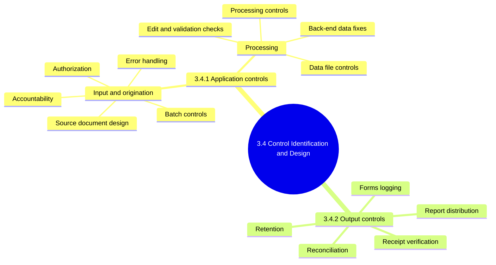

### 3.4.0 Basics: what a control is

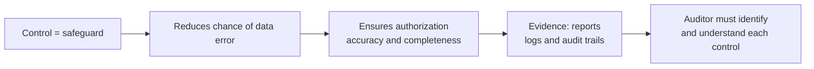

<b>Example</b>

- A rejected-transaction report proves an edit check actually fired.

### 3.4.1 Application controls

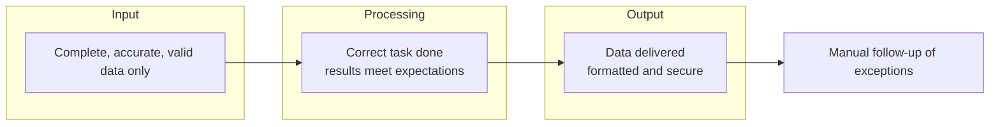

| Technique | Purpose |
|---|---|
| Edit tests | Reject invalid data early |
| Totals | Prove completeness |
| Reconciliations | Compare to independent source |
| Exception reporting | Flag items for human review |

<b>Exam traps</b>

- Automation alone is never enough; exceptions need human investigation.
- Application controls cover input, processing and output, not input only.
- An exception report nobody reviews is an ineffective control.

### 3.4.1.1 Input / origination controls

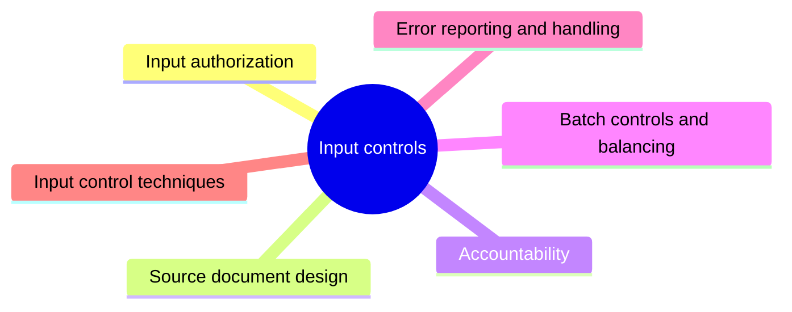

<b>Exam traps</b>

- Trusting another internal system's output without validation is a design weakness.
- The receiving system still applies edits, validations and access controls.

#### Input authorization

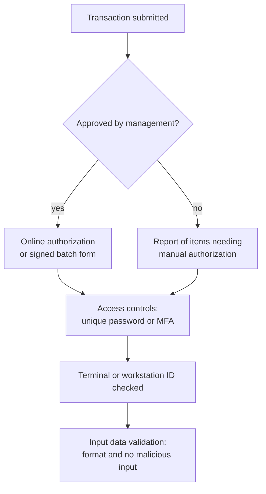

<b>Definitions</b>

- Source document: record of data entered; paper, turnaround document or online image.
- Turnaround document: output of one process reused as input to the next.
- Unique passwords give accountability for data changes.
- Lack of input validation exposes the application to injection.

#### Source document design

| Feature | Benefit |
|---|---|
| Preprinted or electronic forms | Consistency and legibility |
| Standard headings and instructions | Ease of use |
| Grouped similar fields | Easier input |
| Predetermined input codes | Fewer errors |
| Cross-reference numbers | Tracing and research |
| Boxes for each character | Prevent field size errors |
| Management authorization area | Evidence of approval |
| Prenumbering | Confirms all documents input |

<b>Exam traps</b>

- Prenumbering supports completeness; it does not prove accuracy of data.

#### Accountability controls for input

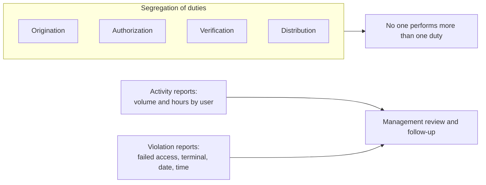

<b>Exam traps</b>

- A violation report without evidence of management review is not effective.
- Repeated violations may signal attempts to circumvent access controls.

#### Batch controls and balancing

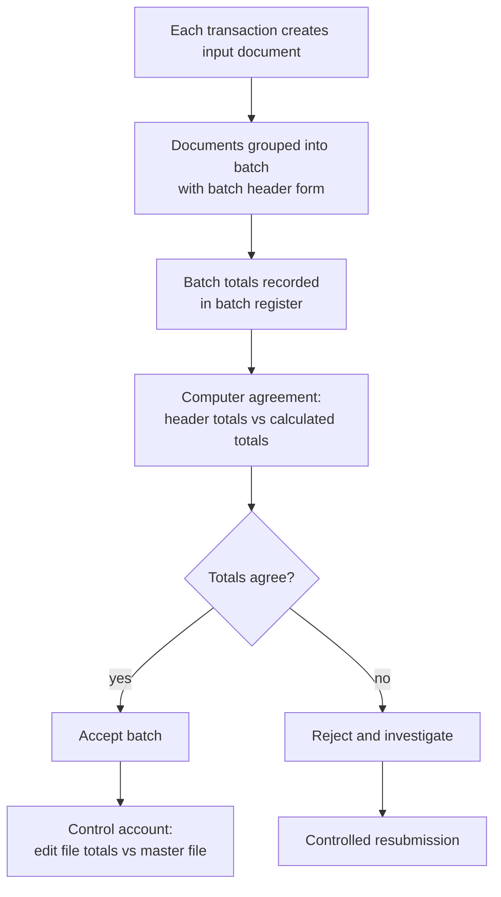

| Batch total | What it sums |
|---|---|
| Monetary amount | Value fields |
| Total items | Item quantities |
| Total documents | Count of documents |
| Hash total | Nonvalue numeric fields, e.g. customer numbers |

<b>Exam traps</b>

- Hash totals sum identifiers, not money; monetary totals sum values.
- Balancing without timely correction of differences is a finding.

#### Error reporting and handling

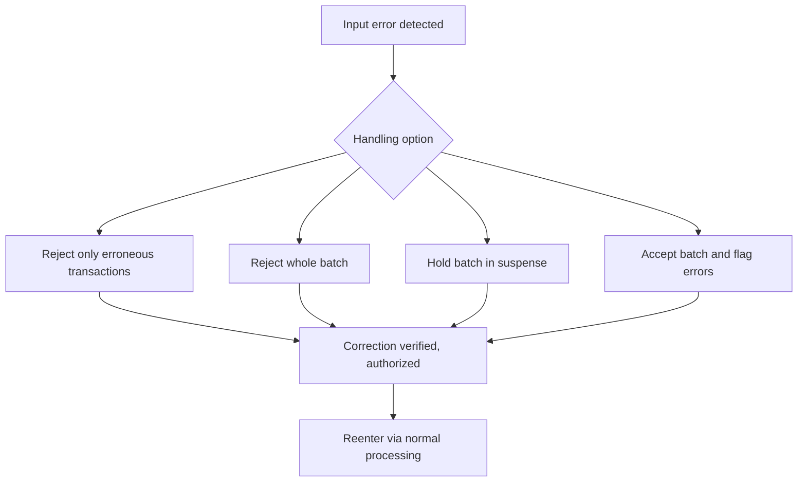

<b>Exam traps</b>

- Corrections bypassing normal processing and authorization defeat the control.
- Suspense and error files need ownership and timely clearing.

#### Input control techniques

| Technique | Purpose |
|---|---|
| Transaction log | Reconcile to source documents received |
| Reconciliation of data | Confirm all data recorded and processed |
| Documentation | Written evidence of procedures |
| Anticipation | Control group expects data receipt |
| Transmittal log | Records transmission or receipt of data |
| Cancellation of source documents | Prevent duplicate entry, e.g. punch holes |
| Input sanitization | Prevent malicious code injection |

### 3.4.1.2 Processing procedures and controls

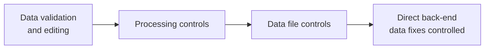

#### Data validation and editing procedures ⭐

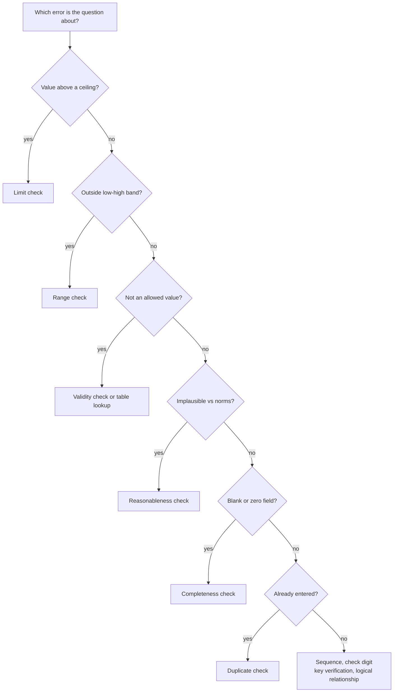

| Check | Tests | Example |
|---|---|---|
| Sequence | Control numbers in order | Invoice above 15045 rejected |
| Limit | Not above set amount | Payroll cheque over ceiling |
| Range | Between low and high | Product codes 100 to 250 |
| Validity | Matches acceptable criteria | Marital status M or S |
| Reasonableness | Within expected rates | Order above usual 20 widgets |
| Table lookup | Matches table of values | Code in valid table |
| Existence | Required valid code present | Account code exists |
| Key verification | Second person rekeys, compare | Rekeyed batch |
| Check digit | Detects transposition, transcription | Added calculated digit |
| Completeness | Not blank or zero | Mandatory field filled |
| Duplicate | Not already entered | Same vendor invoice number |
| Logical relationship | Related conditions hold | Hire date after age 16 |

<b>Exam traps</b>

- Limit check tests a ceiling; range check tests floor and ceiling.
- Validity tests allowed values; reasonableness tests plausibility against norms.
- Completeness detects blanks; existence confirms a valid code is present.
- Check digit targets keying errors, not authorization or fraud.
- Duplicate check stops double payment; sequence check finds gaps and disorder.
- ⚠ Check (unverified): existence and table lookup overlap; choose by wording.
- Edit controls are preventive and run before processing.

<b>Other points</b>

- Validate and edit as near origin as possible.
- Log supervisor overrides automatically; non-initiating manager reviews them.
- Intelligent front-end terminals can perform edits.

#### Processing controls

| Control | Purpose |
|---|---|
| Manual recalculation of sample | Confirm intended task done |
| Editing | Test accuracy, completeness, validity |
| Run-to-run totals | Verify values across processing stages |
| Programmed controls | Detect errors, prompt corrective action |
| Reasonableness verification | Check calculated amounts against criteria |
| Limit checks on amounts | Reject over-limit items |
| Reconciliation of file totals | Manual account, control record or control file |
| Exception reports | List data outside range |

#### Data file control procedures

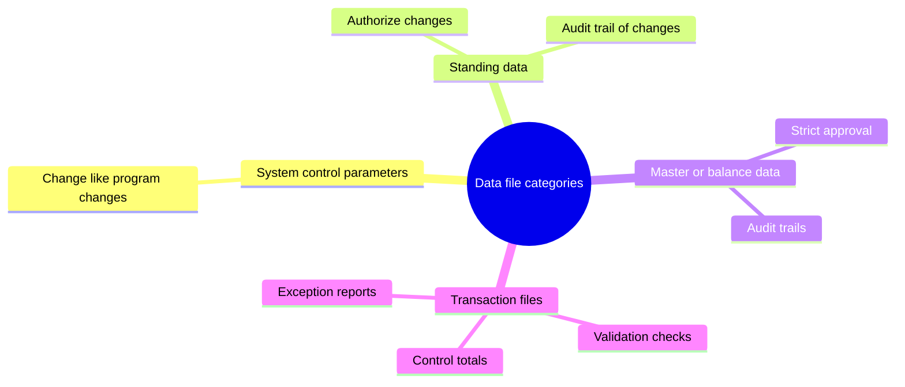

##### Data file controls

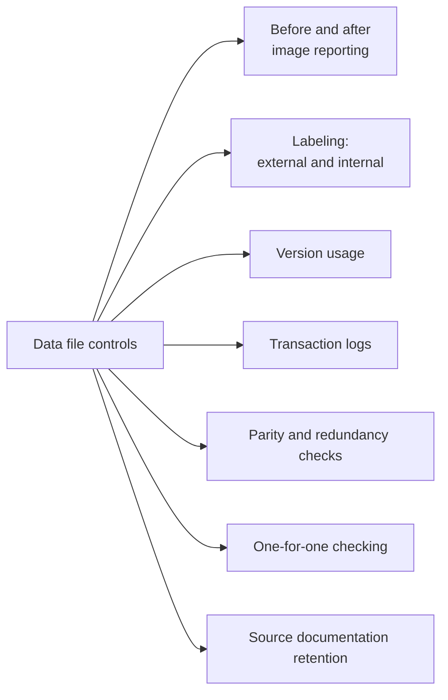

| Parity type | Also called | Checks |
|---|---|---|
| Vertical | Column check | Single character |
| Horizontal | Row or longitudinal check | Equivalent bits |

<b>Exam traps</b>

- Data file security protects against unauthorized change, not invalid data.
- Parity detects errors; it does not correct them.
- Using both parity checks greatly improves detection.
- Redundancy mismatch: receiver ignores block and requests retransmission.
- ⚠ Check (unverified): maintenance error review by non-initiator is marked ➕ in outline.

#### Direct back-end data fixes

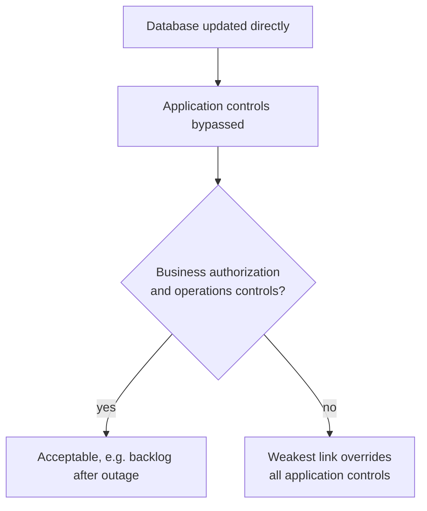

<b>Exam traps</b>

- The auditor does not ban back-end fixes; they must be authorized and controlled.
- Application controls are only as good as back-end fix controls.

### 3.4.2 Output controls

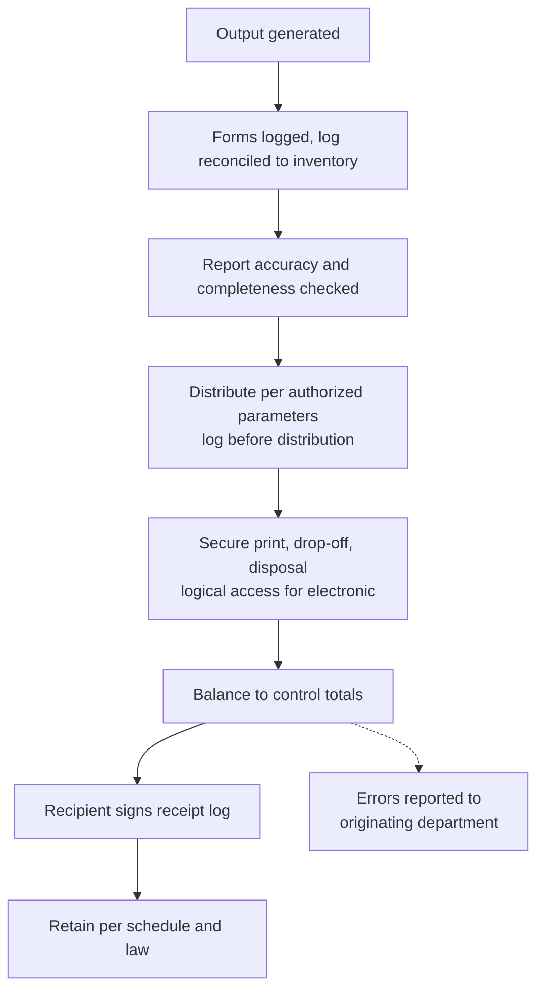

| Control | Key point |
|---|---|
| Negotiable forms | Log, secure, reconcile to inventory |
| Computer-generated instruments | Compare listing to forms; account for mutilations |
| Reports from the system | Auditor validates against source data |
| Print spool and priority | Restrict access to prevent deletion or delay |
| Output retention | Retention schedule plus legal regulations |
| Output restricted to a device | e.g. one printer only |

<b>Example</b>

- Blank cheque stock is logged and reconciled to cheques printed.

<b>Exam traps</b>

- Spool access and print priority are output controls, not input controls.
- Signed receipt log proves delivery, not report accuracy.
- Retention periods come from schedule and law, not storage convenience.
- Do more evaluation after system change or for customized reports.

### Implementation stub (Part B intro)

⚠ Check (unverified placement): these lines belong to the Part B introduction, not 3.4.

### Quick recall

| Fact | Detail |
|---|---|
| ⭐ Hash total | Sum of nonvalue numeric fields |
| ⭐ Limit vs range | Ceiling only vs floor and ceiling |
| ⭐ Check digit | Detects transposition and transcription errors |
| ⭐ SoD duties | Origination, authorization, verification, distribution |
| Edit controls | Preventive, run before processing |
| Batch totals | Money, items, documents, hash |
| Back-end fixes | Bypass application controls; need authorization |
| Parity | Detects errors, does not correct |
| Output | Distribution, reconciliation, retention, receipt proof |
| Exceptions | Automated controls need manual follow-up |
