# 3.5 System Readiness and Implementation Testing - Diagrams

[← Domain 3](../README.md) | [Study notes](../Study-Notes/3.5-Study-Notes.md)

Markers: 📓 in my notes, ⭐ frequently tested, ➕ unverified.

## Section map

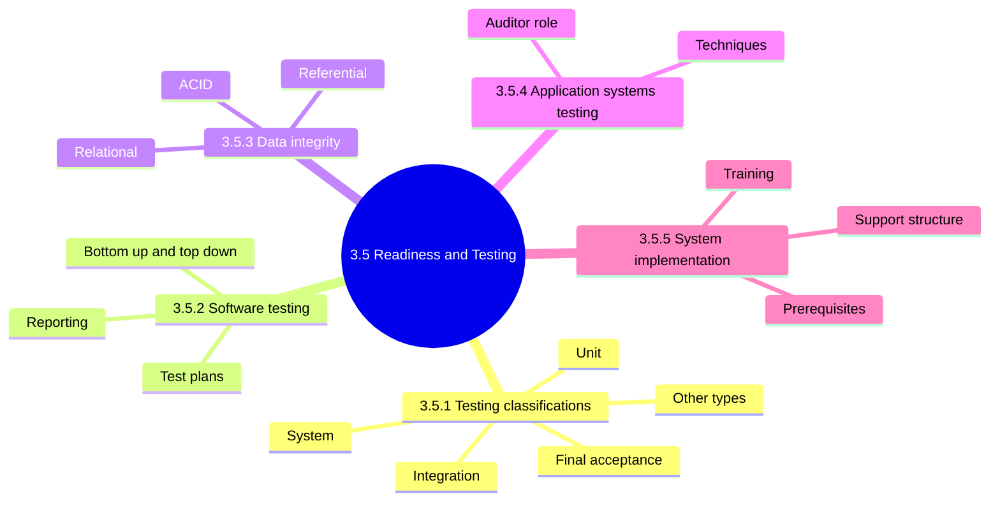

### 3.5.0 Foundations: why test

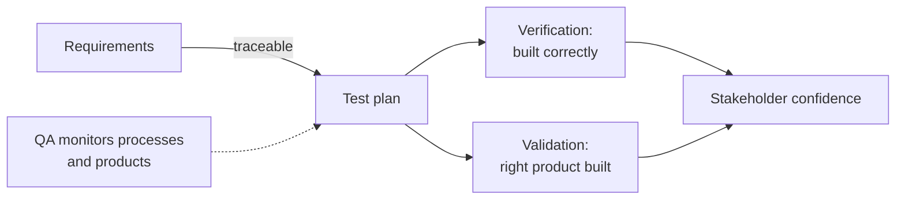

<b>Definitions</b>

- Each set of tests uses different data and different responsible people.
- Testing also checks no adverse effect on other components.
- Auditor plays a preventive role before tests, detective role after.

<b>Exam traps</b>

- The auditor reviews and opines on testing; the auditor does not perform tests.
- Auditor involvement in testing is expected, not an independence breach.

### 3.5.1 Testing classifications ⭐

Testing types flowchart:

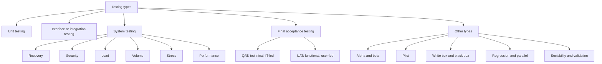

Testing sequence:

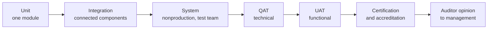

| Type | Focus | Who or where |
|---|---|---|
| Unit | Control structure of one module | Developer |
| Integration | Data passing between components | Test team |
| System | Programs, objects, schema together | Nonproduction, test team |
| QAT | Documented technical specifications | Mainly IT staff |
| UAT | Functional needs, production ready | Users |

#### System testing analyses

| Test | Varies | Finds |
|---|---|---|
| Recovery | Induced failure | Ability to recover |
| Security | Access attempts | Control gaps, new holes |
| Load | Large data at peak hours | Peak performance |
| Volume | Incremental records | Maximum records |
| Stress | Incremental concurrent users | Maximum users |
| Performance | Benchmarks vs equivalent systems | Relative performance |

<b>Exam traps (system testing)</b>

- Volume varies record counts; stress varies concurrent users.
- Load targets peak-hour data levels.
- System testing is nonproduction, so production data exposure is separate.

#### Final acceptance testing

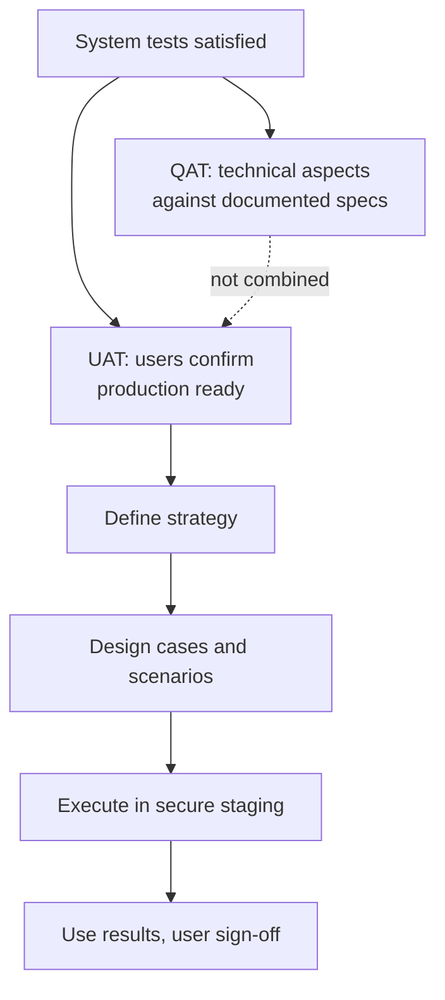

<b>UAT points</b>

- Acceptance criteria: elements a deliverable must meet.
- UAT plan documented; tests are user perspective and production-like.
- Test new business processes and supporting process integration.
- Protect source and executable code from last-minute changes.
- ITFs are production-like systems; IS staff use fictitious data.
- Client reps use production extracts; scramble confidential data.

<b>Acquired software</b>

- Vendor testing does not replace end user and maintenance staff testing.
- Control the accepted version; malicious patch or Trojan risk is high.

<b>Certification and accreditation</b>

- Follows acceptance testing per outline.
- ⚠ Check (unverified): manual says after implementation and operating time.
- Auditor opinion covers requirements, controls and readiness.
- Report lists deficiencies and explains risk of implementing anyway.

<b>Exam traps (acceptance)</b>

- QAT is technical and IT-led; UAT is functional and user-led.
- Combining QAT and UAT is wrong; objectives differ.
- Users sign off UAT; the auditor does not accept for them.

#### Other types of testing

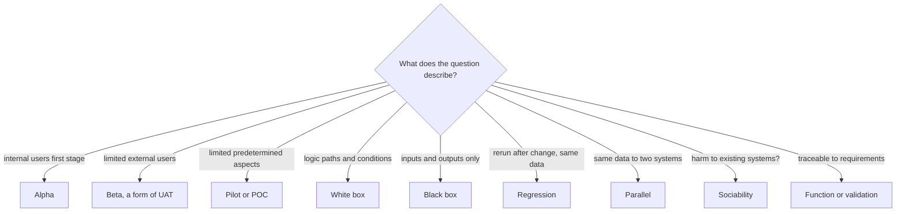

| Type | Key point |
|---|---|
| Alpha | Internal users, similar to system testing |
| Beta | Limited external users |
| Pilot | POCs are early pilots |
| White box | Unit and integration; not all paths feasible |
| Black box | Integration and UAT |
| Regression | Same data as original test |
| Parallel | Compare modified vs alternative system |
| Sociability | Target platform, interfaces, desktop |

<b>Exam traps (other testing)</b>

- Regression needs original data; parallel compares two systems.
- White box looks at internal logic; black box only inputs and outputs.
- Alpha is internal; beta is limited external and counts as UAT.

### 3.5.2 Software testing

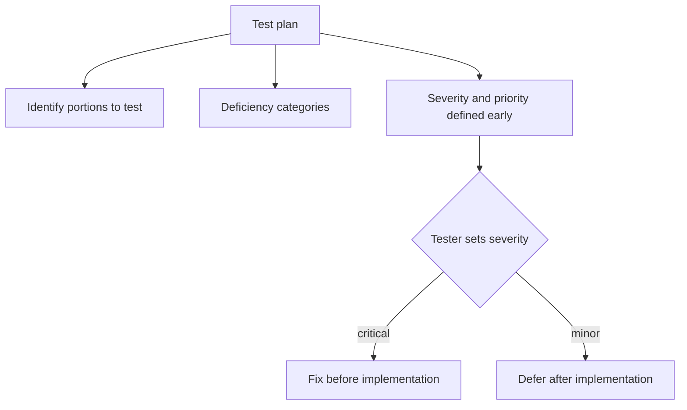

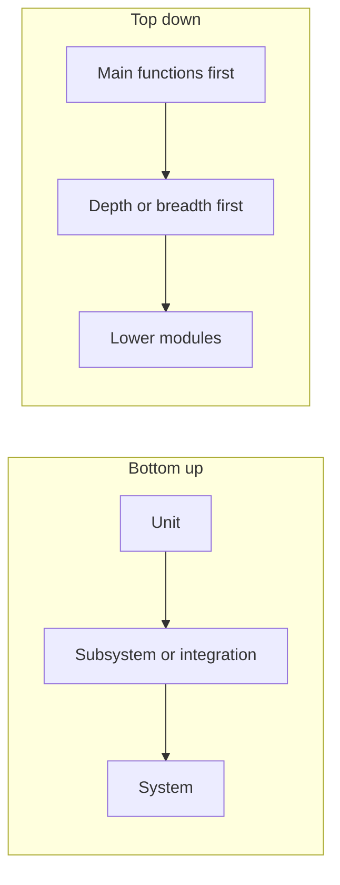

| Approach | Pros |
|---|---|
| Bottom up | No stubs or drivers; start early; critical errors early |
| Top down | Major functions early; interface errors sooner; confidence |

<b>Details</b>

- Deficiency categories: system defects, incomplete requirements, designs, specifications, test case errors.
- Large systems usually test bottom up in ascending levels.
- Reporting: resources, personnel, actual versus expected results.
- Retain results and plan as permanent documentation.
- Redesign and rerun tests until acceptable.
- ➕ Top down needs stubs; bottom up needs drivers (unverified).

<b>Exam traps</b>

- Severity follows predefined definitions, not developer preference.
- Large systems favor bottom up.

### 3.5.3 Data integrity testing

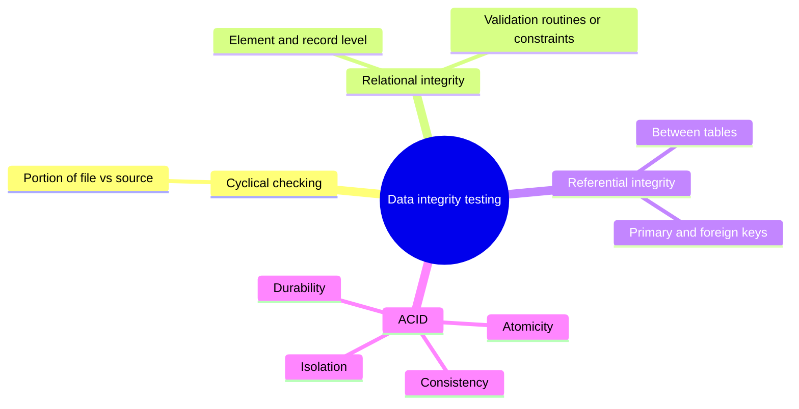

| ACID | Meaning |
|---|---|
| Atomicity 📓 | Fully completes or is backed out |
| Consistency | Moves database between consistent states |
| Isolation | Accesses only consistent data |
| Durability | Completed changes survive failures |

<b>Exam traps</b>

- Relational is element and record level; referential is between tables.
- Half-posted transfer violates atomicity, not durability.
- Lost committed data after crash violates durability.
- ⚠ Check (unverified): outline cites 4.11.3 for ACID.

### 3.5.4 Application systems testing

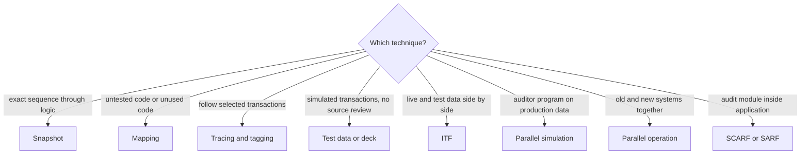

| Technique | Pro | Con |
|---|---|---|
| Snapshot | Exact event sequence | Needs deep IS knowledge |
| Mapping | Finds exposures, unused code | Needs computer time and programming |
| Test data | Surprise basis; no source review | Not all scenarios; not actual master file |
| Base-case | Verify before and after acceptance | Heavy data set upkeep |
| Parallel operation | Compare old and new | Careful planning |
| ITF | Periodic testing, no separate process | Isolation needed; added cost |
| Parallel simulation | No test data needed | Programs must be developed |
| Transaction selection | Independent, auditor controlled | None listed |
| Embedded audit | Live sampling and statistics | High cost; independence issues |

<b>Embedded audit data collection</b>

- SCARF: auditor sets tests in normal processing.
- SARF: random transactions for a representative file.
- Extended records: gather all data affected by a program. ➕ (unverified)

<b>Automated testing tools</b>

- Test data generators: random data from field characteristics and layout.
- Interactive debugging aids.
- Code logic analyzers.
- GAS evaluates tests and runs parallel simulation.

<b>IS auditor's role in IS testing</b>

- Review test plan completeness and user sign-off.
- Rerun critical tests; reconcile control totals and converted data.
- Review error reports and their follow-through.
- Verify cyclical processing and critical report accuracy.
- Interview users; review documentation completeness.
- Review parallel testing results; verify security with access tests.
- Review UAT; vendor must not replace accepted version.

<b>Exam traps</b>

- Test data skips the real master file.
- Parallel simulation needs no test data; parallel operation runs two systems.
- SCARF reviews tests; SARF samples randomly.
- User sign-off evidence beats developer assertions.

### 3.5.5 System implementation

Implementation readiness flow:

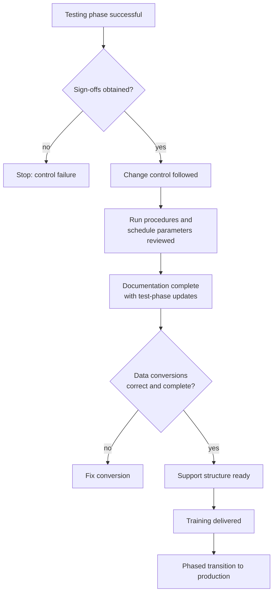

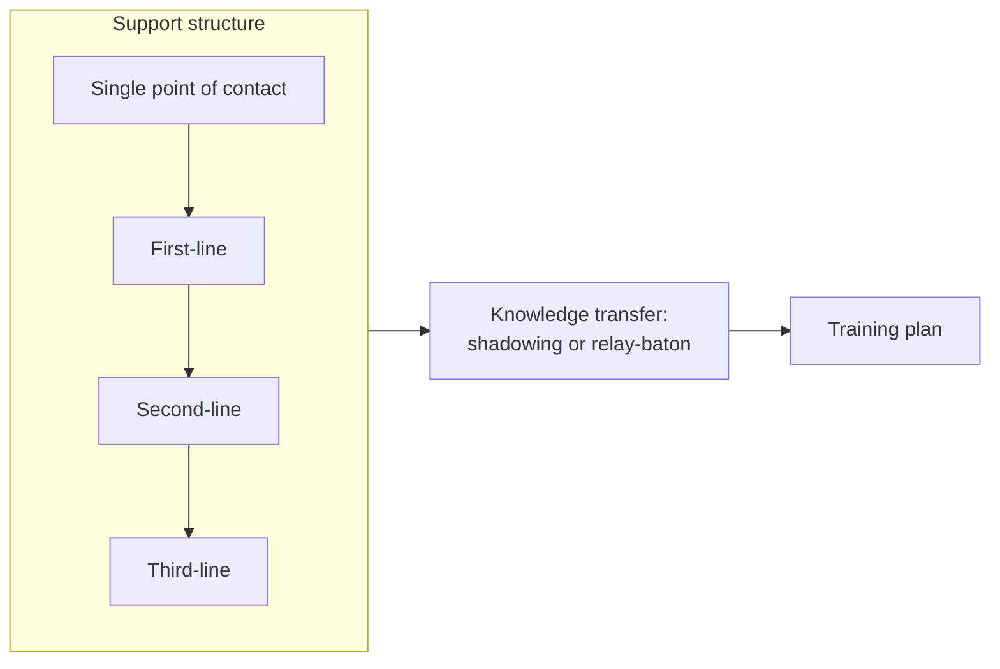

| Planning area | Key point |
|---|---|
| Transition | Smooth, step by step, not one event |
| Staffing | Maximize existing staff; minimize new hires |
| Support roles | Define roles, skills and training |
| Platforms | Legacy and new both supported |
| Communication | Tell users and support staff of changes |

<b>Training and support tasks</b>

- Training plan: content, schedule, duration, delivery, train-the-trainer.
- Consider role definitions, skill profiles and gap analysis.
- Collate documentation; define new support organization and processes.
- Establish functions, communications, briefings, training and transfer.
- Review mobilization progress.

<b>Knowledge transfer</b>

- Shadowing: staff observe the system.
- Relay-baton: knowledge and responsibility pass in small portions.

<b>Exam traps</b>

- Big-bang migration of all services is wrong; phased is preferred.
- Implementation without sign-off or change control is a control failure.

### Quick recall

| Fact | Detail |
|---|---|
| ⭐ Testing order | Unit, integration, system, acceptance |
| ⭐ QAT vs UAT | Technical IT-led vs functional user-led; not combined |
| ⭐ Volume vs stress | Records vs concurrent users |
| Regression | Rerun with original data after change |
| Parallel testing | Same data to old and new, compare |
| Beta | Limited external users; form of UAT |
| Bottom up | Preferred for large systems |
| Referential integrity | Foreign keys must exist in original table |
| ACID | Atomicity, consistency, isolation, durability |
| Implementation | Only after sign-offs, conversions verified, phased |
