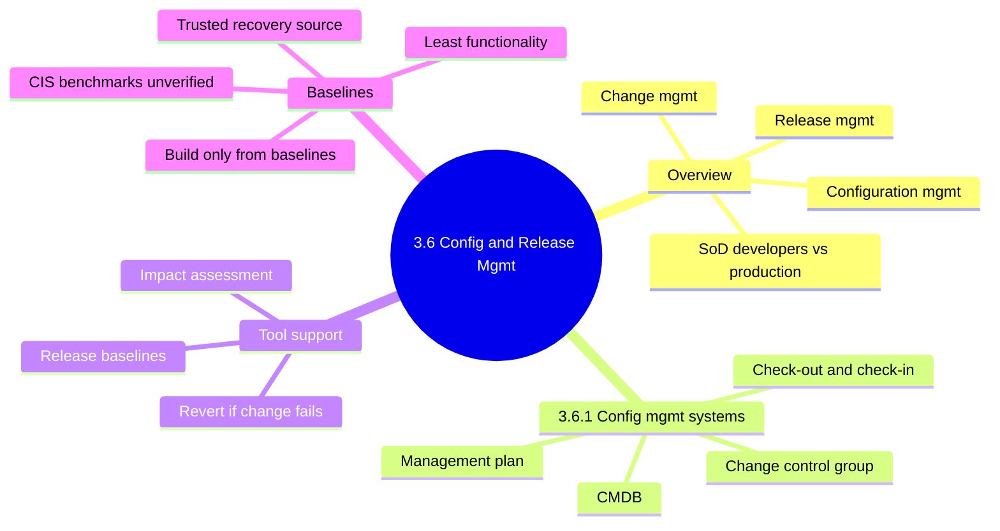
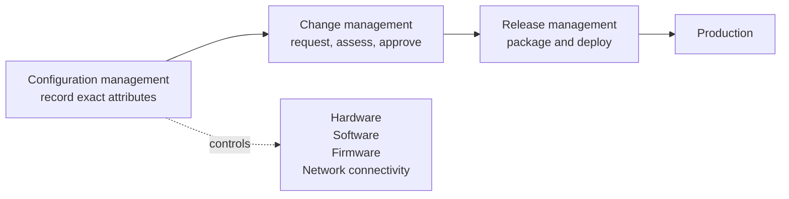
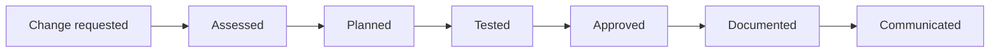
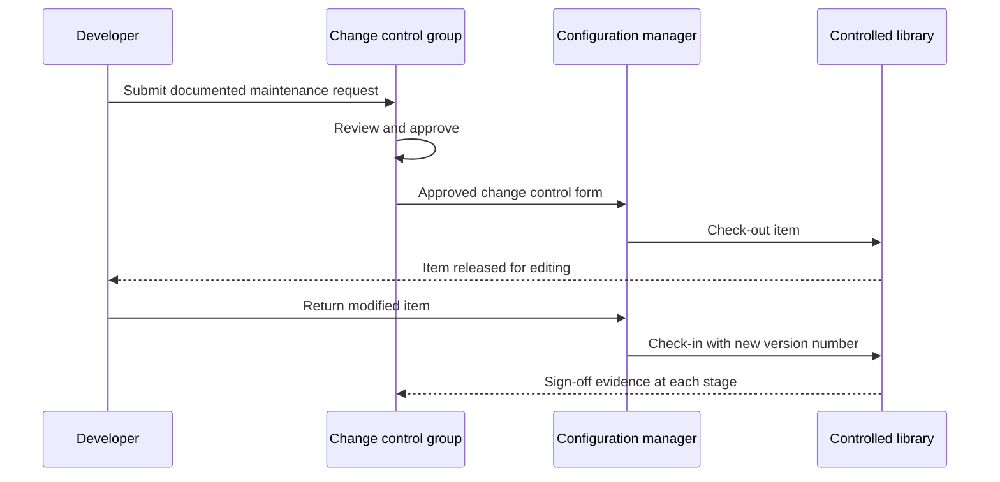
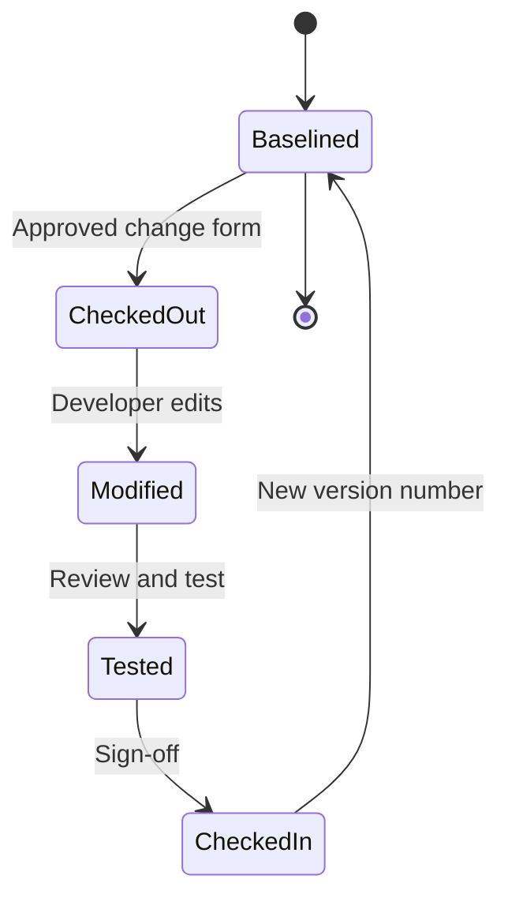
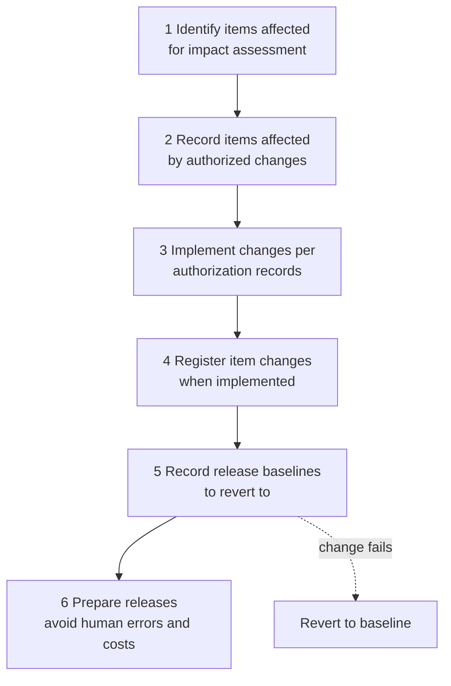
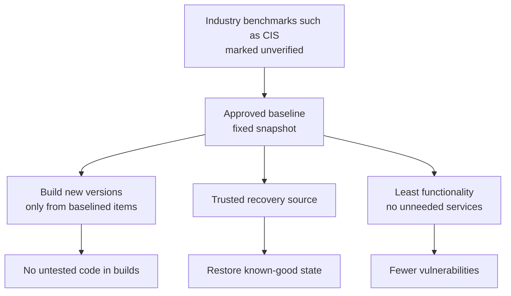

# 3.6 Implementation Configuration and Release Management - Diagrams

[← Domain 3](../README.md) | [Study notes](../Study-Notes/3.6-Study-Notes.md)

> Markers: 📓 = in my notes, ⭐ = frequently tested, ➕ = unverified (not in review manual).

## Section map

### 3.6 Overview: three linked processes

| Process | Purpose | Audit evidence |
|---|---|---|
| Configuration management | Know exact attributes of each component | Accurate configuration records |
| Change management | Reduce harmful side effects | Approval records for each change |
| Release management | Deliver tested versions in a planned way | Only approved releases in production |

<b>Definitions</b>

- Configuration management: controlling and recording attributes of IT components.
- Change management: formal process to request, assess, approve, track changes.
- Release management: packaging approved changes and moving them to production.
- SoD: no one person controls a whole process. ⭐

<b>Example</b>

- A firewall rule change is tested, approved, logged, then announced to operations.
- A developer edits live code directly and hides a fraud routine.

<b>Exam traps</b>

- Best control for developer-versus-production risk is SoD, not extra testing.
- Owning a tool does not prove the process is followed.
- Unapproved emergency changes are a finding even if the change worked.
- Tool names (ServiceNow, SysAid, ManageEngine) are examples; exams test controls. (unverified)

### 3.6.1 Configuration management systems

| Element | Role | Audit check |
|---|---|---|
| Change control group (CCB) ⭐ | Approves maintenance requests | Approval records exist |
| CMDB ⭐ | Records hardware, software assets | Current, supports impact analysis |
| Check-out | Controls simultaneous edits | Triggered by approved form |
| Check-in | Assigns new version number | Version matches request |
| Configuration plan | Covers documents, tests, procedures | Exists and is followed |

<b>Definitions</b>

- Configuration item: any tracked hardware or software component.
- CMDB: database of assets and their relationships.
- Check-out: taking item from controlled storage to modify it.
- Check-in: returning item to controlled environment with new version.

<b>Example</b>

- A server patch is traced through the CMDB to dependent applications.

<b>Exam traps</b>

- Check-out prevents simultaneous edits; it is not a backup control.
- The CMDB records assets; it does not approve changes.
- A plan limited to source code is incomplete.
- Manual wording on check-in and check-out is muddled (unverified).
- Look for sign-off at every stage, not only the last.

### Tool support for change and release management

<b>Definitions</b>

- Impact assessment covers functional, operational and security effects.
- Release baselines have known consequences, so rollback is predictable.

<b>Example</b>

- A release fails; the team restores the recorded prior baseline.

<b>Exam traps</b>

- Rollback needs a recorded baseline, not only a backup tape.
- Changes must match authorization records; speed is not the goal.

### Baselines

| Baseline use | Benefit |
|---|---|
| Build source ⭐ | Only approved, tested items included |
| Recovery source | Restore known-good state |
| Hardening | Least functionality limits vulnerabilities |
| Deviation detection | Reveals unauthorized changes |

<b>Definitions</b>

- Baseline: approved, fixed snapshot of configuration at one point.
- Least functionality: install only functions the system needs.
- Consistent tool use shows management commitment to maintenance control.

<b>Exam traps</b>

- Baselines serve recovery and hardening; one alone is incomplete.
- Building from the latest development copy breaks control.
- Extra services or ports in a build indicate weak baselining.
- CIS is marked ➕ in the outline but the notes say the manual cites it (unverified).

### Quick recall

| # | Fact |
|---|---|
| 1 | ⭐ Auditor verifies SoD between development and production |
| 2 | ⭐ Change control group approves maintenance requests |
| 3 | ⭐ CMDB records assets; supports impact analysis |
| 4 | ⭐ Build new versions only from baselined items |
| 5 | Check-out needs approved form; check-in assigns version number |
| 6 | Release baselines enable rollback if a change fails |
| 7 | Baseline is trusted recovery source |
| 8 | Least functionality avoids unnecessary vulnerabilities |
