# 3.7 System Migration, Infrastructure Deployment and Data Conversion - Diagrams

[← Domain 3](../README.md) | [Study notes](../Study-Notes/3.7-Study-Notes.md)

> Markers: 📓 = in my notes, ⭐ = frequently tested, ➕ = unverified.

## Section map

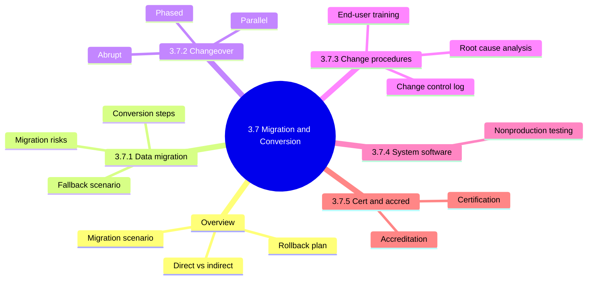

### 3.7 Overview: migration strategy and auditor focus

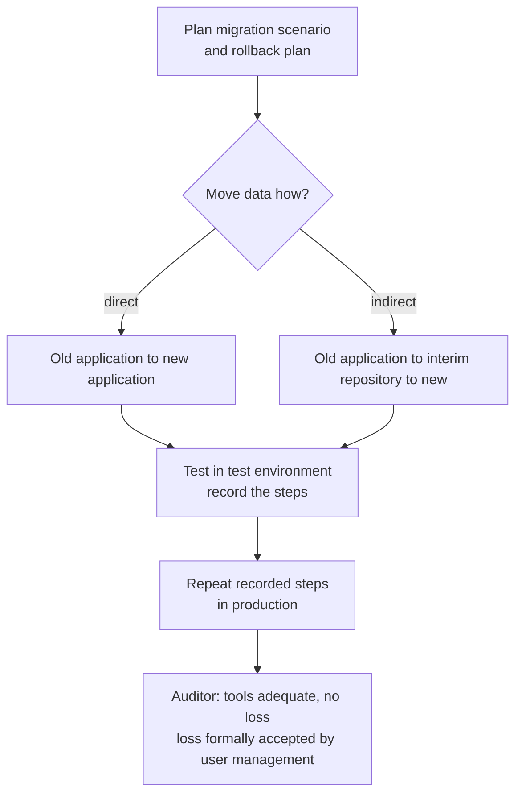

<b>Definitions</b>

- Migration scenario: planned route for moving data old to new.
- Rollback plan: way to reverse migration and restore the old system.
- Conversion is often one-time; programmed input checks are unavailable.
- Source data must be characterized; destination must hold every value.

<b>Exam traps</b>

- Acceptance of data loss belongs to user management.
- Test is minimal and formally accepted loss, not zero loss.
- Interim repositories add copies needing confidentiality protection.

### 3.7.1 Data migration

Data migration flow

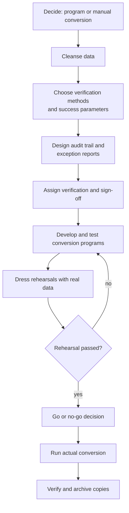

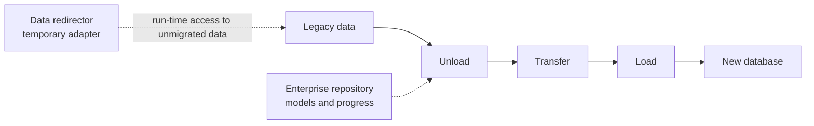

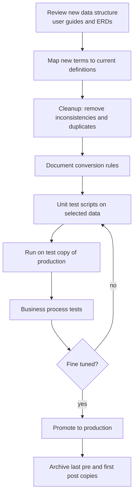

| Fallback component set | Steps |
|---|---|
| Set 1 | Unload from new, transfer and convert, load into legacy |
| Set 2 | Log changes at runtime, transfer, load into legacy |

| Migration risk | Concern |
|---|---|
| Operations | Disruption of routine operations |
| Security | Violation of data security and confidentiality |
| Legacy conflict | Contention between legacy and migrated operations |
| Integrity | Data inconsistency and loss |

| Verification method | Example |
|---|---|
| File comparison | Old vs new files |
| Record counts | Same number of records |
| Control totals | Totals match |
| Balances and samples | Accounting balances, item checks |

<b>Definitions</b>

- Data conversion (data porting): changing data between formats, sizes, structures, coding.
- Objective: preserve meaning and integrity of the data.
- Data redirector: temporary adapter, uses standards such as X/Open XA.
- Large conversion can be a project within a project.
- Key points: completeness, integrity, storage, security, consistency, continuity of access.

<b>Example</b>

- A bank compares record counts and control totals between old and new ledgers.
- A number stored as text, floating point or binary-coded decimal.

<b>Exam traps</b>

- Cleansing first prevents duplicate or erroneous records later.
- Real-data rehearsal beats invented test data.
- Sign-off must be assigned beforehand, not after problems.
- Rollback tools must be ready before cutover.
- Outsourcing needs nondisclosure, data privacy and data destruction terms.

### 3.7.2 Changeover techniques ⭐

| Technique | How | Pros | Cons or risks | Risk level |
|---|---|---|---|---|
| Parallel | Old, then both, then new only | Lowest risk, early problems, user confidence | Double work for users | Lowest |
| Phased | Replace old module by module | Preplanned, gradual | Two environments, longer project, support for old system | Medium |
| Abrupt | New replaces old at cutoff | No explicit pro in manual (unverified: speed or cost) | Safeguarding, integrity, effectiveness, change management | Highest |

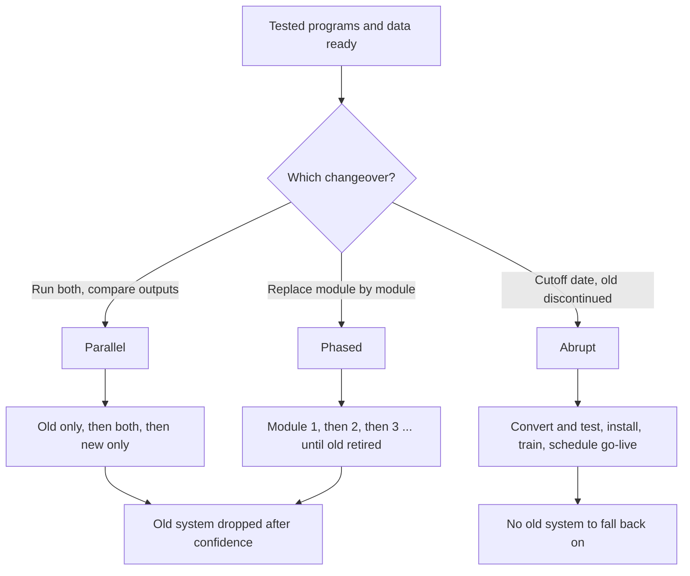

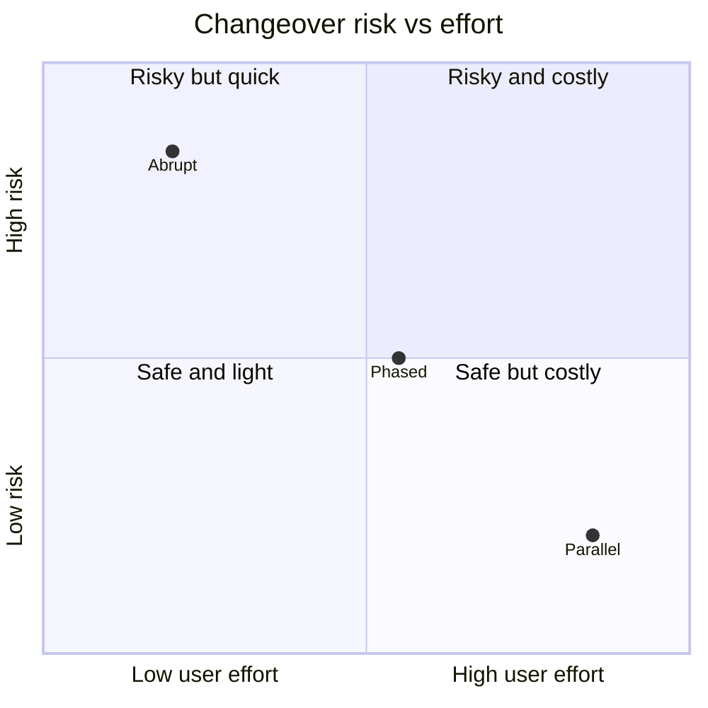

<b>Definitions</b>

- Changeover: shifting users old to new; also go-live or cutover.
- Appropriate only after testing the new system's programs and data.
- Phased two environments: IT side and operations side.
- Abrupt risk: duplicate or missing records if cleansing was flawed.

<b>Example</b>

- Payroll run on both systems, outputs compared for one month.

<b>Exam traps</b>

- Parallel is lowest risk but costs the most effort.
- Parallel does not require identical module counts.
- Abrupt is riskiest: no old system remains for fallback.
- Quadrant positions are a relative illustration, not manual figures.

### 3.7.3 System change procedures and program migration process

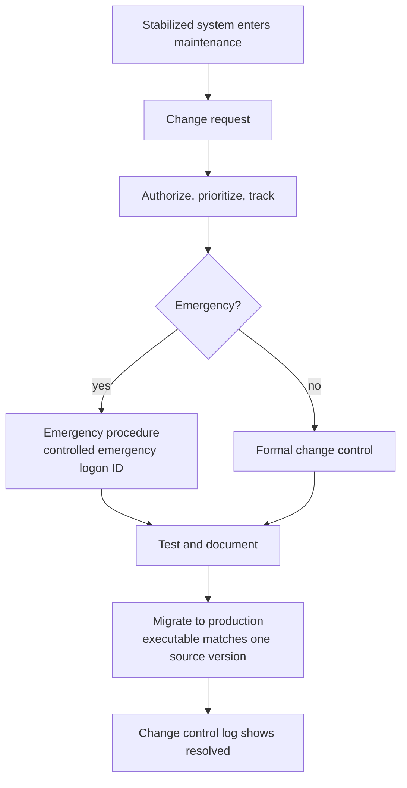

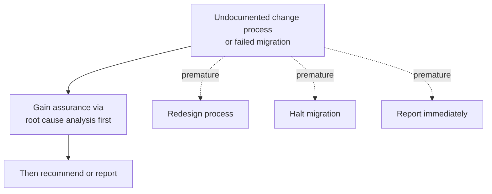

| Auditor checks | Sample from change control log |
|---|---|
| Methodology to authorize and track requests | Requirement changes produced documents |
| Emergency procedures in operations manuals | Changes made as documented |
| Formal change control for users and developers | Test plans and results prove standards |
| Access over production source and executables | Executable matches exactly one source version |
| Security over emergency logon IDs | Change tool technical controls reviewed |

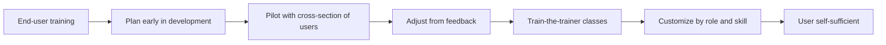

<b>Definitions</b>

- Critical success factors: skilled staff at workshops, documentation ready, decision-makers involved.
- Training administrator identifies who needs which training.
- Formats: case studies, role-based, lecture, online, remedial.
- Keep a case library of user errors and system responses.
- Record student information and feedback.

<b>Exam traps</b>

- Root cause analysis first: this rule comes from my notes (unverified in manual). 📓⭐
- Training too early: users forget. Too late: no time for feedback.
- Weak emergency access lets unauthorized changes reach production.

### 3.7.4 System software implementation

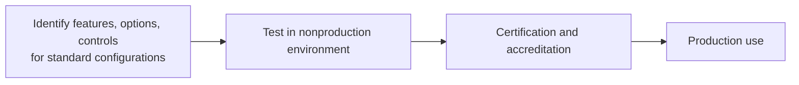

<b>Exam traps</b>

- Untested system software risks outages and weak security configuration.
- Certification and accreditation come before production OS use.

### 3.7.5 Certification / accreditation

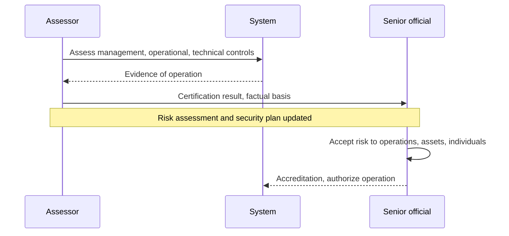

| Aspect | Certification | Accreditation |
|---|---|---|
| Who | Assessor | Senior official |
| What | Technical assessment of controls | Management decision to authorize |
| Result | Factual basis for decision | Accepts risk, responsibility, accountability |

<b>Definitions</b>

- Certification checks controls are implemented correctly and operate as intended.
- Accreditation acts as quality control, pushing best feasible controls.
- Core principles: responsibility and accountability.

<b>Exam traps</b>

- Assessor certifies; senior official accredits.
- Accountability for breach impact rests with the authorizing official.

### Quick recall

| # | Fact |
|---|---|
| 1 | ⭐ Parallel safest but costly; abrupt riskiest |
| 2 | ⭐ Phased replaces modules gradually, sustains two environments |
| 3 | Rollback readiness required before cutover |
| 4 | User management formally accepts any data loss |
| 5 | Cleanse data and rehearse with real data before conversion |
| 6 | Each production executable matches exactly one source version |
| 7 | 📓⭐ Undocumented process and failed migration: root cause analysis first (unverified) |
| 8 | Certification assesses controls; accreditation accepts risk |
