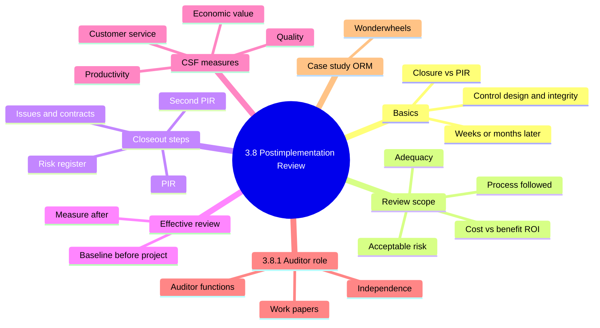
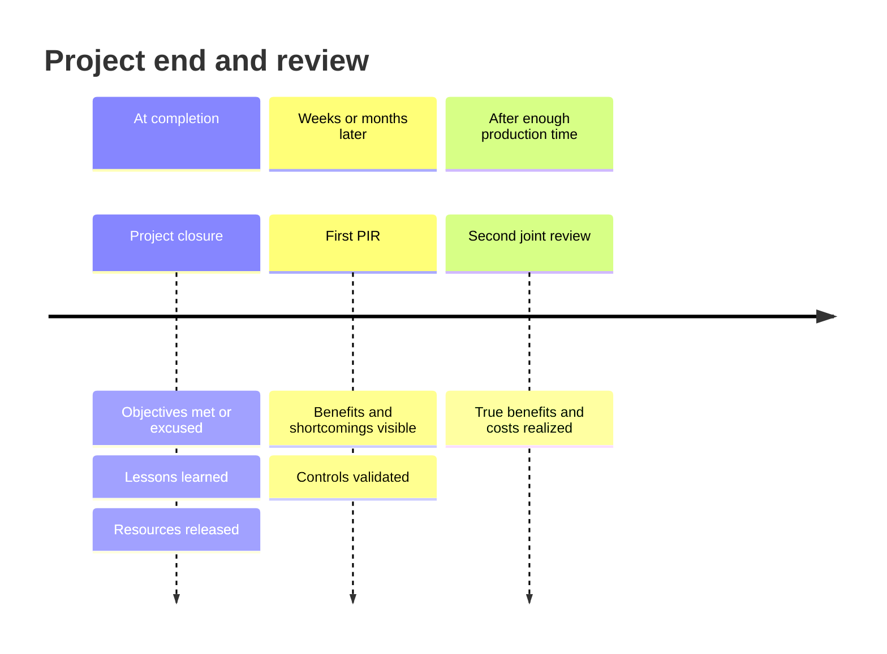
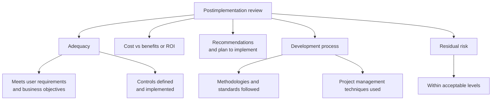
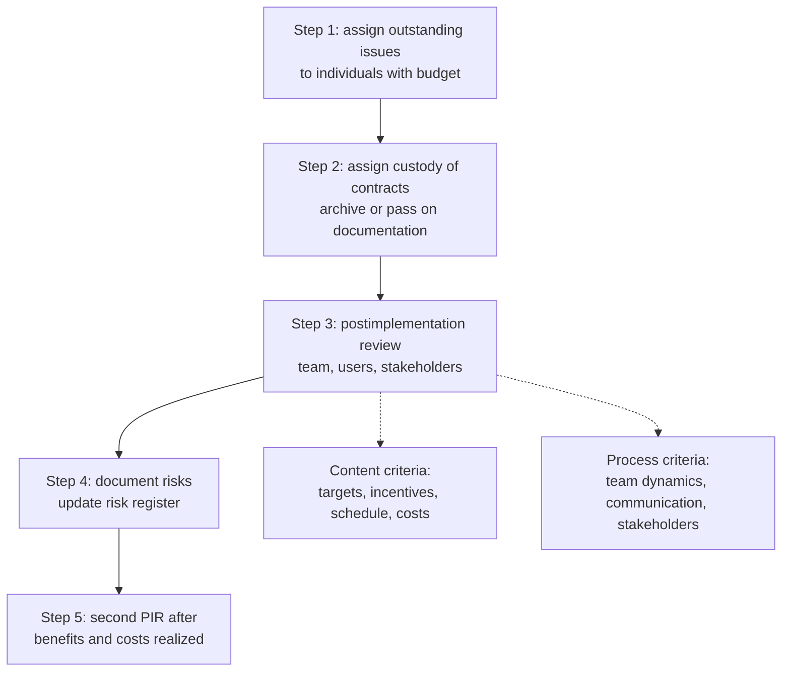
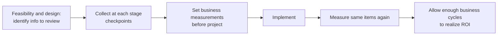
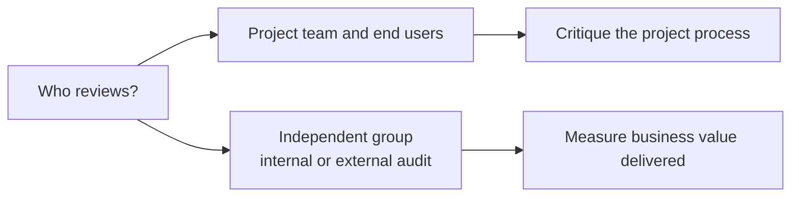
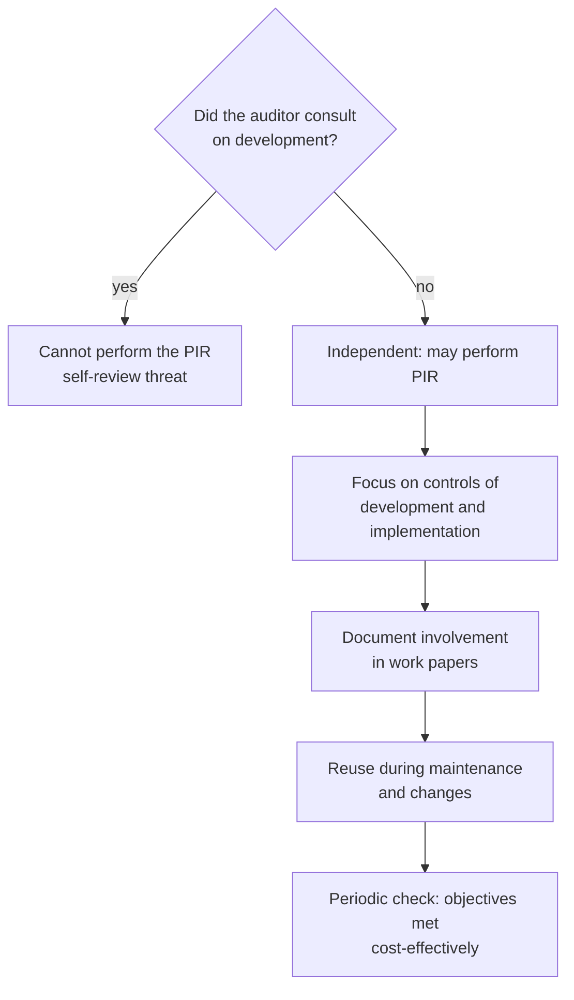
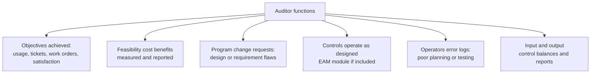
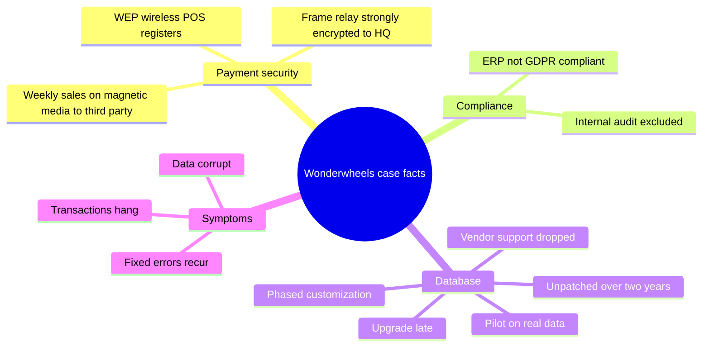

# 3.8 Postimplementation Review - Diagrams

[← Domain 3](../README.md) | [Study notes](../Study-Notes/3.8-Study-Notes.md)

> Markers: 📓 = in my notes, ⭐ = frequently tested, ➕ = unverified.

## Section map

### 3.8 Closure versus postimplementation review

| Aspect | Closure | PIR |
|---|---|---|
| Timing | At completion | Weeks or months after go-live |
| Purpose | Results, lessons, release resources | Confirm benefits and controls are real |
| Evidence | Objectives met or excused | Real-use data |

<b>Definitions</b>

- Project closure: formal end of a project at completion.
- PIR: look-back check of a live system after go-live.
- PIR is part of benefits realization.
- Audit priority: validate control design and technical integrity. 📓⭐

<b>Example</b>

- Payroll goes live; three months later PIR finds duplicate payments.

<b>Exam traps</b>

- Closure and PIR are different events; PIR comes later.
- Best PIR answers stress control design and integrity, not user happiness.

### Review scope

<b>Definitions</b>

- Second joint review: repeat review by development team and users.
- It needs enough production time to judge value.

<b>Exam traps</b>

- A single early review cannot show true ROI.
- Acceptable risk is judged against appetite, not zero risk.

### Project closeout steps (figure 3.28)

<b>Exam traps</b>

- Order: issues and contracts, PIR, risks, second PIR.
- Outstanding issues need an owner and budget, not just a note.
- Step 5 measures overall success and business impact.

### Effective review requirements

<b>Example</b>

- Project manager checks estimate accuracy at each milestone.

<b>Exam traps</b>

- Baselines set after go-live are wrong; set them up front.
- Without a baseline, benefits cannot be proven.

### Measurements of critical success factors (figure 3.29)

| Category | Measures |
|---|---|
| Productivity | Transactions per month, transactions per user |
| Quality | Discrepancies, disputes, fraud or misuse detections |
| Economic value | Processing time reduction, administration cost value |
| Customer service | Question turnaround time, useful communication frequency |

<b>Example</b>

- Disputes fall from 200 to 80 per month after the new billing system.

### Who performs the review

<b>Exam traps</b>

- Value measurement needs independence; a team reviewing itself is biased.

### 3.8.1 IS auditor's role in postimplementation review

<b>Definitions</b>

- EAM: module tracking organizational assets and their upkeep.
- Many change requests suggest design, programming or requirements flaws.

<b>Example</b>

- Output totals fail to reconcile with input batch totals.

<b>Exam traps</b>

- A consulting auditor may attend but cannot do the PIR.
- Trouble tickets and change requests are root-cause clues.
- Logs and balances beat management assurance.
- Lost independence invalidates review conclusions.

### Case study (ORM)

<b>Definitions</b>

- Scope: high-level cardholder-protection readiness review, not full compliance audit.
- Notes cover the stem only; answers are not covered. (unverified)

### Quick recall

| # | Fact |
|---|---|
| 1 | 📓⭐ Validate control design and technical integrity |
| 2 | PIR comes weeks or months after go-live; closure earlier |
| 3 | Set baseline measurements before project; measure again after |
| 4 | Closeout order: issues, contracts, PIR, risk register, second PIR |
| 5 | Auditor must be independent; consulting auditor cannot do PIR |
| 6 | Team reviews critique process; independent group measures value |
| 7 | Change requests, error logs, balances reveal design problems |
| 8 | Second joint review needs enough production time |
