# 4.1 IT Components - Diagrams

[← Domain 4](../README.md) | [Study notes](../Study-Notes/4.1-Study-Notes.md)

Markers: 📓 = in my notes, ⭐ = frequently tested, ➕ = unverified. Items flagged "unverified" were marked ⚠ Check or ➕ in the study notes.

## Section map

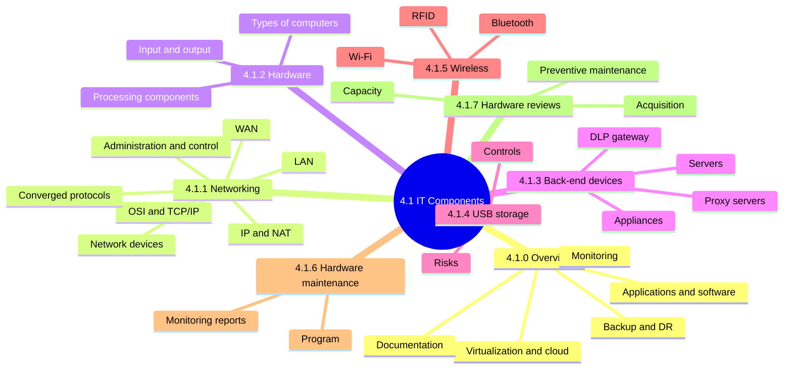

### 4.1.0 Overview: what IT operations covers

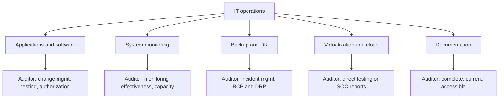

| Area | Definition | Auditor focus |
|---|---|---|
| Applications and software | OSs, applications, databases, middleware | Change management, testing, authorization |
| System monitoring | Tools and logs showing health | Detects issues early; capacity planning |
| Backup and DR | Backups, DRP, data replication | Restore tested; BCP and DRP assessed |
| Virtualization and cloud | VMs on hypervisor; IaaS, PaaS, SaaS | SOC reports when no direct testing |
| Documentation | Procedures, narratives, flowcharts | Complete, current, accessible |

<details>
<summary><b>Exam traps and examples</b></summary>

- Auditor assesses controls; approving changes personally breaks independence.
- Backup proven only by a successful restore test.
- Job completion alone is not evidence of recoverability.
- Customer still owns its data and accountability in the cloud.
- Outdated documentation is not adequate.
- Example: disk alert at 80 percent prevents an outage.
- Application controls list is unverified (⚠ Check in notes).
- Vendor-specific terminology is not examined.

</details>

### 4.1.1 Networking

#### LAN

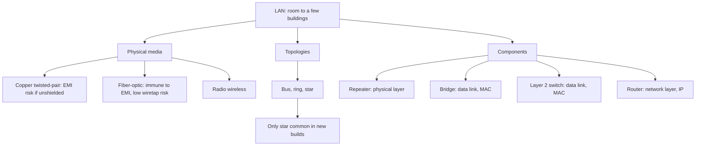

| Component | Layer | Key point |
|---|---|---|
| Repeater | Physical | Regenerates weak signal; extends range |
| Hub ➕ | Physical (unverified) | Shared medium; no port security |
| Bridge | Data link | Filters by MAC; software-based, rare today |
| Layer 2 switch | Data link | ASIC hardware; low latency; cuts collision domains |
| Router | Network | Blocks broadcasts; can bottleneck if software-based |

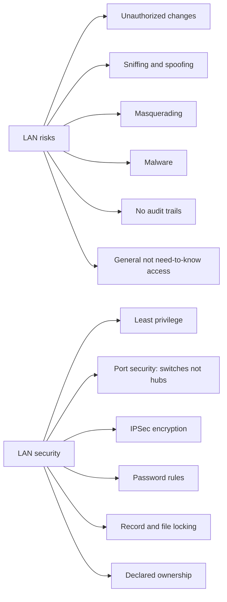

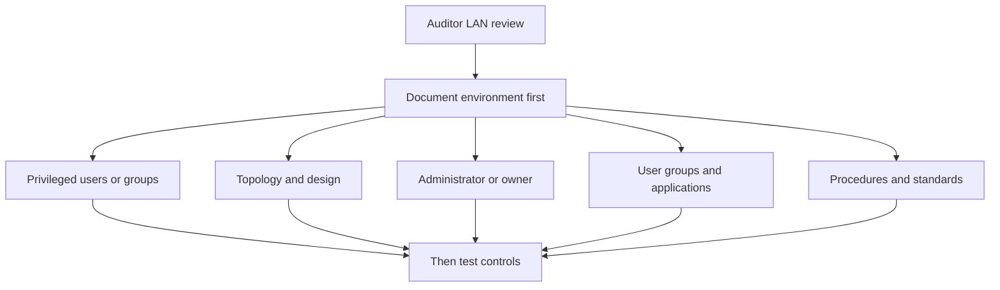

<details>
<summary><b>LAN exam traps</b></summary>

- Layer 2 uses MAC addresses; layer 3 uses IP addresses.
- A router blocks broadcasts; it does not forward them.
- Unshielded twisted-pair: use dedicated conduits, avoid long parallel runs.
- Fiber is fragile; suited where changes are infrequent.
- Understand and document first, then test controls.
- Hubs omitted from outline; their inclusion is unverified.

</details>

#### WAN

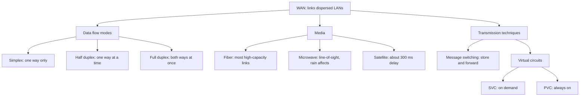

| Medium | Strengths | Weaknesses |
|---|---|---|
| Twisted pair | Cheap, simple | Under 200 feet; easy to tap; cross talk |
| Coaxial | Carries data and video | Thick, expensive, distance sensitive |
| Fiber | High bandwidth; hard to tap | Expensive; hard to splice |
| Radio, microwave, satellite | Wide reach | Easy to tap; interference, noise |

<details>
<summary><b>WAN details and traps</b></summary>

- Microwave: utilities link SCADA systems on light routes.
- Satellite transponders have 36 MHz bandwidth each.
- Low-earth orbit such as Starlink: latency under 100 ms.
- Message switching cost depends on message length.
- Fiber is hardest to tap; best for confidentiality in transit.
- Do not use wireless for sensitive links without encryption.

</details>

#### TCP/IP and its relation to the OSI reference model ⭐

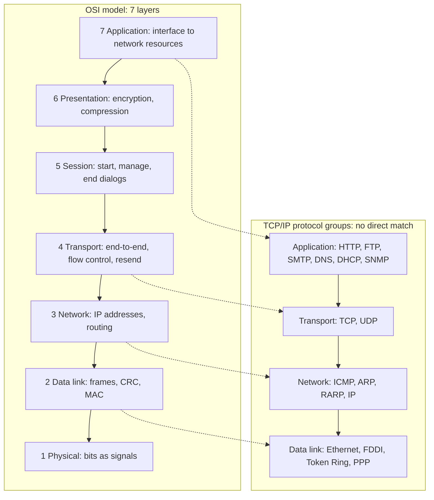

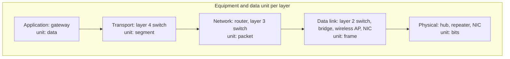

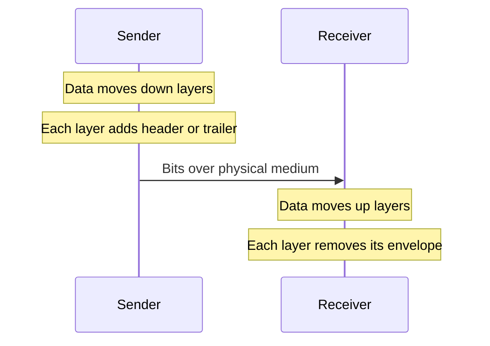

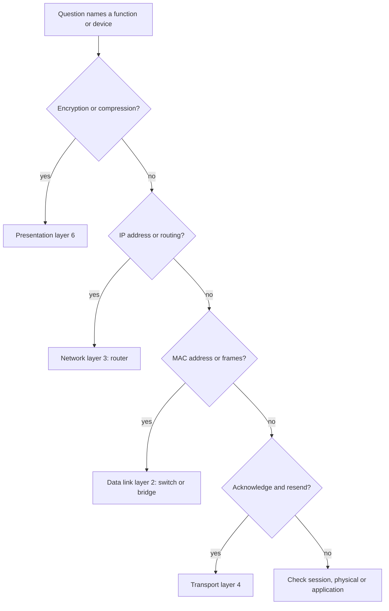

<details>
<summary><b>OSI exam traps</b></summary>

- Application layer is not application software.
- Data link layer detects errors via CRC; it does not correct them.
- CRC detects all single-bit and most multiple-bit errors.
- Bad frames are discarded when CRC values mismatch.
- Promiscuous interface listens to all data, enabling sniffing.
- Memorize units: segment, packet, frame, bits.
- TCP/IP predates OSI, so layers do not map one-to-one.

</details>

#### Network administration and control

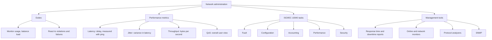

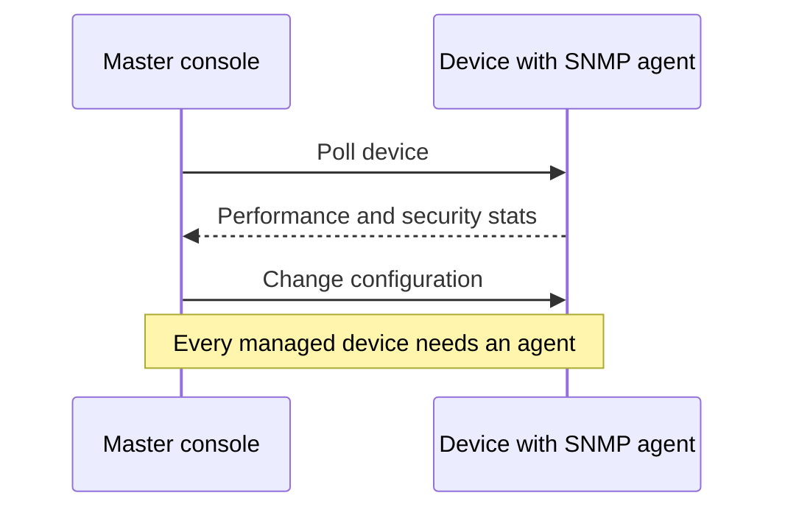

| Tool | What it shows |
|---|---|
| Response time report | Average, worst, best times |
| Downtime report | Line and circuit availability |
| Online monitor | Echo checking, status checking |
| Network monitor | Real-time node status |
| Protocol analyzer | Protocols, packet types, volume, errors |
| SNMP | Polls agents; monitors and configures |

<details>
<summary><b>Traps and remedies</b></summary>

- Latency is delay; jitter is change in delay.
- Throughput is not the same as bandwidth capacity.
- Downtime remedies: add lines, dedicated links, backup power.
- More remedies: access controls, utilization monitoring.
- Analyzers can expose sensitive data; restrict their use.
- Management software accessible only to the administrator.
- Weak SNMP access exposes device configuration.

</details>

#### Converged protocols

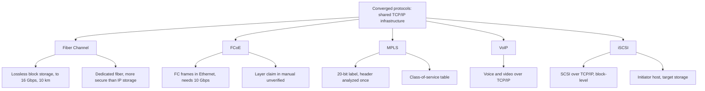

| Protocol | Core idea | Note |
|---|---|---|
| Fiber Channel | Dedicated lossless storage network | More secure; needs separate infrastructure |
| FCoE | FC frames over Ethernet | Costly; manual layer claim unverified |
| MPLS | Forwards by short labels | Handles many protocols |
| VoIP | Voice over TCP/IP | Needs same security as data |
| iSCSI | SCSI commands over TCP/IP | Cheaper than FC; suits DR |

<details>
<summary><b>Converged protocols traps</b></summary>

- FC is dedicated and more secure; iSCSI is cheaper over IP.
- Convergence cuts cost but adds complexity.
- FCoE: manual says Layer 3; Layer 2 likelier (unverified).
- iSCSI security: authentication, isolation, integrity, confidentiality.
- MPLS label is a fixed 20-bit value.

</details>

#### Internet Protocol networking

```mermaid
flowchart LR
    subgraph V4["IPv4"]
        A1["32-bit dotted decimal"]
        A2["About 4.3 billion addresses"]
        A3["Header checksum, broadcast"]
        A4["No built-in encryption or authentication"]
    end
    subgraph V6["IPv6"]
        B1["Vastly larger address space"]
        B2["No checksum, multicast"]
        B3["Built-in encryption and authentication"]
        B4["Autoconfiguration, flow label"]
    end
    subgraph TR["Transition"]
        C1["Dual stacking: both on one device"]
        C2["Tunneling: IPv6 over IPv4"]
    end
    V4 --> TR --> V6
```

<details>
<summary><b>IP traps</b></summary>

- IP is connectionless.
- IPv6 adds security options, but they must be configured.
- Dual-stacked devices expose two attack surfaces; filter both.
- Manual's IPv4/IPv6 table is garbled (unverified); outline matches known facts.

</details>

#### Network Address Translation (NAT)

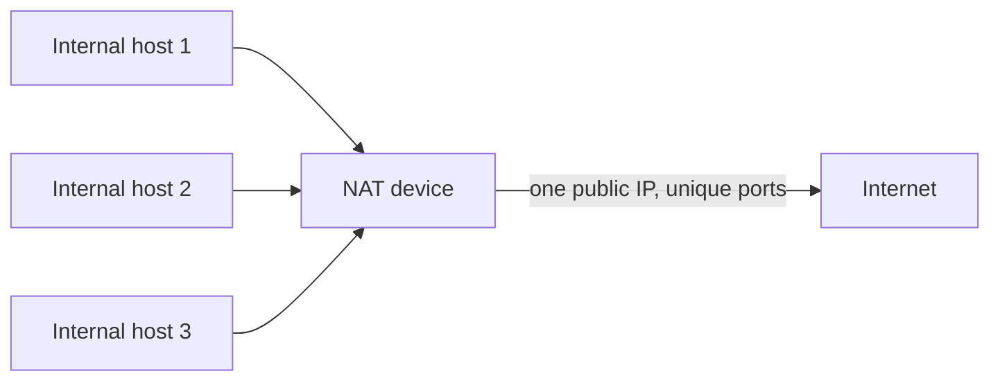

| NAT type | Mapping |
|---|---|
| Static NAT | Permanent one-to-one; internal web server reachable |
| Dynamic NAT | Address from public pool per session |
| NPAT | Many devices share one public IP via ports |

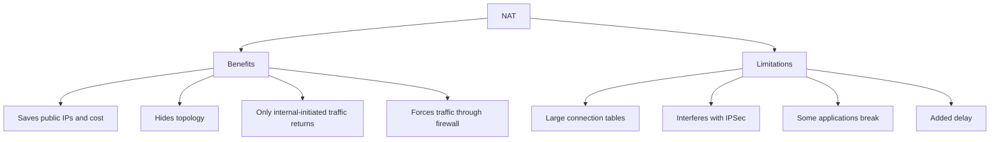

<details>
<summary><b>NAT traps</b></summary>

- NAT conserves IPs and hides topology; it is not encryption.
- NAT does not replace a firewall.
- NAT does not work seamlessly with IPSec.

</details>

#### Network devices 📓

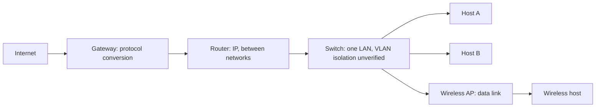

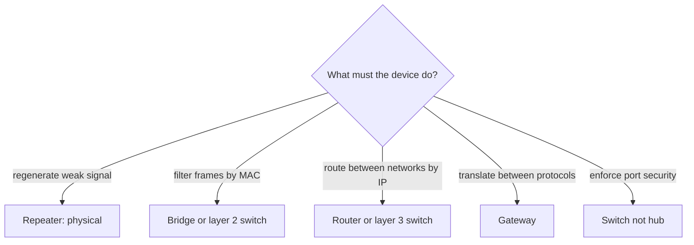

| Device | Layer | Job | Audit point |
|---|---|---|---|
| Repeater | Physical | Regenerates signal | Extends range only |
| Hub ➕ | Physical | Repeats to all ports | No port security (unverified) |
| Bridge | Data link | Filters by MAC | Software-based |
| Layer 2 switch | Data link | MAC forwarding | Fewer collision domains |
| Router 📓 | Network | IP routing | Review routing tables |
| Layer 3 switch | Network | Routing in hardware | Segmentation |
| Layer 4 switch | Transport | Segment-level switching | Load distribution |
| Gateway 📓 | Application | Protocol conversion | Critical control point |
| Wireless AP | Data link | Wireless access | Secure configuration |

<details>
<summary><b>Device traps</b></summary>

- Protocol translation only: gateway, not router.
- Choose device by layer and protocol difference to bridge.
- Gateway as only application-layer equipment is flagged unverified.
- VLANs are not in the 4.1 manual text (unverified).

</details>

### 4.1.2 Computer hardware components and architectures

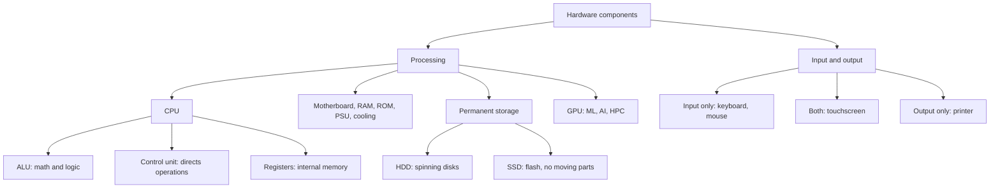

| Computer type | Key feature |
|---|---|
| Supercomputer | Highest speed; specialized calculations |
| Mainframe | Thousands of users; batch and real-time; proprietary OS |
| High-end or midrange server | Partitioning; UNIX database, Windows file or print |
| Personal computer | Single-user workstation |
| Thin client | Minimal hardware; server processes |
| Laptop | Theft risk; battery tolerates power loss |
| NUC | Small-form desktop or edge device |
| SBC | One board; fixed RAM; no expansion slots |
| Smartphone, tablet | Syncs with PCs |

<details>
<summary><b>Hardware details and traps</b></summary>

- CPU variants: microprocessor, multi-processor, multi-core.
- Wireless parts: Wi-Fi, cellular LTE and 5G, Bluetooth.
- Example SBC: Raspberry Pi.
- Thin clients centralize processing, easing control and data protection.
- Laptops risk theft of stored data or LAN access.

</details>

### 4.1.3 Common enterprise back-end devices

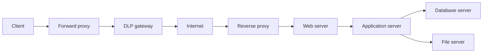

| Device | Purpose |
|---|---|
| Print server | Consolidates printing across sites |
| File server | Central repository; access-control matrix |
| Application server | Business logic; license consolidation |
| Web server | Serves pages via URLs |
| Database server | Stores data; others present it |
| DLP gateway | Inspects traffic; blocks exfiltration |
| Appliance | Single-purpose, smaller, faster |

```mermaid
flowchart TD
    P["Proxy server: acts on user's behalf"] --> F["Forward proxy"]
    P --> R["Reverse proxy"]
    P --> O["Open proxy"]
    F --> F1["Between client and Internet"]
    F --> F2["Caching, filtering, anonymizes client IP"]
    R --> R1["Between Internet and web server"]
    R --> R2["Load balancing, hides server IPs, caching"]
    O --> O1["Avoid: abused for phishing and spam"]
```

<details>
<summary><b>Back-end traps</b></summary>

- Forward proxy protects clients; reverse proxy protects servers.
- A reverse proxy does not hide client addresses.
- Appliances: firewalls, IDS, IPS, switches, routers, VPNs, load balancers.
- Appliances run no other services; patch and configure carefully.
- IoT growth brings leakage and privacy risk; see chapter 5.

</details>

### 4.1.4 USB mass storage devices

```mermaid
flowchart LR
    subgraph RISK["Risks"]
        R1["Malware vector"]
        R2["Data theft from unlocked PCs"]
        R3["Data and media loss"]
        R4["Corruption from improper removal"]
        R5["Version compatibility issues"]
        R6["HIPAA exposure"]
    end
    subgraph CTRL["Controls"]
        C1["Encryption"]
        C2["Central block of mass storage"]
        C3["Policies and awareness"]
        C4["Lock desktop policy"]
        C5["Antivirus scanning"]
        C6["Secure devices only"]
        C7["Read-only switch"]
    end
    RISK --> CTRL
```

<details>
<summary><b>USB features, examples, traps</b></summary>

- Features: hot swapping, plug-and-play, bus power, no vendor drivers.
- Examples: flash drives, external HDDs, SD cards.
- Example: lost unencrypted drive holding patient records.
- Granular control: block storage yet allow mice and keyboards.
- Return information file: omit company details, add legal disclaimer.
- Strongest single control: central port control plus mandatory encryption.
- Encryption alone leaves workstation copies unprotected.

</details>

### 4.1.5 Wireless communication technologies

| Technology | Use |
|---|---|
| Wi-Fi | High-speed Internet by radio waves |
| Bluetooth | Short-distance device connection |
| RFID | Tags identify and track objects |

```mermaid
flowchart TD
    WL["Wireless"] --> AD["Advantages"]
    WL --> AU["Audit view"]
    AD --> A1["Convenience"]
    AD --> A2["Mobility"]
    AD --> A3["Scalability"]
    AU --> U1["Easier to intercept"]
    AU --> U2["See section 5.9 for Wi-Fi and Bluetooth"]
    AU --> U3["RFID: asset tracking, inventory, access control"]
```

<details>
<summary><b>Wireless trap</b></summary>

- Convenience benefits do not reduce risk; wireless widens exposure.

</details>

### 4.1.6 Hardware maintenance program

```mermaid
flowchart TD
    MP["Maintenance program"] --> INF["Information kept"]
    MP --> AUD["Auditor steps"]
    MP --> REP["Monitoring reports"]
    INF --> I1["Reputable service company"]
    INF --> I2["Schedule and cost"]
    INF --> I3["Performance history"]
    AUD --> A1["Scope matches business needs"]
    AUD --> A2["Formal plan approved and followed"]
    AUD --> A3["Costs over budget identified"]
    REP --> R1["Availability: downtime causes"]
    REP --> R2["Hardware error: CPU, I/O, power, storage"]
    REP --> R3["Asset management: inventory"]
    REP --> R4["Utilization: trends"]
```

| Report | Shows |
|---|---|
| Availability | Downtime; causes include hardware, OS maintenance, environment, training |
| Hardware error | CPU, I/O, power, storage failures; intermittent errors |
| Asset management | Inventory of network-connected equipment |
| Utilization | Machine and peripheral use; predicts needs |

<details>
<summary><b>Maintenance details and traps</b></summary>

- Includes environmental hardware: temperature, humidity, fire protection, power.
- Mainframe-class utilization averages about 85 to 95 percent.
- Peaks to 100 percent and dips below 70 percent tolerated.
- Sustained low or maxed utilization signals capacity-planning problems.
- Remote sites may lack equal vendor coverage.
- Management documents deviations from vendor specifications.

</details>

### 4.1.7 Hardware reviews

```mermaid
timeline
    title Hardware lifecycle review points
    Plan : Acquisition plan aligned to business and IS plans : Criteria and lead time documented
    Acquire : Cost-benefit analysis : Purchasing department routing : Approval forms
    Manage : Asset tagging and owner : Contracts and SLAs retained
    Monitor : Capacity monitoring from historical data : Auto-contact equipment monitored
    Maintain : Vendor frequency : Off-peak periods : Flexible backup hardware
    Review : Availability and utilization reports : Problem logs and job accounting
```

```mermaid
flowchart TD
    Q{"Hardware purchase request?"} -->|"has cost-benefit analysis"| A{"Routed via purchasing?"}
    Q -->|"no analysis"| X["Control gap"]
    A -->|"yes"| B{"Matches approved plan?"}
    A -->|"no"| X
    B -->|"yes"| OK["Acceptable"]
    B -->|"no"| X
```

<details>
<summary><b>Review traps</b></summary>

- Acquisition must trace to approved plan and cost-benefit analysis.
- Buying outside purchasing bypasses control.
- Maintenance not scheduled during critical processing.
- Management reviews malfunctions, reruns, abnormal terminations, operator actions.

</details>

### Quick recall

| # | Fact |
|---|---|
| 1 ⭐ | OSI units: data, segment, packet, frame, bits |
| 2 ⭐ | Layer 2 uses MAC; layer 3 uses IP; routers block broadcasts |
| 3 ⭐ | Presentation: encryption; transport: acknowledge and resend; data link: CRC detects |
| 4 ⭐ | Gateway converts protocols; repeater regenerates signal; switch beats hub for port security |
| 5 | Fiber hardest to tap; wireless and copper easier |
| 6 | Latency is delay; jitter is variance in latency |
| 7 | NAT hides topology, conserves IPs, conflicts with IPSec |
| 8 | Forward proxy protects clients; reverse proxy protects servers |
| 9 | USB: central control, encryption, awareness, antivirus together |
| 10 | Document the environment first, then test controls |
