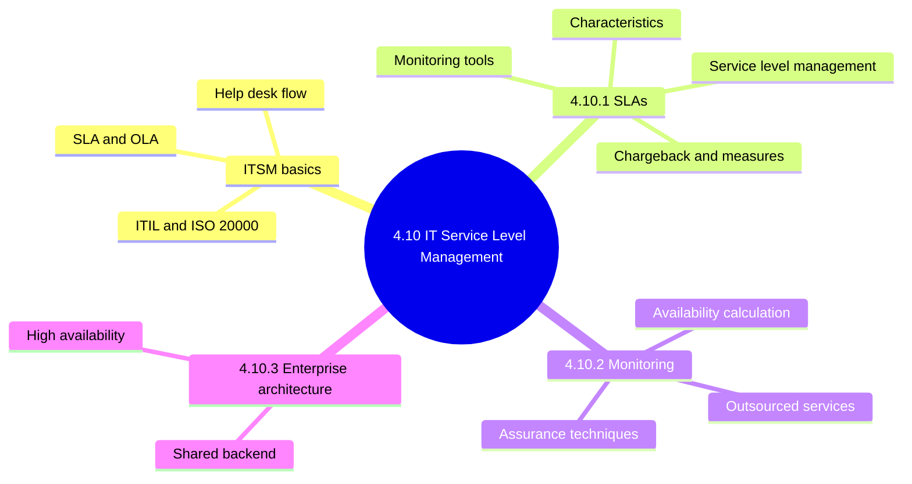
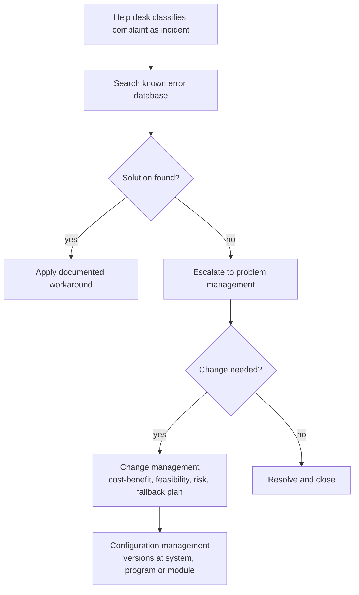
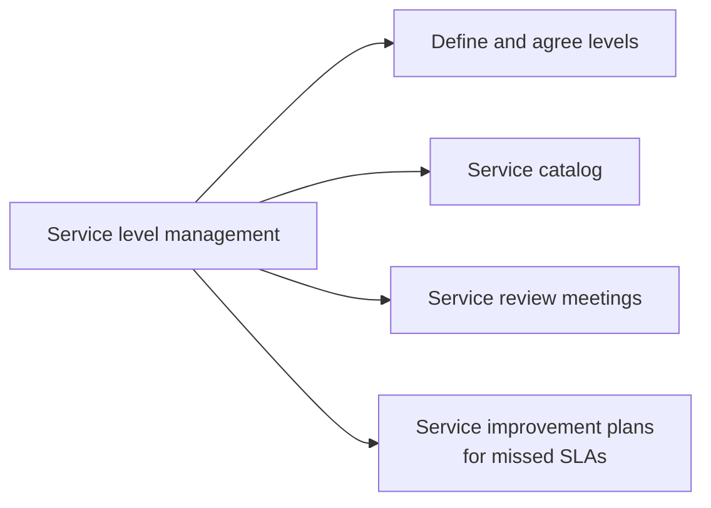
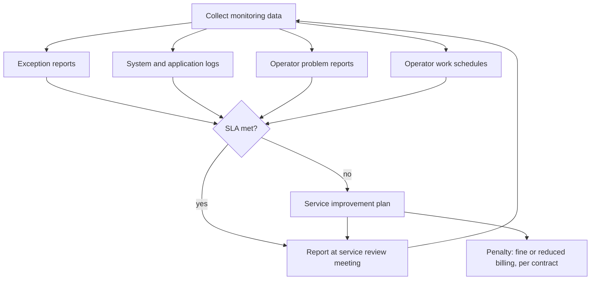
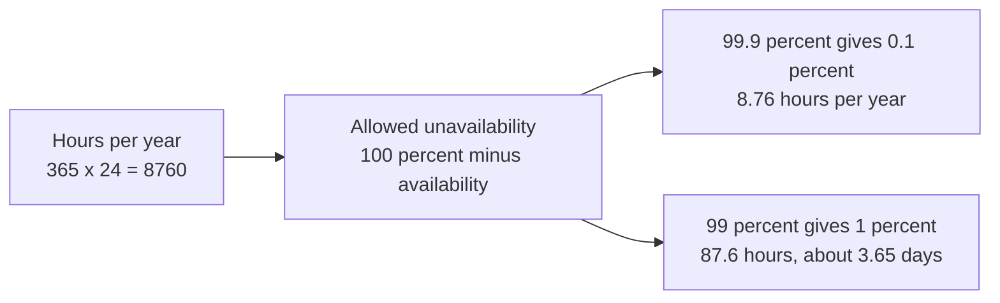
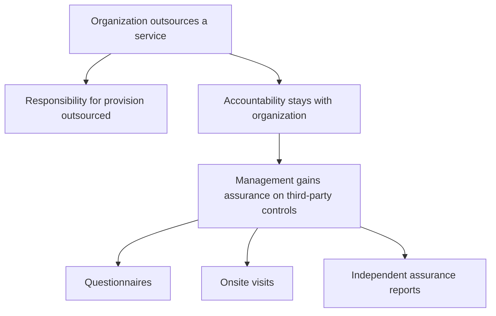
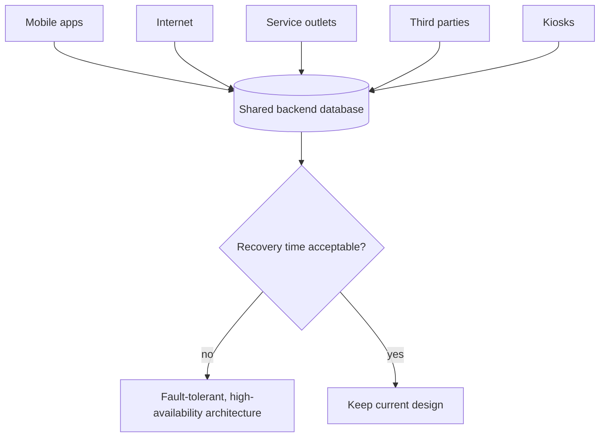

# 4.10 IT Service Level Management - Diagrams

[← Domain 4](../README.md) | [Study notes](../Study-Notes/4.10-Study-Notes.md)

> Markers: 📓 = in my notes, ⭐ = frequently tested, ➕ / ⚠ Check = unverified.

### Section map

### 4.10 ITSM basics

| Item | Faces | Purpose |
|---|---|---|
| SLA | Customer (business) | Narrows gap between expectation and service |
| OLA | Internal IT teams | Supports commitments made in the SLA |
| ITIL | Framework | Detailed ITSM practices on business value |
| ISO 20000 | Standard | International ITSM standard |

<b>Exam traps</b>

- SLA faces the customer; OLA is internal.
- An OLA is not a contract with an external vendor.
- All changes pass through change management, even problem fixes.
- A fallback plan is required.
- ITIL is a framework; ISO 20000 is a standard.

### 4.10.1 Service level agreements (SLA) 📓

SLA characteristics: accuracy, completeness, timeliness, security.

SLA monitoring flow.

| Tool | Type | Shows |
|---|---|---|
| Exception reports | Automated | Failed or malfunctioning applications |
| System and application logs | Automated | Normal and abnormal events; auditor tests |
| Operator problem reports | Manual | Problems, resolutions, training needs |
| Operator work schedules | Manual | Staffing, cross-training, emergency coverage |

<b>Causes of excess exceptions</b>

- Poor understanding of business requirements.
- Poor design, development or testing.
- Inadequate operating instructions or operations support.
- Inadequate operator training or monitoring.
- Poor task sequencing or system configuration.
- Inadequate capacity management.

<b>Log tests and measures</b>

- Only approved programs and authorized staff access sensitive data.
- Data-altering utilities used only for authorized purposes.
- Approved programs run only when scheduled.
- Correct data file generation used for production.
- Measures: performance, financial, human resources, risk management.
- Measures must include risk, security, control, efficiency, effectiveness.
- SLAs often tied to chargeback; outsourcing needs an SLA.

<b>Exam traps</b>

- Service level management includes catalogs, reviews and SIPs.
- Penalties depend on contract wording.
- Exception reports are automated; operator problem reports are manual.
- Performance-only SLA is incomplete without risk and control measures.

### 4.10.2 Monitoring of service levels

Availability calculation.

⚠ Check: the manual text says 99.9 percent allows about three and a half days. That fits 99 percent. 99.9 percent allows about 8.8 hours (unverified manual wording).

Outsourced services.

| Assurance technique | Notes |
|---|---|
| Questionnaire | Self-reported control information from provider |
| Onsite visit | Direct inspection of provider operations |
| Independent report | SSAE 18 SOC 1; AT-101 for SOC 2 and SOC 3 (numbering unverified) |

<b>Exam traps</b>

- Each extra nine cuts allowed downtime tenfold.
- Outsourcing transfers tasks, never accountability.
- Reviewing SLA metrics alone does not prove third-party controls work. 📓
- Independent reports usually outweigh self-assessment.
- ➕ SOC 1 relates to financial reporting controls (unverified).

<b>Example</b>

- A bank tracks ATM availability and customer satisfaction after outages.
- Third-party control weakness causing fraud damages the organization's reputation.

### 4.10.3 Service levels and enterprise architecture

<b>Exam traps</b>

- Recovery time too long: upgrade architecture, not relax the SLA.
- A shared backend outage stops all channels together.

### Quick recall

| Fact | Detail |
|---|---|
| ⭐ SLA vs OLA | SLA faces customer; OLA is internal |
| ⭐ Accountability | Never outsourced; responsibility is |
| ⭐ Availability | 99.9 percent is about 8.8 hours yearly |
| SLA characteristics | Accuracy, completeness, timeliness, security |
| Monitoring tools | Exceptions, logs, operator reports, schedules |
| Missed SLA | Service improvement plan; possible penalty |
| Assurance | Questionnaires, visits, independent reports |
| Recovery too slow | Fault-tolerant high-availability architecture |
