# 4.11 Database Management - Diagrams

[← Domain 4](../README.md) | [Study notes](../Study-Notes/4.11-Study-Notes.md)

Markers: 📓 in my notes, ⭐ frequently tested, ➕ unverified (not in the manual).

### Section map

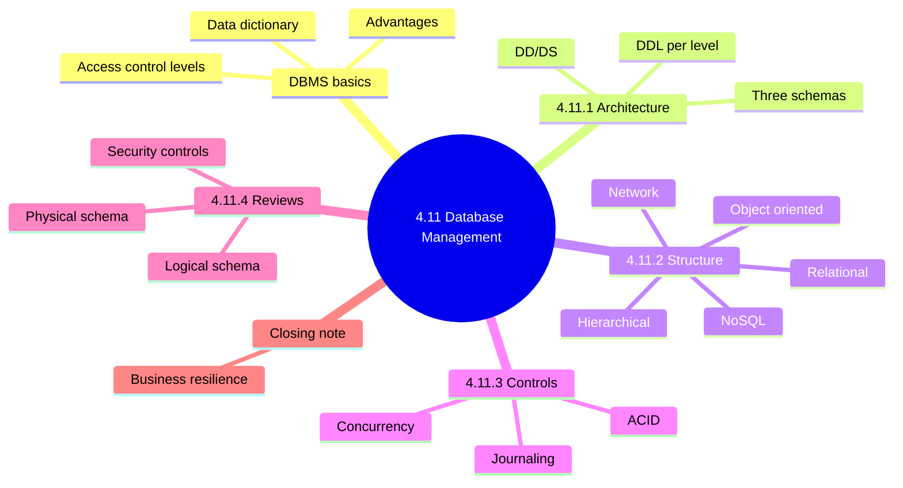

### 4.11.0 DBMS basics

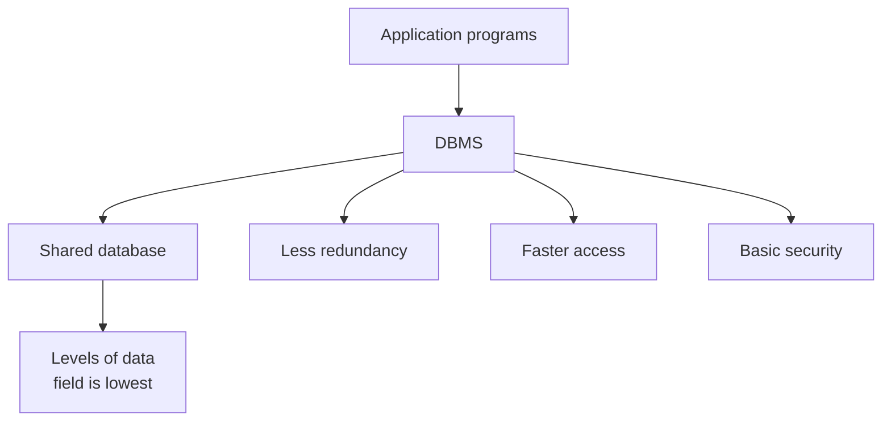

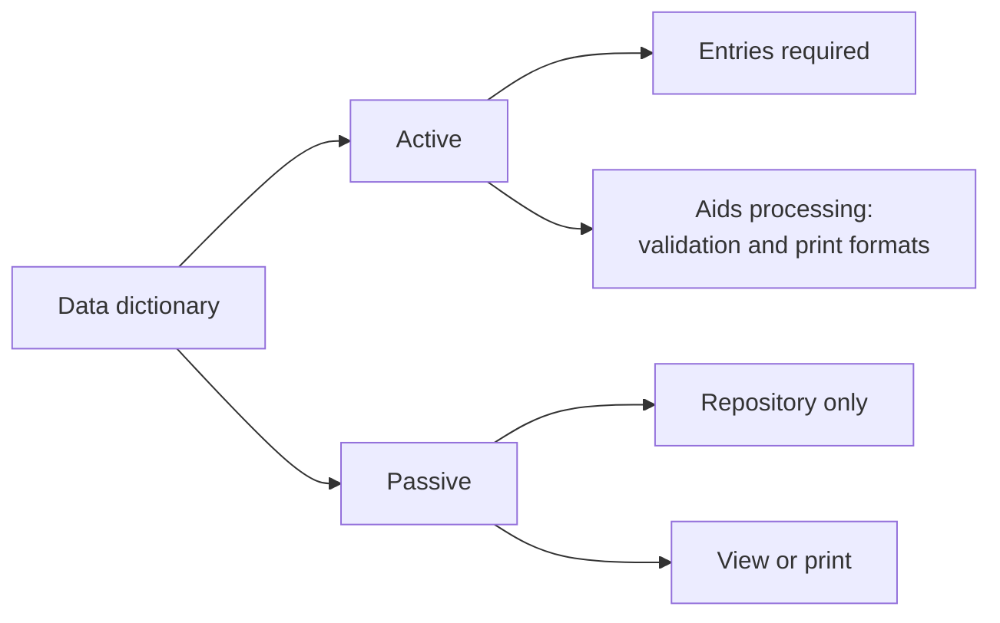

| Access control level | Restricts |
|---|---|
| User and database | Who can reach the database |
| Program and database | Which programs reach the database |
| Transaction and database | Which transactions reach the database |
| Program and data field | Program access to single fields |
| User and transaction | Which transactions a user may run |
| User and data field | User access to single fields |

<b>Definitions</b>

- DBMS creates, organizes, controls and serves shared data.
- Field is the lowest level of data organization.
- Active dictionary: DBMS uses entries during processing.
- Passive dictionary: documentation only, enforces nothing.

<b>DBMS advantages</b>

- Data independence; ease of support and flexibility.
- Transaction processing efficiency.
- Reduced redundancy, maximized consistency.
- Lower maintenance cost through sharing.
- Enforced data and programming standards.
- Enforced data security and stored integrity checks.
- Ad hoc access via query languages or application generators.

<b>Exam traps</b>

- Passive does not mean safer; it enforces nothing.
- Advantages do not remove the need for backups.
- Ad hoc query access is a benefit and a risk.
- Sharing concentrates risk; access controls matter more.

### 4.11.1 DBMS architecture

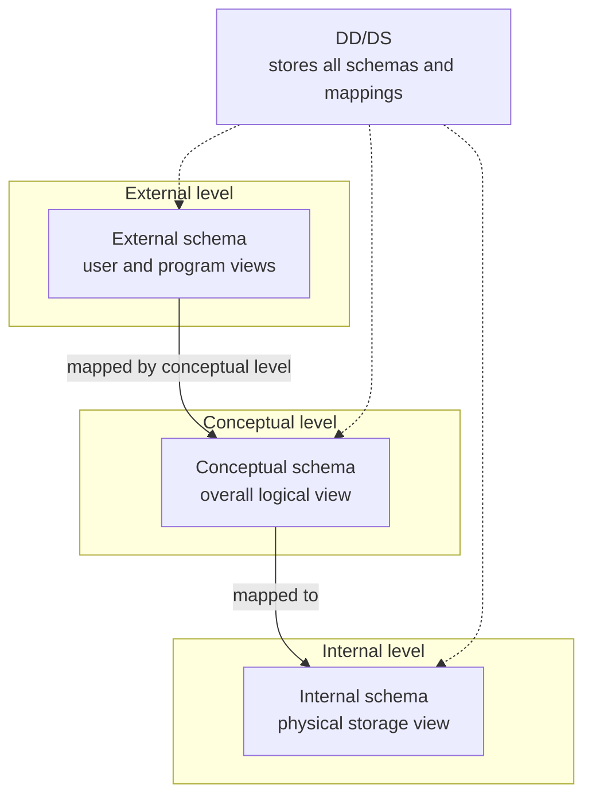

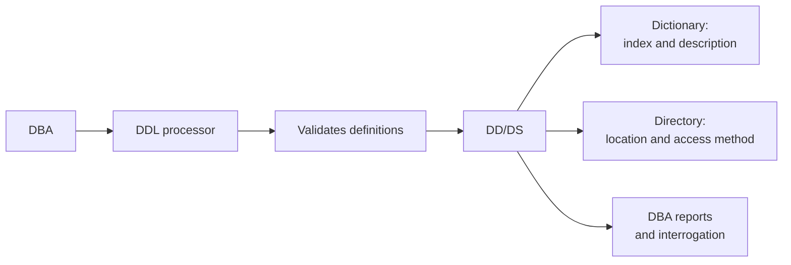

<b>Definitions</b>

- Metadata defines fields, files, relationships and queries.
- Three metadata types: conceptual, external, internal schema.
- Schema meanings (logical, views, physical) are unverified (➕).
- Each level has a DDL component.
- External schemas are location-independent of the internal schema.

<b>DD/DS benefits</b>

- Better documentation and common validation.
- Easier programming and standard methods.
- One DD/DS can serve several DBMSs.
- Prevents unauthorized access to metadata.

<b>Exam traps</b>

- Dictionary describes items; directory says where and how to reach them.

### 4.11.2 Database structure

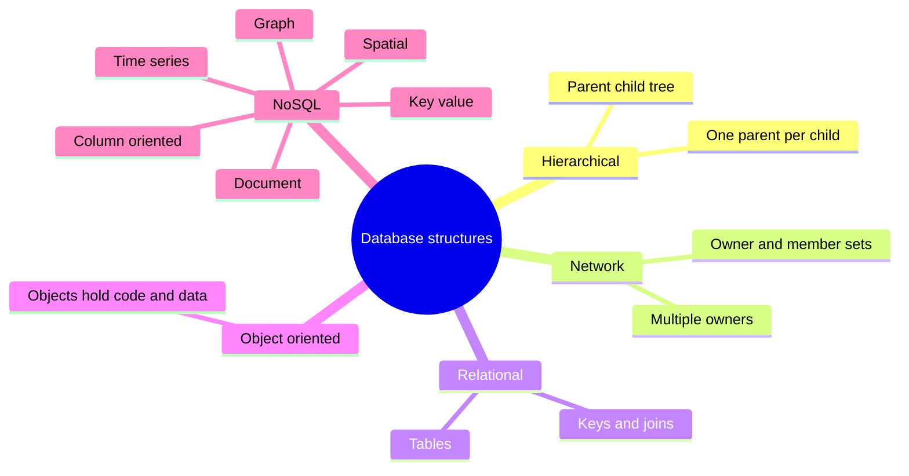

| Model | Core idea | Notes |
|---|---|---|
| Hierarchical | Logical tree, 1:N parent-child | No reverse pointers; example Windows registry |
| Network | Sets with owner and member record types | Complex; hard to rebuild; rarely used |
| Relational | Tables, set theory, joins at retrieval time | Oracle, DB2, SQL Server; ERP systems |
| Object-oriented | Objects with code, data, unique identifier | Niche: engineering, science, spatial |
| NoSQL | Big and unstructured data, dynamic schemas | MongoDB, Cassandra; sharding |

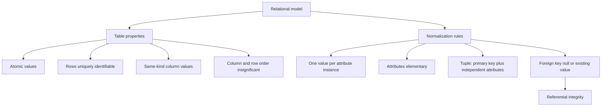

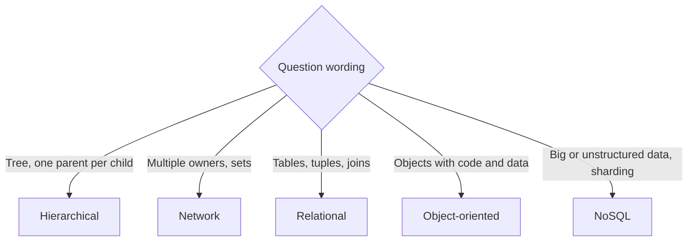

<b>Definitions</b>

- Rows are tuples (records); columns are attributes (fields).
- Referential integrity: foreign keys never point to nothing.
- Sharding: horizontal partitioning across servers.
- Dynamic schemas: no schema needed before adding data.
- Hierarchical and network models lack high-level queries; programs navigate.

<b>Example</b>

- An order row cannot reference a missing customer ID.

<b>Exam traps</b>

- Referential integrity concerns foreign keys, not primary keys.
- Null foreign keys are allowed only where cardinality permits.
- NoSQL is chosen for scale, not stronger integrity.
- Weaker NoSQL integrity is an inference (unverified, ➕).

### 4.11.3 Database controls

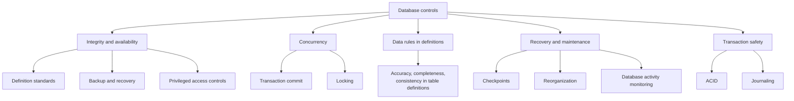

ACID: not in the manual text (unverified, ➕), except atomicity which is in my notes 📓⭐.

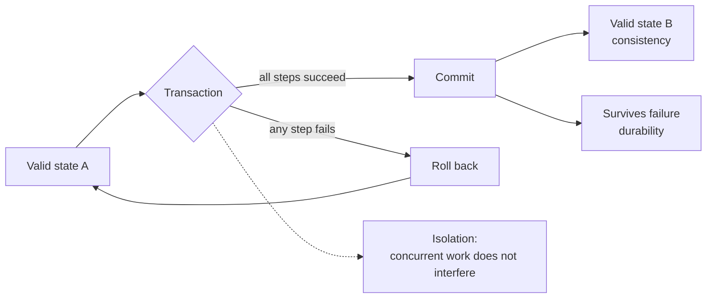

| ACID property | Meaning | Marker |
|---|---|---|
| Atomicity | Completes entirely or not at all | 📓 ⭐ |
| Consistency | Moves database between valid states | ➕ unverified |
| Isolation | Concurrent transactions do not interfere | ➕ unverified |
| Durability | Committed changes survive failure | ➕ unverified |

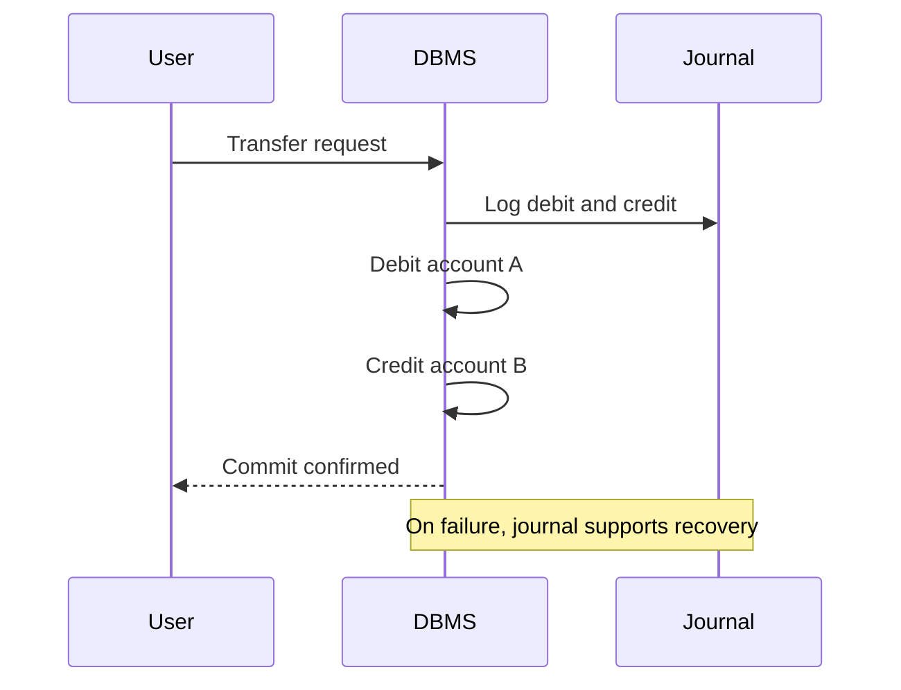

<b>Definitions</b>

- Concurrency: several users updating the same data at once.
- Checkpoints at job stream junctures limit data loss.
- Journaling: sequential log of changes for reconstruction 📓.
- Journaling is not in the manual text (unverified, ➕).
- DAM monitors, audits and reports on database activity.
- DAM independence from DBMS admins is unverified (➕).

<b>Example</b>

- A transfer debits one account and credits another, or neither.

<b>Exam traps</b>

- "All or nothing" means atomicity.
- Durability is survival after commit, not full completion.
- Journals record changes; backups copy data; recovery needs both.
- Rules in table definitions cannot be bypassed by program flaws.
- Minimize non-system tools and utilities that bypass security.

### 4.11.4 Database reviews

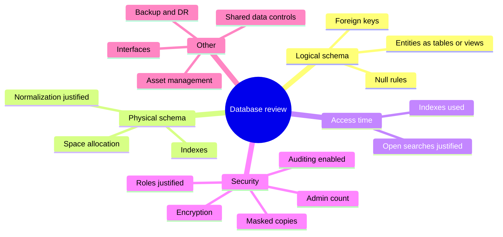

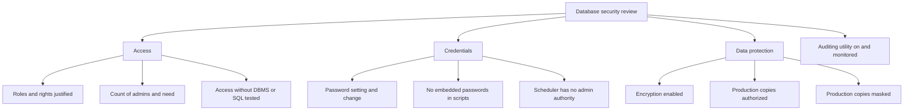

| Review area | Check |
|---|---|
| Interfaces | Import and export keep integrity and confidentiality |
| Concurrent access | Consistency and integrity maintained |
| Backup and DR | High availability and fast recovery controls |
| Supported IS controls | Shared access appropriate; DBMS change procedures; dictionary integrity |
| IT asset management | Owner, contracts and SLAs, license compliance |

<b>Example</b>

- Mask customer names before copying production data to test.

<b>Exam traps</b>

- Excess administrator privilege outranks missing password reminders.
- Embedded passwords defeat access controls whatever their strength.
- Unjustified non-normalized design risks redundancy.

### Closing note: business resilience

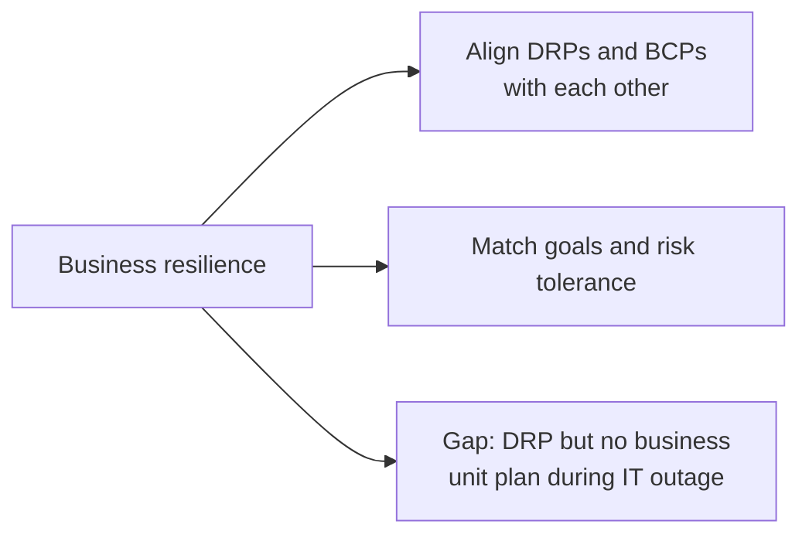

<b>Exam traps</b>

- A DRP alone does not cover business units during outages.
- This is Part B material, not database management proper.

### Quick recall

| # | Fact |
|---|---|
| 1 | ⭐ Atomicity means all or nothing 📓 |
| 2 | Active dictionary is used in processing; passive is documentation |
| 3 | Dictionary describes items; directory gives location and access method |
| 4 | Relational integrity: keys, normalization, referential integrity |
| 5 | Hierarchical: one parent per child; network: multiple owners |
| 6 | NoSQL: big data, sharding, dynamic schemas |
| 7 | Journaling enables recovery 📓 (➕ unverified) |
| 8 | Rules in table definitions beat rules only in application code |
| 9 | Review admin privilege, embedded passwords, masking, indexes, auditing |
