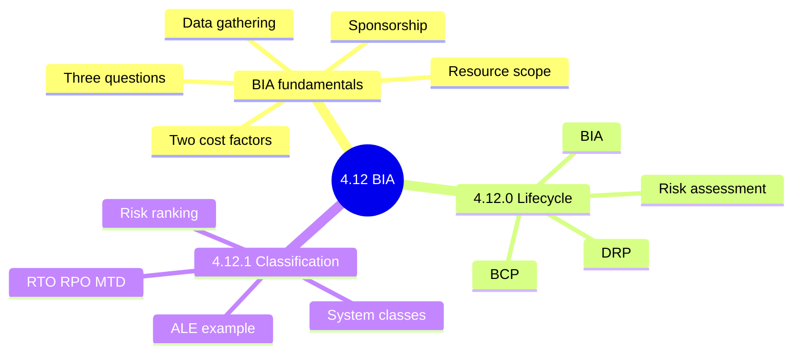
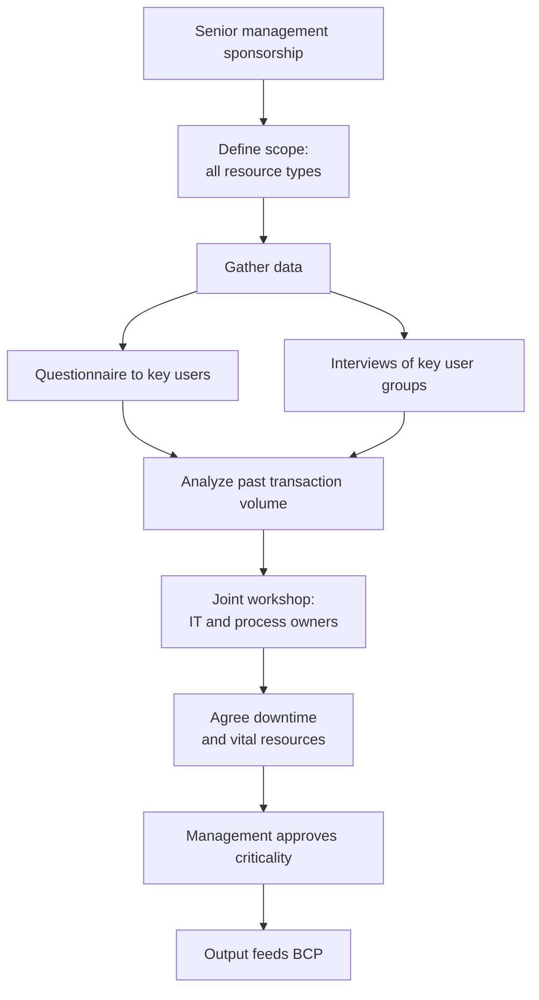
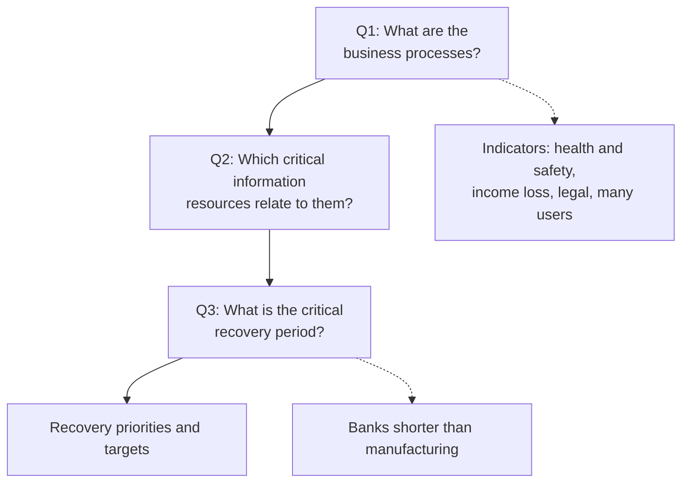
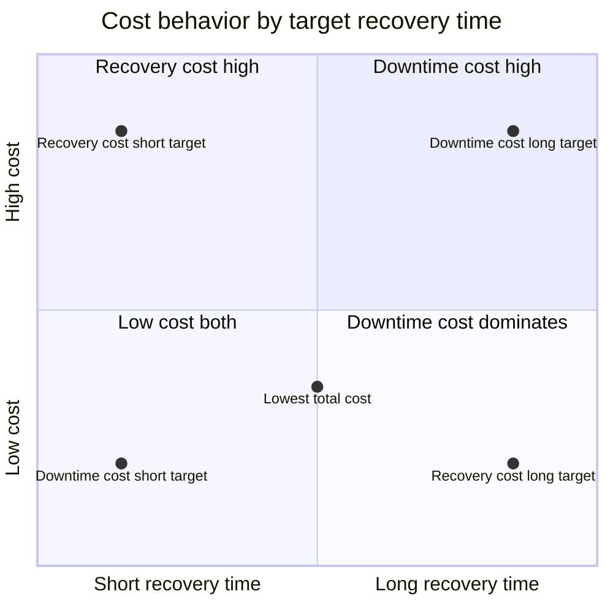
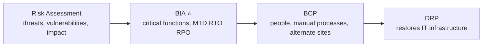
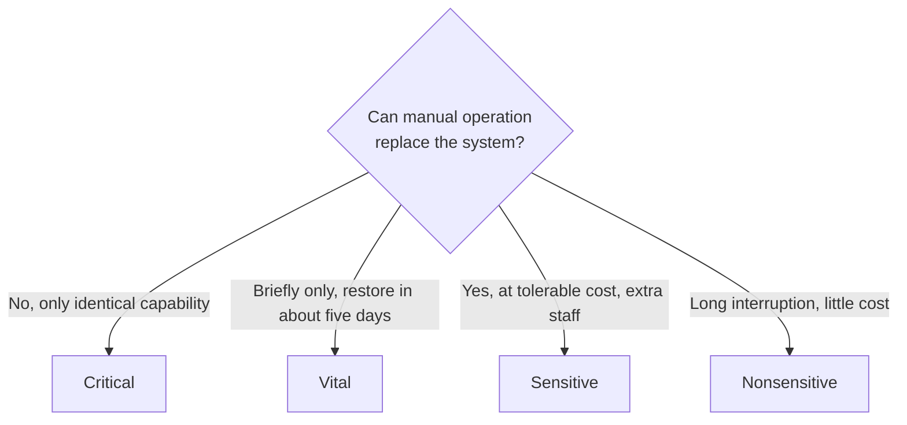
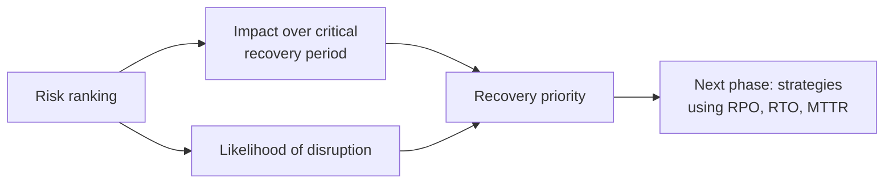
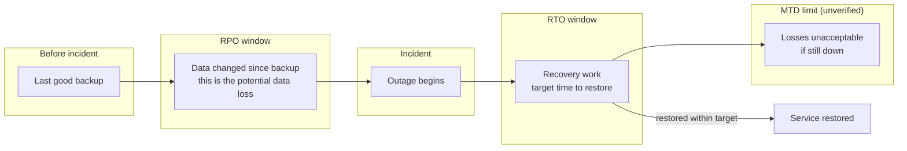
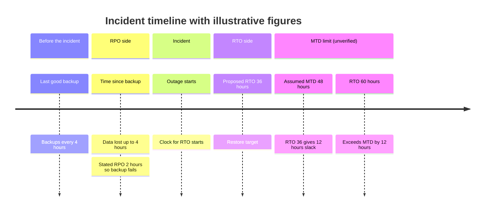
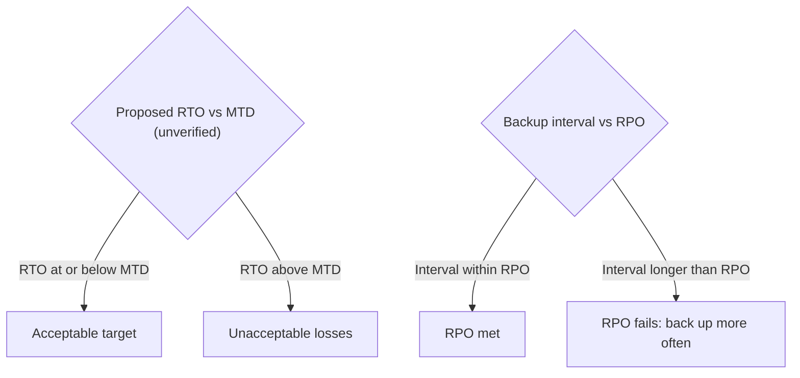

# 4.12 Business Impact Analysis (BIA) - Diagrams

[← Domain 4](../README.md) | [Study notes](../Study-Notes/4.12-Study-Notes.md)

Markers: 📓 in my notes, ⭐ frequently tested, ➕ unverified (not in the manual).

### Section map

### 4.12 BIA fundamentals

Cost trade-off (not tested as calculations on the exam).

| Cost factor | Direction as recovery time lengthens | Parts |
|---|---|---|
| Downtime cost | Rises, then plateaus | Idle resources, lost sales, delays, goodwill |
| Recovery cost | Falls | Testing, offsite premises, insurance, alternate sites |
| Total cost | U curve; choose the minimum | Fixed-base plus variable costs |

<b>Key points</b>

- BIA is a critical step in continuity strategy.
- It evaluates processes, IT, time frames, priorities, resources, interdependencies.
- Double-check risk assessment input; BIA uncovers hidden components.
- Hidden components: gateways and transport servers.
- Include applications, data, networks, system software, facilities.
- Impact bands: high, medium, low; time in hours, days, weeks.
- Consider contractual commitments with outsourced IT.
- Collect time frames for vital resource supply.

<b>Example</b>

- Provider SLA promises 72-hour restore; BIA allows 24 hours.
- Saturday midnight outage gives a bank more time than Monday.

<b>Exam traps</b>

- BIA is not threat identification; that is risk assessment.
- Workshop comes after data collection, not first.
- IT alone deciding criticality is a finding.
- Goal is minimum total cost, not minimum recovery cost.
- Critical recovery period depends on the business, not technology.

### 4.12.0 Resilience lifecycle 📓

| Step | Role | Marker |
|---|---|---|
| Risk Assessment | Finds threats, vulnerabilities, likely impact | 📓 |
| BIA | Sets downtime tolerance and recovery targets | 📓 ⭐ |
| BCP | Keeps business running in a crisis | 📓 |
| DRP | Technical part of BCP restoring IT | 📓 |

<b>Exam traps</b>

- MTD is not defined in the manual's 4.12 text (unverified, ➕).
- Equating MTD with interruption window or MTO is unverified (➕).
- BCP must trace back to BIA priorities.
- DRP targets must match BIA recovery times.

### 4.12.1 Classification of operations and criticality analysis

| Class | Manual operation | Interruption tolerance |
|---|---|---|
| Critical | Not possible | Very low; very high cost |
| Vital | Only briefly | Restore about five days or less |
| Sensitive | Extended, tolerable cost | Needs extra staff; difficult |
| Nonsensitive | Not needed | Long; little catching up |

Incident timeline: RPO, RTO and MTD. RPO and RTO definitions are in the notes. The RTO within MTD relationship and the MTD term are unverified (➕).

Figures are the study notes' worked examples B and C (assumed values). Example B is unverified (➕).

| Metric | Measures | Status |
|---|---|---|
| RPO | Maximum acceptable data loss, in time 📓 | In notes |
| RTO | Target time to restore a service | In notes |
| MTTR | Average time to repair a failed item | In notes |
| MTD | Outage length before unacceptable losses | ➕ unverified |
| RTO within MTD | Recovery must finish before outage unaffordable | ➕ unverified |
| RPO | Independent of RTO; measures data not downtime | ➕ unverified |

<b>ALE example (manual)</b>

- Impact assumed: US$10 million; probability 0.1 percent over five years.
- 10,000,000 x 0.001 = US$10,000 over five years.
- Manual calls it ALE, yet the figure spans five years.
- Annual equivalent would be US$2,000 per year.
- Maximum reasonable preparedness spend equals impact times probability.

<b>Worked examples (illustrative)</b>

- Total cost = fixed recovery cost + downtime hours x hourly cost.
- Hourly cost assumed US$10,000; 4-hour strategy totals US$130,000.
- 12-hour strategy totals US$180,000; 24-hour totals US$280,000.
- Backups every 4 hours at 500 orders per hour risk 2,000 orders.
- RPO of 2 hours means backups at 2 hours or less.

<b>Exam traps</b>

- Critical means no manual substitute, not merely important.
- Sensitive systems can run manually; critical cannot.
- Do not rank by system size or data volume alone.
- ALE probability covers five years; do not treat as annual.
- Backup interval sets achievable RPO.
- A short RTO does not guarantee a short RPO (unverified, ➕).
- Ranking without end users distorts priorities.

### Quick recall

| # | Fact |
|---|---|
| 1 | ⭐ BIA primary objective: critical functions, priorities, RTO and RPO 📓 |
| 2 | Chain: Risk Assessment, BIA, BCP, DRP 📓 |
| 3 | Management approves criticality; IT does not decide alone |
| 4 | Three questions: processes, resources, critical recovery period |
| 5 | Total cost is a U curve; choose the minimum |
| 6 | Critical has no manual substitute; sensitive can run manually |
| 7 | RPO is data loss in time and drives backup frequency 📓 |
| 8 | RTO within MTD (unverified, ➕) |
