# 4.13 System and Operational Resilience: Diagrams

[← Domain 4](../README.md) | [Study notes](../Study-Notes/4.13-Study-Notes.md)

Markers: 📓 in my notes, ⭐ frequently tested, ➕ / ⚠ Check = unverified.

## Section map

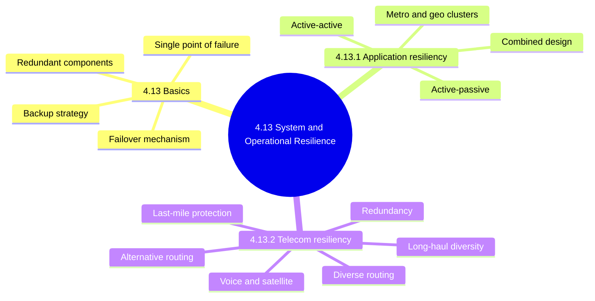

### 4.13 System resilience basics

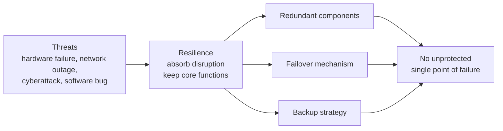

| Term | Meaning | Audit check |
|---|---|---|
| Redundant components | Duplicate parts take over on failure | Exists and tested |
| Failover mechanism | Automatic switch to standby | Failover actually tested |
| Backup strategy | Data copies to restore integrity | Exists and tested |
| Single point of failure | One resource whose loss stops service | Each one found is a finding |

<b>Definitions and example</b>

- Resilience: absorb disruption and keep core functions running.
- Resilience keeps services running; recovery restores them afterwards.
- Both resilience and recovery are needed.
- Example: bank runs two payment servers so one crash does not stop transfers.

### 4.13.1 Application resiliency and disaster recovery methods

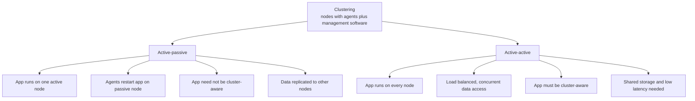

| Feature | Active-passive | Active-active |
|---|---|---|
| App runs on | One active node | Every node |
| Downtime on failure | Brief restart delay | Little or none |
| Cluster-aware app needed | No | Yes |
| Data approach | Replication to passive nodes | Shared storage |
| Network latency demand | Lower | Greater |
| Common? | More common | Less common |

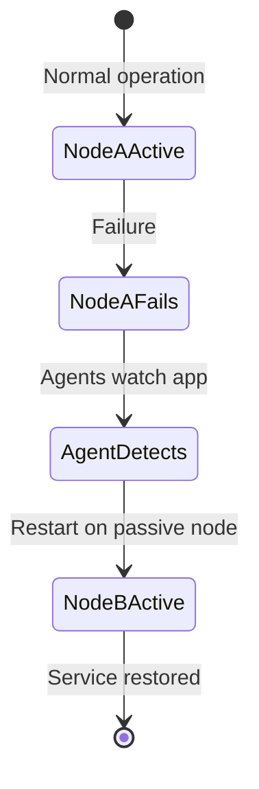

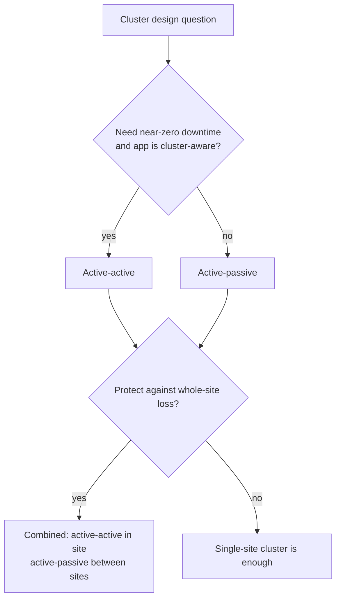

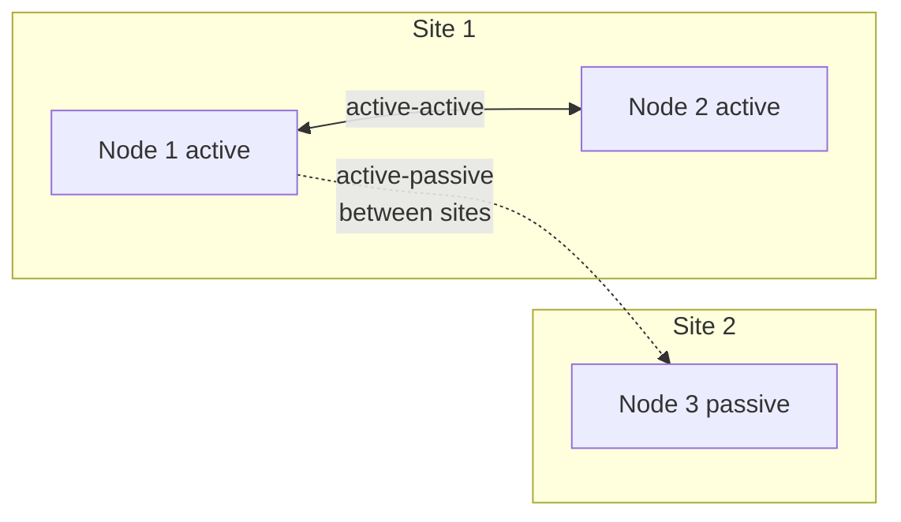

| Cluster scope | Span |
|---|---|
| Metro-cluster | One city |
| Geo-cluster | Cities, countries, continents |

<b>Exam traps (4.13.1)</b>

- Active-passive needs no cluster-aware application; active-active does.
- Active-active gives near-zero downtime; active-passive needs a restart delay.
- Active-active needs shared storage; active-passive needs data replication.
- Clustering raises availability; it does not replace backups.
- Site-wide disaster defeats single-site active-active.
- Geo-cluster preference for active-passive is inferred from latency (unverified).
- In-house cluster software is rarely economical; vendors are usual.

<b>Audit impact (4.13.1)</b>

- Confirm cluster covers every critical application tier.
- Check failover has actually been tested.
- Verify replication is current and failover time meets recovery targets.
- Check transaction integrity when a node fails mid-transaction.
- Shared storage becomes a new single point of failure.
- Review vendor support and licensing.

<b>Example</b>

- Active-passive: database on node A; node B starts it if A dies.
- Active-active: three web servers share traffic; losing one cuts capacity only.

### 4.13.2 Telecommunication networks resiliency and DR methods

#### Responsibility, risks and BCP capabilities

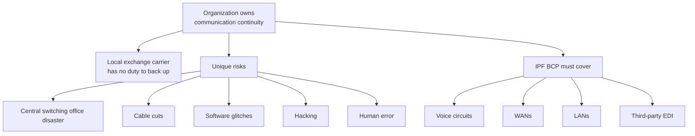

<b>Capacity and UPS</b>

- Identify capacity needs per outage threshold, such as 2, 8 or 24 hours.
- UPS must cover telecom and computer equipment.
- Auditor compares UPS sizing to the longest outage threshold.
- Auditor checks plan does not assume carrier backup.

#### Redundancy

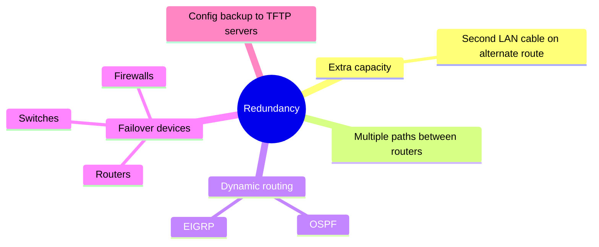

<b>Definitions and caveats</b>

- OSPF: Open Shortest Path First. EIGRP: Enhanced Interior Gateway Routing Protocol.
- TFTP: Trivial File Transfer Protocol; manual spells it Transport.
- TFTP lacks authentication and encryption; secure the server (unverified, not in manual).
- Auditor checks config backups are current and access-controlled.

#### Comparing the routing and diversity terms ⭐

| Term | Core idea | Typical example |
|---|---|---|
| Alternative routing | Different medium, network, circuit or endpoint | Copper vs fiber, cellular, microwave, couriers |
| Diverse routing 📓⭐ | Split-cable or duplicate-cable facilities | Different sheaths, dual entrance facilities |
| Long-haul network diversity | Several long-distance carriers | Automatic rerouting between carriers |
| Last-mile circuit protection | Redundant link to local loop | Microwave, coaxial, alternate local carrier |

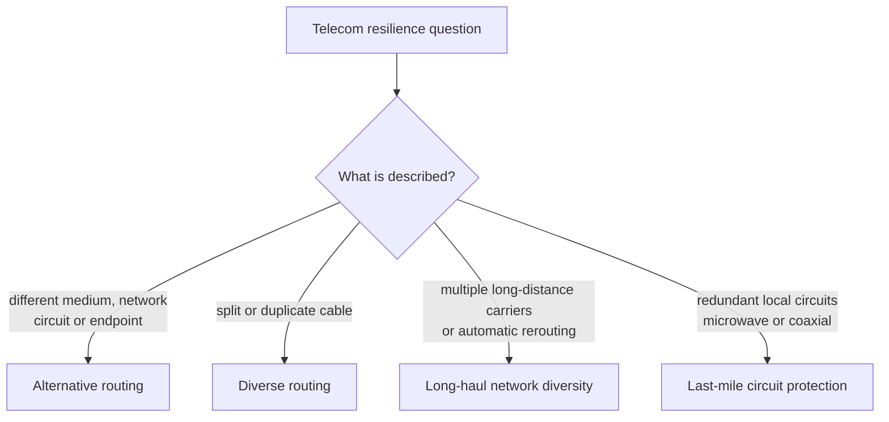

#### Alternative routing

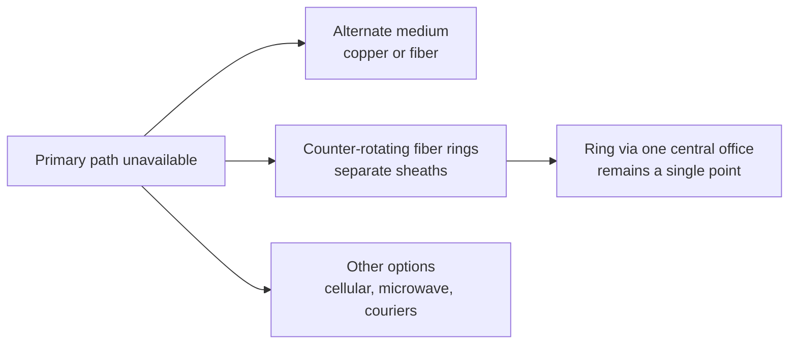

<b>Notes</b>

- Counter-rotating rings carry data in two directions.
- Some carriers offer routes to different points of presence.
- Outline lists Alternative routing twice; manual lists it once (⚠ Check).

#### Diverse routing 📓⭐

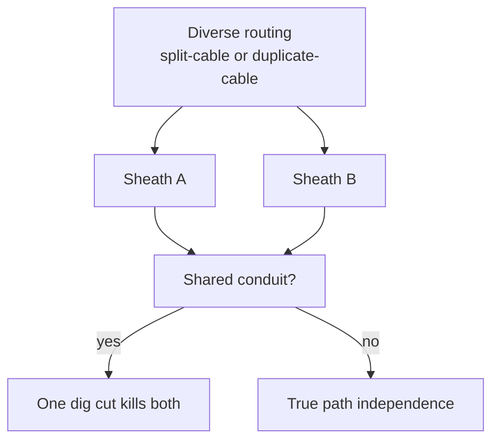

<b>Exam traps and example</b>

- Different sheaths do not guarantee independence; conduit may be shared.
- Split or duplicate cable is diverse routing, not alternative routing.
- Dual entrance facilities are costly and time-consuming to obtain.
- Ground-based cables face aging city infrastructure risk.
- Example: two sheaths enter through one duct; one cut kills both.

#### Long-haul network diversity

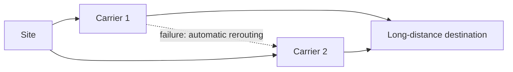

<b>Audit impact</b>

- Auditor verifies these capabilities at the recovery facility.
- Carriers use rerouting software and redundant lines for near-instant recovery.

#### Last-mile circuit protection

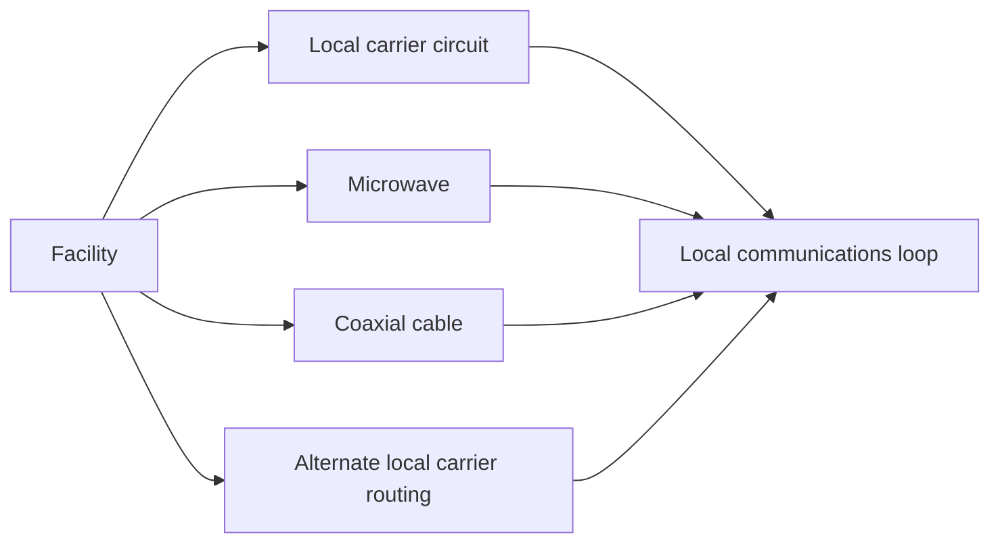

#### Voice recovery and satellite connectivity

| Topic | Methods | Audit check |
|---|---|---|
| Voice recovery | Redundant cabling, VoIP | Voice has its own recovery plan |
| Satellite connectivity | Broadband or temporary satellite | Documented as contingency path |

<b>Notes</b>

- Voice is critical for financial and retail services.
- Satellite covers places with no other option.
- Satellite latency and capacity limits are not in the manual (unverified).

<b>Exam traps (4.13.2)</b>

- Multiple long-distance carriers means long-haul diversity.
- Redundant local circuits, microwave, coaxial means last-mile protection.
- Carrier is not responsible for customer backup connectivity.
- Auditor checking automatic rerouting at recovery facility means long-haul diversity.

### Quick recall

| # | Fact |
|---|---|
| 1 ⭐ | Diverse routing means split or duplicate cables; check shared conduit |
| 2 | Active-passive: no cluster-aware app, restart delay |
| 3 | Active-active: cluster-aware app, shared storage, little downtime |
| 4 | Combined: active-active in site, active-passive between sites |
| 5 | Organization, not carrier, owns telecom continuity |
| 6 | Alternative routing: different medium, network, circuit or endpoint |
| 7 | Long-haul: multiple carriers; last-mile: redundant local circuits |
| 8 | Resilience keeps running; recovery restores; clustering is not backup |
