# 4.14 Data Backup, Storage and Restoration: Diagrams

[← Domain 4](../README.md) | [Study notes](../Study-Notes/4.14-Study-Notes.md)

Markers: 📓 in my notes, ⭐ frequently tested, ➕ / ⚠ Check = unverified.

## Section map

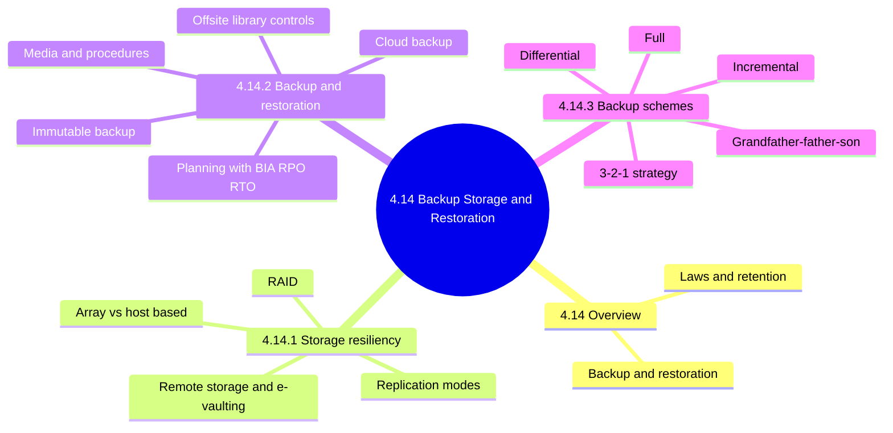

### 4.14 Overview: laws, regulations and planning

<b>Audit impact and example</b>

- Missing or untested backups mean recovery may fail entirely.
- Verify retention periods and storage locations match legal requirements.
- Example: seven-year retention makes short rotation a breach (unverified, illustrative).

### 4.14.1 Data storage resiliency and DR methods

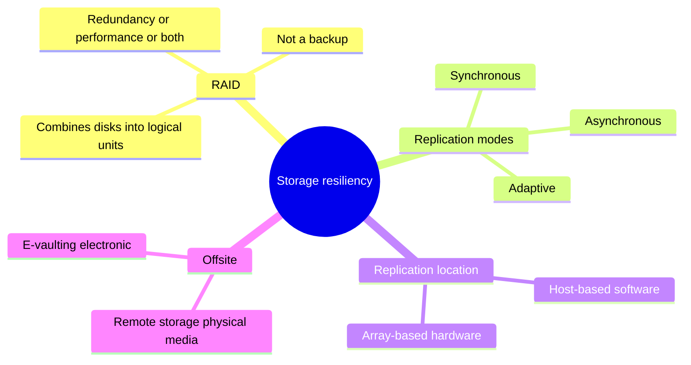

| Replication mode | How it works | Trade-off |
|---|---|---|
| Synchronous | Write confirmed after remote write | Near-zero loss; needs bandwidth, low latency |
| Asynchronous | Copies on a schedule | Tolerates distance; may lose recent writes |
| Adaptive | Switches by network load | RPO varies; confirm mode at peaks |

| Location | Done by | Notes |
|---|---|---|
| Array-based | Storage array hardware | Transparent to application |
| Host-based | Server software | For servers without disk arrays |

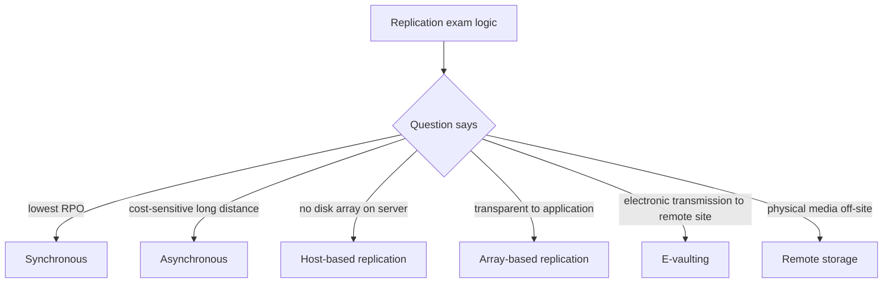

<b>Definitions and exam traps</b>

- RAID protects against disk failure, not deletion, corruption or site loss.
- RAID alone is not a backup.
- Staff must still understand RAID levels despite array automation.
- Remote storage: off-site physical media 📓.
- E-vaulting: electronic transmission to a remote site 📓.
- Audit: verify e-vault encryption and that remote data is restorable.

### 4.14.2 Backup and restoration

#### Planning and secondary storage

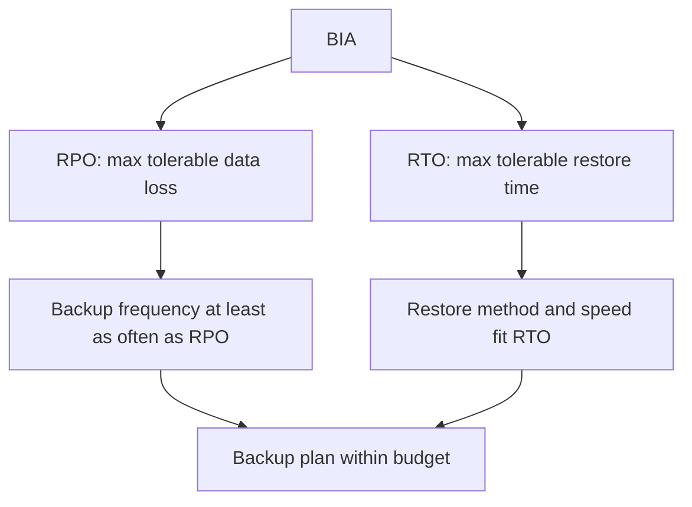

<b>Secondary storage notes</b>

- Secondary storage: mirrored disks, local or remote, and network storage.
- Removable media kept in offsite libraries.
- Number and location depend on use availability and interruption risk.
- Catalog is manual (offsite librarian) or automatic (vaulting).
- Integrated backup solutions are replacing manual catalogs.

#### Immutable backup

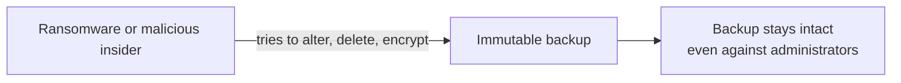

<b>Exam traps</b>

- Encryption protects confidentiality; immutability protects backup integrity and availability.
- Confirm immutability settings and retention locks are enabled.
- Cloud providers can offer immutable backup storage.

#### Offsite library controls and facility security

| Control area | Requirement |
|---|---|
| Access | Authorized personnel only |
| Media | Encrypt, especially in transit |
| Construction | Withstand fire, heat, water |
| Location | Away from data center, not same disaster |
| Records | Inventory, movement log, protected catalog |
| Retention | Per enterprise policy |
| Facility | As secure as source; locked, no windows, surveillance |
| Visibility | Not easily identifiable from outside |
| Environment | Humidity, temperature, air monitoring; UPS, raised floor |
| Protection | Smoke and water detectors, tested fire suppression |

<b>Audit impact</b>

- Sample inventory against physical media to test accuracy.
- Paper records must not create a fire hazard.

#### Cloud backup

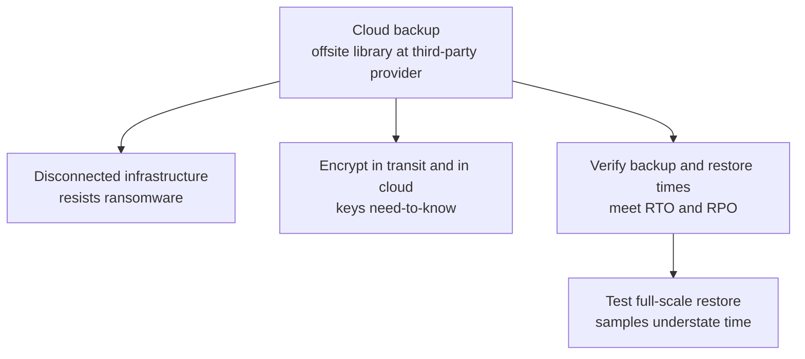

<b>Exam traps</b>

- Cloud backup does not remove the customer's duty to test restores.
- Real restores may need large network transfers.

#### Media and documentation backup; devices and media

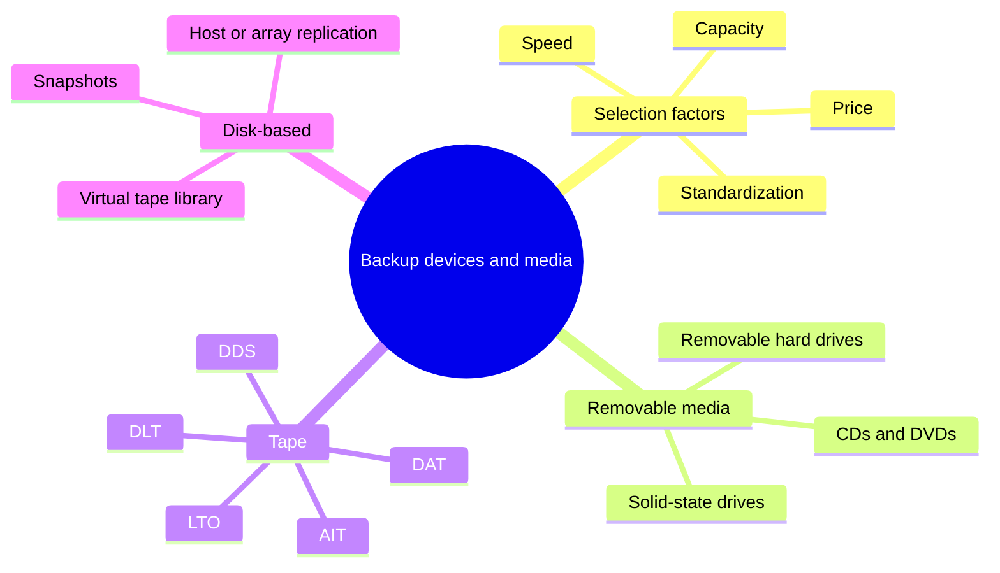

<b>VTL and snapshots</b>

- VTL: disk storage emulating a tape library; can replicate offsite.
- Snapshot: momentary copy; full or changed blocks only.
- Snapshots can be mounted on another server to offload production.
- Snapshots on the same array do not survive array failure.
- Disk-based backup suits virtualized servers; whole VMs replicated.
- Offsite copies need same security as originals.
- Duplicate data and documentation offsite as a recovery prerequisite.

#### Periodic backup procedures and frequency of rotation

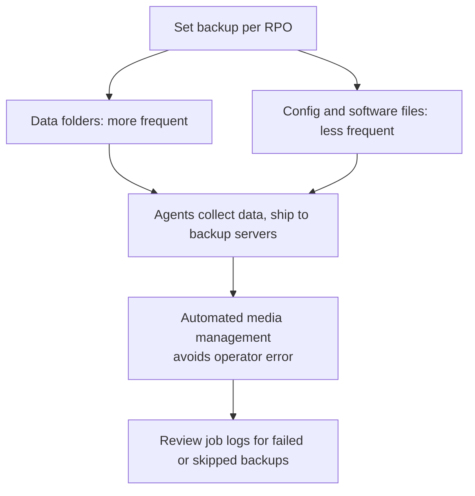

<b>Rotation prerequisites</b>

- Keep a point-in-time copy plus changes since.
- Frequency and retention generations set per application.
- DBMS needs a specialized backup agent for its make and version.
- Arrange vendor software licenses for alternate site beforehand.
- Custom software: object and source libraries, current patches everywhere.
- Keep compatible backup hardware offsite with support agreements.
- Adequate backup is a prerequisite to recovery.

#### Types of media and documentation rotated

| Category | Examples |
|---|---|
| Software | OS, languages, compilers, utilities, applications |
| Paper | Guides, manuals, records, data files, databases |
| Operating procedures | Run books, job stream control, OS manuals |
| System and program documentation | Flow charts, source listings, logic |
| Special procedures | Exception, variation, emergency processing |
| Source documents | Copies, microfiche, microfilm |
| BCP copy | Stored offsite |

<b>Exam traps: missing backup policy 📓</b>

- Missing backup policy is a major risk.
- Prefer root cause (no policy) over symptoms like frequency.
- Which answer the notes intend is unresolved (⚠ Check, unverified).
- Sensitive data goes in fire-resistant magnetic media containers.

### 4.14.3 Backup schemes

#### Full vs incremental vs differential comparison ⭐

| Feature | Full 📓 | Incremental 📓⭐ | Differential |
|---|---|---|---|
| Copies | Everything | Changes since last full or incremental | Changes since last full |
| Cumulative? | Not applicable | No | Yes |
| Backup speed | Slowest | Fastest | Between the two |
| Media needed | Most | Least | More than incremental |
| Restore needs | One set | Full plus all incrementals in order | Full plus latest differential |
| Restore speed | Fastest, simplest | Slowest | Faster than incremental |
| Main risk | Time and media | One missing set breaks chain | Growing backup size |

#### Restore sequence

Illustrative example: full on Sunday, nightly backups Monday to Saturday, loss on Thursday morning.

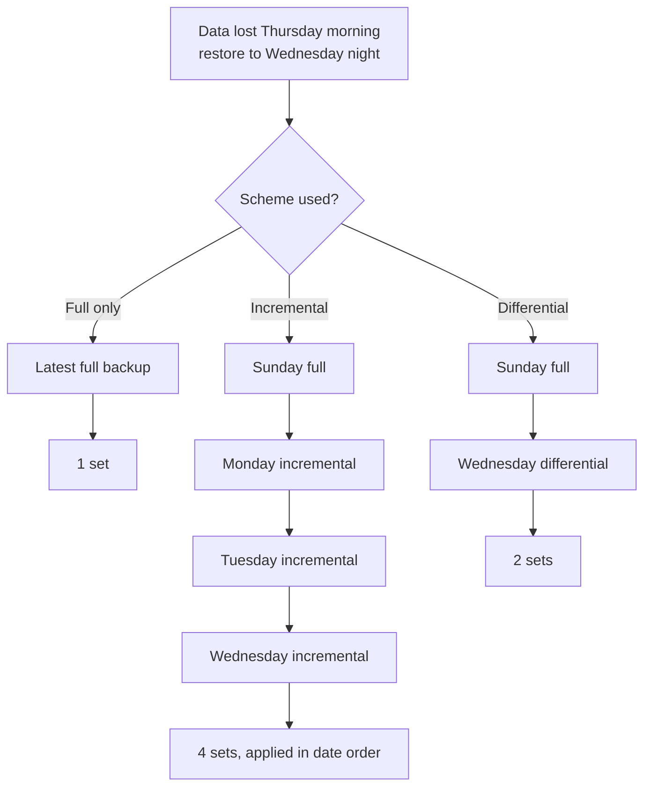

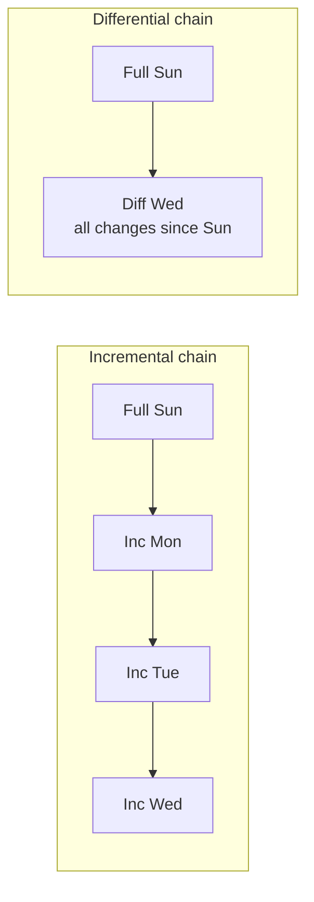

<b>Worked numbers (illustrative assumptions, unverified)</b>

- Assume full 100 GB and 10 GB of different changes daily.
- Both schemes restore 130 GB by Wednesday.
- Wednesday differential holds 30 GB; three days of changes.
- Loss after Saturday: incremental needs 7 sets; differential needs 2.
- Weekly media: incremental 60 GB; differential 10+20+...+60 = 210 GB.
- Real change rates overlap, so differential growth is smaller.

<b>Exam traps (backup schemes)</b>

- Differential is since last full, not since last backup.
- Incremental is since last backup of any kind.
- Incremental primary goal: faster backups with fewer resources.
- Storage saving is true but secondary; integrity applies to all types.
- Incremental restore is slower and more complex.
- The notes' incremental question has conflicting answers (⚠ Check, unverified).

#### Method of rotation: grandfather-father-son

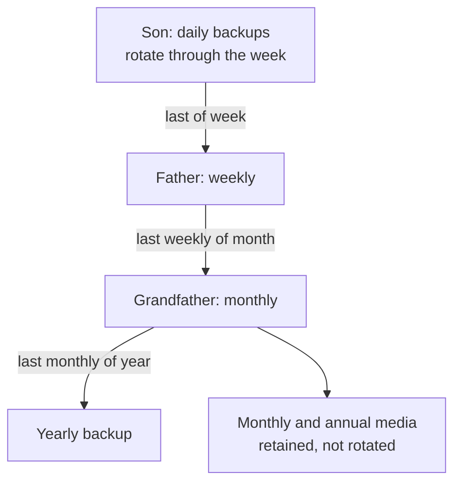

<b>Notes</b>

- Offsite media not returned until replacements are safely offsite.
- Variations exist for quarterly backups and extra redundancy.
- Audit: verify rotation follows policy and generations are kept.

#### Record keeping for offsite storage

| Record | Fields |
|---|---|
| Backup media | Data set name, volume serial, creation date, period, bin number |
| Critical documentation | Name, location, system, date of last update |
| Movement | Receipt and shipment logs between facilities |

<b>Audit impact</b>

- Automated media management records this information.
- Reconcile logs to physical media to detect lost or unauthorized media.

#### 3-2-1 backup strategy

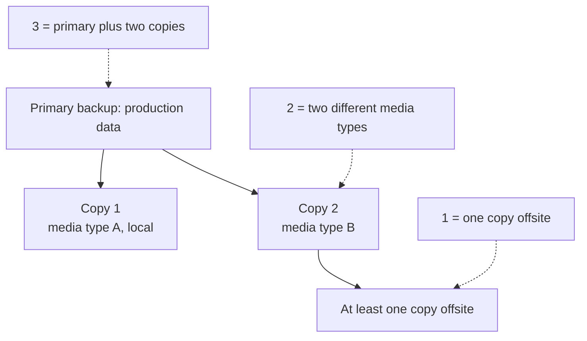

<b>Notes and example</b>

- Manual wording: one primary and two copies.
- Common usage counts three copies total (⚠ Check, unverified).
- Reduces impact of media errors, theft and other single points of failure.
- Offsite element may be unavailable from some cloud providers (unverified).
- Example: production disk, local VTL copy, encrypted cloud copy.

### Quick recall

| # | Fact |
|---|---|
| 1 ⭐ | Incremental: since last backup; fastest backup; restore needs full plus all incrementals |
| 2 | Differential: since last full; restore needs full plus latest differential |
| 3 | Full: single set, simplest restore, most time and media |
| 4 | Synchronous replication means lowest RPO; asynchronous suits distance |
| 5 | RAID is not a backup |
| 6 | Immutable backup resists ransomware and insiders |
| 7 | Backup frequency driven by RPO; restore speed by RTO |
| 8 | Grandfather-father-son: daily, weekly, monthly, yearly tiers |
| 9 | 3-2-1: primary plus two copies, two media types, one offsite |
| 10 | Missing backup policy is a major risk 📓 |
