# 4.15 Business Continuity Plan (BCP) - Diagrams

[← Domain 4](../README.md) | [Study notes](../Study-Notes/4.15-Study-Notes.md)

Markers: 📓 in user's notes, ⭐ frequently tested, ➕ unverified.

## Section map

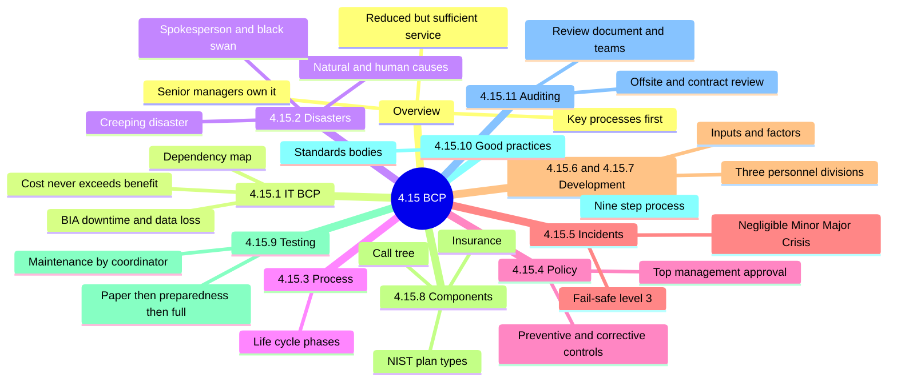

### 4.15 Overview: BCP, DRP and restoration

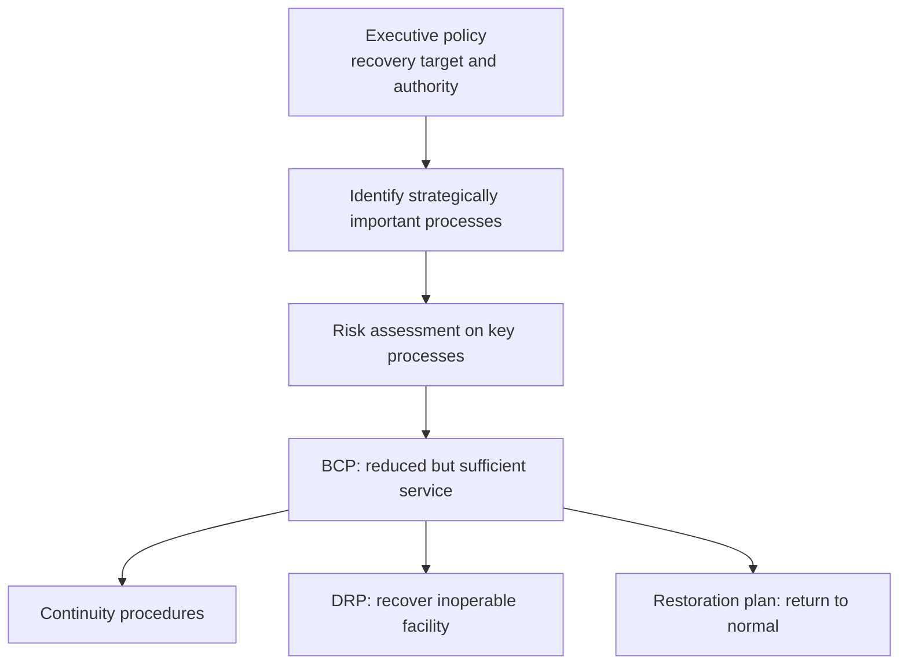

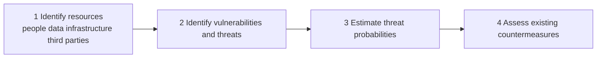

| Item | Meaning |
|---|---|
| BCP 📓 | Keeps business running during disturbance |
| DRP 📓 | Recovers inoperable facility, relocates operations |
| Restoration plan | Returns to normal in restored or new facility |
| Key processes ⭐ | First thing identified in a BCP |

<details>
<summary><b>Exam traps</b></summary>

- Senior managers are primarily responsible, not IT alone. ⭐
- BCP gives reduced but sufficient functionality, not full service. ⭐
- Integrated plan is preferred; consistency is mandatory.
- Same process at another location may need a different solution.

</details>

<details>
<summary><b>Example</b></summary>

- A payment process depends on one data center and one carrier.

</details>

### 4.15.1 IT business continuity planning

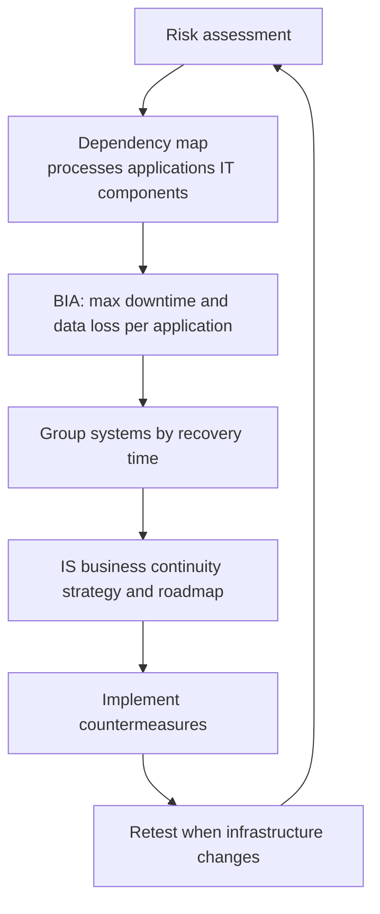

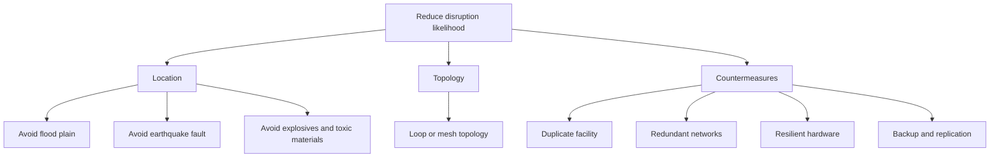

| Compare | BCP | IT DRP |
|---|---|---|
| Scope | Business actions | Systems, communications, applications, data |
| Example | Where staff report, vendor calls | Restore servers and data |
| Relation | Parent plan | Subcomponent, may be separate document |

<details>
<summary><b>Exam traps</b></summary>

- DRP alone is not a BCP. ⭐
- Cost of recovery must never exceed benefit. ⭐
- Not every system needs a recovery strategy.
- Fastest recovery for everything wastes money.
- A plan is never finished; stale plan is a finding. ⭐
- Risk calculation is understood, not tested numerically.

</details>

<details>
<summary><b>Definitions</b></summary>

- BIA: measures business losses from a disruption.
- Risk estimate: qualitative ratings or quantitative monetary loss.
- ISMS: protects controls that may fail during a disaster.
- Cloud outage: customer may wait for vendor's own BCP.

</details>

### 4.15.2 Disasters and other disruptive events

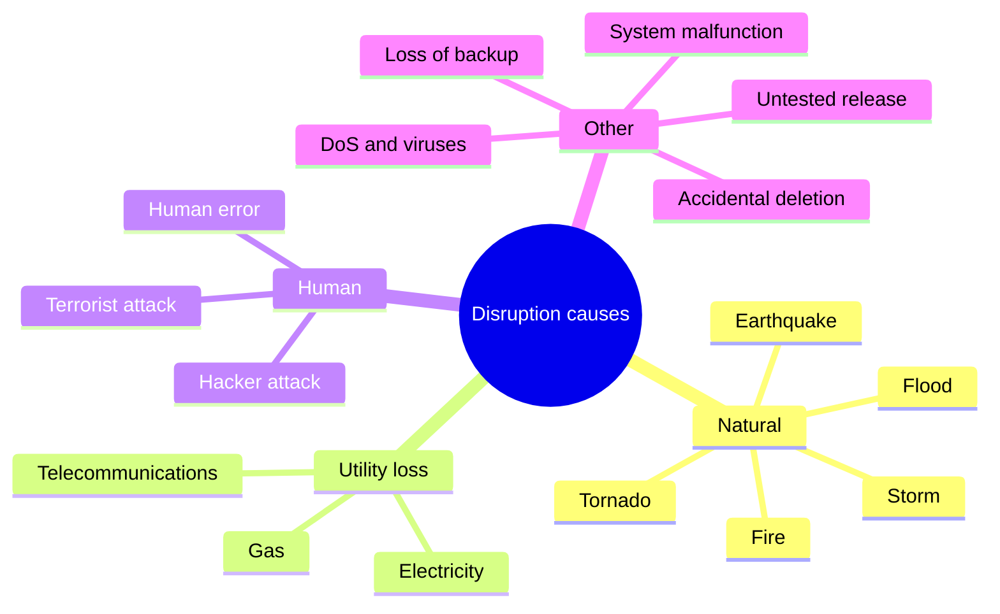

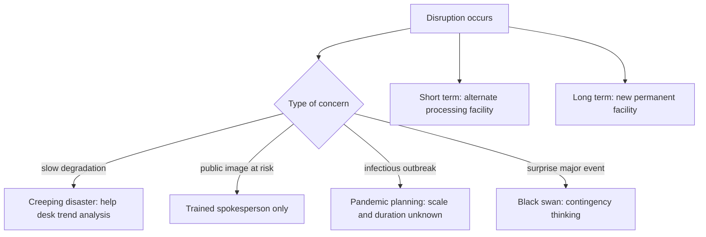

<details>
<summary><b>Reputation protocol</b></summary>

- Appoint a trained spokesperson in advance. ⭐
- Best choice: senior legal counsel or PR officer.
- Only the spokesperson speaks, regardless of rank.
- Keep a pre-drafted generic announcement.
- State investigation started; do not state cause.
- Do not assume liability or blame system.
- Senior executives sharing duties should not travel together.

</details>

<details>
<summary><b>Exam traps</b></summary>

- CEO speaking publicly is wrong; rank gives no authority.
- Naming root cause immediately creates liability risk.
- Black swan cannot be planned for.

</details>

### 4.15.3 Business continuity planning process

Phases are from figure 4.36. (unverified) Order not confirmed; figure text garbled in the manual scan.

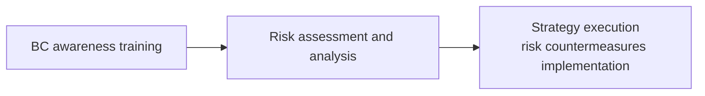

For the confirmed step order, see 4.15.10.

<details>
<summary><b>Audit impact</b></summary>

- Awareness training is a phase; verify training evidence.
- Phase order (unverified).

</details>

### 4.15.4 Business continuity policy

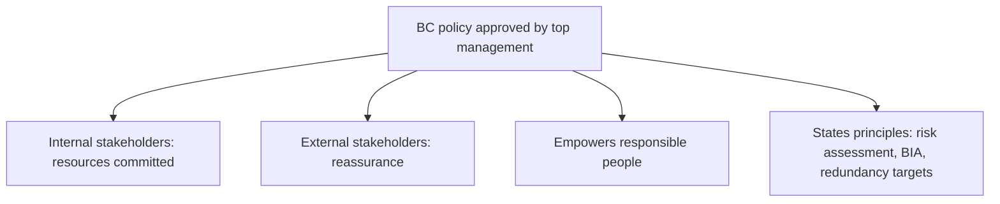

| Control group | Examples |
|---|---|
| Reduce likelihood | Infrastructure monitoring, capacity management |
| Reduce likelihood | Incident management help desk, risk management |
| Mitigate consequences | Backup and recovery, BCP or IT DRP |
| Mitigate consequences | Vendor contract clauses, spare site, UPS or generator |

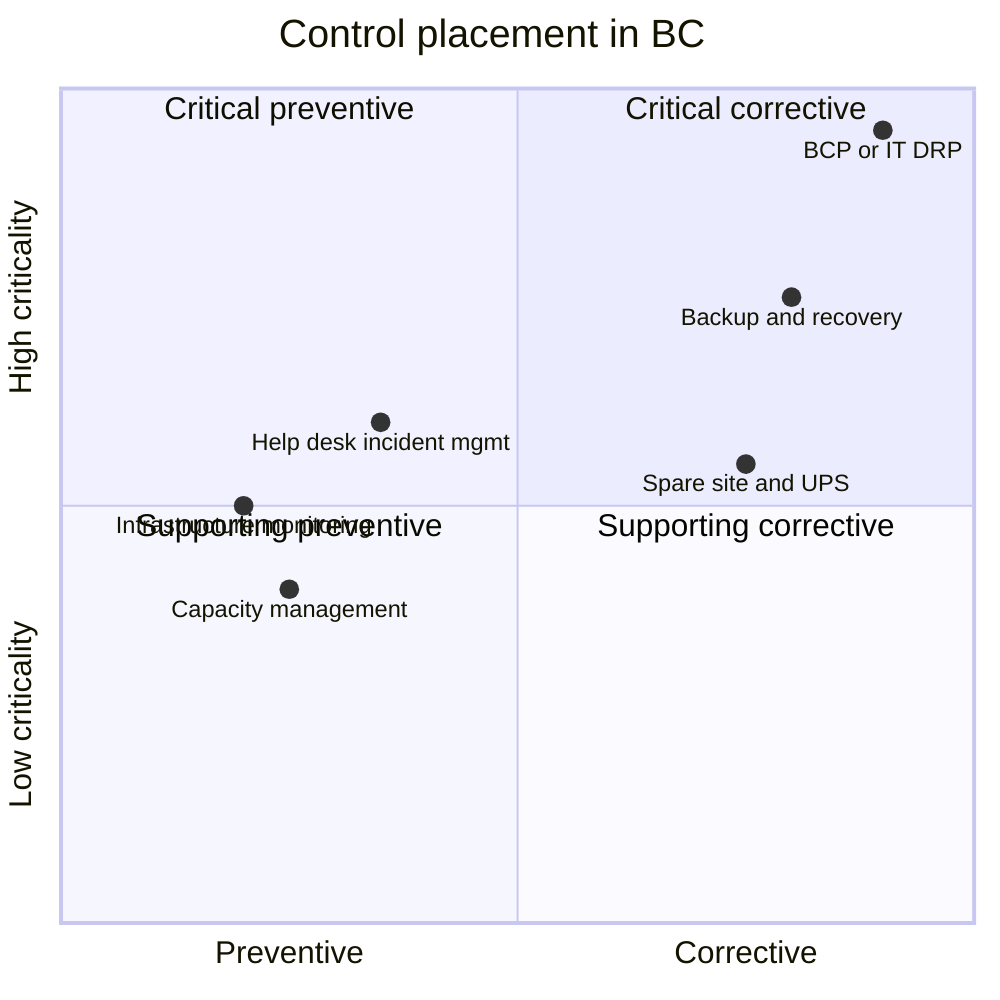

<details>
<summary><b>Exam traps</b></summary>

- BCP or IT DRP is the most critical corrective control. ⭐
- Backups and BCP are corrective, not preventive.
- Policy has public and internal sections.
- BCP should be designed, documented, drill tested, funded, audited.

</details>

### 4.15.5 BCP incident management

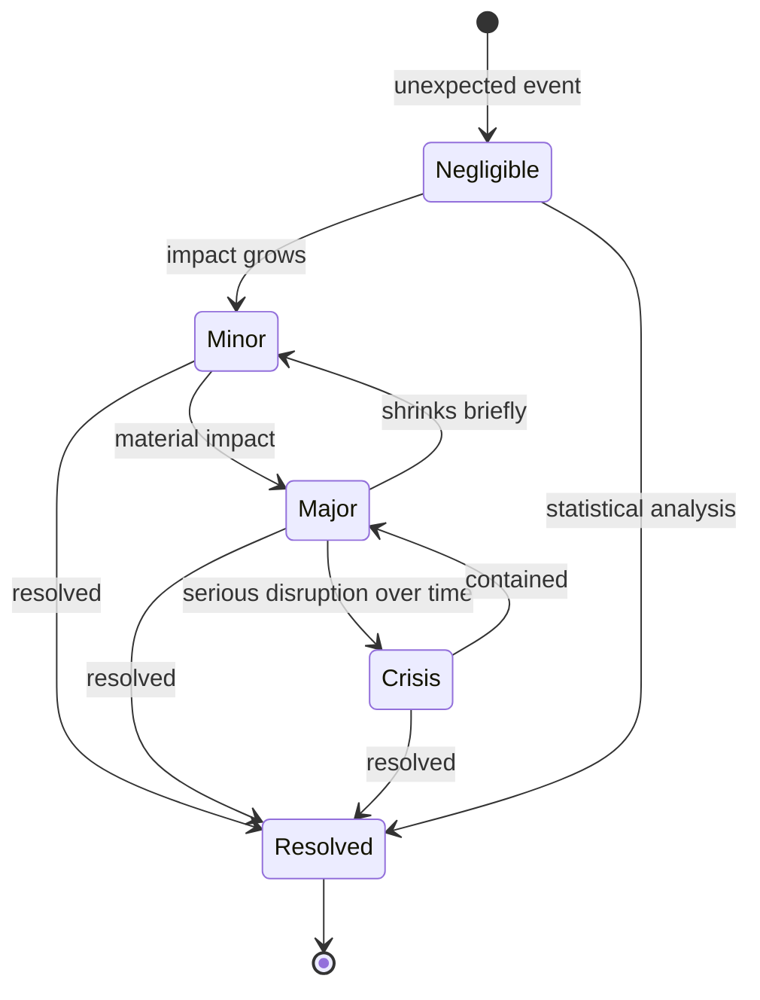

| Level | Meaning | Example |
|---|---|---|
| Negligible | No perceptible damage | Brief OS crash, UPS covers outage |
| Minor | No material impact, localized | Single-office Internet outage |
| Major | Material impact on processes or clients | Ransomware |
| Crisis | Seriously disrupts operations, grows with time | Prolonged major incident |

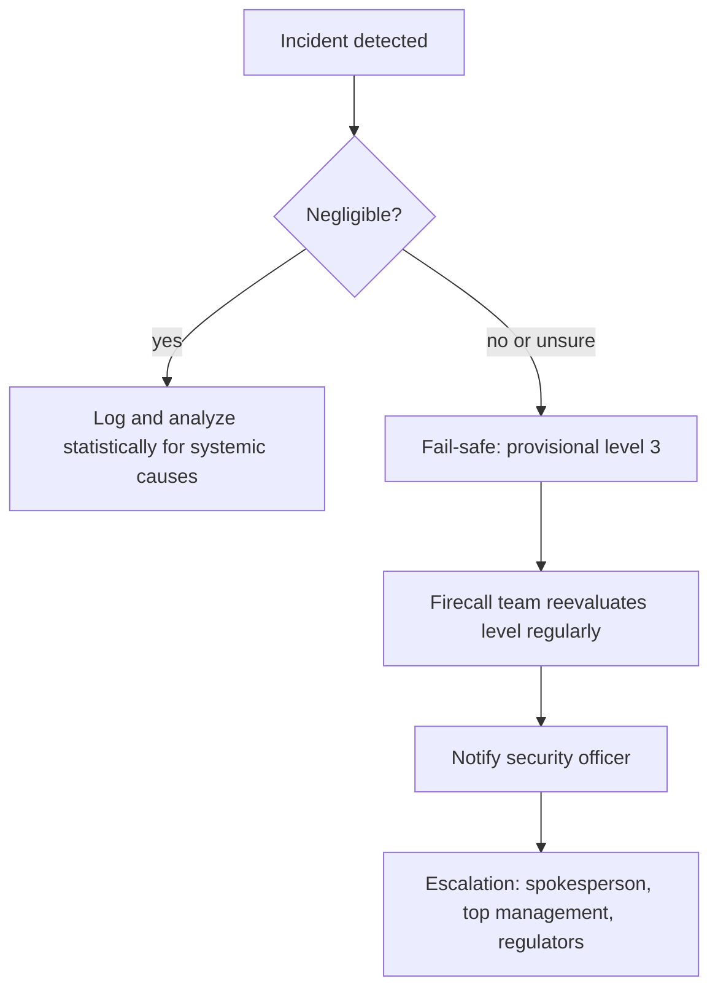

<details>
<summary><b>Severity criteria</b></summary>

- Driven largely by estimated downtime versus SLA.
- Other criteria: impact on data, platforms, functions.
- Data example: database loss of integrity.
- Platform examples: viruses, worms, hardware failure (unverified).
- Crisis action: follow the BCP (unverified).
- Major action: prepare for the BCP (unverified).
- Minor action: correct, clean, restore or replace (unverified).

</details>

<details>
<summary><b>Exam traps</b></summary>

- Negligible incidents are not ignored; trend analysis finds root causes.
- Over-classify first, downgrade later.
- Document and revisit minor, major, crisis until resolved.

</details>

### 4.15.6 Development of business continuity plans

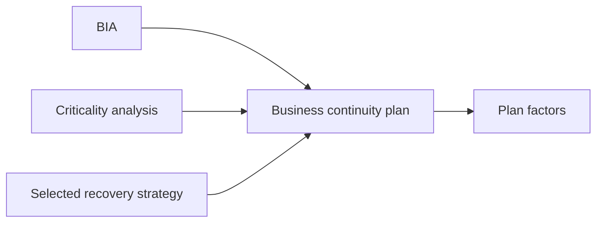

| Plan factor | Detail |
|---|---|
| Predisaster readiness | Includes incident response management |
| Evacuation procedures | Included |
| Declaring a disaster | Rating and escalation procedures |
| Circumstances to declare | Example: uncontained virus |
| Responsibilities | Named person per function |
| Contacts and recovery steps | Contact info, step-by-step processes |
| Resources | Needed for recovery and continued operation |

<details>
<summary><b>Writing and storage</b></summary>

- Write in simple language.
- Structure by team.
- Keep copies offsite.
- Complex or unavailable plans fail under stress.

</details>

### 4.15.7 Other issues in plan development

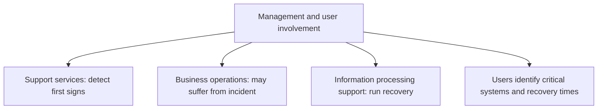

| Plan must include | Detail |
|---|---|
| Whole organization | Not only IS processing |
| Staff list | Short, medium, long term; redundant contacts |
| Facilities | Desks, chairs, telephones |
| Resources | Everything to resume operations, not only IT |

<details>
<summary><b>Exam traps</b></summary>

- IT alone cannot define critical systems; business users must.

</details>

### 4.15.8 Components of a business continuity plan

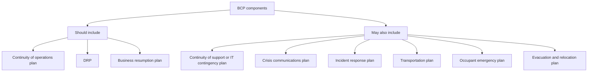

| NIST SP 800-34 plan | Purpose |
|---|---|
| BCP | Sustain business operations during recovery |
| COOP | Mission essential functions at alternate site up to 30 days |
| Crisis communications | Internal and external messages, controls rumors |
| CIP plan | Protects critical infrastructure; supports COOP |
| Cyber incident response | Isolate and clean up cyberattack |
| DRP | Activated after major disruption with long-term effects |
| ISCP | Recovers a single information system |
| OEP | Minimize loss of life and injury |


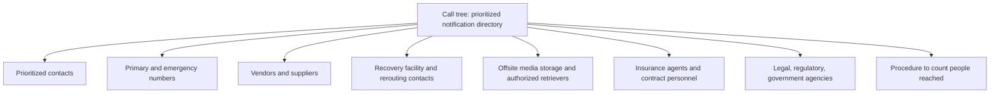

| Insurance type | Covers |
|---|---|
| IT equipment and facilities | Replacement, like kind and quality |
| Media reconstruction | Reproducing damaged media |
| Extra expense | Extra costs of continuing operations |
| Business interruption | Lost profit from IT malfunction |
| Valuable papers and records | Actual cash value of non-media papers |
| Errors and omissions | Liability for professional mistakes |
| Fidelity | Dishonest employee acts |
| Media transportation | Media lost or damaged in transit |

<details>
<summary><b>Agree before planning</b></summary>

- Governing policies
- Goals and products per phase
- Alternate facilities
- Critical information resources
- Persons responsible
- Available resources including humans
- Prioritized scheduling

</details>

<details>
<summary><b>Plan copies and supplies</b></summary>

- Copies at recovery facility, media storage, homes of key staff.
- Electronic version often on mirrored website.
- Hard copy procedures for unfamiliar staff.
- Special forms offsite: check stock, invoices, order forms.
- Data entry hardware and software at hot site.
- Cryptographic equipment and keys, such as RSA tokens.

</details>

<details>
<summary><b>Exam traps</b></summary>

- Life safety first; OEP precedes recovery plans.
- ISCP is single-system; DRP coordinates several ISCPs.
- Insurance does not compensate reputation, image or goodwill. ⭐
- Insurance pays at historical performance; valuation must be current.
- Insurance supplements, never replaces, continuity planning.
- Auditor calls sample of call tree contacts. ⭐
- Insurance specifics are not tested (unverified wording in notes).

</details>

### 4.15.9 Plan testing

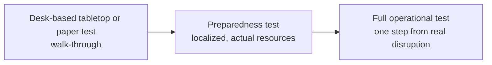

| Test type | Assurance | Notes |
|---|---|---|
| Desk-based ⭐ | Lowest | Precedes preparedness test |
| Preparedness | Medium | Cost-effective, incremental |
| Full operational ⭐ | Highest | Test paper and local first |

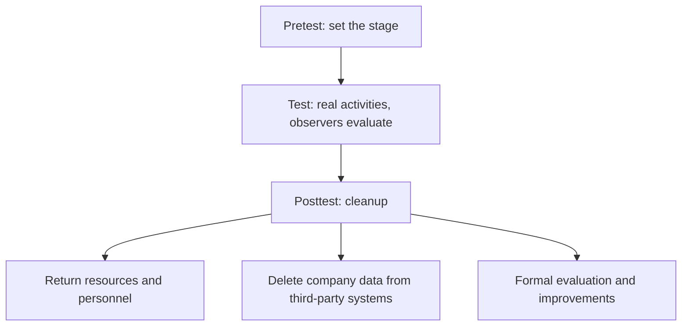

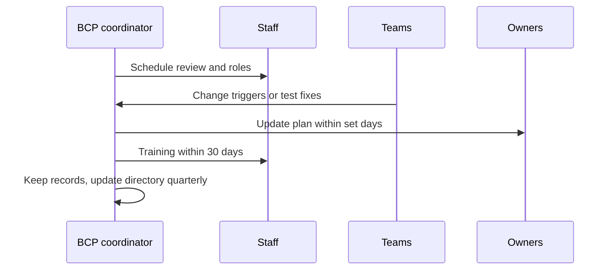

| Result measure | Checks |
|---|---|
| Time | Elapsed time for tasks and arrivals |
| Amount | Work done at backup site |
| Count | Vital records, supplies, systems recovered |
| Accuracy | Data entry versus normal |

<details>
<summary><b>Test objectives</b></summary>

- Verify BCP completeness and precision.
- Evaluate personnel performance.
- Appraise training of all employees.
- Evaluate vendor and supplier coordination.
- Measure backup site capacity.
- Assess vital records retrieval.
- Evaluate relocated equipment and supplies.
- Measure overall IT processing performance.

</details>

<details>
<summary><b>Example</b></summary>

- 45 of 50 vital records arrived: count result is 90 percent.

</details>

<details>
<summary><b>Maintenance triggers</b></summary>

- Process or department changes
- New resources or applications
- Business strategy changes
- Software or hardware environment changes
- New events or changed likelihood
- Personnel or contact changes
- Include BCP in the SDLC. ⭐
- BCP coordinator is responsible. ⭐

</details>

<details>
<summary><b>Exam traps</b></summary>

- Start with tabletop; full test first risks real outage.
- Paper tests give least assurance.
- Test at least yearly; "annual full test" is unsupported (unverified).
- The "30 days" for plan updates is an example only.
- Changes trigger retesting; do not wait for the annual cycle.
- Validate information security during tests.
- Weekends suit tests; simulate prime-time conditions.

</details>

### 4.15.10 BCM good practices

```mermaid
mindmap
  root((Good practice sources))
    Professional bodies
      BCI
      DRII
    US bodies
      FEMA
      NIST
      FFIEC
      HHS HIPAA
    Frameworks
      ISACA COBIT
      ISO 22301 2019 BCMS
```

```mermaid
flowchart TD
    S1["1 Conduct risk assessment"] --> S2["2 Identify and prioritize critical systems and resources"]
    S2 --> S3["3 Identify and prioritize threats and vulnerabilities"]
    S3 --> S4["4 Prepare BIAs"]
    S4 --> S5["5 Choose controls to recover IT components"]
    S5 --> S6["6 Develop detailed DRP"]
    S6 --> S7["7 Develop detailed BCP"]
    S7 --> S8["8 Test the plans"]
    S8 --> S9["9 Maintain the plans"]
```

<details>
<summary><b>Exam traps</b></summary>

- Risk assessment and BIA come before writing any plan.
- Plan is based on the long-range IT plan.
- Plan aligns with overall business continuity strategy.

</details>

### 4.15.11 Auditing business continuity

```mermaid
flowchart TD
    A["Audit of BCP"] --> B["1 Review the document"]
    B --> C["2 Review applications covered"]
    C --> D["3 Review BC teams"]
    D --> E["4 Review plan testing"]
    E --> F["5 Evaluate prior test results"]
    F --> G["6 Evaluate offsite storage"]
    G --> H["7 Interview key personnel"]
    H --> I["8 Review alternative processing contract"]
    I --> J["9 Review insurance coverage"]
```

| Review area | Key checks |
|---|---|
| Document | Policy, strategy, BCP, latest BIA with RTO and RPO |
| Document | Sample manuals for currency; update responsibility documented |
| Applications | Critical apps prioritized, tolerance levels, compatible software at secondary site |
| Teams | Member lists, call sample of contacts, interview |
| Testing | Documentation, backups per DRP area, recovery transactions separable |
| Testing | Movement to and from site, rebuild items offsite |
| Prior results | Coordinator history, trends, corrections incorporated |

```mermaid
flowchart TD
    O["Offsite storage evaluation"] --> O1["Media and documentation present, synchronized, current"]
    O --> O2["Detailed inventory test"]
    O --> O3["Review transport method for ISMS weakness"]
    O --> O4["Facility security"]
    O2 --> O2a["Dataset names, volume serials, periods, bin locations"]
    O4 --> O4a["Authorized access only"]
    O4 --> O4b["Raised floor, humidity and temperature"]
    O4 --> O4c["UPS and specialized circuitry"]
    O4 --> O4d["Water, smoke detection, fire extinguishing"]
    O4 --> O4e["Current inspection tags"]
```

```mermaid
flowchart LR
    K["Contract and insurance review"] --> K1["Vendor references and written promises"]
    K --> K2["Legal review of terms and source code escrow"]
    K --> K3["Shared site rules"]
    K --> K4["Regular hot site tests allowed"]
    K --> K5["Backup site communications"]
    K --> K6["Limit of recourse if breached"]
    K --> K7["Insurance reflects actual recovery cost"]
```

<details>
<summary><b>Auditor tasks</b></summary>

- Evaluate strategy and link to business objectives.
- Review BIA findings for current priorities.
- Evaluate adequacy against standards, regulations, RTO, RPO.
- Verify effectiveness via prior test results.
- Evaluate cloud-based mechanisms.
- Verify secure transport of backup media.
- Evaluate personnel response: procedures, training, drills.
- Ensure plan maintenance is in place and effective.
- Third-party audit rights may be limited by contracts.

</details>

<details>
<summary><b>Questions to consider</b></summary>

- Who administers the plan, and where is it stored?
- Which systems are not covered, and why?
- What assumptions are stated?
- Where are rendezvous points?
- Are varying disaster degrees and telecom backups addressed?
- How is manually processed data loaded back?
- Are backup methods, frequency, media defined?
- Is there a testing and training schedule?

</details>

<details>
<summary><b>Exam traps</b></summary>

- Verify offsite content directly, not only inventory lists.
- Repeated unresolved test problems show weak maintenance.
- Check contract audit clauses before relying on vendor assurance.

</details>

### Quick recall

| # | Fact |
|---|---|
| 1 ⭐ | Senior managers primarily responsible for BCP |
| 2 ⭐ | BCP gives reduced but sufficient functionality |
| 3 ⭐ | BCP or IT DRP is most critical corrective control |
| 4 ⭐ | Cost of recovery never exceeds benefit |
| 5 ⭐ | Spokesperson: senior legal counsel or PR officer |
| 6 ⭐ | Tests: tabletop, preparedness, then full operational |
| 7 ⭐ | Include BCP in the SDLC; coordinator maintains |
| 8 ⭐ | Auditor calls sample of call tree contacts |
| 9 | OEP first; insurance never covers reputation |
| 10 | Risk assessment and BIA before writing plans |
