# 4.16 Disaster Recovery Plans (DRP) - Diagrams

[← Domain 4](../README.md) | [Study notes](../Study-Notes/4.16-Study-Notes.md)

Markers: 📓 in my notes, ⭐ frequently tested, ➕ unverified (not in the review manual), ⚠ Check = flagged in study notes.

## Section map

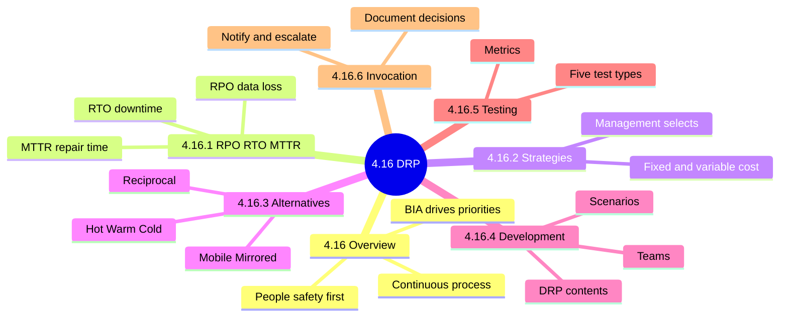

### 4.16 Overview

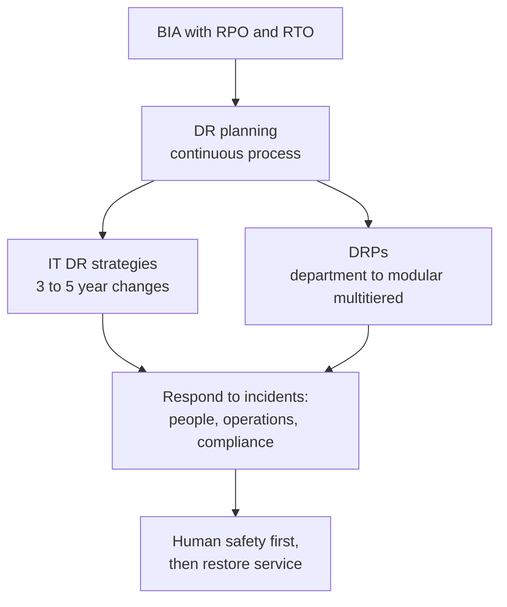

<b>Exam traps</b>

- People safety outranks system restoration in any recovery sequence.
- BIA drives recovery priorities; technology choices follow, never lead.
- Third-party disaster: customer may wait for the vendor's DRP.
- Third-party compliance obligations still apply during a disaster.

### 4.16.1 RPO, RTO and MTTR ⭐

Timeline of one disruption (worked example 1 and 2 from the notes).

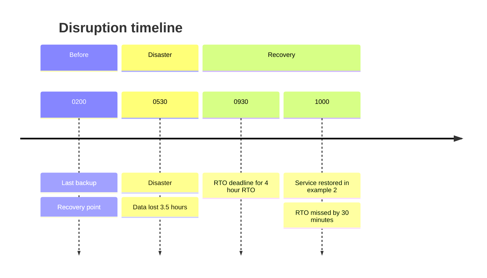

| Term | Measures | Drives | Tight value means |
|---|---|---|---|
| RPO ⭐📓 | Maximum acceptable data loss | Backup or replication frequency | Mirroring, real-time replication |
| RTO 📓 | Maximum acceptable downtime | Availability technology | Hot site, spares, clustering |
| MTTR | Average time to repair | Support and spares | Total repair time / repairs |
| Interruption window | Longest wait to restore | Loss tolerance | Beyond it, losses unaffordable |
| SDO | Service level in alternate mode | Alternate capacity | Must match business need |
| MTO | Longest time in alternate mode | Backlog tolerance | Long stays unmanageable |

Technology ladder (⚠ Check: manual figure is garbled; this ordering is the notes author's reading, unverified).

| Objective | Slower and cheaper | Faster and costlier |
|---|---|---|
| RPO | Tape, log shipping, disk backup, snapshots | Delayed replication, mirroring, real-time replication |
| RTO | Cold standby, hot standby | Active-passive clustering, active-active clustering |

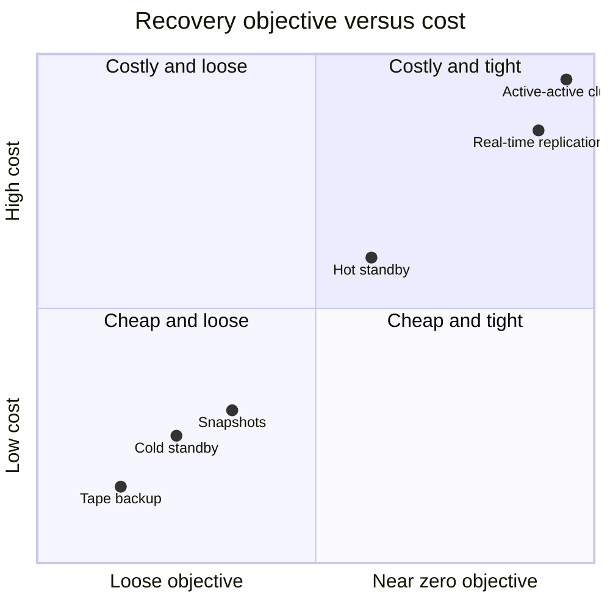

(Point positions are illustrative of "nearer zero costs more", not manual data.)

<b>Formulas and worked examples</b>

- MTTR = total repair time / number of repairs.
- Example: repairs of 2, 5, 2 hours give MTTR of 3 hours.
- Backup 02:00, disaster 05:30: 3.5 hours lost, inside 4 hour RPO.
- Catch-up window 7.5 hours x 40 per hour = 300 transactions.
- Recovery time = declaration + failover + validation.
- 30 + 195 + 45 = 270 minutes, which exceeds 4 hour RTO by 30 minutes.

<b>Exam traps</b>

- RPO concerns data; RTO concerns time. Do not swap them.
- Tight RPO needs replication; tight RTO needs standby capacity.
- Lowering either objective raises cost.
- MTTR is repair time, not site activation time.
- Critical data not retained means RPO was defined wrongly. 📓
- Interruption window and MTO are not the same as MTD (⚠ Check).

### 4.16.2 Recovery strategies

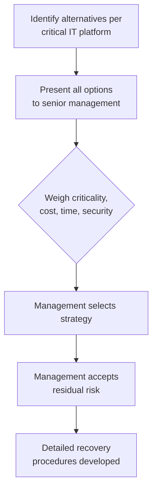

| Cost type | Examples | Insurable? |
|---|---|---|
| Fixed | Redundant computers, alternate routing, testing | Yes |
| Variable | Costs incurred during actual use | Generally no |

<b>Exam traps</b>

- Management selects strategy and owns residual risk; auditors only advise.
- Cheapest option is wrong if it cannot meet RTO.
- A suitable plan can lower insurance premiums.

### 4.16.3 Recovery alternatives

| Site | What it is | Recovery speed | Key concern |
|---|---|---|---|
| Mirrored | Redundant, real-time replication, staffed | No perceived interruption | Highest cost |
| Hot | Full equipment, software, near-real-time data | Fast | Capacity, specs, shared accounts 📓 |
| Warm | Partly configured, network and peripherals | Medium | Less capable equipment |
| Mobile | Modular facility on vehicles | Depends on delivery | Locations, access, utilities |
| Cold | Space and basic infrastructure only | Slowest | Must acquire and install equipment |
| Reciprocal | Similar firms share IT facilities | Variable | Compatibility, privacy, enforceability |

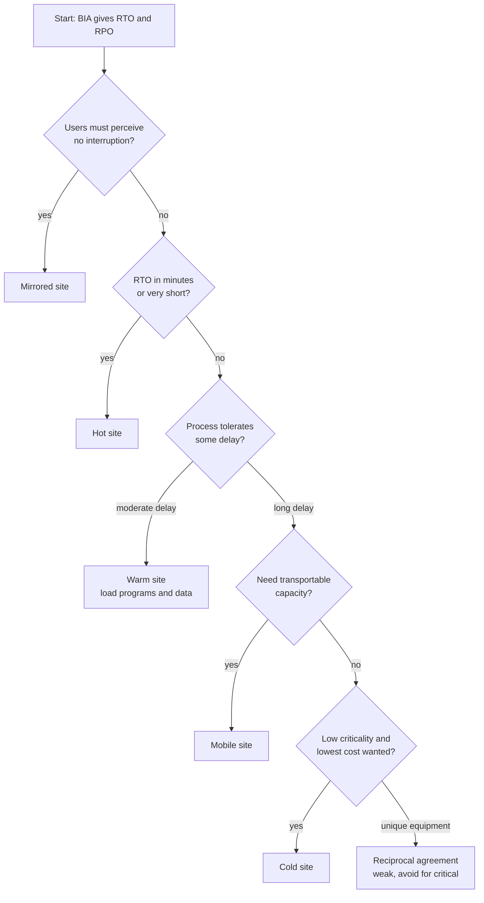

(Flow is a study aid built from the speed and cost ordering in the notes, not a manual figure.)

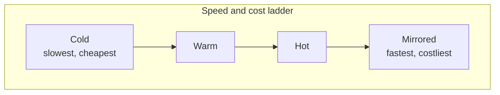

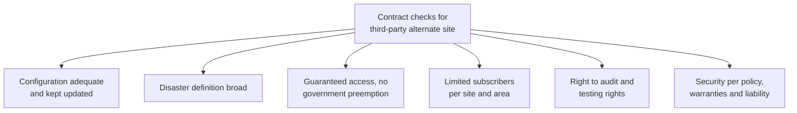

<b>Procuring hardware and telecoms</b>

- Cold and warm sites acquire hardware and software on activation.
- Pre-acquire hard-to-get components to meet the RTO.
- Standard systems are easy to buy; unique or outdated ones are not.
- Diverse routing splits or duplicates cable facilities.
- Also plan long-haul diversity, local loop protection, voice recovery.

<b>Exam traps</b>

- Hot site: storage must match primary site. 📓
- Hot site concerns: differing server specs, shared never-expiring accounts. 📓
- Reciprocal agreements fail on enforceability; avoid for critical systems.
- Site beside the primary is wrong; one disaster could hit both.
- Fastest recovery costs most; compare BIA loss to option cost.

### 4.16.4 Development of DR plans

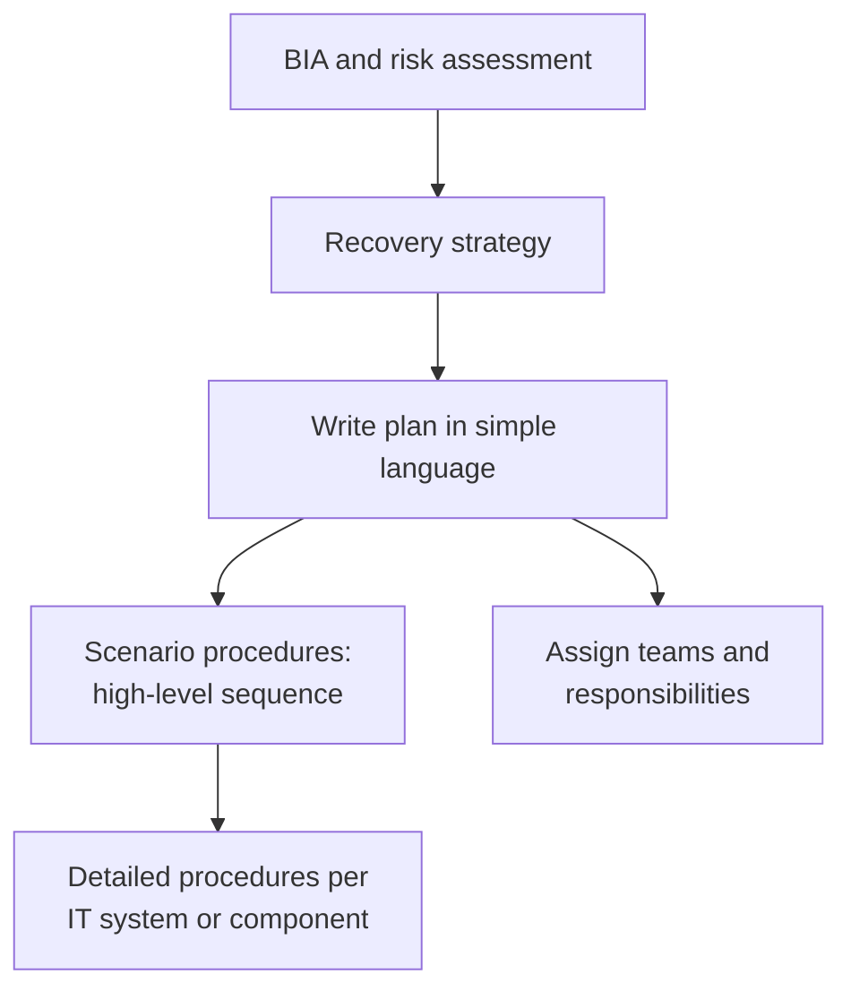

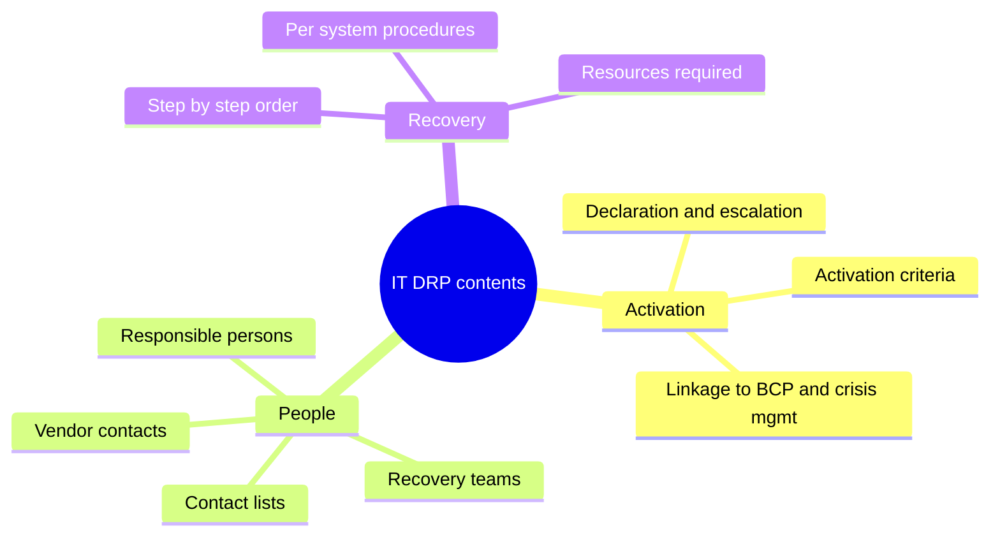

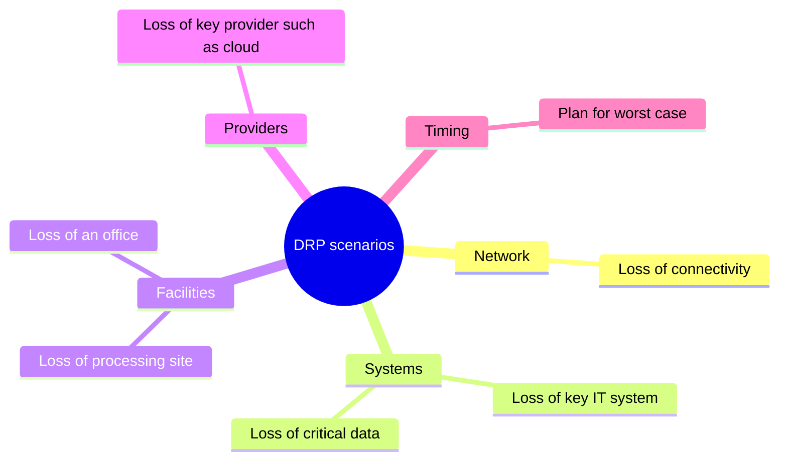

<b>Team designations (unverified, not tested by name)</b>

- ➕ Incident response: receives incident reports; postmortem input.
- ➕ Emergency action: first responders, fire wardens; evacuation.
- ➕ Information security: keeps security at alternate site.
- ➕ Damage assessment: estimates damage and recovery time.
- ➕ Emergency management: coordinates teams; activates BCP.
- ➕ Offsite storage: ships media and records to recovery site.
- ➕ Software and applications: restore OS, programs; monitor database integrity.
- ➕ Network recovery and communications: reroute WAN; carrier liaison.
- ➕ Others: transportation, user hardware, data preparation, administrative support.
- ➕ Others: supplies, salvage, relocation, coordination, legal affairs, test, training.

<b>Exam traps</b>

- A plan lacking escalation and activation criteria cannot be invoked reliably.
- Plan must cover worst-case timing, not average operations.

### 4.16.5 DR testing methods

| Test | Production affected? | Recovery site used? | Cost and risk |
|---|---|---|---|
| Checklist review | No | No | Lowest |
| Structured walk-through | No | No | Low |
| Simulation | No | No processing | Low to medium |
| Parallel | No, continues | Yes, made ready | Medium |
| Full interruption | Yes, shifted | Yes | Highest, most disruptive |

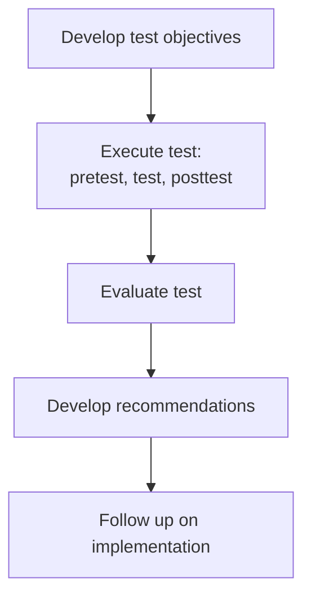

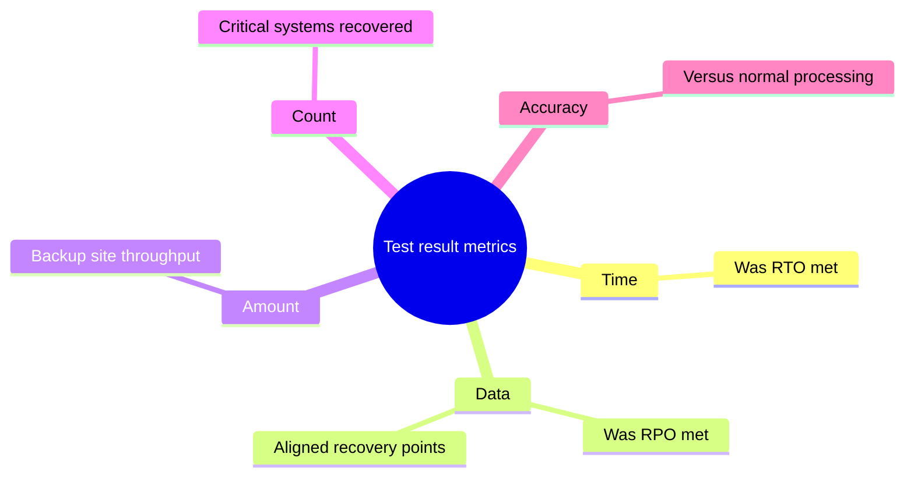

<b>Principles</b>

- Base schedule on risk assessment and BIA.
- Independent party such as IS auditor monitors and evaluates.
- Start simple, increase gradually; full interruption yearly after individual tests.
- Schedule at low-impact times such as long weekends.
- Posttest: restore to primary; delete data from third-party systems.
- Diaries record observations, problems, resolutions.

<b>Exam traps</b>

- Greatest concern in a DR test: defective or failing backup systems. 📓⭐
- No recommendations means the test was not challenging enough.
- Parallel test does not stop production; full interruption does.
- Simulation involves no processing at the recovery site.

### 4.16.6 Invoking DR plans

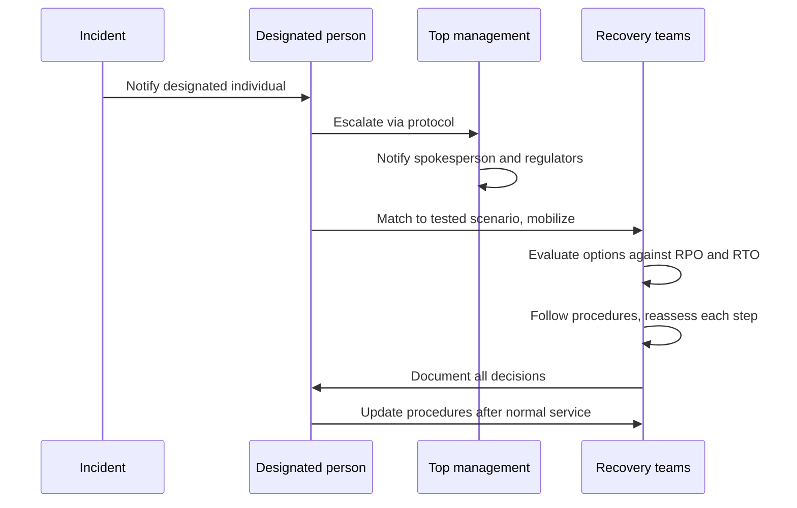

<b>Exam traps</b>

- No tested scenario matches exactly; judgment plus documentation is expected.
- Reassess options at each step; testing may have missed scenarios.
- BCP and DRP are closely aligned; escalation covers regulators.

### Case study: Pinkwater Bank

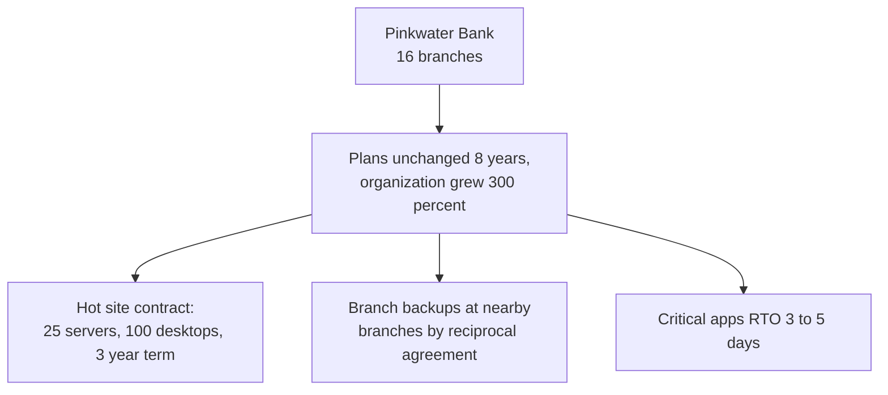

<b>Outline answers (⚠ Check: stem excludes them)</b>

- Microwave concern: lack of encryption, easy to tap.
- Wireless risk: isolate on firewalled subnet.
- Hot site contract: review desktop and server needs quarterly.
- Do not store backup media at the hot site.
- Adding branches to hot site contract is costlier.

### Quick recall

| # | Fact |
|---|---|
| 1 ⭐ | RPO = max data loss, sets backup frequency; RTO = max downtime |
| 2 ⭐ | Greatest DR test concern: defective or failing backup systems |
| 3 | Nearer-zero objectives cost more |
| 4 | Hot site audit: capacity, server specs, shared accounts |
| 5 | Test order: checklist, walk-through, simulation, parallel, full interruption |
| 6 | Full interruption is most rigorous, costly, disruptive |
| 7 | Management selects strategy and accepts residual risk |
| 8 | Safety first, document decisions, update after recovery |
| 9 | MTTR = total repair time / number of repairs |
