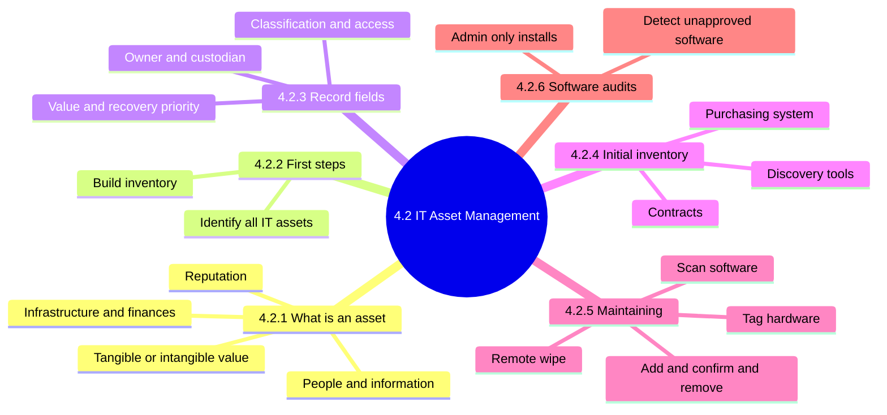
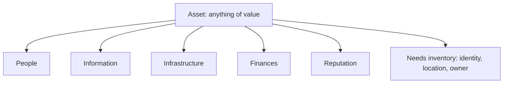
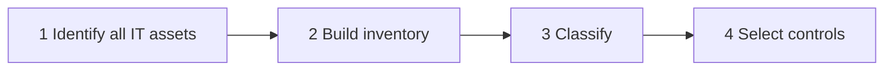
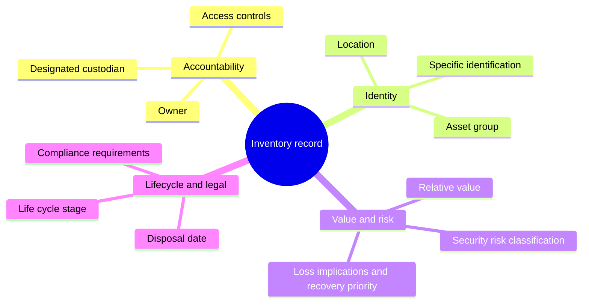
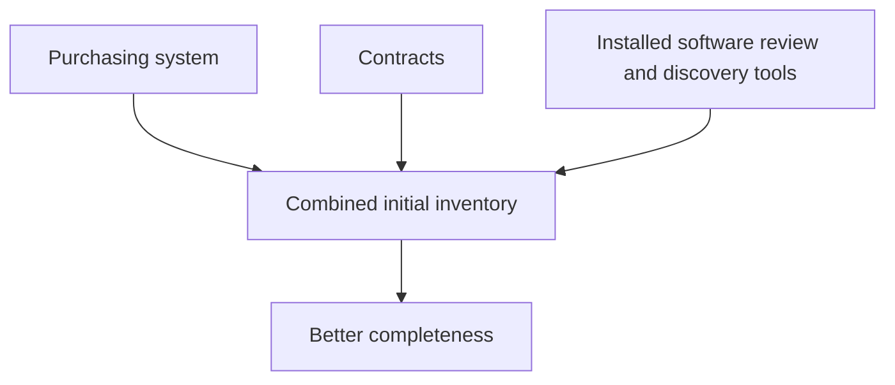
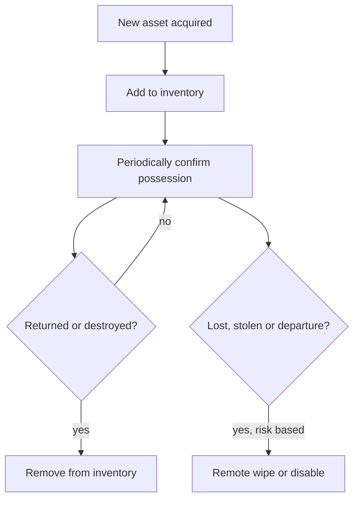
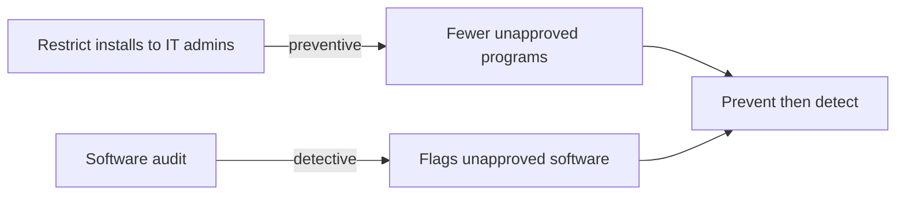

# 4.2 IT Asset Management: Diagrams

[← Domain 4](../README.md) | [Study notes](../Study-Notes/4.2-Study-Notes.md)

### Section map

### 4.2.1 What is an asset

<b>Definitions and example</b>

- Asset: tangible or intangible value worth protecting.
- Unidentified assets receive no controls and become blind spots.
- Example: a customer database and its server are both assets.
- Risk programs start with a comprehensive asset inventory. 📓

### 4.2.2 First steps

<b>Exam traps</b>

- Identification and inventory come before classification or control selection.
- Protecting only critical assets is wrong; all assets need suitable protection.
- Asset management covers both software and hardware.

### 4.2.3 Inventory record fields

| Field | Audit point |
|---|---|
| Owner | Accountable; decides classification and access |
| Custodian | Maintains the asset day to day |
| Loss implications and recovery priority | Align with BIA recovery priorities |
| Location | Needed for physical checks and data residency |
| Asset group | Reveals dependencies and wider impact |
| Life cycle stage | Old assets may lack support or patches |
| Disposal date | Confirms retired assets were sanitized |
| Access controls | Compare recorded access with actual access |

<b>Exam traps</b>

- Owner is accountable; custodian only maintains.
- Relative value and recovery priority are separate fields.
- Confirm owner and custodian are distinct and documented.
- Disposal date as actual removal date, not planned (unverified).

### 4.2.4 Building the initial inventory

| Source | Strength | Gap |
|---|---|---|
| Purchasing system | Shows what was bought | Misses donated or unofficial items |
| Contracts | Reveals leased or outsourced assets | Not physically held |
| Discovery tools | Finds unrecorded or unapproved software | Only scans reachable devices |

<b>Example and exam trap</b>

- Purchasing shows 500 laptops; scanning finds 520 devices.
- No single source is complete; combine sources.

### 4.2.5 Maintaining the inventory

| Asset type | Tracking method |
|---|---|
| Hardware | Physical tagging |
| Software | Network scanning and annual license confirmation |
| Lost or stolen device | Remote wipe or disable |

<b>Exam traps and example</b>

- Wipe is risk-based, not mandatory in every case.
- Tagging suits hardware; software uses scanning and license review.
- Sample from floor to records, and records to floor.
- Example: stolen laptop with confidential data wiped remotely within hours.

### 4.2.6 Software audits and installation control

<b>Exam traps</b>

- Audit alone is detective; add admin-only installation for prevention.
- Findings feed shadow IT and licensing compliance reviews.

### Quick recall

| Fact | Answer |
|---|---|
| First steps | Identify assets, then build inventory |
| Owner vs custodian | Owner accountable; custodian maintains |
| Inventory sources | Purchasing, contracts, discovery tools |
| Hardware tracking | Physical tags |
| Software tracking | Scanning plus annual license confirmation |
| Remote wipe | Risk-based |
| Software controls | Audit (detect) plus admin-only install (prevent) |
