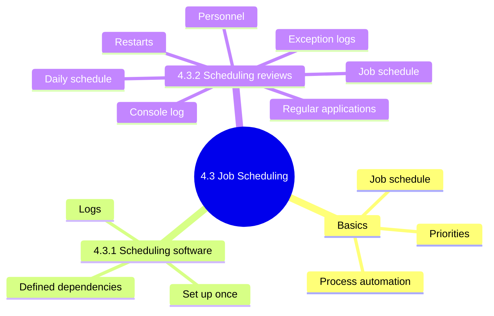
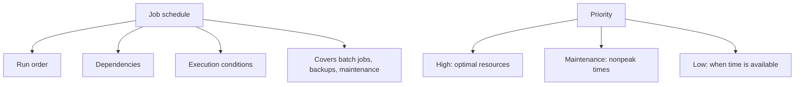
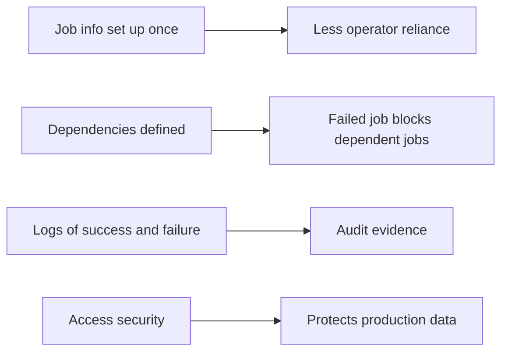
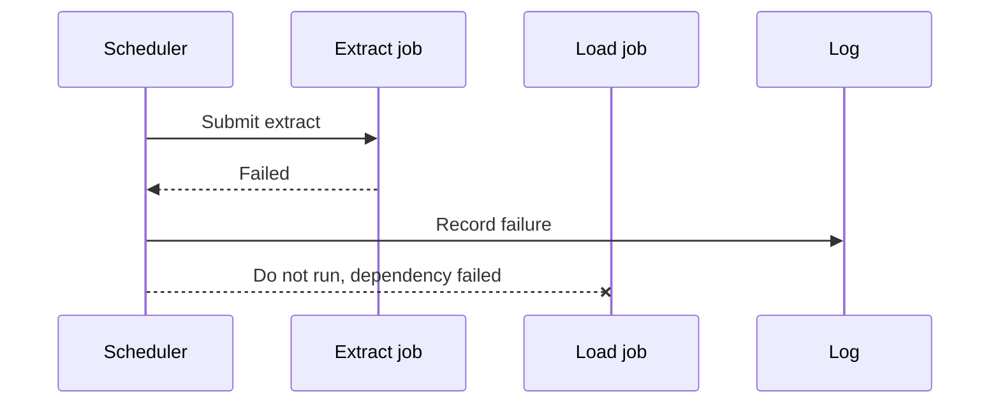
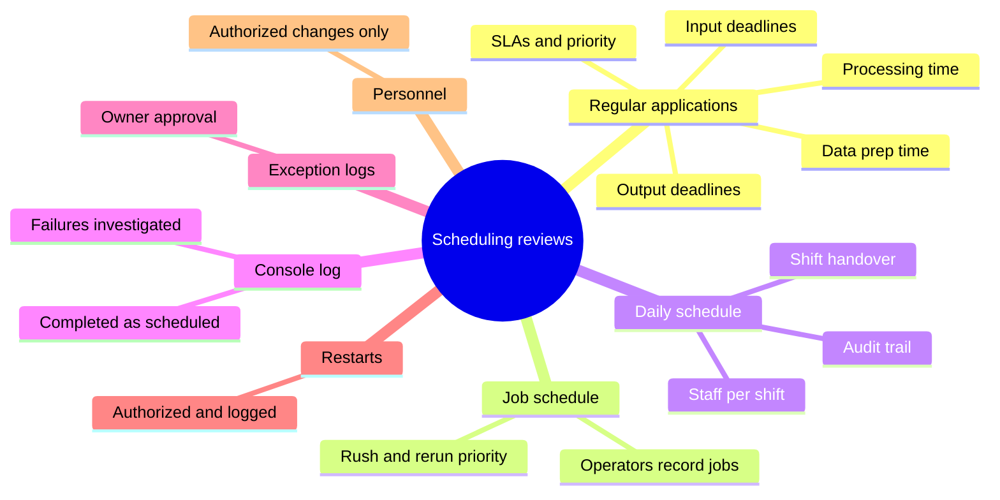
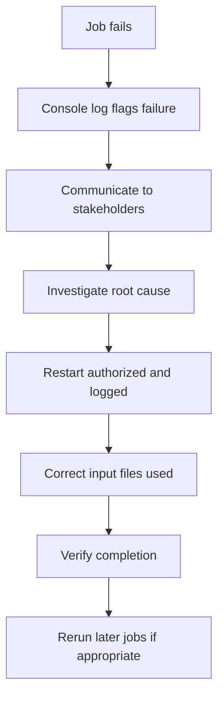

# 4.3 Job Scheduling and Production Process Automation: Diagrams

[← Domain 4](../README.md) | [Study notes](../Study-Notes/4.3-Study-Notes.md)

### Section map

### 4.3 Basics: schedules, priorities, automation

<b>Definitions and example</b>

- Production job: program run in normal operations; batch needs no user.
- Weak schedule causes missed processing, wrong sequence, unauthorized runs.
- Example: payroll waits for timekeeping import; month-end outranks archive cleanup.
- Continuous availability leaves little downtime for maintenance.
- Automation moves risk to the tool and its configuration.
- Manual says little on automation beyond scheduling software (unverified).

### 4.3.1 Job scheduling software

<b>Exam traps</b>

- Defined dependencies block dependent jobs; operator vigilance is error-prone.
- Benefit is consistency and logging, not eliminating all review.
- Software needs ongoing maintenance; set once and never reviewed is weak.
- Scheduling software has privileged control; restrict its access.

### 4.3.2 Scheduling reviews

| Review area | What to check |
|---|---|
| Regular applications | Deadlines in SLAs; critical apps top priority |
| Job schedule | Rush and rerun jobs match priority |
| Daily schedule | Adequate staff; audit trail; shift statement |
| Console log | Failures flagged and root causes found |
| Exception logs | Written or electronic owner approval |
| Restarts | Authorized, logged, correct input, verified |
| Personnel | Only authorized staff change schedules |

<b>Unverified items</b>

- Manual lists KPI collection procedures; outline omits them (unverified).
- Restart wording: logging for IS management versus management reviewed (unverified).

<b>Exam traps</b>

- Checkpoints are detective, not preventive or corrective. ⭐ 📓
- Best evidence of what ran: console log, not planned schedule.
- Highest rerun risk is wrong input files.
- Schedule changes need authorization; operator convenience is invalid.
- Critical applications get highest priority regardless of requester.

<b>Example</b>

- Rerunning a billing job on yesterday's file double-charges customers.

### Quick recall

| Fact | Answer |
|---|---|
| Checkpoints ⭐ | Detective controls |
| Failed job and dependents | Defined dependencies block them |
| Evidence of actual runs | Console log |
| Evidence of intent | Planned schedule |
| Rerun main risk | Wrong input files |
| Exception jobs | Need owner approval and logging |
| Schedule changes | Authorized personnel only |
| Maintenance timing | Nonpeak times |
