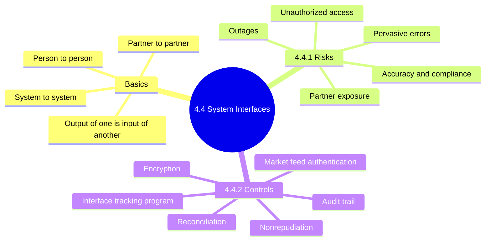
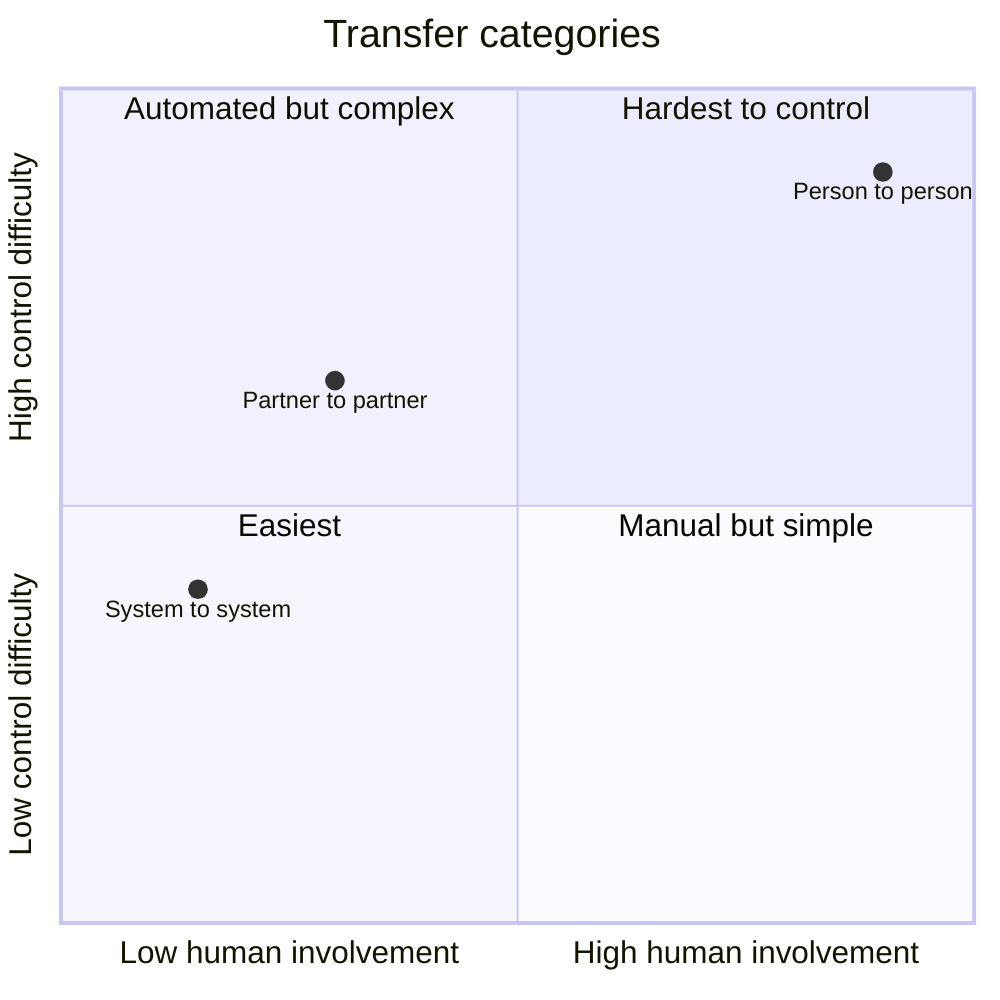
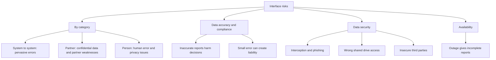
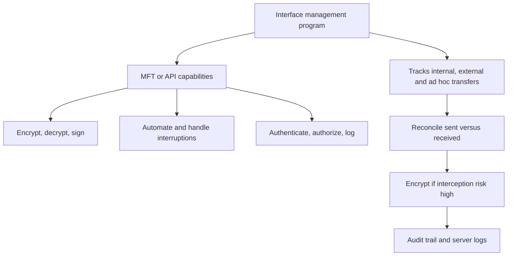
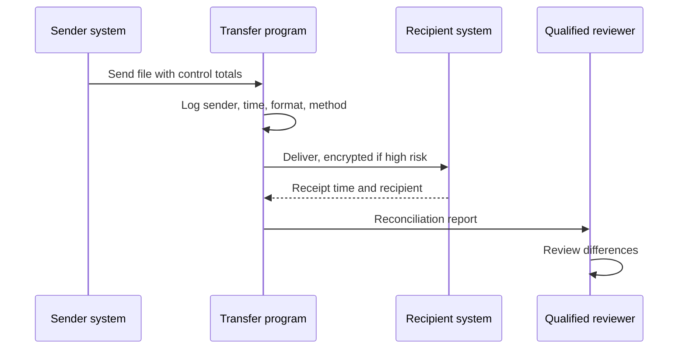
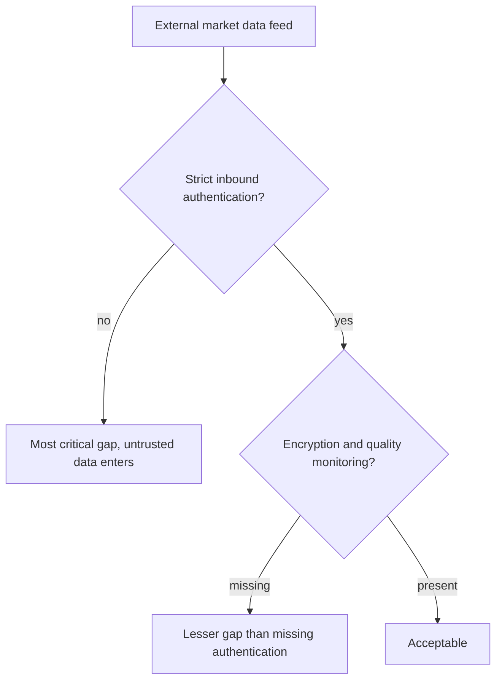

# 4.4 System Interfaces: Diagrams

[← Domain 4](../README.md) | [Study notes](../Study-Notes/4.4-Study-Notes.md)

### Section map

### 4.4 Basics: transfer categories

| Category | Description | Control level |
|---|---|---|
| System-to-system | Internal or external; financial data, BI | Automated, errors repeat |
| Partner-to-partner | Partners interface directly, e.g. supply chain | Depends on partner |
| Person-to-person | Email attachments, shared drives | Least controlled |

<b>Definitions and exam traps</b>

- System interface: one application's output feeds another, little human interaction.
- User interface: where a human interacts; do not confuse the two.
- Person-to-person is least controlled, not most automated.
- Mixed technologies complicate testing, mapping and reconciliation.
- Example: general ledger exports journal data nightly to a BI tool.
- Example: finance emails a payroll spreadsheet to an outside bureau.

### 4.4.1 Risk associated with system interfaces

<b>Exam traps</b>

- Protect data in transit, not only at rest.
- Outages affect accuracy and completeness, not only availability.
- Extracted data must equal data recorded in the recipient.

### 4.4.2 Controls associated with system interfaces

| Control | Key point |
|---|---|
| Reconciliation | Automated preferred; hash checksums; manual comparison |
| Monitoring | Qualified person reviews results |
| Encryption | When interception risk is relatively high |
| Nonrepudiation | Intended recipient is actual recipient (unverified usage) |
| Audit trail | Sender, send time, receive time, format, method, recipient |
| Server logs | Assess along the transfer path |

### External market data feeds 📓⭐ (unverified)

- Ranking is from user notes and is not in the manual section (unverified).

<b>Exam traps</b>

- Pick the control whose absence lets untrusted data enter.
- Encryption protects confidentiality, not sender identity.
- Reconciliation detects mismatch; it does not replace authentication or logging.
- One-time transfer review does not cover ad hoc transfers.
- Manual lists capabilities twice, with and without APIs (unverified).

<b>Examples</b>

- Software creates control totals at extraction, reconciles after loading.
- Encryption suits industrial espionage, identity theft, card data theft.
- Formats logged: xls, csv, txt or xml.

### Quick recall

| Fact | Answer |
|---|---|
| Interface | Output of one app is input of another |
| Least controlled category | Person-to-person |
| System-to-system risk | Pervasive errors |
| Reconciliation | Automated preferred; qualified reviewer |
| Audit trail items | Sender, times, format, method, recipient |
| Encryption | When interception risk is high |
| Market feed ⭐ 📓 | Authentication first (unverified) |
