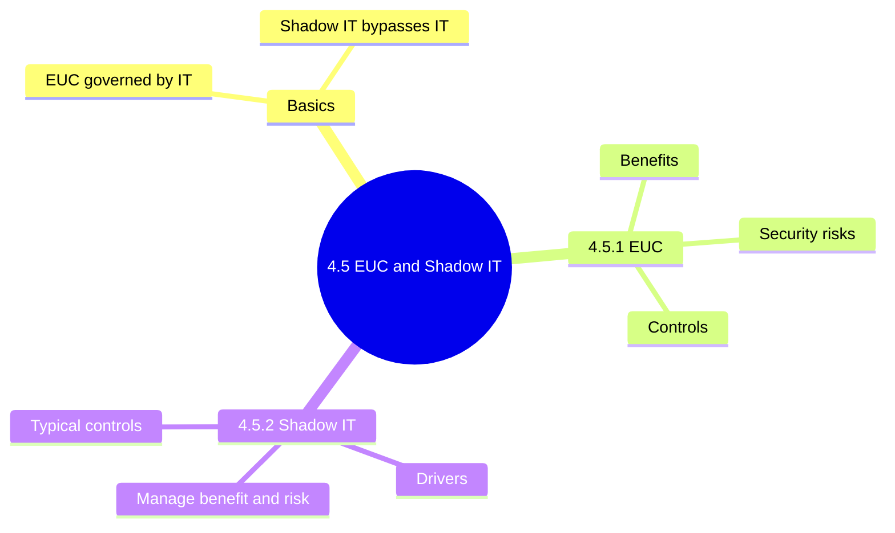
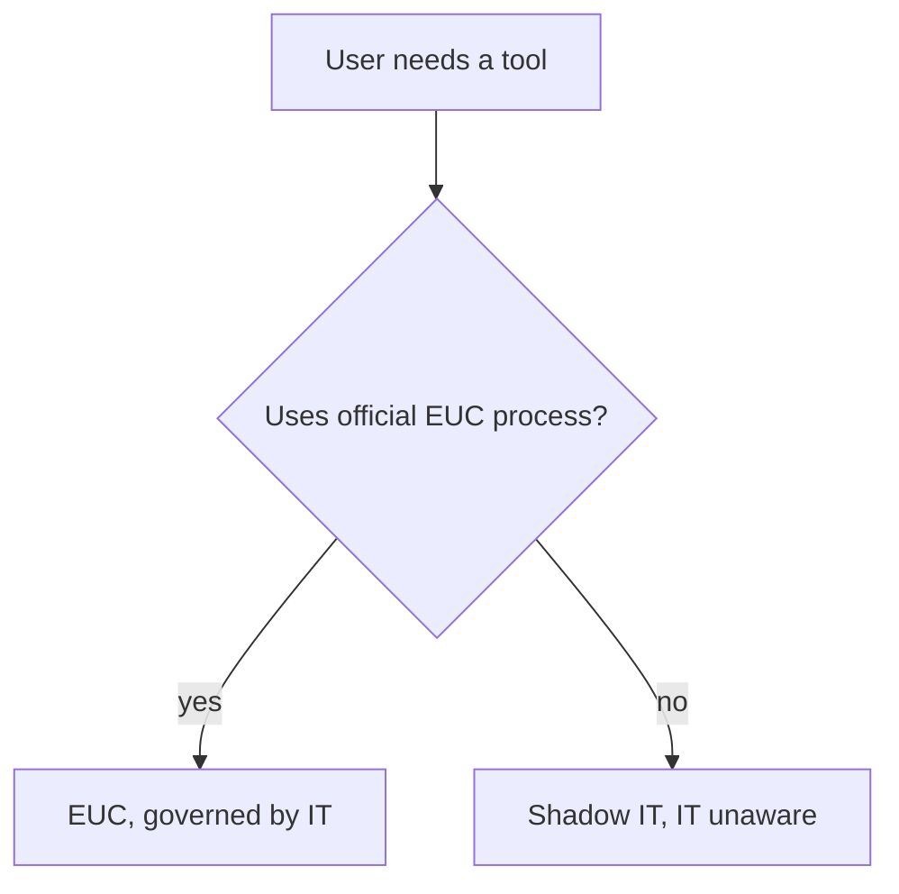
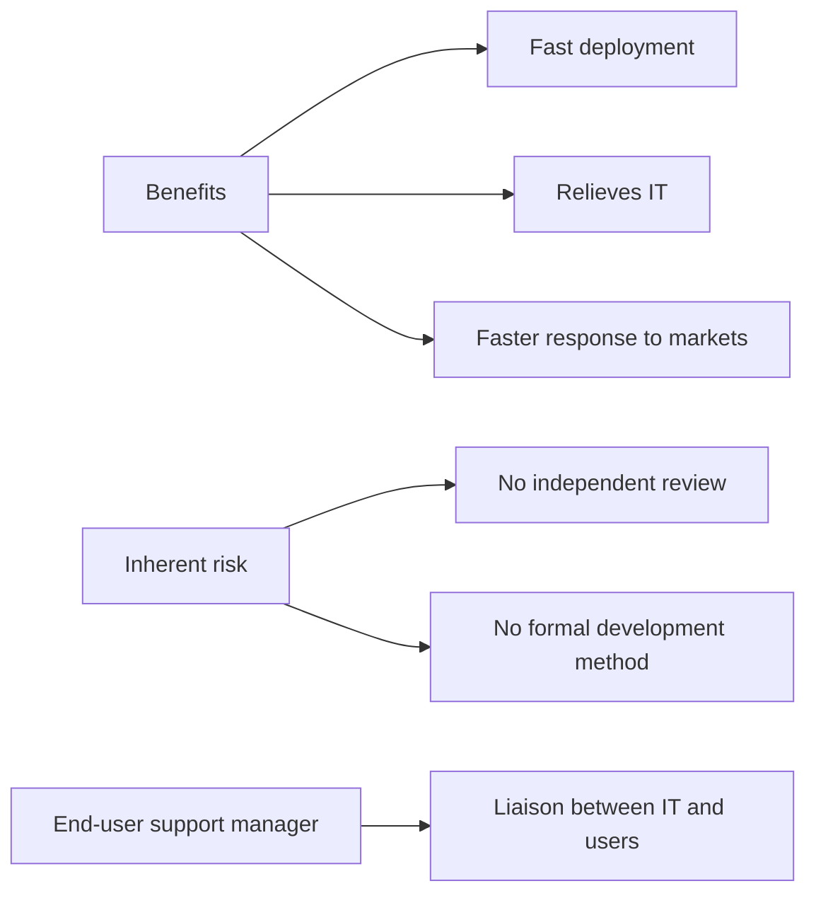
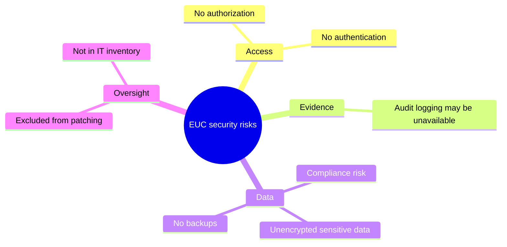
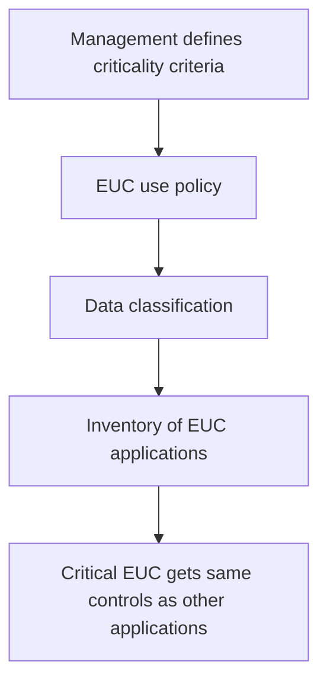
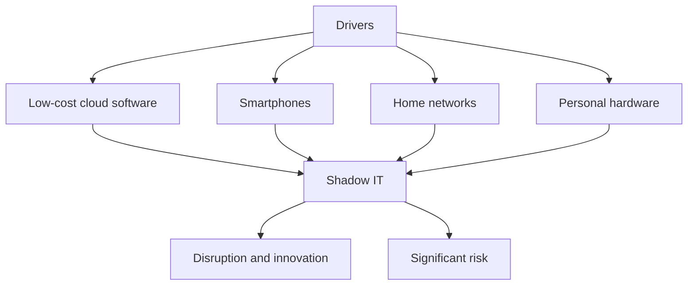
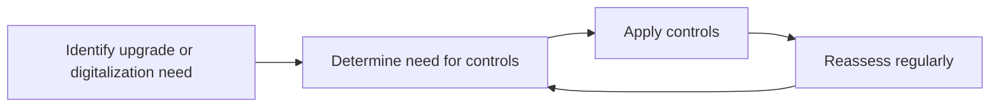

# 4.5 End-User Computing and Shadow IT: Diagrams

[← Domain 4](../README.md) | [Study notes](../Study-Notes/4.5-Study-Notes.md)

### Section map

### 4.5 Basics: EUC versus Shadow IT

| Aspect | EUC | Shadow IT |
|---|---|---|
| Who creates | Non-IT staff | Users or departments |
| IT knowledge | IT governs via official process | IT unaware |
| Defined by | Self-built applications | Missing approval |
| Example | Finance Excel pricing model | Sales buys cloud tool by card |

<b>Exam traps</b>

- Official EUC is governed by IT; shadow IT is not.
- Shadow IT is defined by missing approval, not the technology.

### 4.5.1 End-user computing

<b>Definitions and example</b>

- End user: uses applications built and installed by others.
- EUC: non-programmers design own applications with software products.
- Example: Access database holds customer data, no password, no backup.
- Inventory links to section 4.2 IT Asset Management.

<b>Exam traps and unverified points</b>

- Root cause is lack of IT oversight, not the tool.
- Best first fix is policy and inventory, not banning EUC.
- Criticality, not builder, decides control level.
- Policy alone is weak without inventory and classification.
- Manual says most EUC poses no significant enterprise risk (unverified).
- Manual says logging "may not be available" (unverified as absolute).

### 4.5.2 Shadow IT

| Typical control | Type or purpose |
|---|---|
| Shadow IT policy | Aligned with business objectives |
| IT as service-delivery organization | Cultural; reduces motive to bypass IT |
| IT budgeting and procurement approval | Preventive; stops unapproved purchases |
| IT system consolidation | Shrinks footprint, if feasible |
| Explicit user access and admin rights | Blocks free installation |
| User education program | Awareness of risks and channels |
| User activity monitoring | Detective |
| Strong endpoint controls on data exchange | Limits data leaving |

<b>Exam traps and example</b>

- Banning all shadow IT is weaker than channeling needs through IT.
- Shadow IT may signal an unmet business need.
- Procurement approval beats after-the-fact detection.
- Technical blocking alone fails without policy and education.
- Controls must be reassessed, not set once.
- Example: staff share files through a personal cloud account.

### Quick recall

| Fact | Answer |
|---|---|
| EUC | IT-governed |
| Shadow IT | Unapproved, IT unaware |
| EUC control level | Set by criticality |
| EUC first fix | Policy, classification, inventory |
| EUC risks | No authorization, authentication, logs, backups |
| Preventive shadow IT control | Procurement approval |
| Shadow IT controls | Reassess regularly |
