# 4.6 Systems Availability and Capacity Management - Diagrams

[← Domain 4](../README.md) | [Study notes](../Study-Notes/4.6-Study-Notes.md)

### Section map

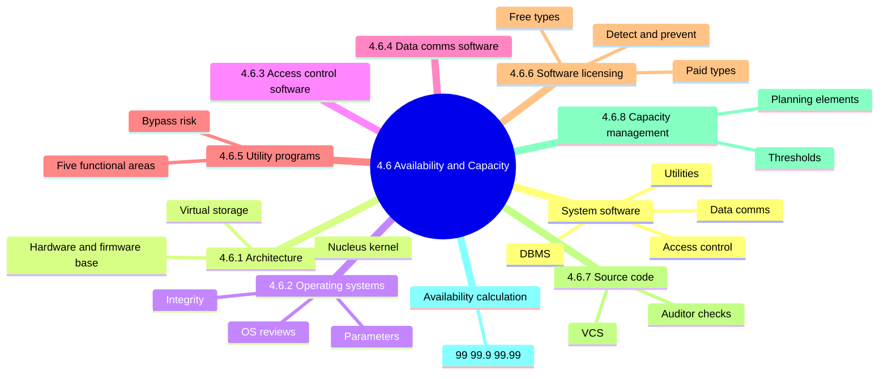

### System software overview

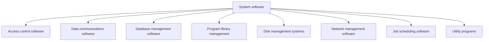

<b>Definitions</b>

- System software runs and controls the hardware.
- It keeps data and programs intact and controls program flow.
- Weak controls undermine every application running above it.
- Each type needs restricted access, change control, and logging.

### 4.6.1 IS architecture and software

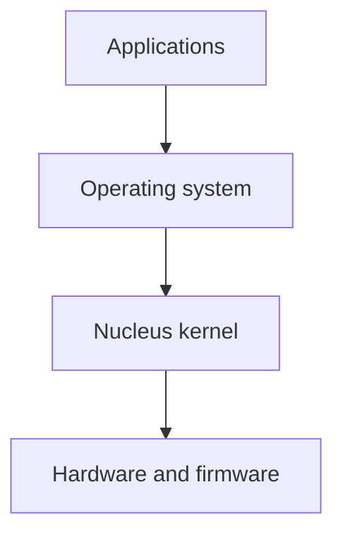

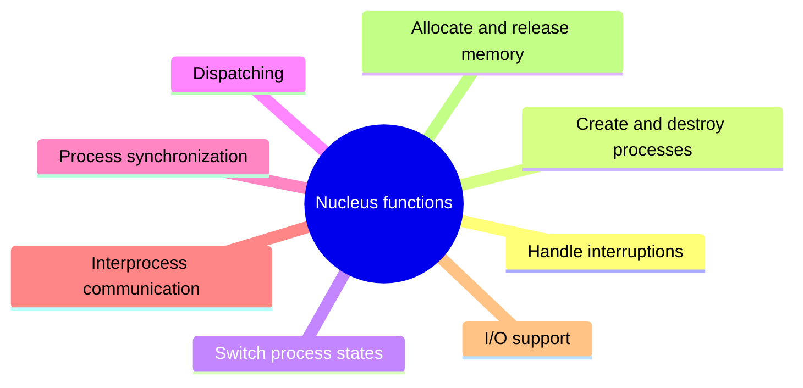

<b>Definitions and audit impact</b>

- Hardware and firmware sit at the base of the hierarchy.
- Virtual storage lets programs address more memory than physically exists.
- Heavy swapping signals memory shortage and degrades performance.
- A flaw in the nucleus can expose the whole system.

### 4.6.2 Operating systems

| Environment | OS need |
|---|---|
| Stand-alone microcomputer | Catalog files, load programs |
| Mainframe | Extensive resources, high reliability, for example z/OS |
| Multi-user server | Multiprocessing, multitasking, multithreading, for example UNIX |
| Networked microcomputer | Acts as specialized server |
| Virtual servers | One physical server partitioned |

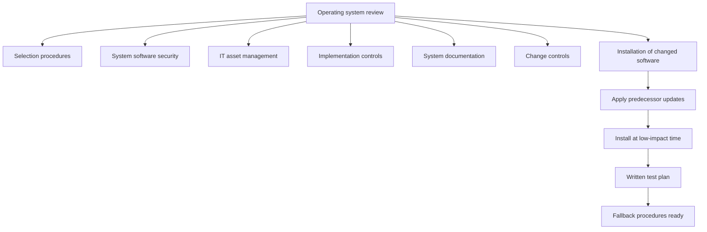

<b>Integrity issues</b>

- Protect OS from deliberate and unintentional modification.
- User programs must not interfere with privileged programs.
- Process isolation and least privilege apply to processes.
- Nonprivileged users cannot run privileged instructions.
- z/OS: SYSGEN, initial program load, SYS1.PARMLIB protect supervisory state.
- Windows: monitor registry changes.
- UNIX/Linux: secure kernel, start-up, file-sharing config files.
- Patch currency prevents compromise through known flaws.

<b>Exam traps</b>

- Default parameters left unchanged are a weakness.
- Parameter review beats interviewing staff.
- Emergency changes still need after-the-fact authorization.
- Programmers should not have direct production library access.
- Default vendor passwords are a classic finding.
- No fallback plan turns a failed change into an outage.

### 4.6.3 Access control software

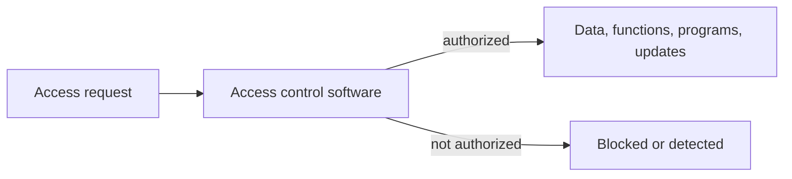

<b>Notes</b>

- Detects or prevents unauthorized access.
- Weak configuration defeats all other logical controls.
- Detailed coverage is in chapter 5.

### 4.6.4 Data communications software

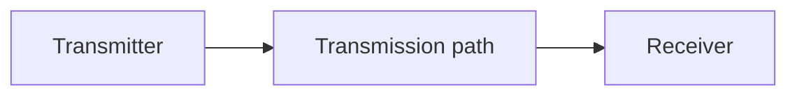

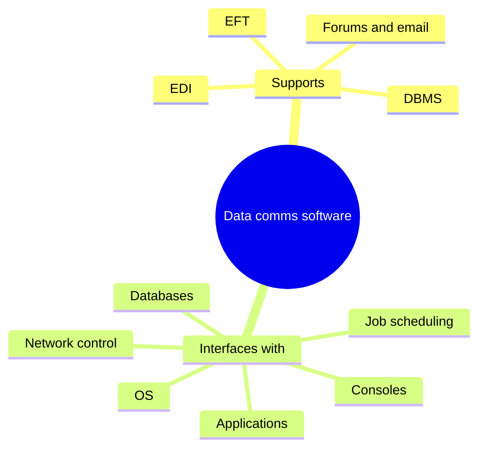

<b>Notes</b>

- Moves messages or data between local or remote points.
- One-way or two-way communication.
- Cares only about correct transmission, not content.
- Layered, with at least physical and data link layers.
- Failure interrupts every dependent application.
- Content not validated at this layer, so applications must check it (unverified).

### 4.6.5 Utility programs

| Functional area | Examples |
|---|---|
| Understanding applications | Flowcharting, transaction profile analyzer, executive path analyzer, data dictionary |
| Assessing data quality | Data manipulation, database dump, data comparison, query |
| Testing function and integrity | Test data generator, online debugging, output analyzer, network simulator |
| Faster development | Visual display, library copy, text editor, report and code generators |
| Operational efficiency | CPU and memory monitors, communication line analyzers |

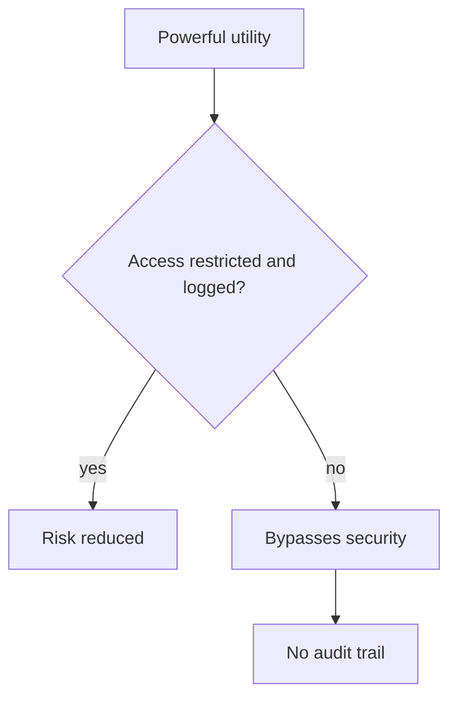

<b>Exam traps</b>

- Best control is restricted access, not removal.
- Core risk is bypassing application controls.
- Example: a database dump utility reads data without application controls.
- PC and server utilities: defragmenting, volume initialization, image save and restore, file recovery.

### 4.6.6 Software licensing issues

| Type | Detail |
|---|---|
| Open source | Use, modify, redistribute; Linux, GNU GPL |
| Freeware | Free, no source redistribution, sometimes personal-use only |
| Trial | Demo with limited function |
| Per CPU | Counts cores |
| Per seat | Unique named users |
| Concurrent users | Simultaneous users |
| Utilization | CPU busyness or active users |
| Per device | Each device |
| Enterprise | Unlimited use within organization |

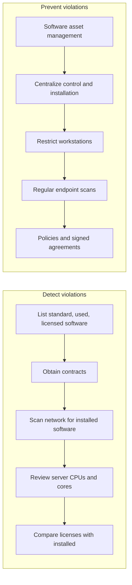

<b>Exam traps and example</b>

- Policy alone does not prevent violations; scanning against the asset list does.
- Network scan against purchased licenses is strongest detection evidence.
- Example: per-core license breached when a VM moves to a larger host.
- Publishers may hold audit rights; collect licenses up front.
- DR arrangements may need extra licenses and metering software.

### 4.6.7 Source code management

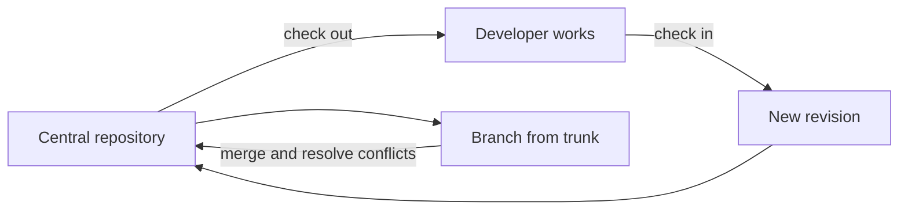

| Software origin | Source access |
|---|---|
| No source | Escrow arrangement |
| Packaged | License only |
| Bespoke | Full access |

<b>VCS advantages and auditor checks</b>

- Advantages: access control, change tracking, concurrent development, rollback, branching.
- Examples: Apache Subversion, Git, GitLab, GitHub.
- Distributed VCS replicates the repository locally.
- Check who has access to source code.
- Check who can commit to production.
- Check source-to-object alignment.
- Check alignment with change and release management.
- Check backups, including offsite and escrow.
- Developers committing straight to production is a segregation-of-duties failure.

### 4.6.8 Capacity management

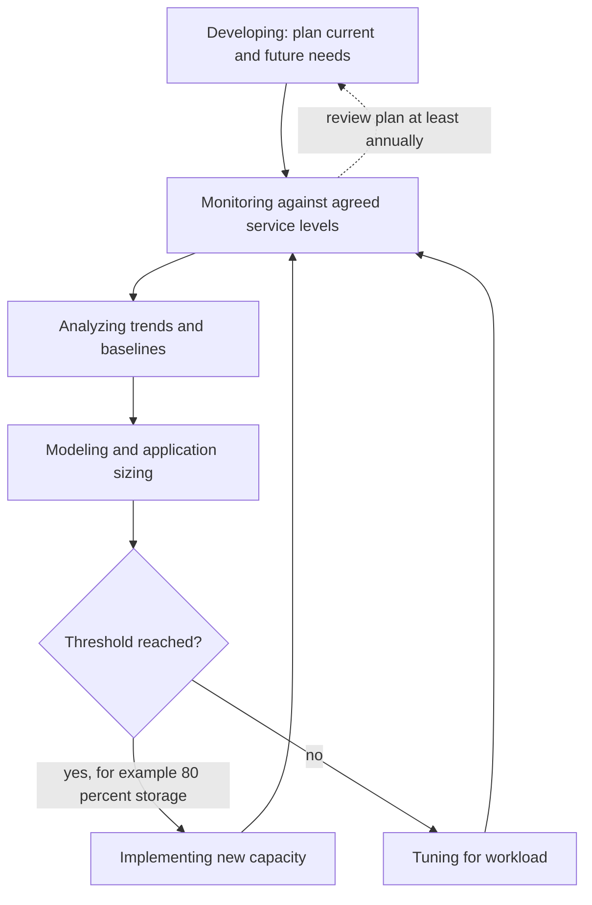

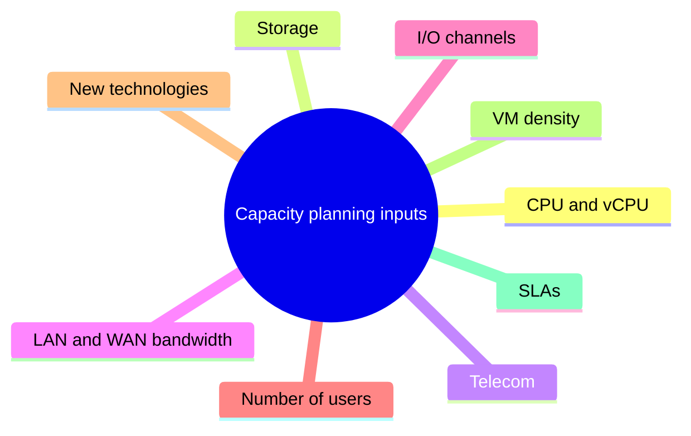

<b>Hosting choices and benefits</b>

- Options: distributed small servers, consolidated large servers, cloud.
- Application stacking raises outage impact.
- Cloud gives on-demand capacity but adds supplier reliance.
- Benefit: defer cost of new capacity.
- Benefit: avoid performance failure via threshold monitoring.
- Benefit: forecasting through application sizing and modeling.
- Sizing estimates use transaction counts, data size, response times (unverified).

<b>Exam traps: unmonitored disk space 📓</b>

- Unmonitored disk space causes systemic failures, including at recovery sites.
- Stale disk data at a hot site is a serious readiness gap.
- Capacity management is proactive; incident management is reactive.

### Availability and downtime calculation

Formula: allowed downtime = (1 - availability) x hours per year, where a year = 365 x 24 = 8,760 hours.

| Availability | Unavailable fraction | Downtime per year | Approximate |
|---|---|---|---|
| 99 percent | 0.01 | 87.6 hours | About 3.65 days |
| 99.9 percent | 0.001 | 8.76 hours | About 8 h 46 min, 526 min |
| 99.99 percent | 0.0001 | 0.876 hours | About 53 minutes |

The 99 percent row is derived with the same formula; it is not stated in the study notes.

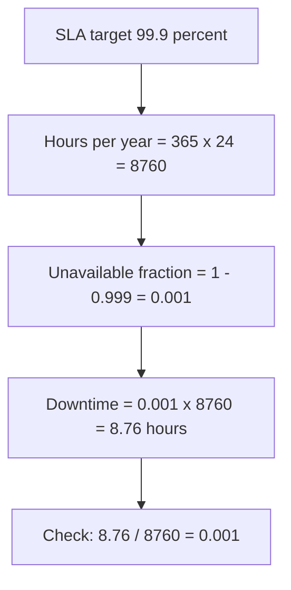

<b>Manual error flagged (⚠ Check)</b>

- The manual's ATM example says about 3.5 days for 99.9 percent.
- 3.5 days is 84 hours, which is 0.96 percent downtime.
- That equals about 99.04 percent availability, not 99.9 percent.
- Correct figure is about 8.8 hours per year; trust the calculation.
- Each extra nine cuts allowed downtime by a factor of ten.
- Availability percent is not reliability or recovery time.

### Quick recall

| Fact | Answer |
|---|---|
| ⭐ 99.9 percent downtime | About 8.8 hours per year, not 3.5 days |
| Each extra nine | Downtime falls tenfold |
| Utility risk | Bypass security, no audit trail; restrict access |
| Best licence violation evidence | Network scan versus purchased licenses |
| Capacity management style | Proactive, threshold driven |
| Example threshold | Add disk at 80 percent |
| Plan review | At least annually |
| Source-to-object comparison | Proves running code matches approved code |
| Unmonitored disk space | Can break recovery sites |
