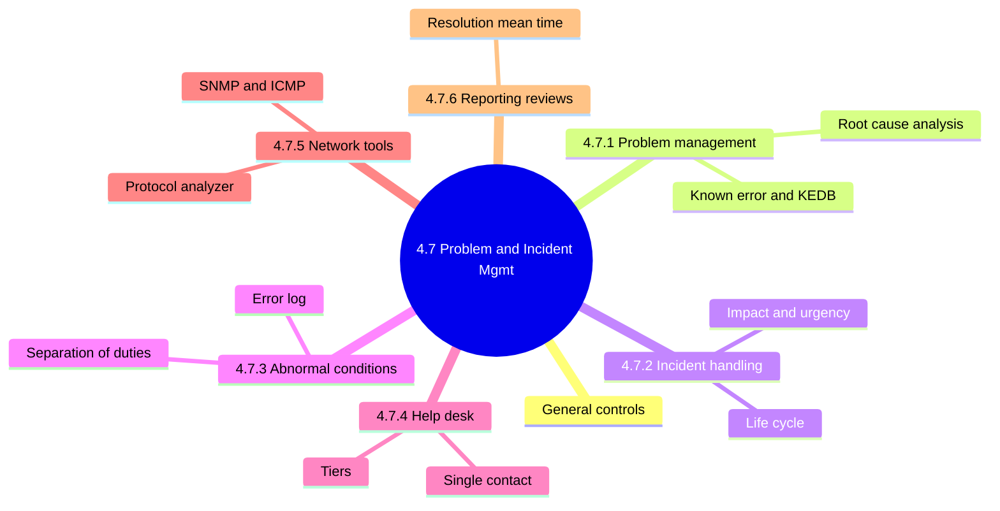
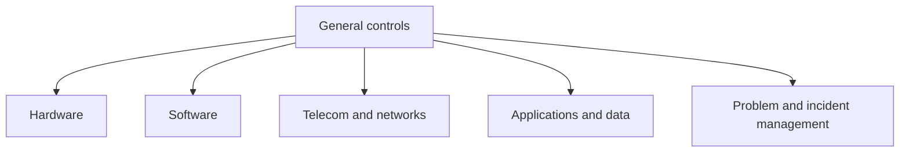
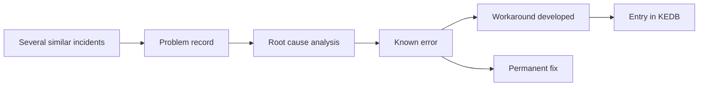
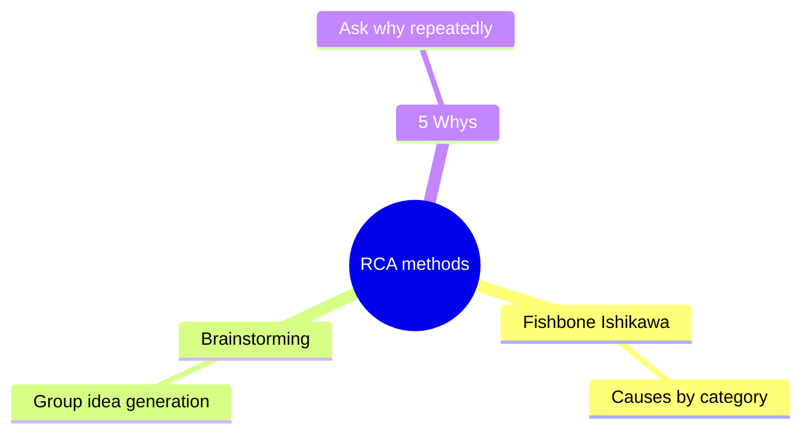
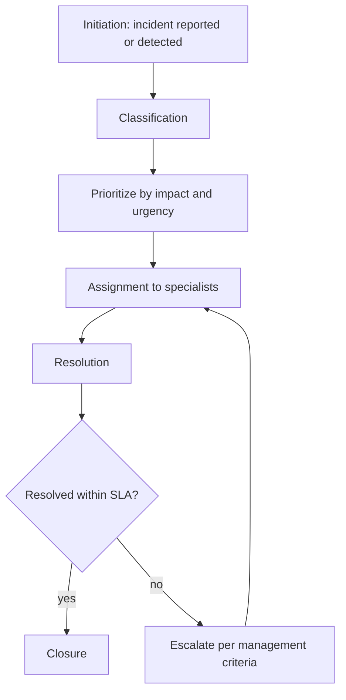
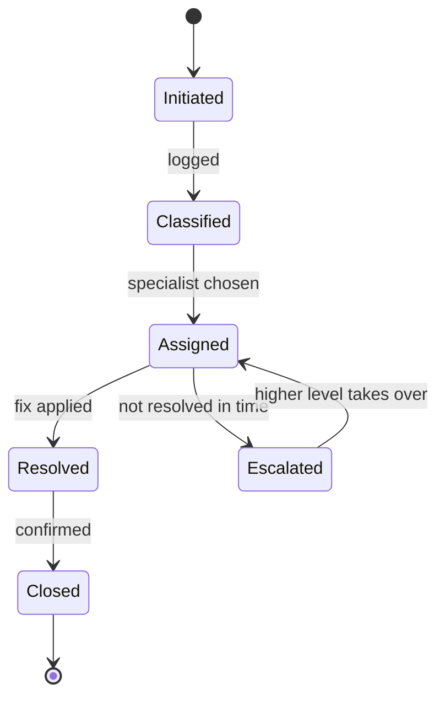
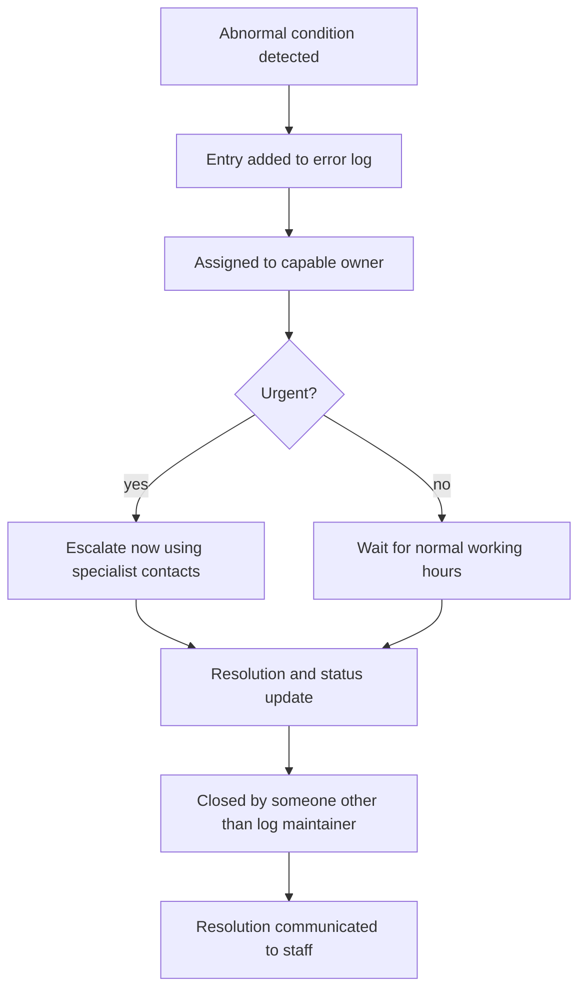
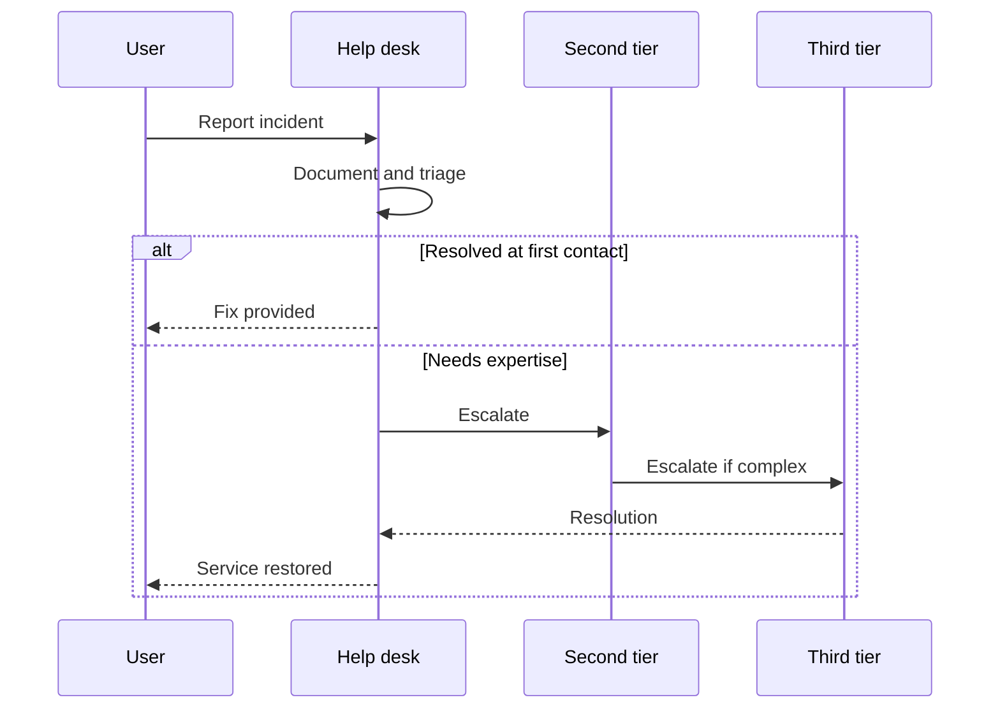
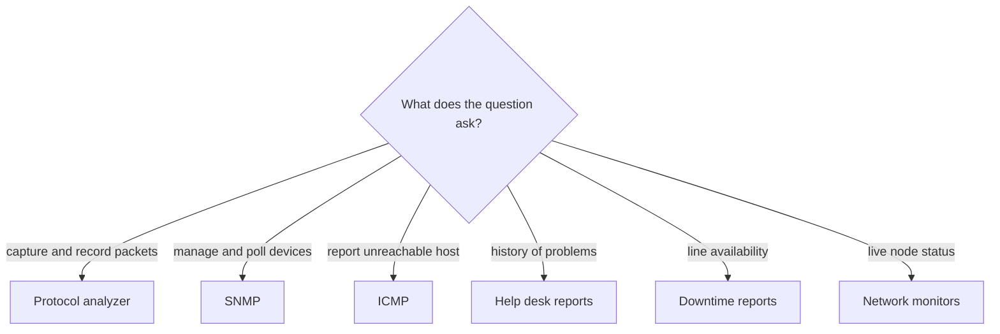
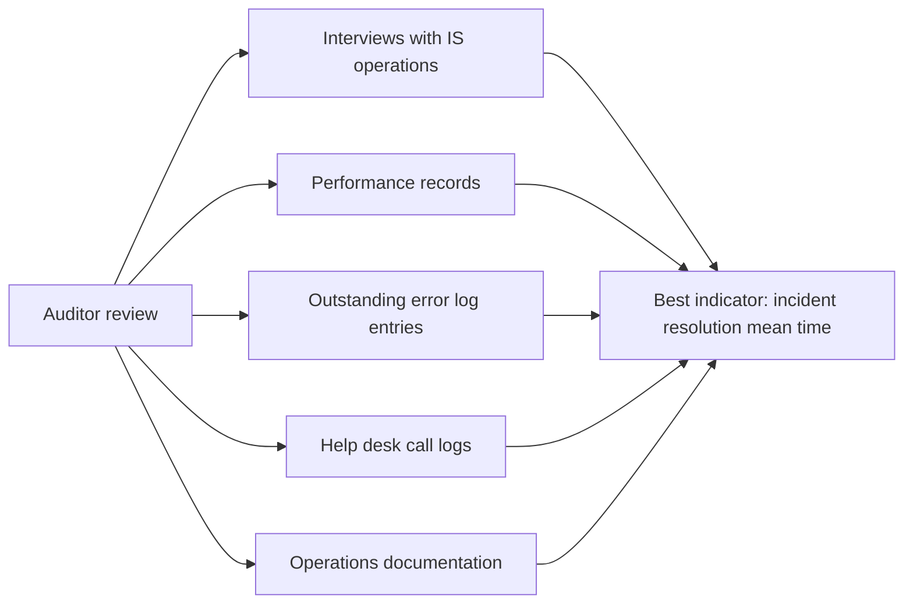

# 4.7 Problem and Incident Management - Diagrams

[← Domain 4](../README.md) | [Study notes](../Study-Notes/4.7-Study-Notes.md)

### Section map

### General controls

<b>Notes</b>

- General controls cover all computer resources, not one application.
- Weak general controls undermine reliance on application controls.
- Auditor tests that failures are detected, logged, escalated, resolved.

### 4.7.1 Problem management

#### Problem vs incident vs change

| Aspect | Incident | Problem | Change |
|---|---|---|---|
| What it is | Unplanned disruption or degradation | Underlying cause of one or more incidents | Planned modification to systems |
| Goal | Restore service quickly | Reduce number and severity of incidents | Introduce modification safely |
| Style | Reactive | Proactive | Controlled and authorized |
| Key output | Restored service | Known error, workaround, KEDB entry | Tested, authorized release with fallback |
| Example | Server crashes today | Faulty memory driver behind weekly crashes | Install tested driver fix |

The change column is drawn from 4.6.2 notes (test, authorize, fallback); see section 4.8 for full change management.

<b>Definitions</b>

- Known error: problem with identified root cause.
- Workaround: temporary way to reduce a known error's impact.
- KEDB: searchable repository of known errors and workarounds.
- Stale or missing KEDB entries slow resolution.
- 5 Whys: "five" is a guideline, stop at root cause (⚠ Check).
- Example 5 Whys: site down, disk full, logs unrotated, no job, no owner.

<b>Exam traps</b>

- Permanent prevention: choose problem management.
- Fastest restoration: choose incident management.
- A workaround alone is wrong when recurrence prevention is asked.

### 4.7.2 Process of incident handling

<b>Definitions and example</b>

- Incident management is a critical ITSM process.
- Goal: restore normal service as defined by the SLA.
- Impact is business harm; urgency is how soon it must be fixed.
- Example: a server crash outranks an executive's printer problem.
- SLAs define acceptable incident statistics.

<b>Exam traps</b>

- Priority is impact plus urgency, not who reported it.
- Incident handling is reactive; not for root cause removal.

### 4.7.3 Detection, documentation, control, resolution and reporting of abnormal conditions

| Error log entry item | Detail |
|---|---|
| Error identity | Date, code, description, source |
| Escalation | Date and time |
| Responsibility | Department resolving it |
| Status code | Open, closed pending date, irresolvable |
| Resolution | Description and narrative |
| Accountability | Initials of maintainer and closer |

| Typical errors logged |
|---|
| Application, system, network |
| Telecommunication, operator, hardware |

<b>Access control and risks</b>

- Adding entries should not be restricted.
- Updates are limited to authorized people and traceable.
- Outline says "anyone may add"; manual wording needs confirming (⚠ Check).
- Closer differs from log maintainer or initiator.
- Unresolved problems risk business interruption and corrupted data.
- Auditor checks problems go to capable owners and finish on time.

<b>Exam traps</b>

- Restricting log additions is wrong; restrict updates and closure.
- Closer being the log maintainer is a separation of duties failure.

### 4.7.4 Support / help desk

<b>Support functions</b>

- Determine incident source and take corrective action.
- Initiate problem reports.
- Provide second- and third-tier support.
- Maintain vendor documentation, releases, fixes.
- Signal abnormal call patterns to IS operations.
- Example: sudden login-failure calls reveal an authentication outage.

<b>Exam traps</b>

- Help desk is the single contact; users do not call specialists directly.
- Document every incident, even when resolved at first contact.

### 4.7.5 Network management tools

| Tool | Purpose |
|---|---|
| ⭐ Protocol analyzer | Captures and records real-time packet data 📓 |
| Response time reports | Time from user command to host answer |
| Downtime reports | Line and circuit availability; remedies include SDN |
| Help desk reports | History of problems and resolutions |
| Online monitors | Echo checking, status checking |
| Network monitors | Real-time node status |
| SNMP | Console polls agents on devices |
| ICMP | Error reporting, such as host unreachable |

<b>Details</b>

- Analyzer is typically hardware-based, at data link or network level.
- Analyzer output: protocols, packet types, traffic volume, errors, bandwidth.
- Analyzer may expose cleartext traffic; restrict its use (unverified).
- SNMP needs an agent on every device.
- Manual advises SNMPv2 or v3; v3 is the encrypted one (unverified).
- ICMP does not exchange data between systems.

<b>Exam traps</b>

- Reports summarize history; only the analyzer inspects live packets.
- SNMP manages devices; ICMP reports errors; do not swap them.

### 4.7.6 Problem management reporting reviews

<b>Auditor questions</b>

- Are procedures documented for logging, analyzing, resolving, escalating?
- Are reasons for processing delays valid?
- Are recurring problems identified and prevented?
- Are recurring problems hidden from IS management?
- Are online processing statistics adequate?
- Last two items paraphrase the manual; confirm against figure 4.16 (⚠ Check).

<b>Exam traps</b>

- Efficiency metric is time to resolve, not incident frequency.
- Incident count, time between incidents, alert time do not measure resolution.
- Review records and logs first, not just management assurances.

### Quick recall

| Fact | Answer |
|---|---|
| ⭐ Best incident program indicator | Incident resolution mean time 📓 |
| ⭐ Capture and record packets | Protocol analyzer 📓 |
| Problem management | Proactive, removes causes |
| Incident management | Reactive, restores service fast |
| Lifecycle | Initiation, classification, assignment, resolution, closure |
| Priority | Impact and urgency |
| Known errors | Stored with workarounds in KEDB |
| Error log closure | By someone other than the maintainer |
| Help desk | First single central contact |
