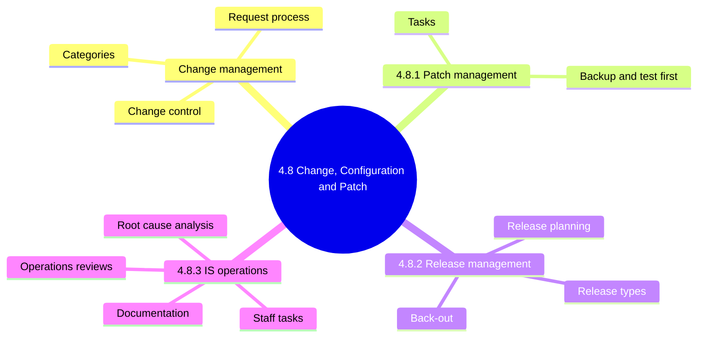
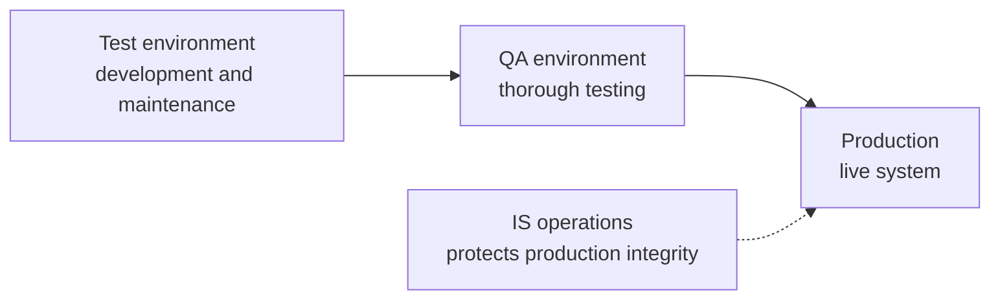
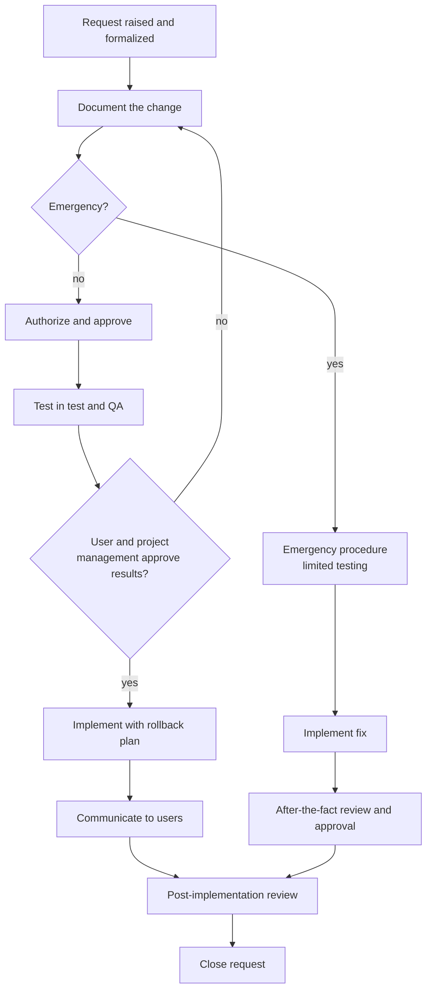
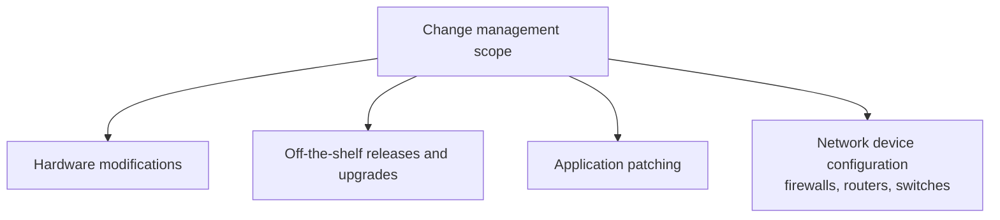
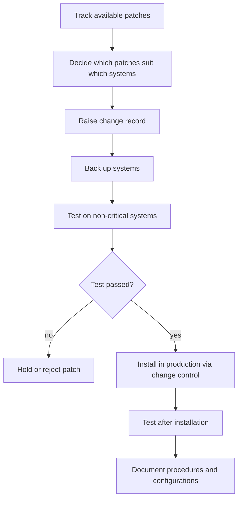
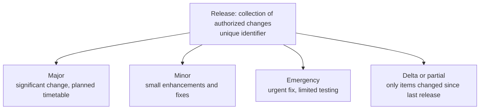
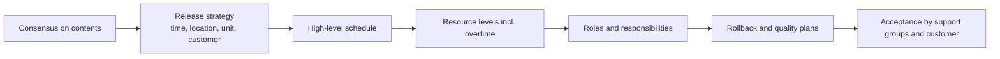
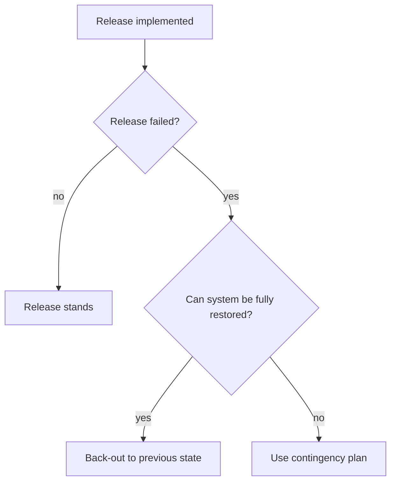
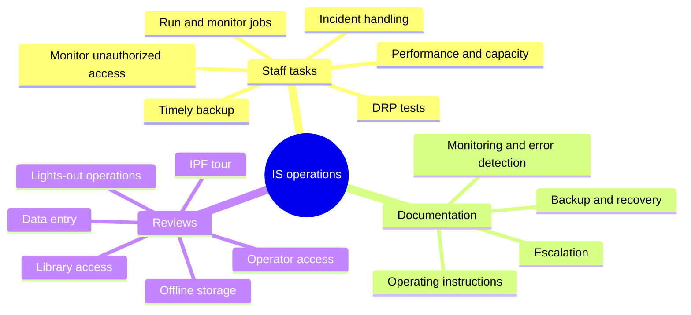
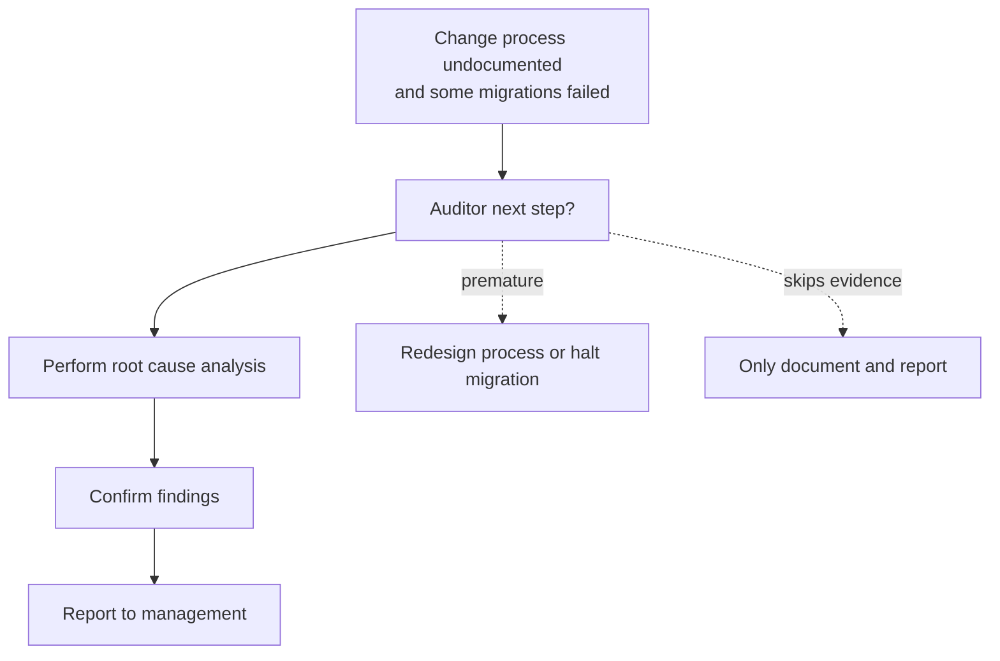

# 4.8 IT Change, Configuration and Patch Management - Diagrams

[← Domain 4](../README.md) | [Study notes](../Study-Notes/4.8-Study-Notes.md)

> Markers: 📓 = in my notes, ⭐ = frequently tested, ➕ / ⚠ Check = unverified.

### Section map

### 4.8 Change management (intro)

Change control moves changes through environments in controlled steps.

Change request lifecycle with the emergency path.

Change categories and what the auditor checks.

| Category | Auditor focus |
|---|---|
| Emergency | Documented procedure; after-the-fact review and approval |
| Major | Full request process with testing |
| Minor | Follows its own procedure; check evidence |

Scope of change management.

<b>Assurances the procedures must give</b>

- Relevant personnel know of the change and its timing.
- Documentation is complete, current and compliant.
- Job preparation, scheduling and operating instructions are established.
- User and project management approve test results.
- Data file and system conversion accurate, complete, approved.
- Operations personnel test and approve turned-over jobs.
- Legal and compliance aspects are considered.
- Risk reviewed and rollback plan developed.

<b>Exam traps and example</b>

- Strongest evidence: testing, approval, documentation before production move.
- A change without a rollback plan is a design weakness.
- Speed of delivery never outranks control.
- Emergency changes still need after-the-fact review.
- Watch for routine changes mislabeled as emergencies.
- ⚠ Check: whether IS operations is "final approver" or only "often" is.
- Example: a firewall rule edited with no ticket is a control gap.

### 4.8.1 Patch management

<b>Definitions and risks</b>

- Patch: code change fixing a flaw or adding improvement.
- Patch management: acquire, test, install patches.
- Part of change management; patches need change records.
- Automation tools exist but do not remove testing and approval.
- Patches can be ineffective and cause more problems.
- Unpatched systems are an exploitable weakness.
- ⚠ Check: no patch timelines are stated in the manual.

<b>Exam traps</b>

- Best response to a new patch: test first, deploy via change control.
- Applying immediately to production is wrong.
- Never patching to avoid risk is wrong.

### 4.8.2 Release management

| Type | Key points |
|---|---|
| Major | Supersedes earlier minor upgrades; comprehensive testing |
| Minor | Supersedes emergency fixes; full process, less effort |
| Emergency | Avoid; raises risk of introducing errors |
| Delta | Chosen when time, space or testing resources limited |

Release planning steps.

Back-out decision.

<b>Exam traps</b>

- Emergency release acceptable only when needed, with after-the-fact review.
- Delta release is partial; do not confuse with major.
- Rollback planning belongs before release, not after failure.
- Missing release identifier weakens traceability.

### 4.8.3 IS operations

| Review area | What to verify |
|---|---|
| Operator access | Limited files; no source code or fix utilities |
| Library | Librarian has no hardware access; sign-in and sign-out logs |
| Offline storage | Labeled, offsite, encrypted in transit, inventory kept |
| Data entry | Signed inputs, batch totals, keying and review separated |
| Lights-out | Secured remote console; errors always notify operator |

<b>Exam traps</b>

- Operators, librarians and programmers hold separate access.
- Lights-out risk centers on console access and hidden errors.
- Logging with independent review compensates when duties cannot be separated.
- Operator access to source code breaks segregation of duties.

Root cause analysis scenario 📓

### Quick recall

| Fact | Detail |
|---|---|
| ⭐ Order of movement | Test, then QA, then production |
| ⭐ Patch rule | Backup, test on non-critical, then change control |
| ⭐ Emergency release | Limited testing; avoid; after-the-fact review |
| ⭐ Back-out | Plan before release |
| Release identifier | Unique; supports configuration management |
| Delta release | Only items modified since last release |
| Library | Librarian has no hardware access |
| 📓 Undocumented change and failed migrations | Root cause analysis first |
