# 4.9 Operational Log Management - Diagrams

[← Domain 4](../README.md) | [Study notes](../Study-Notes/4.9-Study-Notes.md)

> Markers: 📓 = in my notes, ⭐ = frequently tested, ➕ / ⚠ Check = unverified.

### Section map

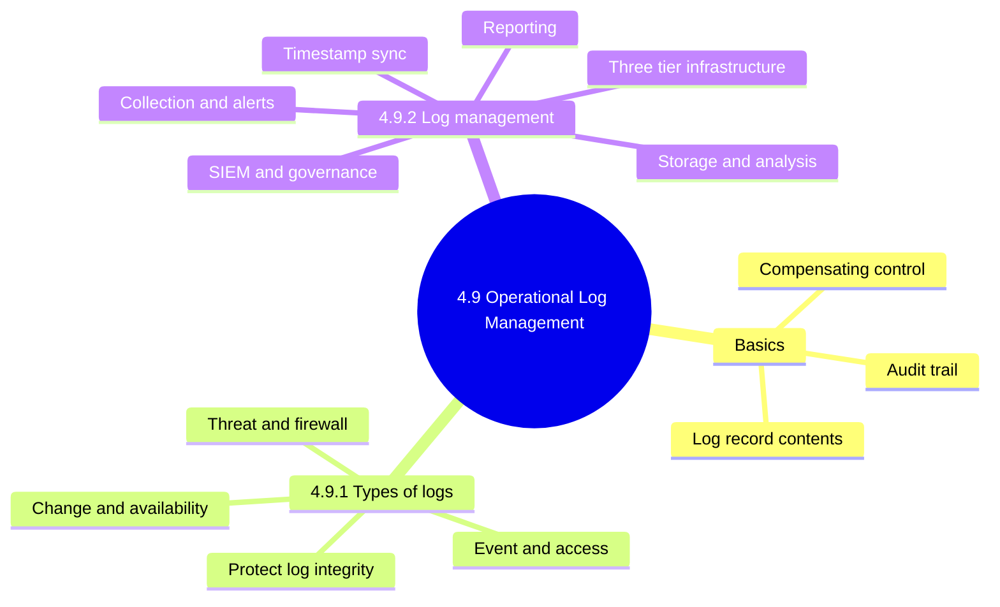

### 4.9 Basics

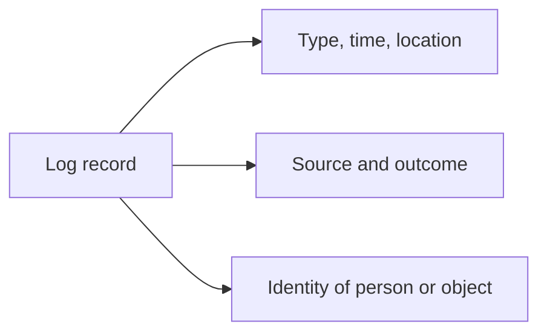

<b>Definitions and exam traps</b>

- Log (audit trail): recorded history of activities and events.
- Log monitoring can be a compensating control.
- Example: small IT team reviews admin logs instead of segregating duties.
- Monitoring logs is detective or compensating, not preventive.
- Compensating means the primary control is impossible.
- Missing fields weaken accountability and forensic value.

### 4.9.1 Types of logs

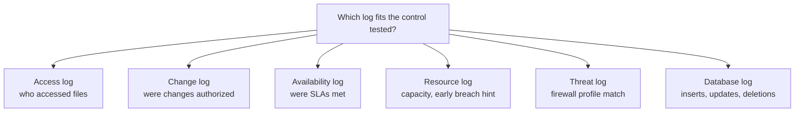

| Log | Records | Use |
|---|---|---|
| Event | Traffic, logins, failed passwords | Often detective |
| Server | One server's activity over a period | Activity review |
| System | OS startup, changes, shutdowns, errors | OS events |
| Access | People or bots accessing files | Compensating control |
| Change | Chronological changes | Change management |
| Availability | Uptime and performance | SLA check |
| Resource | Connectivity issues, capacity limits | Sizing, early breach sign |
| Threat | Firewall profile matches | Early warning |
| Database | Inserts, updates, deletions | Integrity, security |
| Error | Problem details | Resolution |
| Firewall | Inbound and outbound traffic | Threat identification |
| Operating system | File versions, scheduled programs, utility use | OS integrity |
| Application | Efficiency, authorized changes | Detect unauthorized use |
| Access control | Controls over critical files and programs | Control evaluation |

Protecting log integrity.

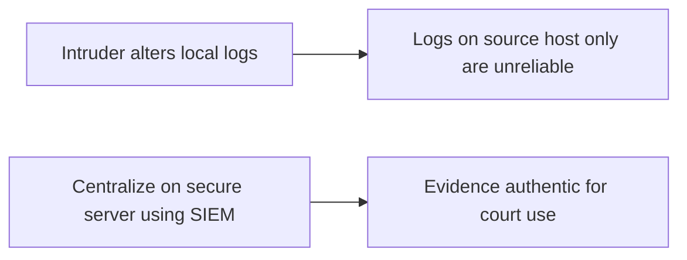

<b>Exam traps</b>

- Threat log means firewall profile matches.
- Availability log answers SLA questions.
- Change log answers authorization-of-change questions.
- Best tamper protection: centralization, not stronger local admin passwords.
- ⚠ Check: manual says event logs "often" detective, not always.

### 4.9.2 Log management

Six-step log management cycle. The manual figure is illegible, so step names below are unverified (➕).

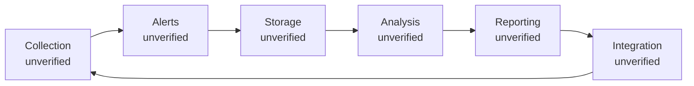

Three-tier infrastructure.

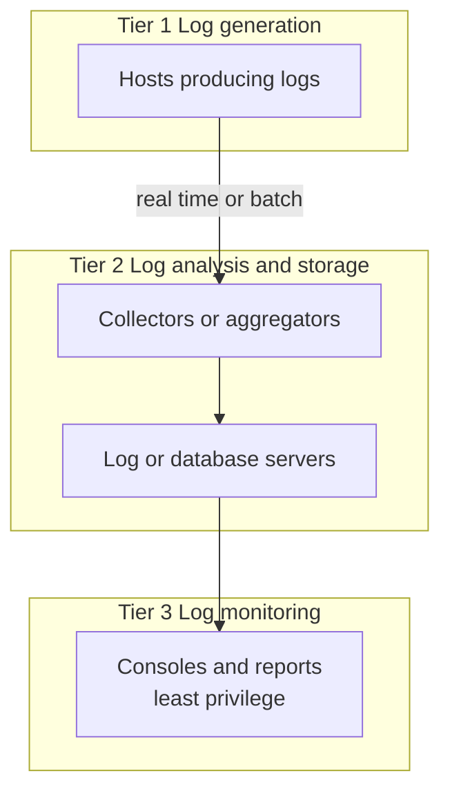

Alert handling.

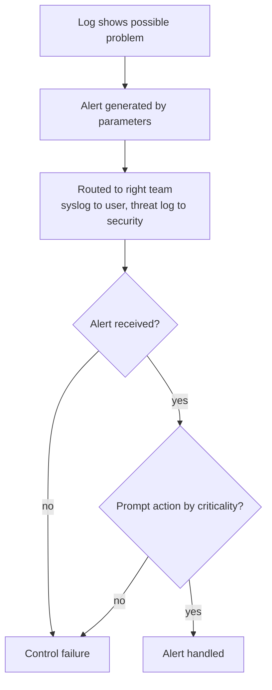

Analysis stages.

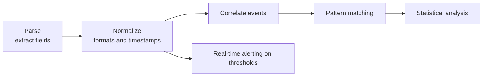

Reporting flow.

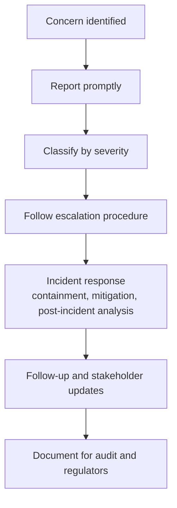

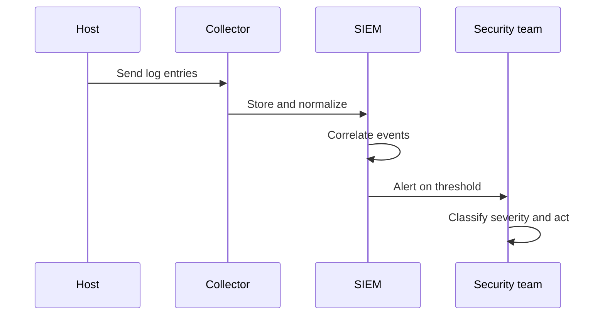

Storage and protection controls.

| Control | Purpose |
|---|---|
| Centralized system | Easier analysis and correlation |
| Retention policy | Set by regulation and business need |
| Encryption and offsite backup | Confidentiality, integrity, redundancy |
| Role-based access | Only authorized personnel access logs |
| Automated backup | Prevents loss from failure |

Timestamp synchronization 📓⭐

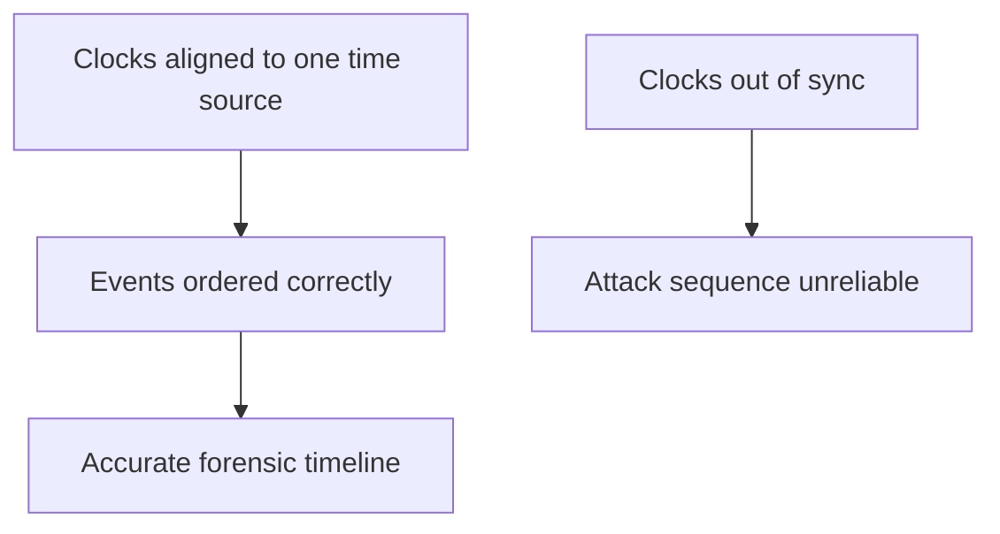

SIEM and governance integration.

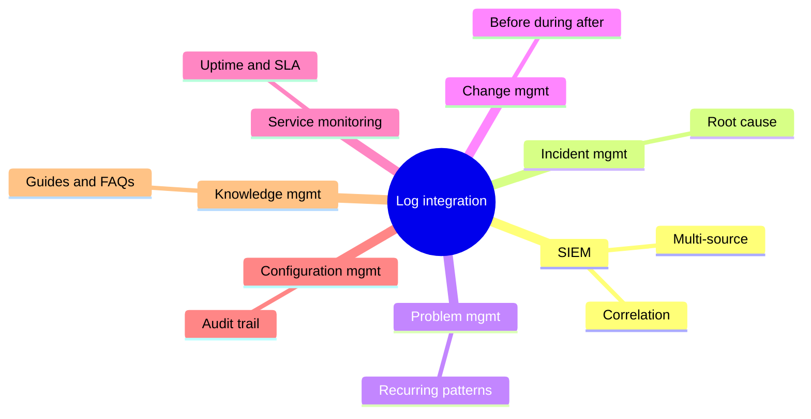

<b>Exam traps</b>

- Log lacking user identity cannot support accountability.
- Alerts never acted on is a control failure.
- Retention length set by regulation, not storage convenience.
- Administrators of monitored hosts should not control their own logs.
- Correlation needs normalized formats and synchronized timestamps.
- Report as soon as identified; do not wait for full analysis.
- Clock skew harms forensics, not storage or indexing.
- SIEM extends log management; it does not replace good logs.
- ➕ Minimum content: timestamp, user, event (⚠ Check: notes say manual states it).

<b>Examples</b>

- Failed logins on many hosts, then one success, then large transfer.
- Nightly data volume far above normal standard deviation.
- Servers differing by minutes make cross-host sequence unreliable.

### Quick recall

| Fact | Detail |
|---|---|
| ⭐📓 Timestamp sync | Needed for forensic timelines |
| ⭐ Tamper protection | Centralize logs on secure server using SIEM |
| Compensating control | Log review when segregation of duties impossible |
| Three tiers | Generation, analysis and storage, monitoring |
| Auditor alert checks | Parameters, receipt, prompt action |
| Threat log | Firewall profile match, early warning |
| Availability log | Shows whether SLAs met |
| SIEM | Adds correlation and real-time monitoring to logs |
