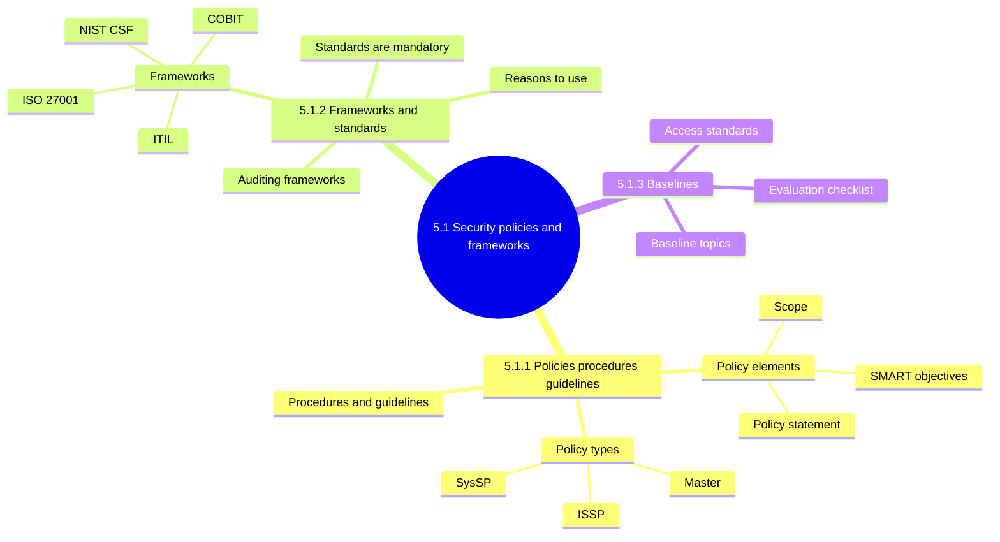
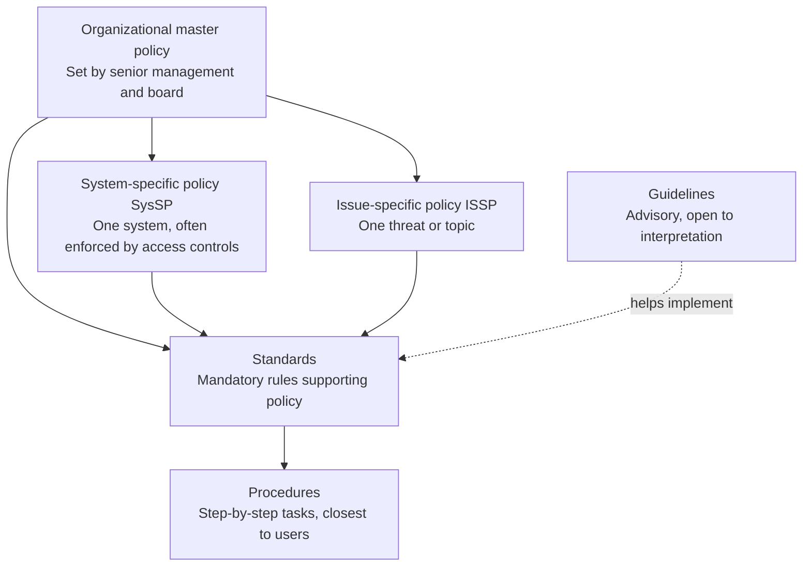
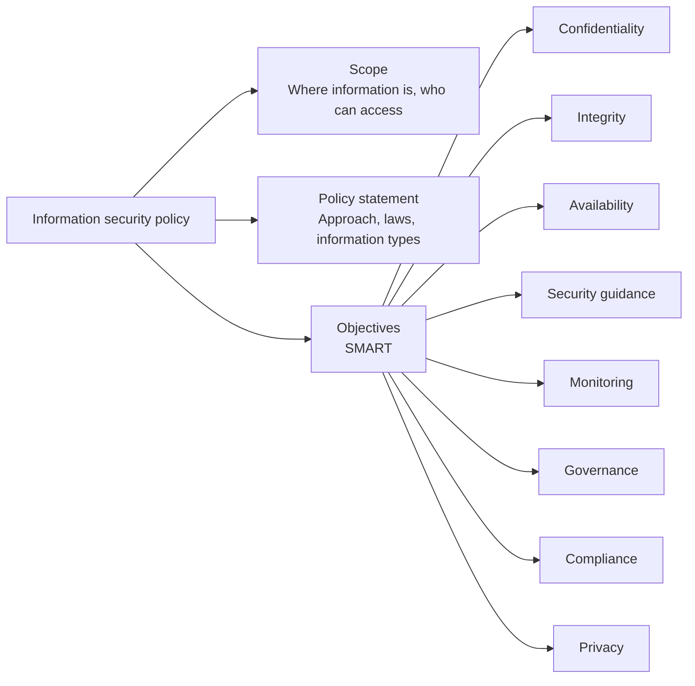
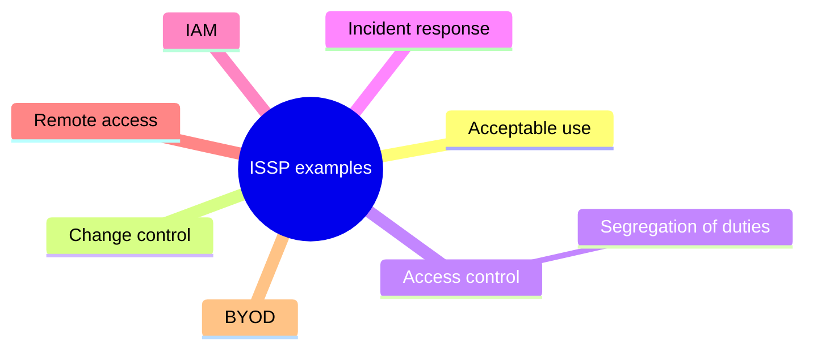
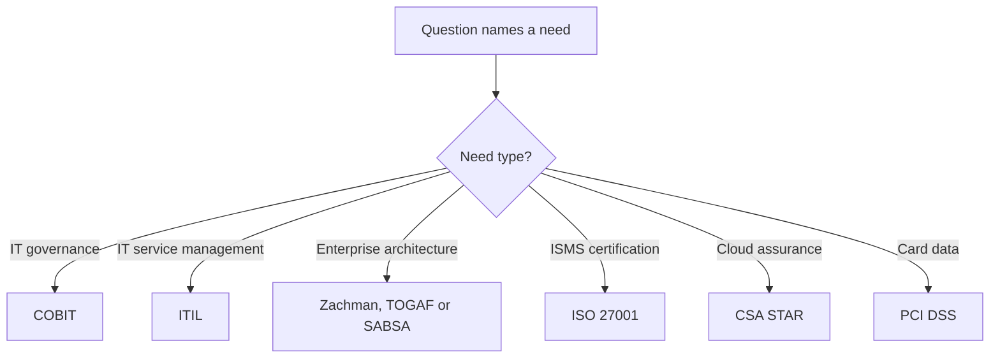
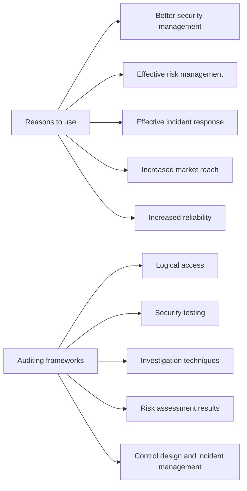
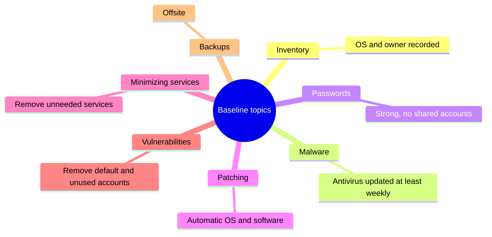
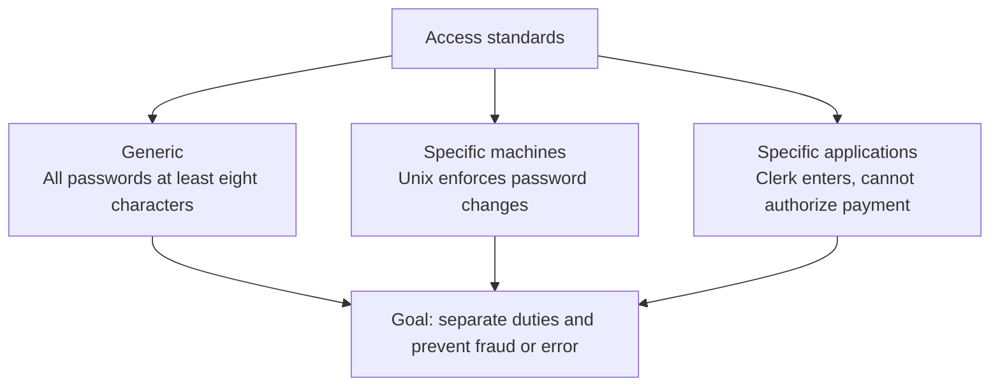

# 5.1 Information Asset Security Policies, Frameworks, Standards and Guidelines - Diagrams

[← Domain 5](../README.md) | [Study notes](../Study-Notes/5.1-Study-Notes.md)

> Markers: 📓 = in my notes, ⭐ = frequently tested, ➕ / ⚠ Check = unverified.

## Section map

### 5.1.1 Policies, procedures and guidelines

Policy hierarchy (documentation chain):

Policy anatomy:

Document comparison:

| Document | Mandatory? | Detail level | Example |
|---|---|---|---|
| Policy | Yes | High-level what and why | Encrypt sensitive email |
| Standard | Yes | Specific rules | Approved algorithm named |
| Procedure | Yes, followed as written | Step by step | Setup checklist |
| Guideline | No, advisory | Recommendations | Best-practice tips |

Issue-specific policy examples:

<b>Characteristics of a good policy</b>

- Executive support gives budget and authority.
- Business-driven, simple, accessible, strategic, professional.
- Integrated with issue-specific policies.
- Penalties for noncompliance make it enforceable.
- Flexible and regularly updated.
- Revisions record date and responsible department.

<b>Exam traps</b>

- ⭐ Policy owned only by IT or never reviewed is a finding.
- ⭐ Penalties and accessible are often tested as missing elements.
- SysSP covers one system; ISSP covers one issue.
- Standards are mandatory; guidelines are advisory.
- ⭐ Reviewing access policy mainly checks segregation of duties.
- Auditor checks policy date of last update.

<b>Example</b>

- "Restore payroll within four hours" is SMART.
- "Keep systems safe" is not SMART.
- Payroll system security policy is a SysSP.

### 5.1.2 Information security frameworks and standards

Framework comparison:

| Framework | Purpose | Exam hook |
|---|---|---|
| COBIT 📓 | IT governance, minimize IT risk | Governance, not a control catalog |
| ISO/IEC 27001 ➕ | Specifies an ISMS | ISMS certification |
| NIST CSF ➕ | Manage cybersecurity risk, any sector | Flexible, sector-neutral |
| ITIL | IT service management | Service lifecycle |
| Zachman | Classifies enterprise architectures | Architecture model |
| TOGAF | Aligns business and architecture objectives | The Open Group |
| SABSA | Risk-driven security architecture | Strategy to measure lifecycle |
| CIS CSC | Technical and operational controls | No risk management |
| PCI DSS | Cardholder data security | Covers outsourced payments |
| CSA STAR | Cloud provider assurance | Self-assessment, attestation |
| CCM | 197 objectives in 17 domains | Cloud control set |

Choosing a framework (exam logic):

Reasons to use a framework and how to audit it:

<b>Standards: advantages</b>

- Repeatable, consistent security management.
- Objective decisions based on best practice.
- Common terms and definitions.
- Product functionality and compatibility.

<b>Exam traps</b>

- COBIT is governance, not a security control catalog.
- CIS CSC does not address risk management.
- Framework adoption alone is not assurance; check real results.
- Framework choice depends on location, industry, compliance.
- ⚠ Check: ISO 27002 as companion to 27001 is unverified.

### 5.1.3 Information security baselines

Baseline topics (Figure 5.3):

Baseline evaluation checklist (Figure 5.4):

| Area | Check |
|---|---|
| Inventory | Hardware and software inventory current |
| Malware | Signatures current, updates automatic |
| Passwords | Strong policy, MFA for cloud systems |
| Patching | Tested before applying, machine backed up first |
| Services | Unneeded default services removed |
| Vulnerabilities | Scan findings resolved |
| Backup and BCP | Offsite, restore tests, immutable backups |
| IT staff | Job descriptions include security duties |
| Privacy | Privacy policy and nondisclosure agreements |

Access standards levels:

<b>Definitions</b>

- Baseline: minimum security level a system must meet.
- Baseline is the comparison point when integrity is questioned.
- Example: minimum C2 evaluation standard.
- ⚠ Check: C2 expansion unverified.

<b>Exam traps</b>

- Untested patches and unrestored backups outrank missing paperwork.
- Default-enabled services widen attack surface.
- Access standards exist to enforce segregation of duties.

### Quick recall

| Fact | Detail |
|---|---|
| ⭐ Documentation chain | Policy, standard, procedure, guideline |
| ⭐ Standards vs guidelines | Mandatory vs advisory |
| ⭐ Policy approval | Senior management and board; check currency |
| ⭐ Access policy review | Segregation of duties |
| ⭐ SysSP vs ISSP | One system vs one issue |
| COBIT | IT governance |
| ISO 27001 | ISMS |
| CCM | 197 objectives, 17 domains |
| Baseline | Minimum security level |
| Antivirus update | At least weekly |
