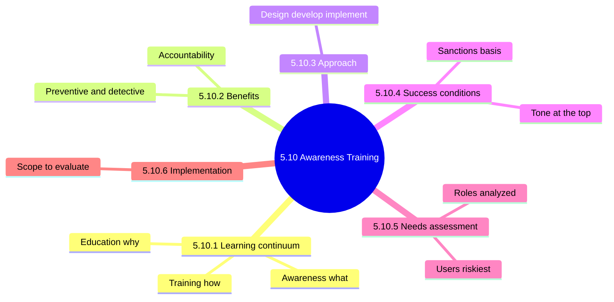
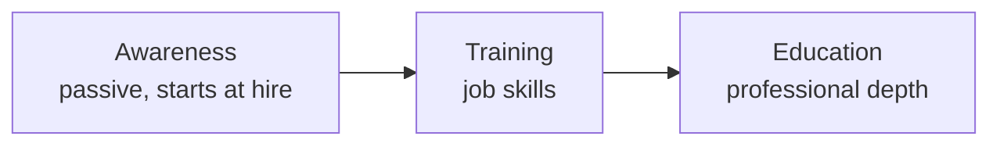
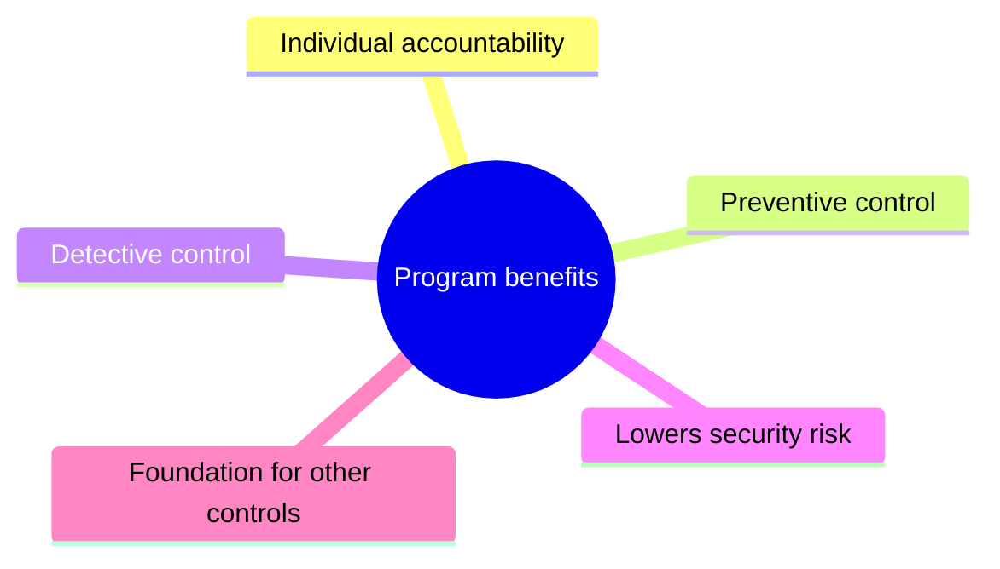
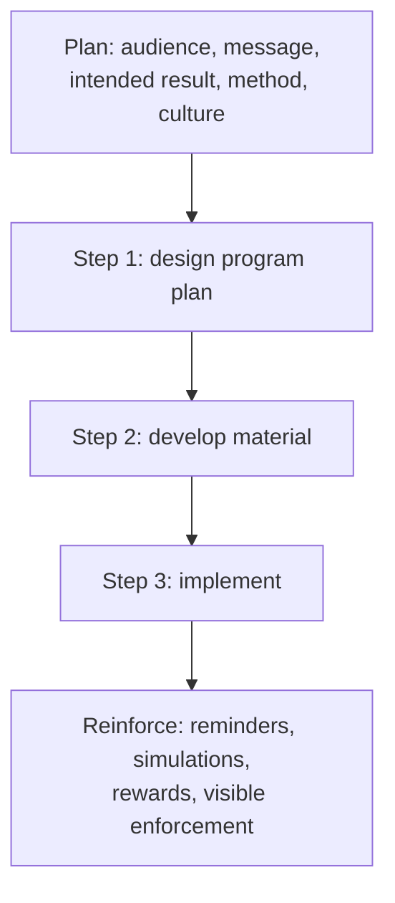
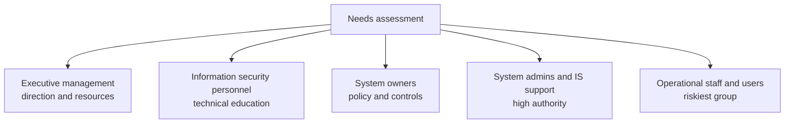
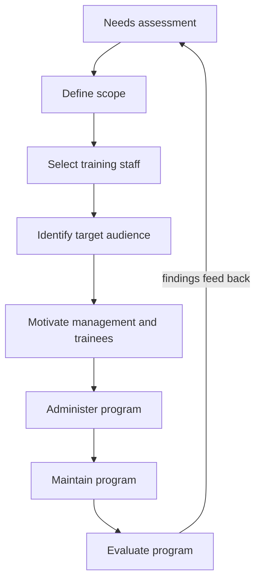
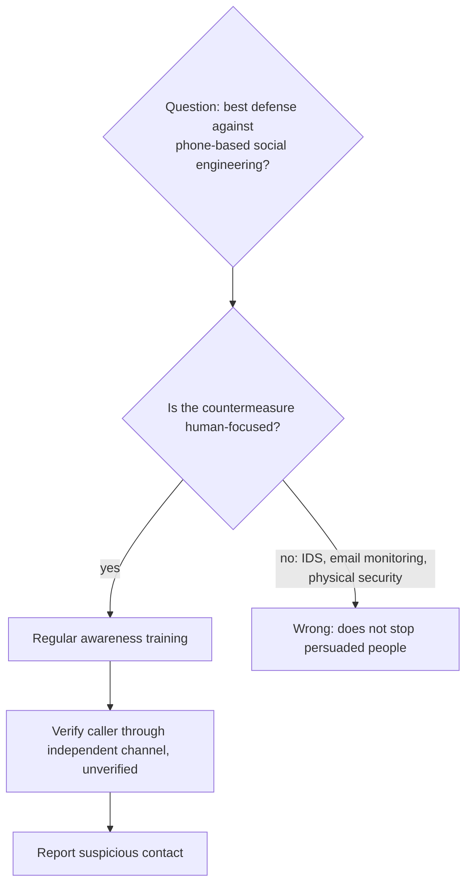

# 5.10 Security Awareness Training and Programs: Diagrams

[← Domain 5](../README.md) | [Study notes](../Study-Notes/5.10-Study-Notes.md)

> Markers: 📓 = in my notes, ⭐ = frequently tested, ➕ / ⚠ Check = unverified, shown as "(unverified)".

## Section map

### 5.10.1 Information security learning continuum

| Level | Question | Audience | Time | Methods | Testing |
|---|---|---|---|---|---|
| Awareness | What | All staff | Short | E-learning, videos | Quizzes, true/false |
| Training | How | Role-based | Intermediate | Instructor-led, hands-on | Problem solving |
| Education | Why | Security professionals | Long | Seminars, research | Essays, architecture |

<b>Exam traps</b>

- Keyword match: what is awareness, how is training, why is education.
- Do not choose education for general staff.
- Quizzes test awareness; hands-on tests training.

### 5.10.2 Benefits of a program

<b>Exam traps</b>

- Awareness is preventive and detective, not only corrective.
- It complements technical controls; never replaces them.
- Best practice: train before deploying any security solution.

### 5.10.3 Approach

<b>Mechanisms for raising awareness</b>

- Computer-based training; email tips; written policies.
- Nondisclosure statements; newsletters, videos, posters, login reminders.
- Simulated incidents such as phishing tests.
- Reward employees who report suspicious events.

<b>Exam traps</b>

- New hires trained before access; access first is a weakness.
- Rewarding reporters encourages reporting; punishing mistakes discourages it.

### 5.10.4 Conditions for a successful program

| Condition | Note |
|---|---|
| Security culture | Shared vigilant mindset |
| Policy | Covers awareness, training, education |
| Roles and responsibilities | Everyone informed |
| Monitoring and review | Ongoing processes |
| Organization-wide focus | Not only IT |
| Tone at the top | Management sets behavior |
| Simple rules of behavior | Plain language |
| Penalties and sanctions | Basis for enforcement |
| Rollout plan | After needs assessment |

<b>Exam traps</b>

- Needs assessment comes before rollout planning.
- Tone at the top beats posters as key success factor.

### 5.10.5 Conducting a needs assessment

<b>Information sources</b>

- Interviews, security surveys, existing training review.
- Metrics, such as percent trained in social engineering.
- Security plans, access databases, internal audit findings.
- Analysis of events, incidents, attacks; industry trends.

<b>Exam traps</b>

- Highest-risk audience is regular users.
- Incident analysis shows who needs targeted training.
- Tailor training to role; not everyone needs the same.

### 5.10.6 Implementing an awareness and training program

Program lifecycle

Evaluation methods: questionnaires, observation, testing, incidents before and after, focus groups, interviews.

Social engineering response decision tree 📓⭐

<b>Exam traps</b>

- ⭐ Regular awareness training is best defense against phone-based social engineering.
- Technical tools like IDS do not stop persuaded people.
- Email monitoring and physical security miss voice manipulation.
- Return on investment is hard to quantify; use retention and incident trends.
- Outline lists Maintain and Evaluate separately (⚠ Check, unverified).

### Quick recall

| Fact | Answer |
|---|---|
| ⭐ Awareness / training / education | What / how / why |
| ⭐ Phone social engineering | Regular awareness training |
| New hires | Train before access |
| First step | Needs assessment |
| Riskiest group | Operational staff and users |
| Key success factor | Tone at the top |
| Awareness control type | Preventive and detective |
| Effectiveness evidence | Incidents drop after training |
