# 5.11 Information System Attack Methods and Techniques: Diagrams

[← Domain 5](../README.md) | [Study notes](../Study-Notes/5.11-Study-Notes.md)

> Conceptual only, for audit and defense. No exploit steps. Items marked "(unverified)" carry a Check or plus flag in the study notes.

## Section map

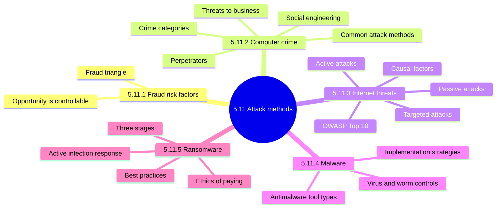

### 5.11.1 Fraud risk factors

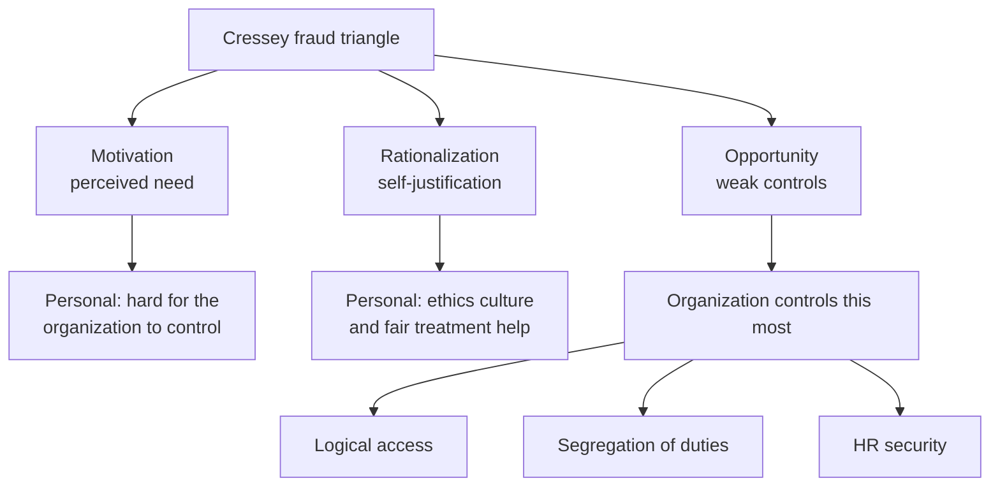

| Element | Who controls it | Audit focus |
|---|---|---|
| Motivation | Mostly the individual | Rarely visible |
| Rationalization | Mostly the individual | Hard to detect |
| Opportunity ⭐ | The organization | Control weaknesses, missing detection |

<b>Definitions and exam traps</b>

- Fraud: dishonest methods used to take something valuable.
- Remove or weaken one side to reduce fraud likelihood.
- Trap: pick the element the organization controls, which is opportunity.
- Poor oversight and abuse of position also create opportunity.
- Example: gambling debts create pressure; weak SoD supplies the chance.

### 5.11.2 Computer crime issues and exposures

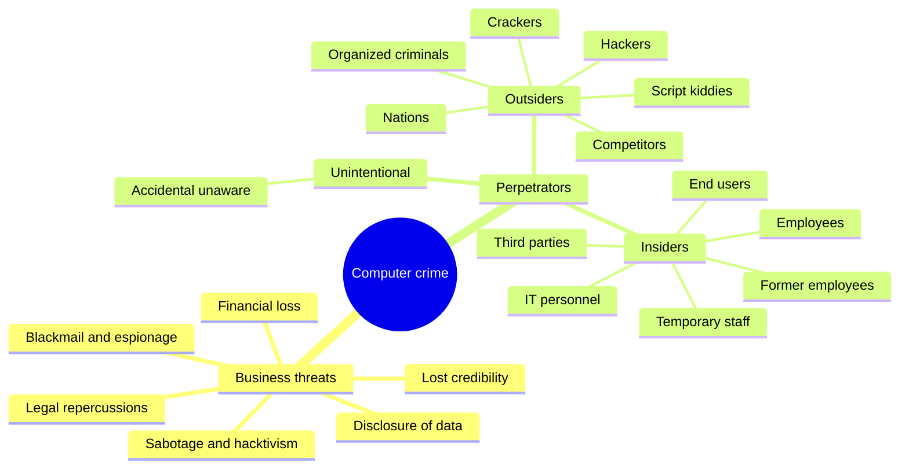

| Category (Figure 5.57) | Role of the computer | Example |
|---|---|---|
| Target | Specific computer attacked | DoS, hacking |
| Subject | One computer used against another | DDoS, malware |
| Tool | Used to commit crime, data is target | Fraud |
| Symbolizes crime | Lures user into giving information | Phishing, fake sites |

<b>Perpetrator notes and exam traps</b>

- Hackers test limits; crackers have malicious intent.
- Script kiddies run tools written by others.
- IT personnel have easiest access; SoD and supervision reduce abuse.
- Former employees: block access at termination, watch for back doors.
- Trap: classify by role of the computer, not by harm caused.
- Attackers often chain several methods together.
- Crime versus abuse changes the response; get legal assistance.
- If a crime is suspected, protect evidence and report.

#### Social engineering 📓

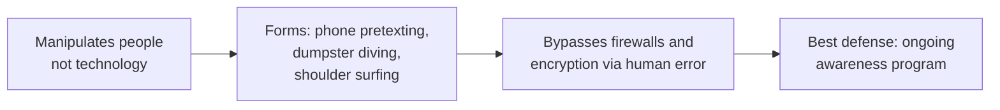

#### Attack taxonomy (Figure 5.58 methods grouped)

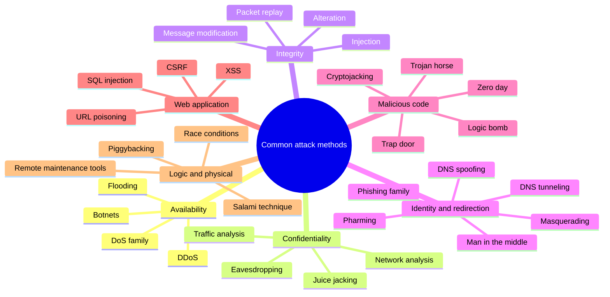

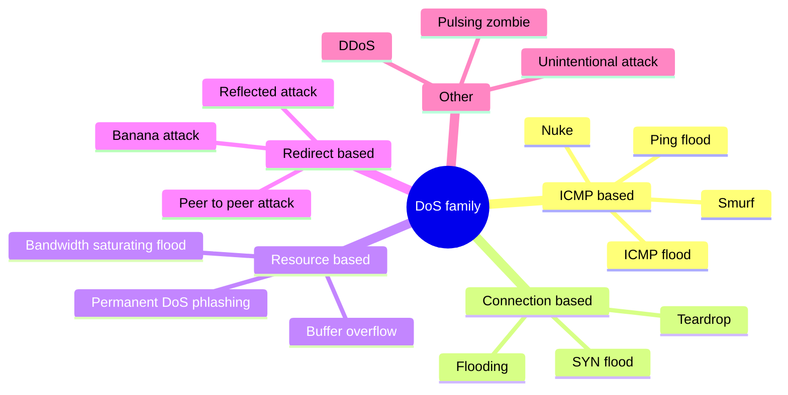

<b>DoS and phishing definitions</b>

- DoS targets availability.
- Smurf: misconfigured devices relay packets to all hosts via broadcast.
- SYN flood: forged TCP requests leave half-open connections.
- Teardrop: malformed overlapping IP fragments.
- Phlashing: damages hardware until replaced.
- Reflected attack: forged victim address makes replies flood the victim.
- Unintentional attack: popularity spike, no malice.
- DDoS: many compromised systems flood one target.
- Spear phishing targets a subset; whaling targets leadership.
- Smishing uses SMS; vishing uses phone calls.
- (unverified) Manual lists brute force under DoS; 5.11.3 lists it as active.

#### Attack-to-control mapping

| Attack | What it does | Control named in notes |
|---|---|---|
| Alteration | Unauthorized change to data or code | Cryptographic hash ⭐ |
| Eavesdropping | Reads traffic | Encryption in transit |
| Phishing family | Fraud posing as trusted entity | User awareness, email filtering |
| Social engineering | Manipulates people | Ongoing awareness program ⭐ |
| Pharming | Redirects via DNS poisoning | Antipharming; antivirus cannot stop it |
| DNS spoofing | Altered records, fake site | Keep DNS servers updated |
| DNS tunneling | Hides data in DNS queries | Block malicious DNS, denylist, analyze queries |
| SQL injection and XSS | Malicious input to app | Input validation and sanitization |
| CSRF | Forces logged-in user actions | Notes give no control (unverified) |
| URL poisoning | Reaches admin pages | MFA on sensitive areas |
| Race condition | Gap between check and use | Careful programming, administration |
| Logic bomb and back door | Hidden triggered or access code | Threat vector analysis, SoD, code audits |
| Zero day | Unpatched unknown flaw | Patching, sandboxing, updated IRP |
| Cryptojacking | Hijacks CPU to mine coins | Monitor CPU, staff reporting |
| Juice jacking | Public USB port abuse | Avoid public ports; data-blocking cable (unverified) |
| Man in the middle | Sits between two parties | Mutual authentication and encryption (unverified) |
| Salami technique | Slices tiny sums | Code review, reconcile totals (unverified) |
| Piggybacking | Follows through door | Physical access controls |
| Remote maintenance tools | Weak tools give elevated access | Secure the tools |
| Resource enumeration | Lists shares and privileges | Least privilege, restricted shares |
| Traffic analysis | Infers from patterns | Encryption alone does not stop it |

#### What it is, how detected, which control stops it

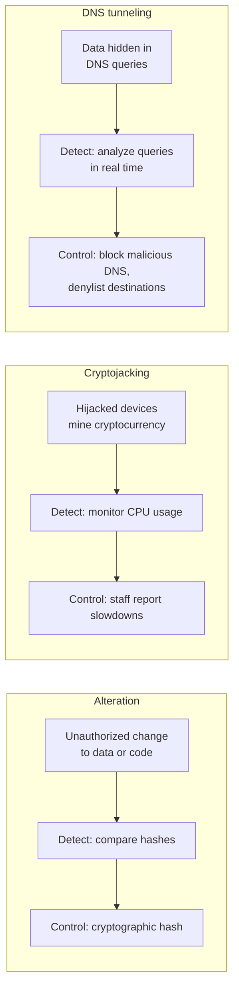

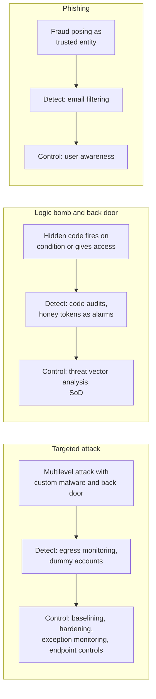

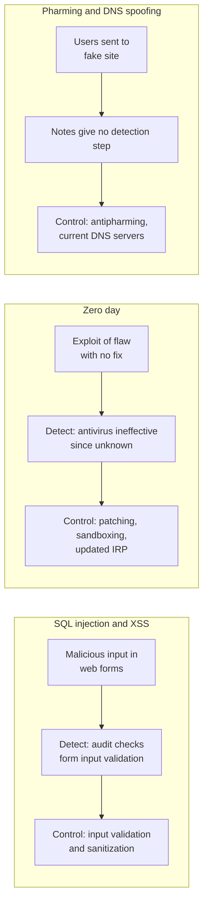

<b>More attack definitions</b>

- Botnet: zombie computers run by an attacker; spread by worms or Trojans.
- Interrupt attack: makes the OS run a particular system call.
- Masquerading: presenting a false identity; IP spoofing forges addresses.
- Message modification: capture, then alter, delete, reorder, or delay.
- Packet replay: capture passively, reinsert actively; strong against automated receivers.
- Network analysis: footprinting and port scanning to profile a target.
- Race condition: exposure grows with the check-to-use time gap.
- Salami: truncates more digits than rounding down.
- CSRF: ordinary victim loses funds; admin victim compromises the application.
- Trap: XSS exploits trust in the site; CSRF exploits trust in user (unverified).
- Worm needs no host program; virus attaches to one.
- Spyware collects keystrokes and card numbers, then transmits.
- (unverified) Pharming and DNS spoofing overlap in the manual.

### 5.11.3 Internet threats and security

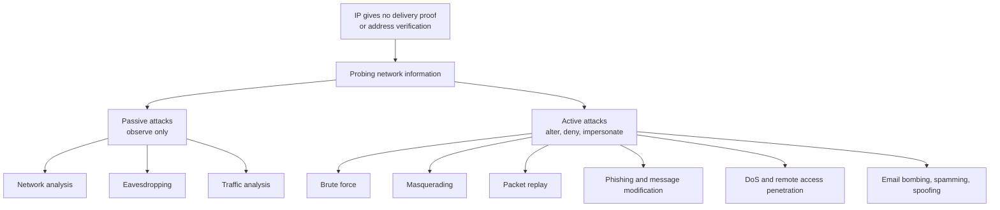

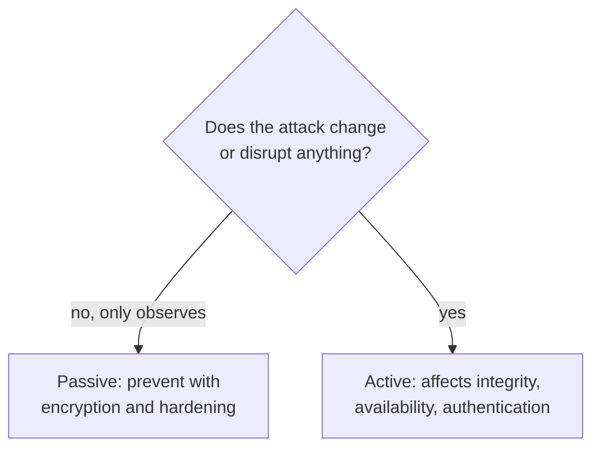

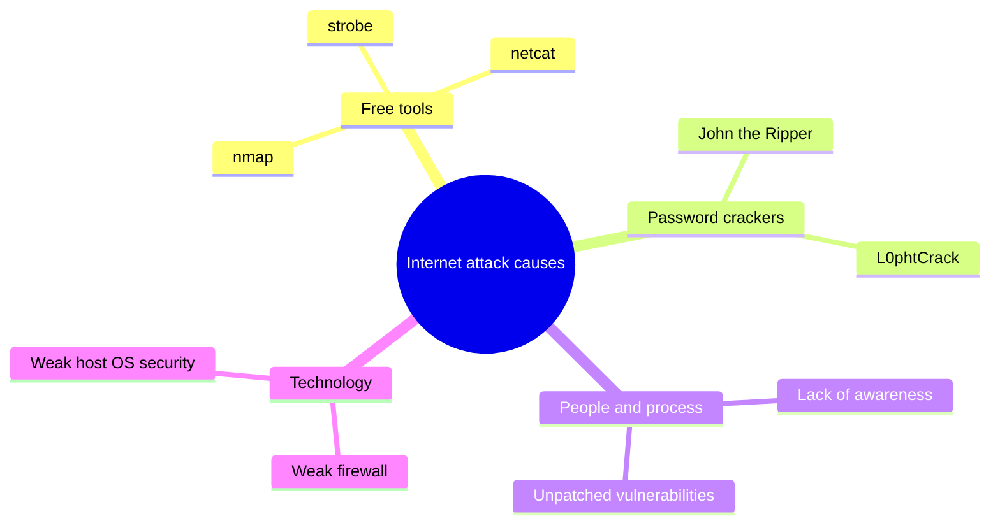

<b>Targeted attacks and OWASP</b>

- Targeted attack: custom malware opens a back door, data leaves slowly.
- Detective: egress monitoring and dummy accounts.
- Preventive: baselining, hardening, exception monitoring, endpoint controls.
- OWASP Top 10: most common and impactful web application flaws.
- Use OWASP as a checklist for web testing and review.
- Trap: traffic analysis is passive; packet replay is active.

### 5.11.4 Malware

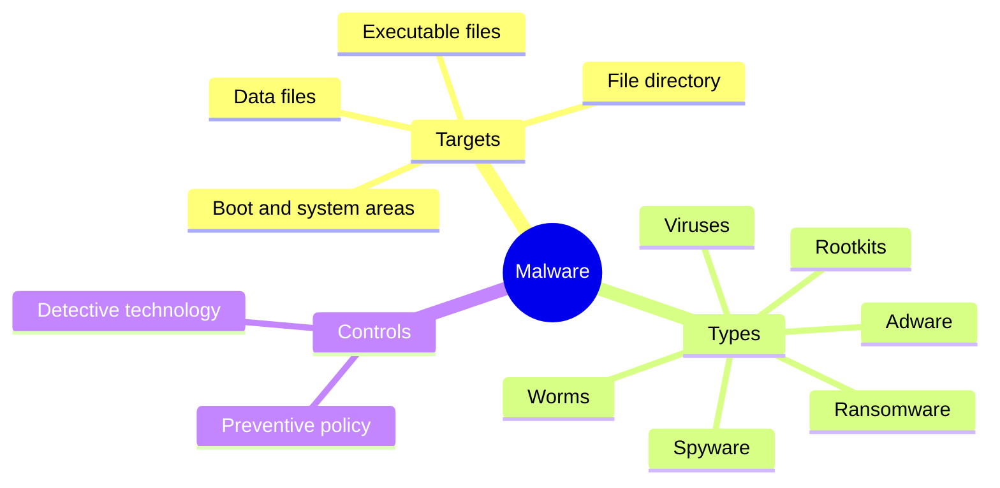

| Tool type | How it works | Limit |
|---|---|---|
| Scanner, signatures | Matches known code strings | Misses unknown malware |
| Heuristic scanner | Statistical probability of malice | High false positives |
| Active monitor | Watches command and BIOS calls | Cannot tell user from malware requests |
| Integrity CRC checker | Compares checksums of clean programs | Detects only after infection |
| Behavior blocker | Flags abnormal actions | Most hardware tools use it |
| Immunizer | Tricks malware into skipping files | Cannot cover all malware |
| Eradication program | Removes malware | May delete infected files |
| Inoculator | Blocks program containing malware | Not covered further |

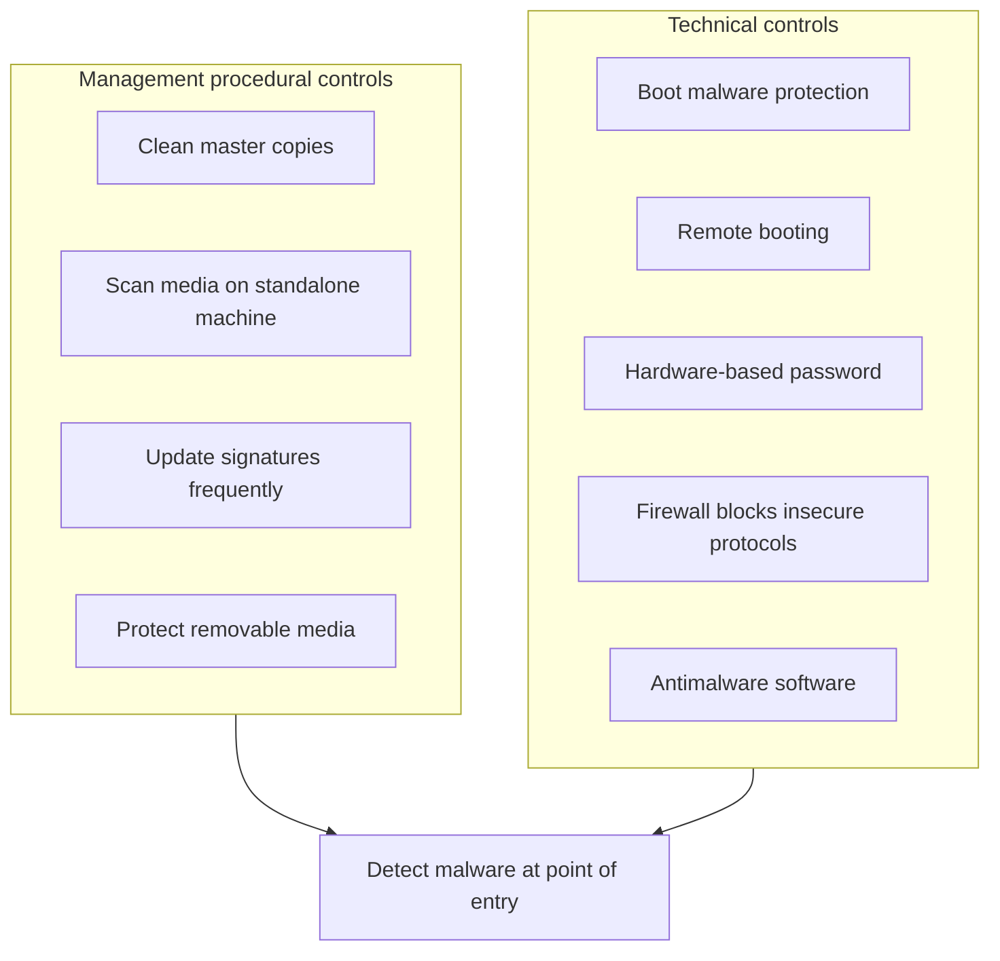

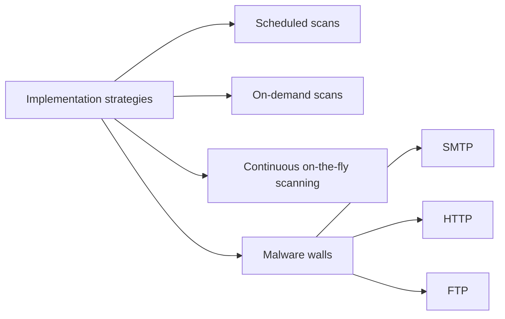

<b>Virus and worm controls and traps</b>

- Scan shareware and new software before installing.
- Vendors run demonstrations on their own machines.
- Scan selected backups once malware is detected.
- Review antimalware policy at least yearly.
- Prepare eradication and incident procedures.
- Worm runs independently; virus attaches to programs.
- A wall covers one channel; endpoint software still needed.
- Trap: signature scanners miss unknown malware; heuristics add false positives.
- Trap: CRC checkers assume files were clean at the start.
- (unverified) Manual may suggest encrypting files before execution.

### 5.11.5 Ransomware

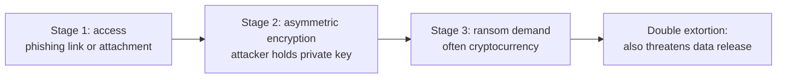

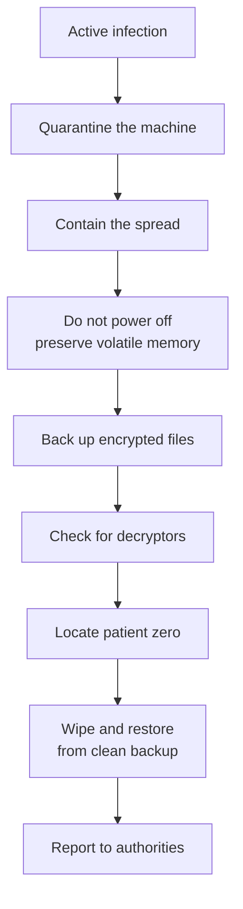

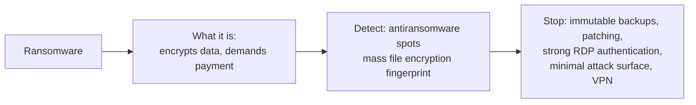

<b>Ethics, traps and notes</b>

- Examples: WannaCry and Maze.
- Backup restore does not remove the data-leak threat.
- Law enforcement urges not paying; payment encourages more attacks.
- In practice firms run cost-benefit analysis and plan for payment.
- Downside: no key supplied, or the key fails.
- Trap: ransomware seeks out and encrypts online backups.
- Trap: first actions are isolate and preserve, not power off or pay.
- (unverified) Manual defines patient zero oddly.

### Quick recall

| Fact | Detail |
|---|---|
| ⭐ Fraud triangle | Opportunity is the element organizations control |
| ⭐ Social engineering | Ongoing awareness program is best defense |
| ⭐ Alteration | Cryptographic hash is the primary defense |
| ⭐ Passive vs active | Observe only versus alter, deny, impersonate |
| Injection and XSS | Input validation and sanitization |
| Zero day | Patching, sandboxing, updated IRP |
| Malware | Preventive policy plus detective technology |
| Ransomware | Immutable backups, strong authentication, isolate and preserve |
