# 5.12 Security Testing Tools and Techniques: Diagrams

[← Domain 5](../README.md) | [Study notes](../Study-Notes/5.12-Study-Notes.md)

> Items marked "(unverified)" carry a Check or plus flag in the study notes.

## Section map

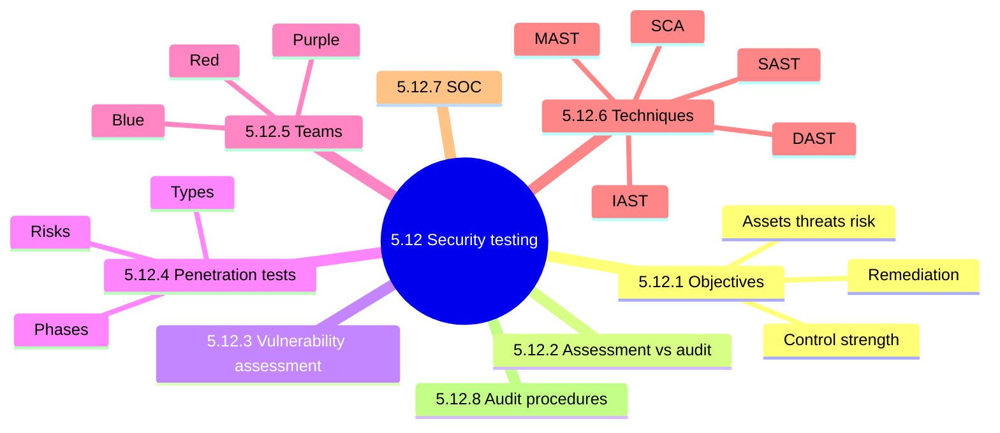

### 5.12.1 Objectives of security testing

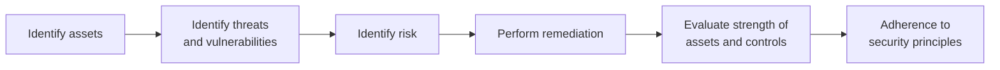

<b>Definitions and exam traps</b>

- Security testing reveals flaws in security mechanisms.
- Auditor uses test results as evidence of control effectiveness.
- Principles: confidentiality, integrity, authentication, authorization, availability, nonrepudiation.
- Trap: testing aims to prove controls work, not cause damage.
- Trap: evaluation alone is passive; testing adds remediation insight.

### 5.12.2 Security assessments and security audits

| Aspect | Security assessment | Security audit |
|---|---|---|
| Purpose | Identify, evaluate, prioritize risks | Review practice against a published standard |
| Output | Risk profile per asset | Level of compliance |
| Examples | Asset ranking, cost balance | PCI DSS, ISO/IEC 27002, HIPAA |
| Performed by | Any time, quantitative or qualitative | Internal self-report or third party |

<b>Notes and exam traps</b>

- Assessment objectives: asset value, criticality, probability, impact, cost balance.
- Audit includes review of security audit logs.
- Trap: an audit shows compliance extent; it does not test security itself.
- Trap: control cost should not exceed the impact it prevents.

### 5.12.3 Vulnerability assessments

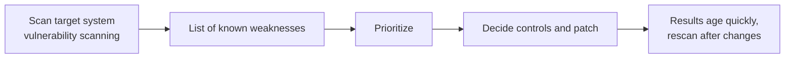

<b>Goals and exam traps</b>

- Evaluate security posture; identify and prioritize vulnerabilities.
- Assess how the environment reacts to attacks.
- Identify ways attackers could exploit weaknesses.
- Trap: a scan lists weaknesses; it does not prove exploitability.
- Trap: an old scan report is weak evidence.
- (unverified) Skill level: text says experts, manual table implies lower skill.

### 5.12.4 Penetration tests

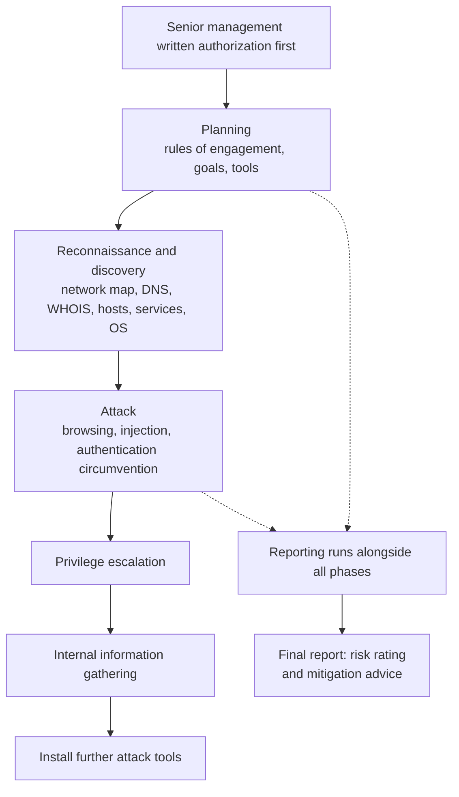

Testing types comparison.

| Aspect | Vulnerability scan | Penetration test | Ethical hacking |
|---|---|---|---|
| Goal | Find known weaknesses | Exploit them, show lateral movement | Broad attacker emulation |
| Scope | Wide and broad | Focused and deep | Unrestricted |
| Frequency | At least quarterly or after changes | Once or twice yearly | Continuous |
| Performed by | Automated tools, in-house oversight | Highly skilled, often external | Assists client security teams |
| Output | List to prioritize patching | Exploitable findings, concise report | In-depth, tactics focused |

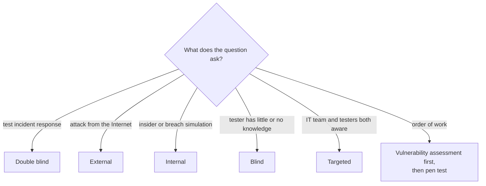

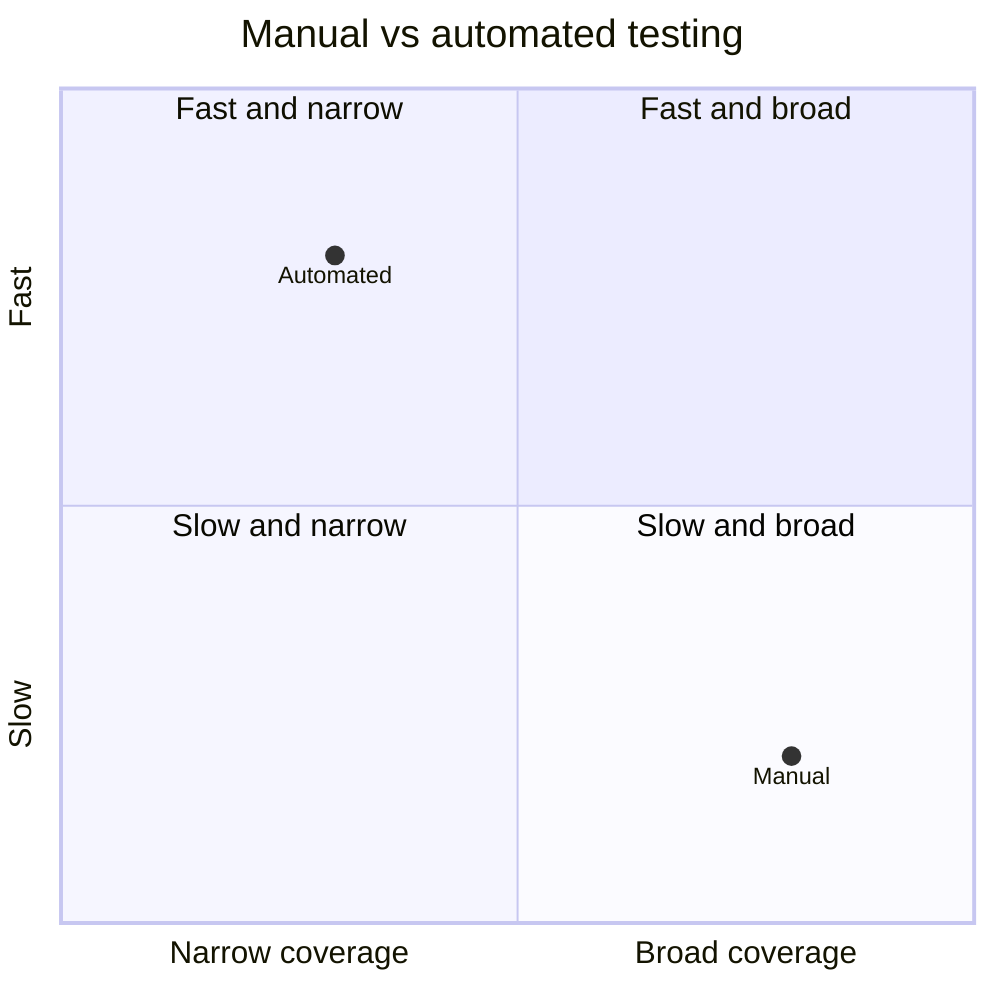

<b>Scope, risks and exam traps</b>

- Scope: IP ranges, restricted hosts, techniques, timing, source IPs, contacts, NDA.
- Risks: misses some vulnerabilities, miscommunication, unplanned escalation.
- Risks: sensitive disclosure, unqualified testers.
- Controls: vetting, NDA, clear scope, designated contacts.
- Manual: comprehensive, finds hidden flaws, slow. Automated: fast, fixed tests.
- Without permission, the whole test may be illegal. ⭐📓
- Black box test needs management awareness and defined scope. 📓
- Network diagrams are not needed for black box.
- Management decides which tests are unannounced to monitoring staff.
- Double blind: defenders also unaware; best tests incident response.
- Targeted: testers may get a limited-privilege account.
- Pen test is once-off and scoped; ethical hacking is continuous.
- Trap: automated is faster, not more thorough.
- Trap: pen test does not replace routine scanning.

### 5.12.5 Threat readiness and information security teams

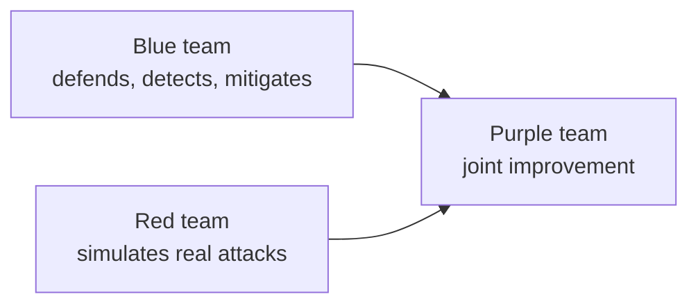

| Team | Role | Tools or style | Controls tested (unverified) |
|---|---|---|---|
| Blue | Detect and mitigate attacks, continuous | SIEM, EDR | None stated |
| Red | Test resilience by simulation, periodic | Stealthy sophisticated tools | Detective and responsive |
| Purple | Improve posture efficiently | Combines both | Detective and preventive |

Unverified: the manual's team table is garbled in the source; verify scope and control cells.

<b>Example and trap</b>

- Red team evades alerts; blue team tunes SIEM rules together.
- Trap: defender is blue, attacker simulator is red, collaboration is purple.

### 5.12.6 Security testing techniques

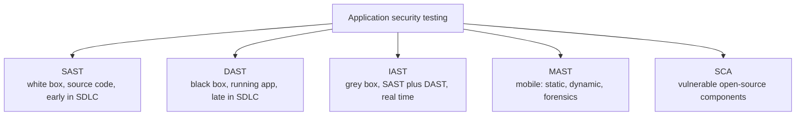

| Technique | Needs source code | Finds |
|---|---|---|
| SAST | Yes | Flaws early; no runtime flaws |
| DAST | No | Runtime flaws from attacker view |
| IAST | Inside running app | Broader rule coverage |
| MAST | Mobile focus | Rooting, spoofed Wi-Fi, certificates |
| SCA | Component list | Outdated open-source libraries |

<b>Exam traps</b>

- Source code review means SAST.
- Running application without code means DAST.
- Runtime flaws are missed by SAST.
- Open-source risk calls for SCA.

### 5.12.7 Security Operations Center (SOC)

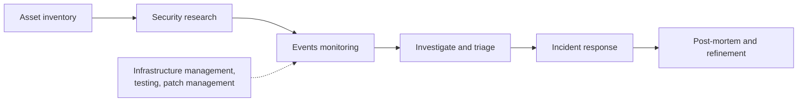

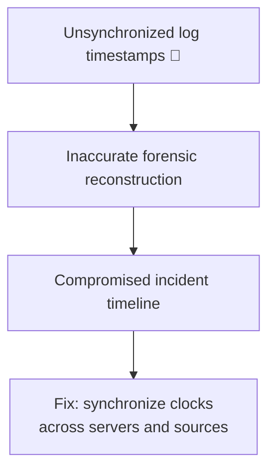

<b>Full network assessment review items (unverified)</b>

- Review security policy and procedures.
- Evaluate network, firewall configuration, and proxy servers.
- Logical access controls support SoD.
- Segmentation by trust level limits spread.
- Check IDS, filtering, encryption, strong authentication.
- Check virus scanning and periodic penetration testing.
- Audit logging with SIEM; track CERT and NVD.
- Trap: clock drift harms reconstruction, not indexing or storage.

### 5.12.8 Security testing audit procedures

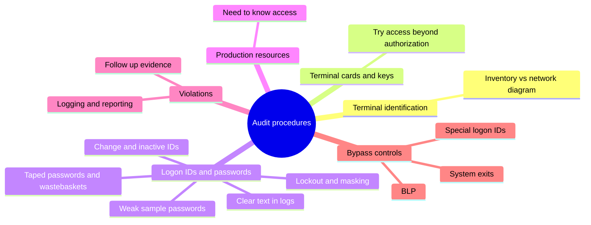

#### Audit use of test results

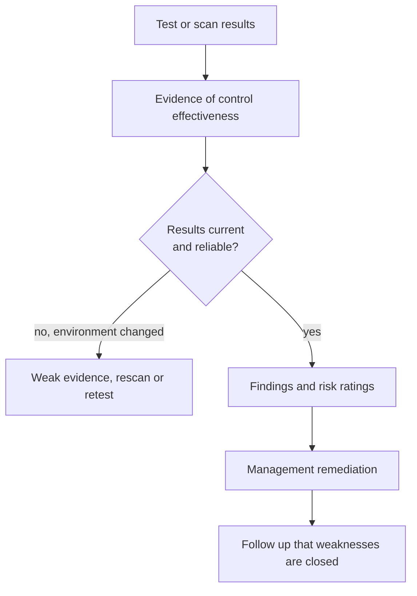

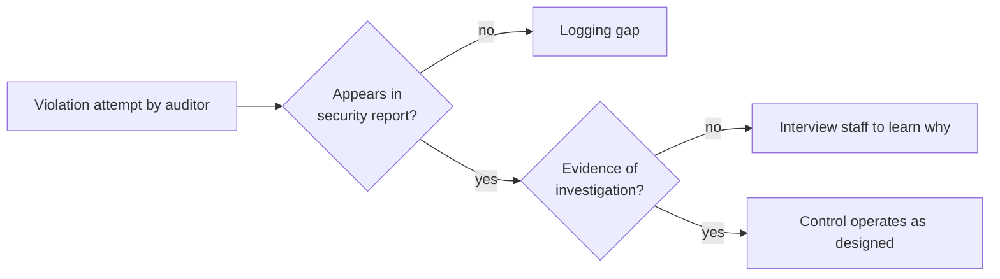

<b>Bypass controls and traps</b>

- Coordinate attempts with data owner and security administrator first.
- Bypass label processing skips label reading, so label rules fail.
- System exits sit outside the security system.
- Special vendor logon IDs share names; change passwords at installation.
- Log, report, and investigate all bypass use; deactivate extras.
- If access is not need-to-know, find compensating detective controls.
- Trap: unavoidable bypass needs logging and review, not just removal.

### Quick recall

| Fact | Detail |
|---|---|
| ⭐ Authorization | Senior management written approval before any pen test |
| ⭐ Order | Vulnerability assessment first, then pen test |
| ⭐ Double blind | Best test of incident response |
| ⭐ SAST, DAST, IAST | White, black, grey box |
| Assessment vs audit | Assessment ranks risk; audit checks compliance |
| Teams | Blue defends, red attacks, purple collaborates |
| Clock drift | Undermines forensic timelines 📓 |
| Default vendor IDs | Change passwords at installation |
