# 5.13 Security Monitoring Logs, Tools and Techniques: Diagrams

[← Domain 5](../README.md) | [Study notes](../Study-Notes/5.13-Study-Notes.md)

Markers: 📓 in my notes, ⭐ frequently tested, items marked "(unverified)" carry a ⚠ Check or ➕ in the notes.

## Section map

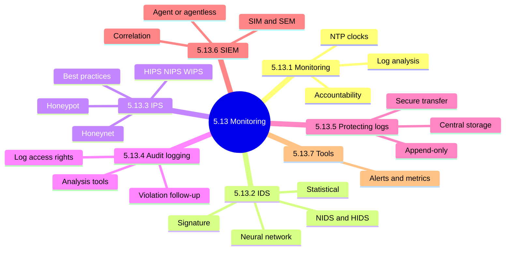

### 5.13.1 Information security monitoring

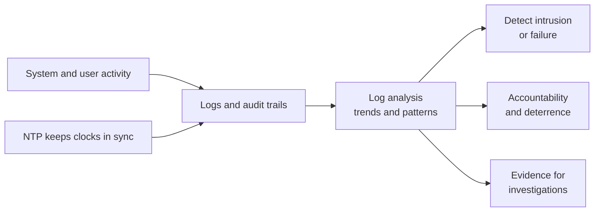

| Benefit | Meaning |
|---|---|
| Enforces accountability | Actions tied to unique user IDs |
| Promotes positive behavior | Logged users avoid circumventing controls |
| Encourages compliance culture | Laws and policies require monitoring |
| Supports investigations | Shows conditions before, during, after an event |
| Identifies security problems | Reveals failures, bugs and attacks |

<b>Exam traps</b>

- Out-of-sync timestamps harm forensic reconstruction.
- Monitoring is detective; it does not stop an attack.
- Logs nobody reviews give no real control value.

<b>Example: NTP 📓</b>

- Server A logs 10:02, server B logs 10:07 for one event.
- Unsynchronized clocks break event sequencing.

### 5.13.2 Intrusion Detection Systems (IDS)

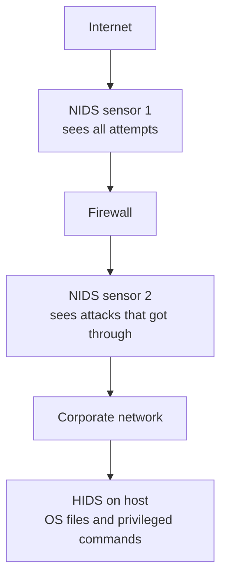

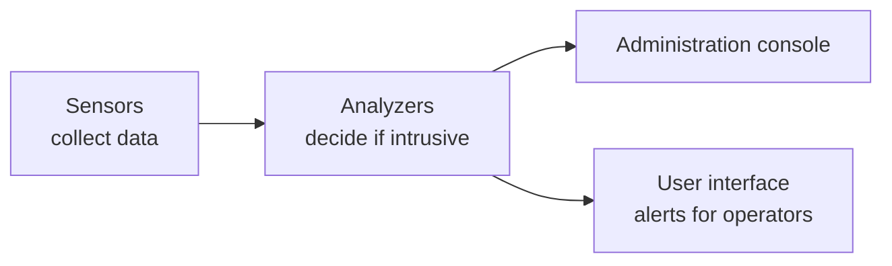

| IDS type | How it works | Weakness |
|---|---|---|
| Signature-based | Matches stored known patterns | Misses new attacks |
| Statistical-based | Compares to normal profile | Many false positives |
| Neural network | Statistical plus self-learning | Not stated in notes |

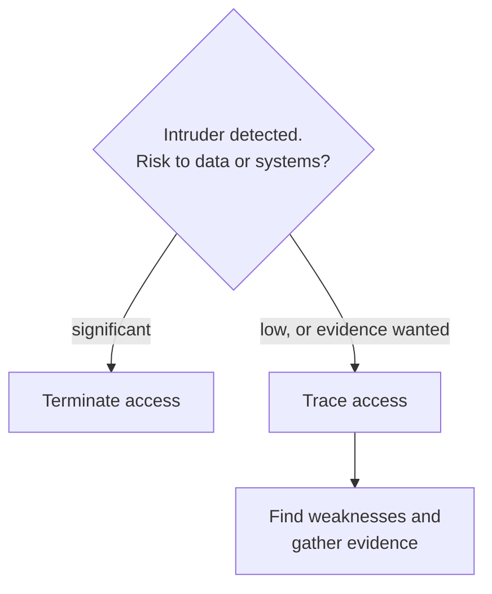

<b>Exam traps</b>

- IDS complements a firewall; it never replaces it.
- Best placement to see all attempts is outside the firewall.
- Signature-only misses new attacks; statistical-only gives false alarms.
- Management must predefine terminate versus trace in policy.

<b>IDS limitations</b>

- Cannot fix policy definition weaknesses.
- Cannot fix application-level vulnerabilities.
- Cannot fix back doors in applications.
- Cannot fix identification and authentication weaknesses.
- 📓 Internal IDS behind the firewall detects attacks that pass the perimeter.

### 5.13.3 Intrusion Prevention Systems (IPS)

IDS vs IPS comparison. Placement wording is flagged as inconsistent in the manual (unverified).

| Aspect | IDS | IPS |
|---|---|---|
| Action | Monitors and alerts only | Accepts or rejects packets |
| Response | Needs a human | Acts proactively on its own |
| Can do other's job? | No | Yes, can do the IDS job |
| Range | Wider, across network | Leans on IDS to extend view |
| Zero-day | Signature-limited | May block without signatures (unverified) |
| Placement | Across network | At firewall juncture (unverified) |

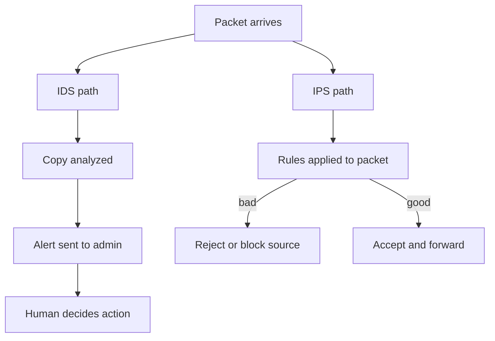

<b>Unverified manual wording (⚠ Check)</b>

- Manual places IPS both behind and at the firewall (unverified).
- Manual says IDS inline, IPS host or inline; likely swapped (unverified).
- Zero-day blocking relies on behavior or ML; not guaranteed (unverified).

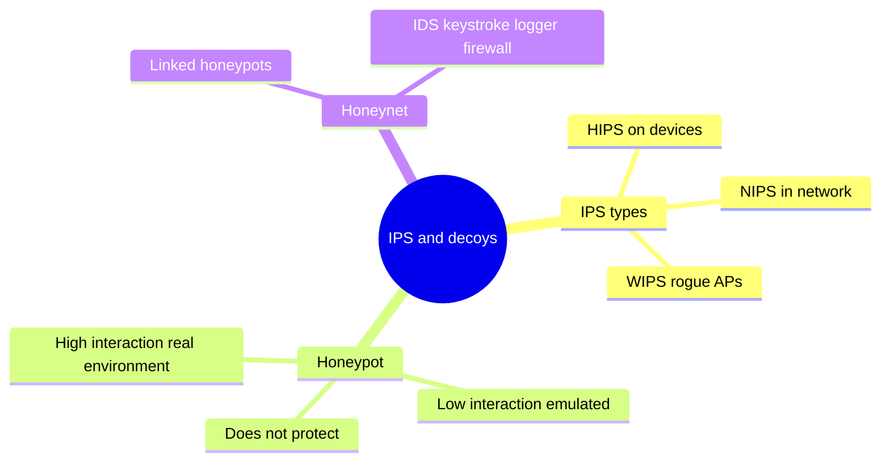

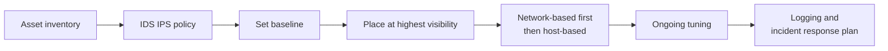

<b>Exam traps</b>

- Stops the attack points to IPS; alerts only points to IDS.
- Honeypot is research and detection, never preventive.
- Baseline comes before tuning; tuning is ongoing.
- A misconfigured IPS can block legitimate traffic.
- Attackers may trigger an IPS to disable many hosts.

<b>Honeypot facts</b>

- All honeypot traffic is assumed suspicious.
- External services may flag the organization as vulnerable.
- Honeynet data helps patch the live network.

### 5.13.4 Audit logging in monitoring system access

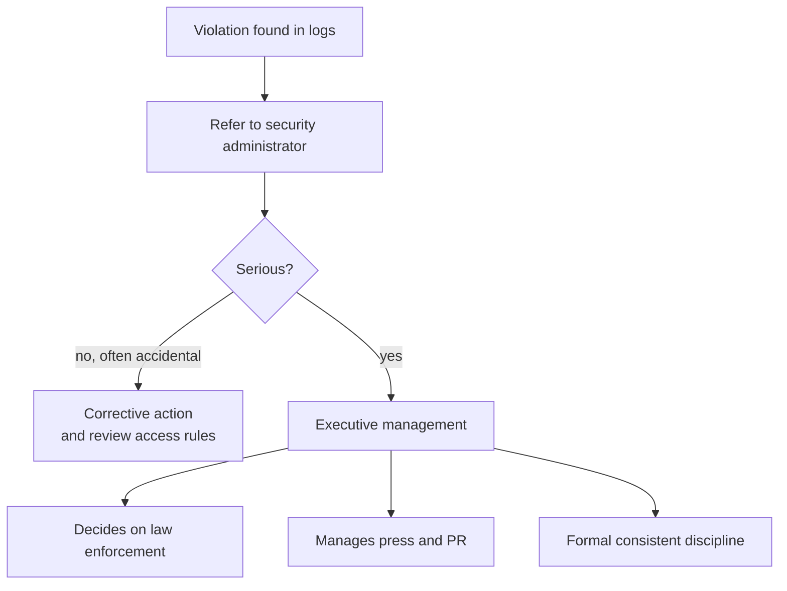

| Audit trail tool | Purpose |
|---|---|
| Audit reduction | Removes low-significance records |
| Trend or variance detection | Flags deviation from normal behavior |
| Attack-signature detection | Finds event sequences of known attacks |
| SIEM | Collects, correlates and alerts in real time |

<b>Log access and integrity</b>

- Strictly control access to logs.
- Integrity: digital signatures, write-once devices, SIEM.
- Confidentiality: strong access controls and encryption.
- Policy must set what is logged, who sees it, retention.
- Media logging supports accountability for tapes and disks.

<b>Cost considerations</b>

- System overhead from recording.
- Storage and processing cost.
- Analysis time.
- Investigating anomalous events.

<b>Exam traps</b>

- Serious violation goes to executive management, not police first.
- Log integrity beats log volume.
- Reduction tools cut noise; they do not detect attacks.

### 5.13.5 Protecting log data

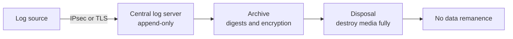

| Control | Detail |
|---|---|
| Centralize storage | Copy survives if original altered |
| Access control | Append-only, no read if possible |
| Restrict sensitive data | Do not log passwords |
| Log policy | Backup and retention times |
| Secure media | Secure location, environmental controls |

<b>Exam traps</b>

- Append-only is the best answer for log access.
- Central copies do not replace access control.
- Altered logs may be inadmissible.

### 5.13.6 Security Information and Event Management (SIEM)

SIEM data flow:

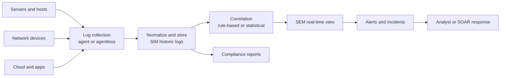

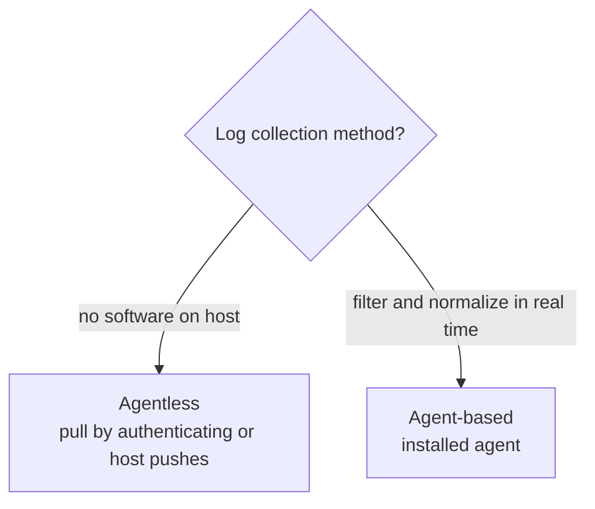

| Concept | Meaning |
|---|---|
| SIM | Historic log analysis and reporting |
| SEM | Real-time identification and correlation |
| Rule-based | Situation-specific event patterns |
| Statistical | Algorithms compute threat levels |

<b>Benefits</b>

- Enhances analytics with ML and AI.
- Enhances regulatory compliance.
- Faster response with SOAR.
- Supports investigations.
- Improves threat intelligence.
- Insight into past events.
- Real-time attack detection.
- Reduces security staffing needs.

<b>Features</b>

- Policies and security knowledge base.
- Log data management.
- Event correlation and analytics.
- Notifications and alerts.
- Network visibility and incident monitoring.
- Compliance reporting.

<b>Implementation best practices</b>

- Set scope; classify digital assets.
- Identify compliance requirements.
- Fine-tune configurations to cut false positives.
- Implement an incident response plan.
- Automate and integrate with SOAR.
- Assign SIEM administrator; consider MSSP.
- Monitor access controls; test the SIEM.

<b>Exam traps</b>

- Correlation separates a SIEM from a log server.
- Untuned SIEM floods analysts with false positives.
- SIM is historic; SEM is real time.

### 5.13.7 Security monitoring tools

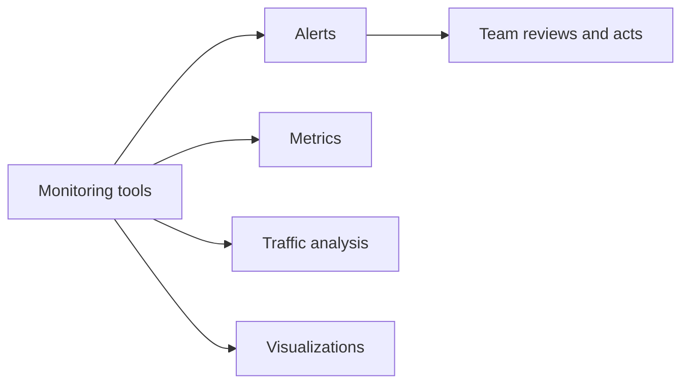

<b>Exam traps</b>

- Tools only help if alerts are reviewed and acted on.

### Quick recall

| Fact | Answer |
|---|---|
| ⭐ IDS placement to see all attempts | Outside the firewall |
| ⭐ IDS vs IPS | IDS alerts; IPS blocks |
| ⭐ Honeypot role | Study attackers, not protect |
| ⭐ Log access best practice | Append-only, central, encrypted |
| ⭐ Serious violation | Executive management decides on police |
| 📓 NTP | Consistent timestamps for forensics |
| SIEM differentiator | Correlation and tuning |
| SIM vs SEM | Historic vs real time |
